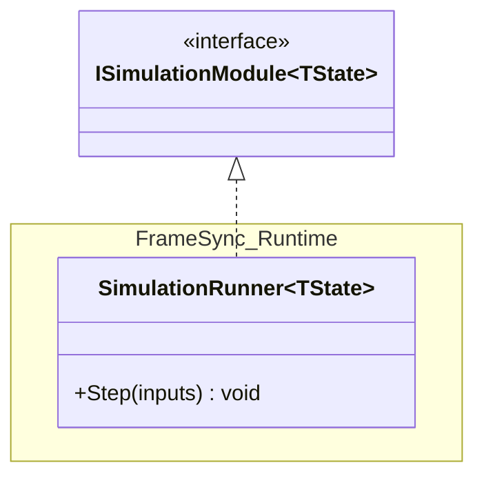
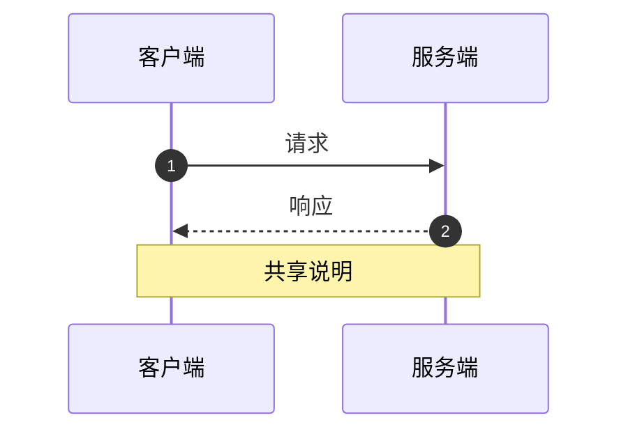
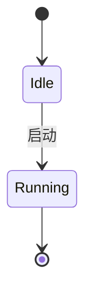

# Mermaid 语法坑与渲染校验

Mermaid 在 Markdown 里可以直接渲染，这让它成为代码结构图的默认选择。代价是它的解析器对特殊字符很敏感，而报错信息通常只告诉你"哪一行附近有问题"。本文件列出实际会踩的坑，以及在不依赖浏览器的情况下校验图的方法。

## 一、先确认图能渲染

**最低要求**：把图放进 Markdown 后，用支持 Mermaid 的渲染器预览一次。没渲染过的图不算交付。

本机可用的校验路径（按代价从低到高）：

1. **看语法结构**：`graph`／`classDiagram`／`sequenceDiagram` 之后的第一行必须是合法声明；缩进、引号成对；没有中文全角括号冒充语法符号。
2. **用 Node 渲染**：装了 `@mermaid-js/mermaid-cli` 时可离线出图。
   ```bash
   npx -y @mermaid-js/mermaid-cli -i diagram.mmd -o diagram.svg
   ```
   成功后同时得到 SVG，可直接交付或转 PNG。首次执行会下载依赖，需要网络。
3. **浏览器预览**：把图贴进支持 Mermaid 的 Markdown 预览（VS Code、GitHub、多数文档站）。
4. **本机 Chrome**：没有 mermaid-cli 但装了 Chrome 时，可以起一个临时 HTML 页面加载 `mermaid` ESM 构建来检查；只在确实需要出图时才值得这么做。

**渲染失败不等于图错了**：某些渲染器版本对 `classDiagram` 的泛型、`namespace` 支持不一致。遇到只在某处失败的情况，先降级语法（见下文），不要急着改结构。

## 二、高频语法坑

### 节点文本

```mermaid
graph LR
  A[普通文本]           %% 安全
  B["含 空格、逗号, 的文本"]  %% 用双引号包住
  C["含 ( ) 括号"]        %% 括号在 [] 内会提前结束标签，必须加引号
  D["多行<br/>文本"]      %% br 可以换行
```

- `[]` 里的圆括号、方括号、花括号都可能截断标签。**含标点的标签一律加双引号**。
- 标签里出现双引号会直接破坏语法，改用单引号或去掉。
- `&` 用 `&amp;`，`<` 用 `&lt;`；`#` 在某些版本里是实体前缀，避免使用。

### 节点 ID

```mermaid
graph LR
  order_service[订单服务]   %% 用下划线
  orderService[订单服务]    %% 驼峰也能用
  n_框架[框架]              %% 中文 ID 多数版本可以，但迁移时最脆弱
```

- ID 一旦被引用，改动成本高；用稳定的英文＋下划线。
- 含点号的名称（`FrameSync.Runtime`）在 `classDiagram` 里最容易出错，统一替换成下划线别名，再用标签显示原名。

### classDiagram



- **类型名不能含点号**；用 `namespace` 块或下划线别名表达归属。
- 泛型用 `~T~`，不要用 `<>`。
- 关系符号：`<|--` 继承、`<|..` 实现、`*--` 组合、`o--` 聚合、`-->` 关联、`..>` 依赖。方向和符号必须匹配，写反了语义就错了。
- 类体里的方法签名格式是 `+Method(args) ReturnType`；Mermaid 不校验类型，写错会静默显示成文本。
- 在 `classDiagram` 里画 `<<interface>>` 时，它必须单独占一行，且紧跟在 `class` 声明之后。

### sequenceDiagram



- `participant` 的别名（`as` 后面）含空格没问题，但**消息文本里的冒号会被解析成新的消息**，避免在消息里写 `key: value`。
- `alt`／`else`／`end`、`loop`／`end`、`opt`／`end` 必须成对，嵌套时容易漏 `end`。
- `->>` 实线箭头、`-->>` 虚线箭头；用虚线表示返回或异步，不要混用。

### stateDiagram-v2



- 状态名用代码里的真实标识符；含空格的必须写成 `state "含 空格" as Alias`。
- `[*]` 只能出现在起点和终点，位置写反会导致布局异常。

### 通用

- **注释**用 `%%` 独占一行，别写在语句末尾（部分版本会吞掉后面内容）。
- **主题／样式**用 `classDef` + `class`，或在图开头写 `%%{init: {...}}%%`。样式只影响观感，不要用样式承载语义之外的信息（例如只靠颜色区分错误，色盲读者看不到）。
- **图表类型声明**必须是第一行有效内容；前面只能有 `%%` 注释或 `%%{init}%%`。

## 三、规模与可读性

| 图类型 | 建议节点上限 | 超限后的处理 |
|---|---|---|
| flowchart | 20～25 | 按子系统拆图，或先聚合再下钻 |
| classDiagram | 15～20 | 只留协作簇，成员精简 |
| sequenceDiagram | 4～6 参与者、20 条消息 | 拆成主流程 + 异常流程 |
| stateDiagram | 10 个状态 | 按阶段分组 |

超过上限的图不是"信息量大"，而是"没人验证得了"。评审时无法逐条核对的图，等于没有。

## 四、交付前自检清单

- [ ] 图能在目标渲染器里真的渲染出来（不是"看起来对"）。
- [ ] 每个节点、每条边都能指向具体文件或构建配置。
- [ ] 推测性的边用了虚线或明确注释。
- [ ] 箭头方向全图一致，且语义正确（谁依赖谁）。
- [ ] 图注写明：范围、来源、验证程度、未包含的内容。
- [ ] 节点数在建议上限内，或已说明为何必须超限。
- [ ] 如果图由脚本生成，生成命令写在图注里，便于下次刷新。
- [ ] 没有把生成目录（`.build/`、`artifacts/`、`Library/`）里的副本当成第二套架构。
- [ ] 挑战过自己：这张图能不能支撑用户最初的那个决定？如果不能，说明视图选错了。

## 五、渲染产物怎么放

- **默认**：Mermaid 源码内联在 Markdown 里。它随文档演进，diff 可读，不需要额外文件。
- **需要图片时**：SVG 优先（矢量、可缩放、体积小），PNG 次之（兼容性好但会过期）。
- **产物位置**：跟着文档走，例如 `docs/images/architecture-overview.svg`；不要放进 `.build/` 或 `artifacts/`，这两个目录是本地生成内容，不提交。
- **图片与源码同时提交**时，把 `.mmd` 源文件也留下，否则下次只能重画。
- 图片文件名带用途（`dependency-graph.svg`），不要用 `diagram1.svg`。
