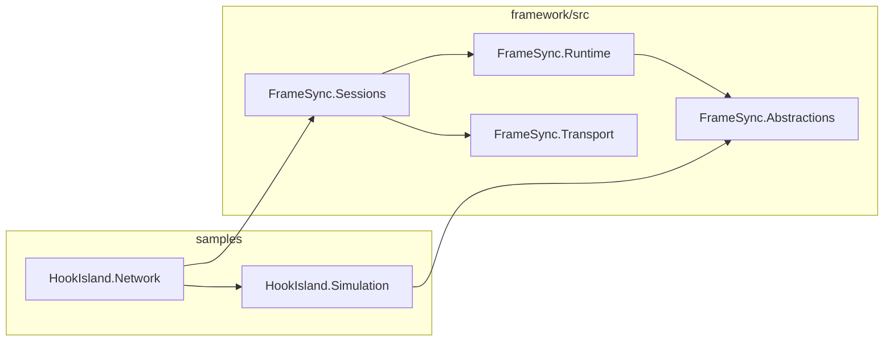
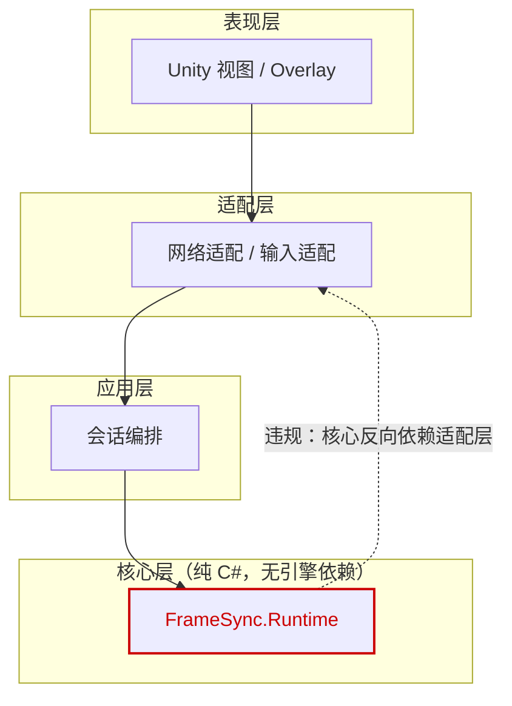
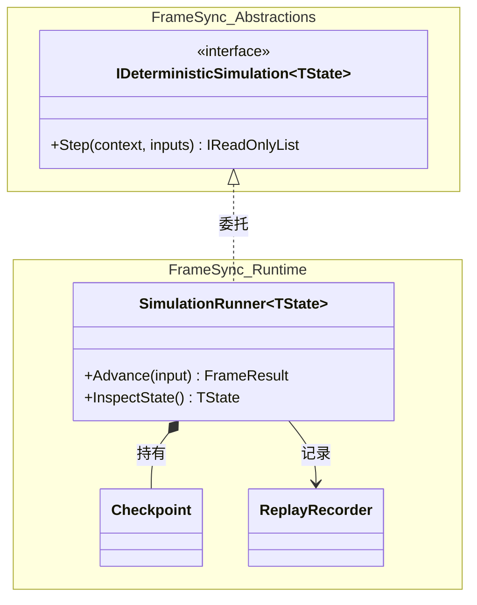
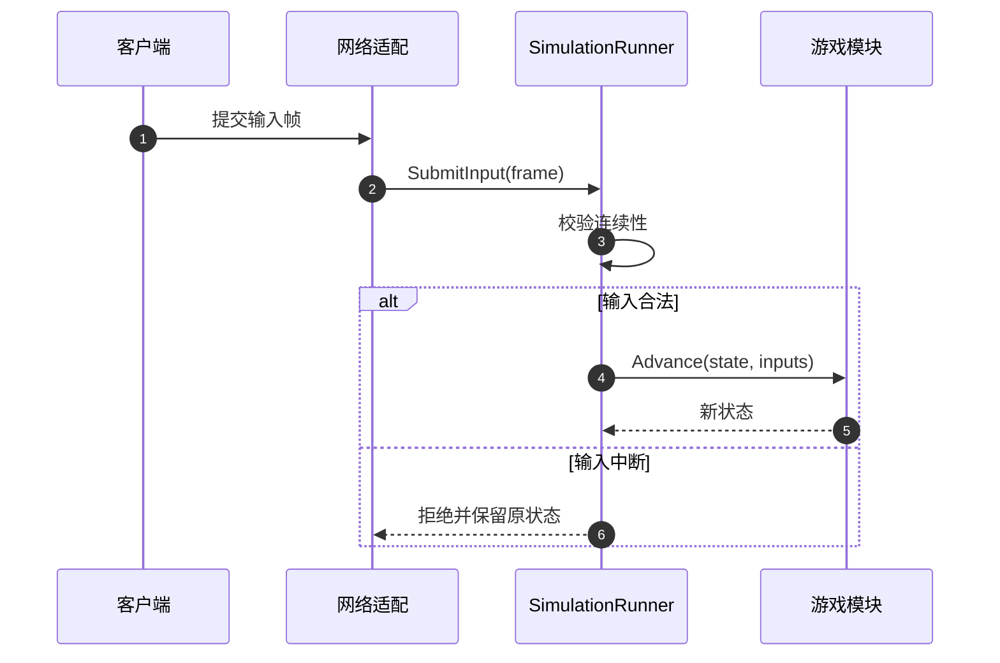
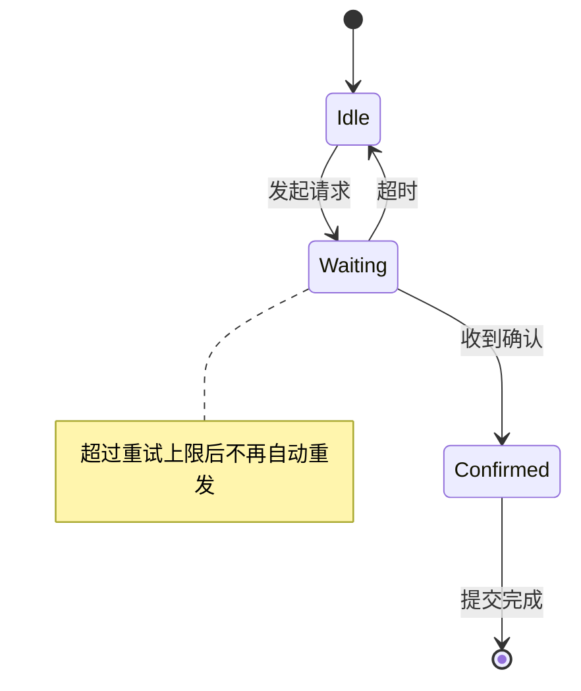
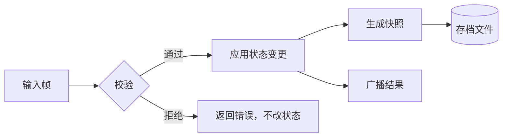
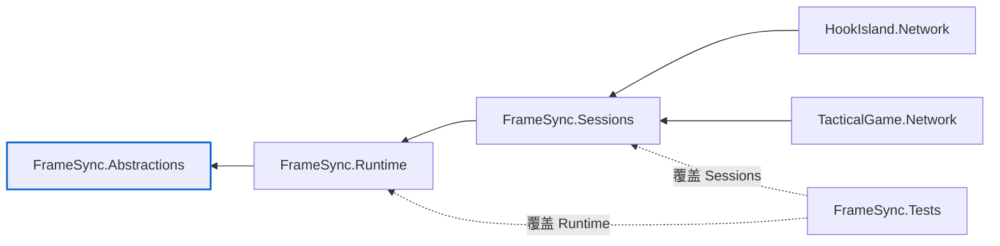

# 视图配方

每种视图都按"回答什么问题 → 怎么取证 → 模板 → 常见错误"组织。模板可直接复制，把方括号里的内容替换成真实名称。

## 目录

- [1. 模块／项目依赖图](#1-模块项目依赖图)
- [2. 分层评审图](#2-分层评审图)
- [3. 类图](#3-类图)
- [4. 时序图](#4-时序图)
- [5. 状态图](#5-状态图)
- [6. 数据流图](#6-数据流图)
- [7. 代码量分布](#7-代码量分布)
- [8. 改动影响面](#8-改动影响面)

---

## 1. 模块／项目依赖图

**回答**：系统由哪些可独立编译的单元组成，编译期依赖朝哪个方向。

**取证**：`.csproj` 的 `ProjectReference`、Unity `.asmdef` 的 `references`、解决方案的项目列表。这些是构建系统的事实，不是推断。

**模板**：



**注意**：

- 箭头方向统一成"使用者 → 被依赖者"或反过来，全图一致。混用会让读者算反。
- 用 `subgraph` 表达物理位置（源码树），用节点形状表达类型（程序集、可执行文件、Unity 程序集）。不要让 subgraph 同时承担"层次"含义。
- 外部包依赖（NuGet、Unity Package）单独用虚线或灰色分组，别和分析范围内的代码混在一起。
- 边太多时先按目录聚合，再看需要展开哪一组。

---

## 2. 分层评审图

**回答**：既定的分层约束有没有被破坏，哪些依赖是反向的。

**取证**：先写出目标分层（通常来自项目文档或既有约定），再把实际依赖边映射上去。**目标是主张，实际是事实**，两者要分开呈现。

**模板**：



**注意**：

- 违规边必须显式标注并配一句处置建议（移到哪、抽什么接口），否则读者只知道"有问题"，不知道下一步。
- 一条违规边就足以让分层失效；不要用"大部分是好的"淡化它。
- 分层图的层次是设计意图。如果代码里根本没有这层，别为了对称画一个空层。

---

## 3. 类图

**回答**：某个功能由哪些类型协作，继承／实现／组合关系如何。

**取证**：类型声明、基类列表、字段类型、构造函数注入。注意 `partial` 类会散在多个文件，要合并后再画。

**模板**：



**注意**：

- **实现关系 ≠ 调用关系**：`A <|.. B` 只说 B 实现了 A，不说明谁在调用谁。需要调用信息时用时序图，别在类图上暗示。
- 泛型类用 `~T~` 形式；含点的类型名在 Mermaid 里容易解析失败，改用下划线别名。
- 一张类图只放一个协作簇。把整个命名空间塞进去通常意味着应该退回模块图。
- 只画对理解有贡献的成员。字段全列出来会让图变成源码缩进版。

---

## 4. 时序图

**回答**：一次操作在时间上经过哪些参与者，消息如何流动。

**取证**：必须读实现。从入口方法开始跟调用，记录真实的方法名与顺序。这类图**不能**由静态扫描直接生成。

**模板**：



**注意**：

- 参与者控制在 3～6 个。超过就说明这个流程本身需要拆分，或者该画两张图。
- 用 `alt`／`opt` 表达分支和可选路径；线性画到底常常掩盖了真正的失败路径。
- 异步、跨进程、跨线程的跳转要标出来（`-->>` 虚线 + 注释），这是读者最容易误解的地方。
- 图上每个消息都应有代码位置支撑；如果是根据命名推测的，在图注里说明。

---

## 5. 状态图

**回答**：某个对象或协议有哪些状态，如何迁移，哪些迁移非法。

**取证**：状态枚举、状态机的 `switch`、协议文档。三者不一致时以代码为准并记录差异。

**模板**：



**注意**：

- 状态名用代码里的真实标识符，读者要能搜索到。
- 缺省迁移（"什么都没发生"）也要画，否则读者会以为状态会自己前进。
- 状态爆炸时按阶段分组，或拆成"协议阶段"与"业务状态"两张图。

---

## 6. 数据流图

**回答**：数据从哪来、经过哪些变换、最终落在哪，失败时留下什么。

**取证**：读取入口、序列化代码、存储实现。关注"同一个事务里必须一起成功的操作"。

**模板**：



**注意**：

- 用不同形状区分数据（矩形）、判断（菱形）、存储（圆柱），这是流程图里唯一值得坚持的约定。
- 标出事务边界：哪些步骤必须原子完成，失败回滚点在哪。
- 数据形状变化（原始输入 → 校验后命令 → 持久化记录）要写清，否则读者无法判断能否重放。

---

## 7. 代码量分布

**回答**：代码堆在哪些目录，哪块成了巨石。

**取证**：直接统计，用脚本。不需要画图，表格通常比图更易读。

```bash
python3 .agents/skills/code-structure-map/scripts/scan_structure.py tree --path framework/src --depth 1
```

**注意**：

- 代码量不等于复杂度。行数多的目录可能是数据表，行数少的可能是核心算法。
- 说明统计口径（是否含测试、是否含生成代码），否则数字会被误读。
- 只有需要看趋势或对比时才用图（条形图），单次快照用表格。

---

## 8. 改动影响面

**回答**：改动某个模块会波及谁，评审该重点看哪里。

**取证**：依赖图取反向边（谁依赖我），再叠加测试项目覆盖。

**模板**：



**注意**：

- 反向图容易让人误以为"被依赖 = 会被破坏"。要区分编译期影响、行为影响和协议兼容性影响。
- 明确列出"不在影响面内"的部分，这往往比列受影响的部分更有价值。
- 结合 `scripts/verify.sh` 之类的验证入口说明该怎么确认，而不是只给一张图。
