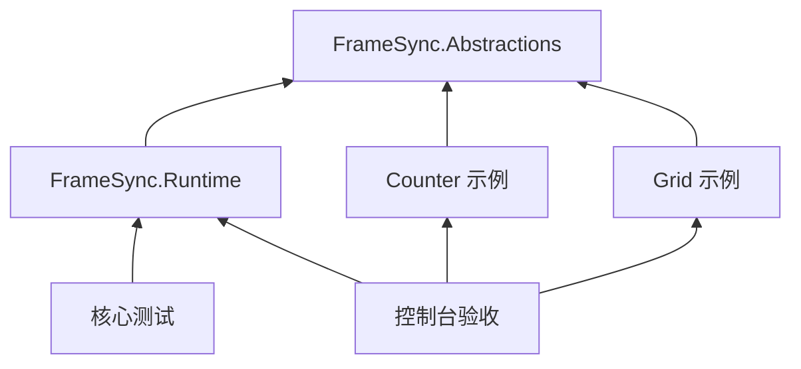

# 可复用帧同步框架

供自己的不同游戏共用的纯 C# 框架。当前实现到 **阶段 A：确定性模拟、完整状态保存恢复、输入录制与重放**，可直接在控制台运行。

核心工程没有 Unity、Steam、网络 Socket 或具体玩法依赖。两个示例分别提供自己的规则、输入格式和状态，框架不需要随示例切换而修改。

## 运行

需要 .NET 8 SDK。工程不使用第三方 NuGet 包，`NuGet.Config` 关闭外部包源。请在本目录执行命令。

macOS / Linux / Git Bash 一键验收：

```bash
./scripts/verify.sh
```

它会构建核心和工具，执行测试，运行两个模型各 100000 帧，验证多个中间检查点恢复后的状态和事件，最后在两个新进程中读取录制文件并核对最终摘要。任何失败都会返回非零退出码。

Windows PowerShell、macOS 终端均可逐条执行：

```text
dotnet build framework/FrameSync.sln -c Release --disable-build-servers -m:1
dotnet framework/tests/FrameSync.Tests/bin/Release/net8.0/FrameSync.Tests.dll
dotnet build tools/HeadlessHarness.Tests -c Release --disable-build-servers -m:1
dotnet tools/HeadlessHarness.Tests/bin/Release/net8.0/HeadlessHarness.Tests.dll
dotnet tools/HeadlessHarness/bin/Release/net8.0/HeadlessHarness.dll --frames 100000 --output artifacts/stage-a --report artifacts/stage-a/report.json
```

测试入口是上面的控制台程序，**`dotnet test` 不会运行这些断言**。可先用 `--frames 300` 快速体验，再执行完整验收。

导出后，重新开启终端运行：

```text
dotnet tools/HeadlessHarness/bin/Release/net8.0/HeadlessHarness.dll --replay artifacts/stage-a/counter.fsrp
dotnet tools/HeadlessHarness/bin/Release/net8.0/HeadlessHarness.dll --replay artifacts/stage-a/grid.fsrp
```

加上 `--expected-hash <摘要>` 可以让结果不一致时直接失败；摘要见同名 `.sha256` 文件。`--help` 查看完整参数。

## 目录与职责

| 目录 | 内容 |
| --- | --- |
| `framework/src/FrameSync.Abstractions` | 游戏要实现的接口、不可变输入、参与者与帧信息 |
| `framework/src/FrameSync.Runtime` | 按帧推进、检查点、编码校验、输入录制和重放 |
| `framework/tests/FrameSync.Tests` | 核心行为测试；不引用两个示例 |
| `samples/CounterHeadless` | 整数操作示例，演示保存随机数的当前进度 |
| `samples/GridHeadless` | 网格示例，演示多个参与者各自拥有状态 |
| `tools/HeadlessHarness` | 控制台验收与文件导出，具体文件操作留在这里 |
| `tools/HeadlessHarness.Tests` | 示例手算结果、输入验证、命令行与坏文件测试 |

核心和两个示例均以 `netstandard2.1` 为目标；工具与测试以 `net8.0` 为目标。框架可单独构建：`dotnet build framework/FrameSync.sln`，不需要 samples、Unity 或游戏工程。



## 保存与重放如何使用

“检查点”是一帧计算结束后的完整状态。`S[0]` 表示尚未执行任何输入；保存 `S[100]` 后，下一帧必须是 101。

```csharp
// module 由游戏提供；session 描述固定参与者和逻辑帧率。
var runner = new SimulationRunner<MyState>(module, session);
var recorder = new ReplayRecorder(runner.CaptureCheckpoint());

runner.Advance(frame1);
recorder.Append(frame1);                  // 推进成功之后，记录这一帧输入
byte[] saved = CheckpointCodec.Encode(runner.CaptureCheckpoint());

runner.Advance(frame2);
recorder.Append(frame2);

runner.Restore(CheckpointCodec.Decode(saved)); // 恢复到 frame1 结束后的状态
runner.Advance(frame2);                       // 重新计算 frame2

byte[] replayBytes = ReplayCodec.Encode(recorder.Build());
var replay = ReplayCodec.Decode(replayBytes);
var fresh = new SimulationRunner<MyState>(module, replay.Initial.Session,
    replay.Initial.Limits, replay.Initial.InitializationData);
Checkpoint final = ReplayPlayer.Play(fresh, replay);
```

这是接口用法示意；可运行的调用见 [HeadlessHarness](tools/HeadlessHarness/HarnessApp.cs)。示例中的 `MyState`、`module` 和两帧输入由具体游戏定义。

每个游戏实现四类约定：创建独立模拟实例、按输入计算一帧、完整捕获/恢复状态、将状态和输入编码为稳定字节。随机数进度也必须进入状态。完整解释见 [阶段 A 实现说明](docs/stage-a-implementation.md)。

## 当前边界

阶段 A 的调用者直接提供一整帧输入，帧率只是固定逻辑时间信息，没有网络收集、等待超时或真实时间调度。后续阶段 B 在它外面增加服务器和客户端运行流程。

现在可以生成和恢复检查点字节，以及导出用于验证的 `.fscp` / `.fsrp` 文件。正式玩家存档所需的原子替换、备份、旧版本迁移、重新开房身份处理留到阶段 D。文件格式暂定版本 1；后续升级必须显式处理版本兼容。

本次实测环境是 **macOS arm64、.NET SDK 8.0.403**。已通过两个模型各 10 万帧及跨进程重放；Windows 和 Unity 尚未运行验证。Windows 验证时可用同一录制运行并比较 `report.json` 中所有对应帧的 `PeriodicHashes`。

完整目标和后续阶段见 [文档入口](docs/README.md)。
