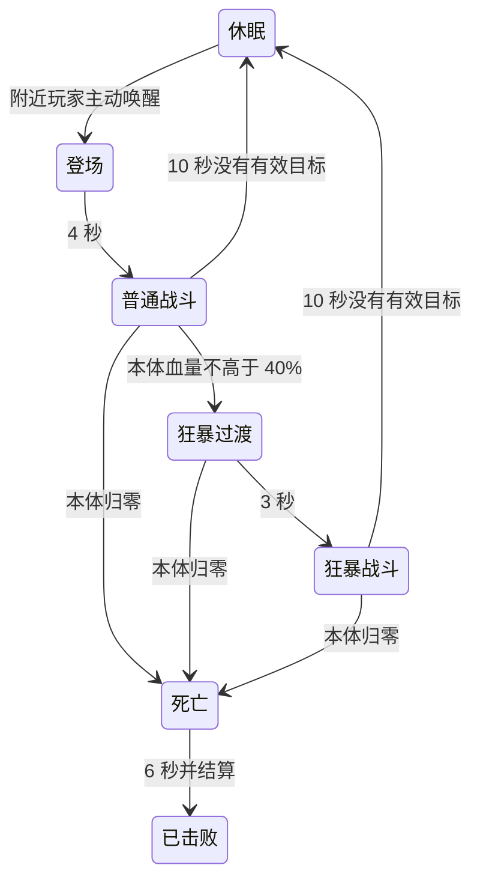
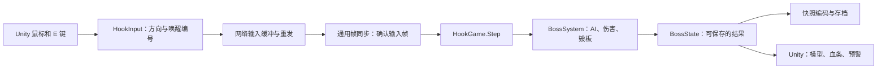

# 深渊凝视者：游戏接入与代码阅读

2026-11-03。BOSS 已接入现有 `HookPlatform` 钓鱼地图，作为玩家主动开启的可选挑战。它不替代灯笼巨鱼终章，击败后仍可继续捕鱼。完整数值意图见[玩法设计](superpowers/specs/2026-11-03-abyssal-watcher-gameplay-design.md)。

## 怎样试玩

1. 在仓库根目录运行 `./scripts/sync-hook-island.sh`，再用 Unity 2022.3.62f1 打开 `samples/TacticalGame.Unity`。
2. 打开 `Assets/HookIsland/Scenes/HookPlatform.unity`，运行并创建新房间，单人或最多四人均可。
3. 沿初始平台北侧的窄栈道前进，到环形平台南入口的绿色标记附近按 **E**。未唤醒时不会主动攻击。
4. 用快捷栏或背包装备沙漠之鹰，进入第一人称视角；鼠标抬头瞄准、左键射击、**R** 换弹。主眼位于海面上方，需要实际抬枪。
5. 红色长条是下砸区，会毁板；橙色是横扫区；绿色预警后会留下墨池。向外圈或侧面移动避开，毁板后沿用落水、救援和建造规则。

当前资产已经安装，不需要每次重导模型。新工程丢失生成资源时，可在停止运行后执行 **Tools → Hook Island → Install Abyssal Watcher Challenge**。该入口保留现有场景，关联模型与配置，并重新导出地图。重新生成动作较慢，只修订源动作后才需要执行。

本轮更新游戏规则、地图、输入及存档版本。两端必须使用同一版本，旧游戏存档不自动迁移；不会把旧字节按新结构读取。通用帧同步框架和可靠 UDP 未改变。

## 数值与 AI

| 项目 | 1 人 | 2 人 | 3 人 | 4 人 |
|---|---:|---:|---:|---:|
| 本体生命 | 2400 | 3960 | 5520 | 7080 |
| 单条攻击触手生命 | 300 | 435 | 570 | 705 |
| 单条支撑触手生命 | 220 | 319 | 418 | 517 |

人数在唤醒时确定，之后不因加入或掉线改变本次血量。八条触手各自扣血，触手伤害不会转移给本体；主眼命中按 1.5 倍伤害向上取整。本体归零即可结束战斗，不必清掉所有触手。

AI 采用阶段状态机，意思是明确记录当前阶段和已经经过的时间：

普通战斗最多一条攻击触手动作，狂暴最多两条。每条触手有独立计时，AI 按玩家位置选择更接近的固定攻击路线；同时进攻时优先分散目标。四条后方支撑触手只负责支撑，不加入攻击。BOSS 不转身追人。

- **下砸**：动作第 45 帧命中，36 点基础伤害、3 米击退，摧毁命中长条内的地板；90 帧结束。
- **横扫**：第 36～60 帧扫过固定区域，24 点伤害、5 米击退；同一玩家每轮只命中一次，不毁板；108 帧结束。
- **喷墨**：前方有玩家时，普通约每 12 秒、狂暴约每 10 秒发动。36 帧后形成持续 6 秒的墨池，每秒 8 点伤害，移动速度降低 35%。
- **断肢**：血量归零立即取消未发生的攻击。表现层在第 9 帧断离，再下沉至第 78 帧；狂暴不会长回触手。
- **失败与结算**：无人能继续挑战 10 秒后回到休眠，已毁地板保留。击败后，造成过伤害的玩家各自获得 600 金币，每局只结算一次。

时间统一使用每秒 30 个逻辑帧。伤害继续经过现有角色防御规则。抓取、卷起和抛掷玩家没有加入本轮。

## 代码从哪里开始读

建议按下面顺序阅读。表中路径以仓库根目录为起点。

| 文件 | 承担的职责 |
|---|---|
| `samples/HookIsland.Simulation/Data/Configuration/BossConfig.cs` | 默认数值、人数缩放、地图位置和攻击时长 |
| `samples/HookIsland.Simulation/Data/State/BossState.cs` | 本体、八条触手、墨池、请求处理结果、奖励和毁板记录；是保存恢复的完整依据 |
| `samples/HookIsland.Simulation/Logic/Combat/BossSystem.cs` | 接受唤醒请求，逐帧选择和推进攻击，扣血、断肢、狂暴及退场 |
| `samples/HookIsland.Simulation/Logic/Combat/BossGeometry.cs` | 用整数判断子弹命中和地面危险区域；不依赖 Unity 碰撞回调 |
| `samples/HookIsland.Simulation/Logic/Simulation/HookGame.Boss.cs` | 把 BOSS 接入游戏主循环，协调地板、落水、物品、宝箱、螃蟹和终章位置，结算个人金币 |
| `samples/HookIsland.Simulation/Serialization/BossStateCodec.cs` | 写入／读取状态，并拒绝不合法的时钟、血量、攻击和材料记录 |
| `samples/HookIsland.Network/Commands/BossRequestBuffer.cs` | 待确认的唤醒编号持续重发；成功或失败均结束当前请求，不会自动重开挑战 |
| `samples/TacticalGame.Unity/Assets/HookIsland/Runtime/Application/Commands/BossController.cs` | E 键入口、提示和血条，读取确认态 |
| `samples/TacticalGame.Unity/Assets/HookIsland/Runtime/Presentation/World/BossAnimationView.cs` | 按逻辑时间取样动作；全身姿态上分别叠加各条触手与喷墨头部，维护断肢显示 |
| `samples/TacticalGame.Unity/Assets/HookIsland/Runtime/Presentation/World/BossPresentation.cs` | 模型锚点、地面危险色块、墨池和触手血条 |

`FishingPlayerInput` 把鼠标上下方向量化为 `AimVertical`，范围是 -995～995，表示单位方向 Y 分量的千分比。服务器用相同方向重新计算命中，客户端不上传“我击中了谁”。枪械事件增加发射和命中高度，曳光线与伤害数字因此能出现在高处。

`BossRequest` 是唤醒请求编号。同一个编号重复到达，只返回同一个处理结果；它与购买、建造、背包等事务互斥。各输入组合器保留新增字段，避免在组合换装或房间规则输入时丢掉上下瞄准。

## 联机与存档中需要注意的边界

**模拟与画面分开。** 游戏规则全部位于纯 C# 的 `samples/HookIsland.Simulation`。模型、Unity 帧率和动画事件不决定伤害。BOSS 表现只读取确认态，预测回滚不会提前断肢或重复显示奖励。

**碰撞使用同一份离线采样。** 从批准的 Blender 动作每秒采样 30 次，记录毫米整数骨链与头部范围，压缩后约 839 KiB，嵌入模拟程序集。触手使用连起来的胶囊，头部使用椭球，主眼使用球体，属于近似碰撞，不是逐三角形碰撞。数据 SHA256 进入游戏内容版本，加载时也会核验。

**毁板不能把花掉的材料抹掉。** `BossTileLoss` 记录格子、材料、建造者和历史支出。玩家再次铺板会产生新的正常花费；保存时同时核对剩余平台和损毁记录。地板消失的同一帧会协调玩家水态，搬移岸上材料包、大宝箱和终章靠岸位置，并处理螃蟹失去立足点，防止产生游戏自己都无法读回的快照。

**全灭不是继续运行整个世界。** 普通世界时间冻结，商店补货和海洋事件的时间也冻结；BOSS 仅推进自己的退场、死亡及断肢计数。Unity 不能只用世界帧号缓存画面，还会检查 BOSS 的独立时间。灯笼巨鱼胜利时继续遵循既有世界冻结规则。

**奖励属于个人。** 造成过伤害的玩家槽位记录在 `Attackers` 中；`Rewarded` 记录整笔奖励是否已结算。先检查所有参与者余额和累计收入能否容纳，再一次性发放，读档和重放不会重复领钱。

## 美术与调整入口

- 数值资产：`Assets/HookIsland/Data/BossSettings.asset`。修改单人本体／两类触手血量及奖励后，要重新导出地图并让所有客户端使用相同配置。
- 模型和动作：`Assets/HookIsland/Art/AbyssalWatcher/`，44 个蒙皮网格、185 根骨骼、24 个动作。
- 来源与导出规则：[美术交付说明](../source-assets/creatures/abyssal-watcher/exports/unity/README.md)。两个批准的 `.blend` 文件没有被导出操作改写。
- 世界单位：Unity 1 单位为 1 米；中心 `(0, 0, 28)`，朝向负 Z。环形平台内半径 12 米、外半径 20 米，当前正式地图排除商船格后共有 218 块初始地板。

`Animator` 位于预制体 `Model` 子节点，自动播放关闭。动作先取样全身待机，再只保留属于当前触手的骨骼；喷墨只覆盖头部。渲染帧可重复显示同一确认帧，不会额外推进攻击时间。

## 验证记录

专项入口 `./scripts/verify-hook-boss.sh` 包含纯 C# 玩法、真实四客户端 UDP 战斗和输入适配测试；日志在 `artifacts/boss/`。四客户端测试使用较低的测试血量缩短耗时，正式数值未降低。各端比较完整确认检查点，并保存、读取和恢复同一份状态。

Unity 的 `BossPresentationTests` 检查上下瞄准、两条触手同时动作、死亡时断肢保留，以及八组阶段／喷墨／触手组合的模型关节与权威采样对齐。对齐误差要求小于 8 毫米；主眼比较实际蒙皮网格中心，而非骨骼轴心。3 项通过；30 项已有相机检查也通过。

实际 `HookPlatform` 运行使用 `Editor/BossChallengeSmoke.cs` 显式提供普通输入。角色从出生点步行、唤醒、装备枪械和射击，没有传送或注入血量／金币。记录到第 973 帧：本体 2400→2294、射击 3 次、地板 218→214，登场、下砸、喷墨均实际出现，无运行异常；随后角色因站立不躲避而失败。截图与记录位于 `artifacts/abyssal-watcher/integration/unity-play/`。该验证工具仅编入 Editor，不进入发布包。

全量回归的最终结果见实施计划中的验收记录。本轮没有 Windows 实机验证，也没有完成真人平衡、声音制作、GPU 性能预算或完整双 Unity 窗口战斗验收；现有四端一致性证据来自控制台真实 UDP 会话。
