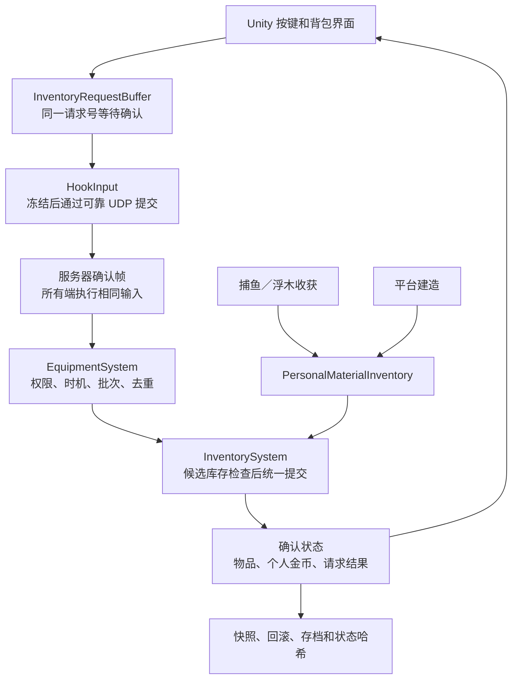

# 格子背包与个人金币：实现说明

本次实现用于 `HookPlatform.unity` 的钓鱼平台玩法。通用帧同步框架没有增加任何物品、金币或 Unity 依赖。背包属于游戏模拟，输入经过现有冻结、确认、重放和存档链路。

## 已实现的玩法

- 每人初始穿戴免费 Lv1 背包，容量 4×4。Lv2～10 的容量、价格由 `samples/HookIsland.Simulation/Data/backpacks.csv` 配置。
- 木材、鱼骨每格最多 99 个（2026-10-27 更新）；备用钓竿按目录占格，空背包为 2×2。穿戴中的装备不占包内格子；备用包不会额外增加容量。
- 移动、旋转、合堆、拆分、指定数量丢弃、主动拾取、穿戴和卸下。只能整理自己的物品。
- 满包仍可直接购买并穿上大包。换包先验证新布局，失败保持金币、货架、装备和内容不变。可明确选择将旧包装备放到平台，否则必须为它保留空间。
- 收获先补现有堆叠，再放空格，剩余放到平台。地面材料按种类和地块合并，不定时删除；拾取空间不够时只收能容纳的部分。
- 地面物品可转交队友。抢同一件商品或地面装备时，由确定性的玩家处理顺序决定唯一成功者。
- 没有包时容量为零。附近列表可翻页查看所有掉落；F 优先拾取并穿上附近背包，避免旧钓竿挡住恢复容量的入口。

**金币属于每个人自己。** 收鱼者获得金币；买东西只扣购买者的余额。金币不占背包格子，也不随物品丢弃或转交。共享的是商人货架和平台上的物品，不是钱包。

每个玩家有当前金币 `Fisher.Coins`、累计收入 `Fisher.CoinsEarned`、累计支出 `InventoryState.SpentCoins[slot]`。存档校验 `收入－支出＝余额`。`HookState.Coins` 在平台模式只保存所有玩家余额之和，用于已有诊断；任何购买都不能使用队友余额。物品转交后，支出仍记在原购买者名下。

## 如何试玩

在 Unity 工程 `samples/TacticalGame.Unity` 打开 `Assets/HookIsland/Scenes/HookPlatform.unity`。单人或 2～4 人房间使用相同规则。

| 操作 | 方法 |
| --- | --- |
| 打开角色／背包 | Tab 或 I，点击“背包·整理”页签 |
| 整理物品 | 点击物品，选择“移动”，再点击目标格 |
| 旋转 | 移动模式下按 R |
| 合并材料 | 把材料整堆移动到同类材料格子，余量留在原处 |
| 拆分／丢弃 | 选材料，调整数量，再点“拆分到空格”／“放到平台上” |
| 地面拾取 | 靠近 2 米内按 F，或从背包的“附近可拾取”列表选择 |
| 换装 | 选择备用装备后“穿戴”；先查看布局预览和旧装备去处 |
| 卸下包 | 先清空包，选择背包槽，明确卸到平台上 |
| 买包 | 靠近商人按 E，选择包，点“购买并装备”或“购买并放入背包” |
| 材料建造 | B 打开建造，消费本人包内木材／鱼骨，可以使用队友转交的材料 |

整理采用“选择物品→选择操作→点击目标格”。角色页的装备装卸、拖动预览见[角色说明](hook-character-implementation.md)。操作挂起时显示确认提示；成功或失败都以确认帧回执为准。

## 从哪里读代码

建议按下表顺序阅读。先看数据，再看一次事务，最后追踪输入如何到达事务入口。

| 文件 | 职责 |
| --- | --- |
| `InventoryCatalog.cs`、`Data/backpacks.csv` | 物品类型、占格、堆叠、槽位、背包尺寸和价格 |
| `InventoryState.cs` | 一个物品的唯一 ID、归属和位置，以及独立库存快照 |
| `InventorySystem.cs` | 库存事务：在副本中检查，成功后统一提交 |
| `InventoryLayout.cs` | 矩形摆放、旋转和换包重排；不决定金币或角色规则 |
| `InventoryCommand.cs` | 一次操作的固定 24 字节输入：物品、数量、目标格、批次、请求号、商人 ID |
| `EquipmentSystem.cs` | 校验当前角色、距离、钓竿状态、商品批次；去重并记录结果 |
| `PersonalMaterialInventory.cs` | 捕鱼／浮木发材料和建造扣材料的统一入口 |
| `InventoryStateCodec.cs`、`FishingStateCodec.cs`、`PlatformStateCodec.cs` | 保存恢复及库存布局、钱包、物品和建造材料守恒校验 |
| `samples/HookIsland.Network/Commands/InventoryRequestBuffer.cs` | 保留同一个操作意图，直到收到确认回执 |
| Unity `FishingEquipmentController.cs` | 本地按键、面板状态、操作排队；不直接改物品或金币 |
| Unity `BackpackOverlay.cs` | 背包格子、货架、材料数量、掉落列表和换包预览 |
| Unity `GroundPickupSelection.cs` | 附近掉落排序和无包恢复选择；不决定交易成功 |
| Unity `InventoryEquipmentPreview.cs` | 缓存换装预览，内容不变时不重跑复杂布局搜索 |
| Unity `GroundItemPresentation.cs` | 将确认的地面物品显示为模型，离开房间后清理 |

以上模拟文件位于 `samples/HookIsland.Simulation/`，Unity 文件位于 `samples/TacticalGame.Unity/Assets/HookIsland/Runtime/`。



### 一次购买如何完成

1. 界面只发送“本批货架第几件商品、买入还是买入并装备”。不上传价格、余额或新物品。
2. 本地分配一次请求号，可能在多个未来帧里重复发送，已冻结帧不改写。
3. 模拟检查请求是否处理过、玩家是否能操作、距离、批次、售罄状态和个人余额。
4. 库存在候选集合里创建物品、安排旧装备与现有内容；确认放得下才统一提交。成功才扣个人金币并标记售罄。
5. 成功或失败均记录到 `LastInventoryRequest / LastInventoryResult`。重复输入不能再次扣款，也不能在空间变化后让旧的失败请求突然成功。

### 收获与建造为什么不会复制材料

只有实际收鱼／收浮木才增加个人累计收获。拾取只是把已有材料从平台搬入背包，不再发金币或增加累计收获。建造从本人库存按 ID 顺序跨堆扣料；快照校验“全体累计收获＝包中材料＋地面材料＋已消耗的铺设材料”，允许队友间转交。

收获在提交库存前预检查金币、收入、捕获数和后继鱼。物品编号不能继续分配时，拆分／新掉落等操作受控失败；无法完整保存的收获暂不结算，保留钩住的资源，不生成一半奖励。随机鱼代数是明确按 2^32 循环的计数器。

### 格式与边界

- 背包阶段命令为 20 字节，当时总输入 60 字节；外围商人阶段命令扩展为 24 字节并携带商人 ID，当前输入布局以 `HookInput.ByteCount` 为准。房间／帧消息仍使用 Protobuf，可靠 UDP 和通用框架不变。
- 本次与角色集成的验证基线为房间／规则／状态版本 8，输入版本 6；旧格式会被明确拒绝，未提供旧岛屿装备存档迁移。
- 单局装备实例最多 1024，总物品实例最多 4096。ID 不回绕或复用。单个游戏状态最多 512 KiB。
- 换包先保留已有合法位置，必要时按固定顺序搜索。搜索最多 200000 节点；预算用完提示手动整理，不假装已证明无解。重复界面重绘复用预览。
- 八槽位已定义；此基线只生成实际实现的钓竿、背包、木材和鱼骨。游泳圈接入由后续独立任务完成。

## 验证入口

```bash
# 全项目回归，含背包、角色与真实 UDP
./scripts/verify.sh

# 仅背包领域、游戏、输入和只读 UI 辅助逻辑
dotnet run --project tools/HookIsland.Inventory.Tests -c Release -- --simulation-only

# 构建开发版 HookPlatform.app 后，四个独立 Unity 进程验收
python3 scripts/run-island-party.py --inventory --players 4
```

自动输入只存在于编辑器／开发构建，并且需显式 `-island-inventory-smoke 1` 启用；正式场景不挂验证组件，发布构建不编译 `InventorySmokeDriver` 或 `InventorySmokePilot`。流程通过实际捕鱼挣钱，再购买大包、移动／拆分／丢弃／争抢材料、铺地，并检查角色卸竿与再装备，不注入资源。

## 本次验收结果（2026-10-21，版本 8 基线）

以下保留当时的验收记录；2026-10-27 的 99 堆叠、56 个物品图标及最新兼容版本见 [本次实现说明](item-icons-and-stack99.md)。

- 完整 `./scripts/verify.sh` 通过：包含背包 26/26、角色 19/19、钓鱼平台 78/78，以及通用框架、可靠 UDP、存档和原战术示例回归。日志：`artifacts/backpack/full-verify.log`。
- Unity EditMode 36/36 通过。开发版和发布版 macOS 构建均为 0 错误、0 警告。
- 四个独立 Unity 进程通过实际输入完成捕鱼挣钱、购买 Lv2 包、移动／拆分／丢弃／争抢材料、各铺一块地、卸下并重新装备钓竿。服务器与四端在第 **785** 帧的状态哈希完全一致：`5effd2e0ea94a1071075123caee04e172f8cf88ada8e86f4a093495fdde5411a`。
- 四端均确认面板互斥检查和角色装卸检查完成，显示 4 名玩家；最终平台 13 格，地面剩余物品 0。四份运行日志没有异常、不同步或错误记录。
- 发布版程序集检查确认未包含 `InventorySmokePilot/Driver`、`RodSmokePilot/Driver`、`PlatformSmokePilot/Driver`。审计日志：`artifacts/backpack/release-audit.log`。

实际四人验收的钱包如下。P1 买包支出 200，未扣除其他玩家金币：

| 玩家 | 累计收入 | 累计支出 | 当前金币 |
| --- | ---: | ---: | ---: |
| P1 | 202 | 200 | 2 |
| P2 | 26 | 0 | 26 |
| P3 | 18 | 0 | 18 |
| P4 | 53 | 0 | 53 |

四进程的 `result.json`、每端报告、背包／商店／角色截图及结束检查点位于 `artifacts/hook-island-playable/inventory-smoke-20261021-152900-e9314b/`。这是本次 macOS 上版本 8 的固定构建验收记录；后续游泳功能的版本升级由其任务另行验证。

### 角色页拖拽补充验收

同日，角色任务修复了 IMGUI 按钮消费鼠标事件导致拖拽不提交的问题，并验证从装备槽拖回背包、从背包拖入匹配槽位均只提交一次请求。新增界面回归先复现失败再通过，修复后 Unity 全部测试 **37/37**；记录为 `artifacts/character/editor-tests-final.json`。实际鼠标双向拖拽也已通过。

包含此修复的独立发布构建为 `artifacts/character/HookPlatform-Character.app`，0 错误／0 警告，仍使用版本 8 模拟程序集。本节是界面修复的补充记录，前述背包四进程构建和证据目录保持原样。
