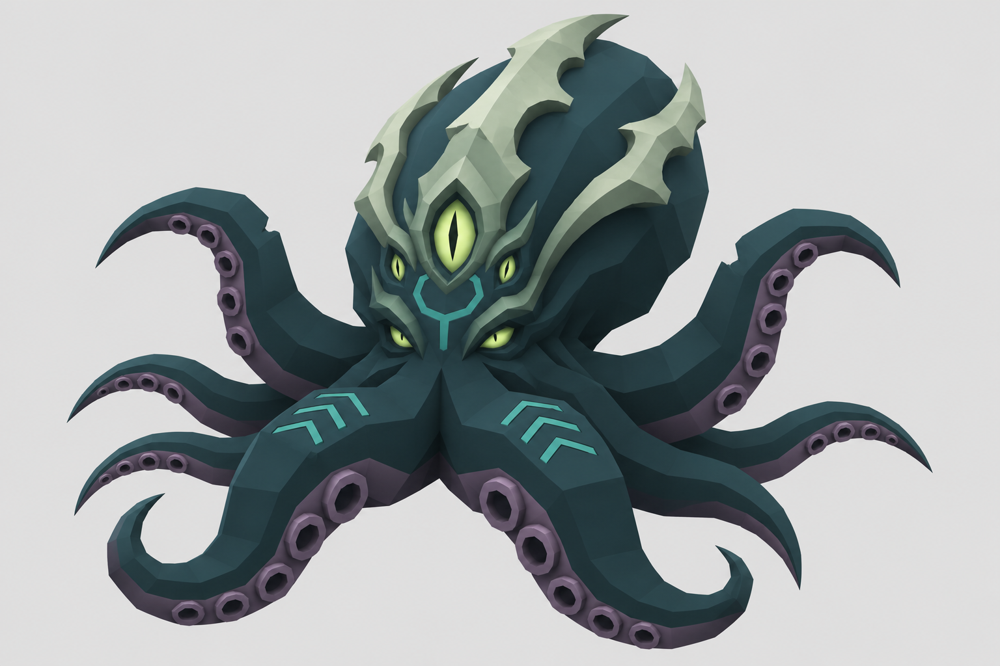

# 静潮 · 低多边形克苏鲁章鱼首领

这张图用于游戏 BOSS 的造型评审和 Blender 建模参考，使用内置 ImageGen 绘制。



本版采用厚实的后倾头囊和八条触手。三道浅玉色骨脊与头部长在一起，额头的竖眼和四枚较小的眼睛构成异化面部。墨绿色皮肤、灰紫色腕腹、幽绿色眼睛和少量青色符纹区分不同部位。用大块平面表现立体形状，吸盘采用便于重复建模的八边形。

## 最终生图提示词

以下为最后一次重设计使用的提示词。继续迭代时可将本目录的 concept.png 作为输入参考图。

```text
Use case: stylized-concept.
Redesign the supplied low-poly octopus creature into a MUCH MORE RECOGNIZABLE CTHULHU / ELDRITCH OLD GOD GAME BOSS. The supplied image is the base anatomy and low-poly rendering reference, but its plain appearance must be substantially enriched through a FEW BIG ICONIC anatomical shapes and sharply chosen color accents. Keep this a clean 3D low-polygon game-model render.

Core shape: enormous high backward-leaning cephalopod mantle, compact face at the base, exactly eight thick tapering arms in spatially staggered curves around one arm crown. Keep rounded volume built from clear large polygon planes, angular six-to-eight-sided arm cross sections, octagonal sucker geometry, simple materials. Whole creature, front three-quarter view, no cropped parts.

Three strong eldritch signatures, integrated into the biological model:
1. An ancient-looking organic BONE CREST forms three large swept-back ridges along the upper mantle: one central ridge and a ridge on either side. Each is a broad angular shape with a few large scalloped notches, tapering toward the backward crown. Desaturated weathered pale jade / greenish ivory makes these ridges stand out against the dark head. Roots visibly grow from the skin as part of the skull. Rounded chips or notches only in a few deliberate large places. They should evoke an alien sea god's natural skull crest, with primitive ancient geometric shapes, NOT a detachable helmet or jewelry.
2. Unnatural EYE ARRANGEMENT: the original two narrow recessed face eyes glow pale yellow-green. A larger VERTICAL ALMOND-SHAPED third eye sits midway up the forehead within one broad angular jade socket. Two much smaller vertical eye slits sit just below it to either side. Five eyes total arranged as a memorable alien cluster, luminous irises but sharp dark slit pupils. An ancient, watchful, coldly intelligent expression. All five eye shapes clearly separated and sculptable; no human nose or lips. The two ordinary eyes stay relatively small while the forehead eye reads immediately.
3. Only a few sparse oversized ELDRITCH GEOMETRIC SKIN MARKS. One simple broken angular ring with a short branching incision lies below the forehead eye. Short sets of three angular rune-like marks run along the thick roots of the two FRONT arms. These marks are subtle muted turquoise in dark grooves, engraved into the skin with broad clean geometry, very simple, easy to model or make as a single color mask. Keep the rest of the skin plain. No actual writing.

Color and material: main head and dorsal arms very dark desaturated DEEP OCEAN TEAL with charcoal shadow planes. Inner arms and sucker rims a complementary muted smoky VIOLET / gray-purple. Pale aged jade bony crest and eye socket edges. Pale toxic yellow-green eyes and very restrained turquoise marks as the only luminous accents. Clear designed color hierarchy, eye cluster first, broad head crest second, massive arms third. Add a few larger octagonal suckers nearest the arm bases with deeper dark centers. All arms have the same consistent anatomy.

The result should read instantly as an ancient alien underwater deity and a powerful game boss. Rich personality from silhouette and a handful of significant features, with CLEAN ECONOMICAL LOW-POLY GEOMETRY. Flat face normals, large triangle/quad planes, matte materials, simple octagonal sockets, carefully controlled studio shading, legible self-occlusion. Real-time low-poly 3D asset appearance. Maintain the original thick volume. These are broad modelable forms, no intricate surface sculpture.

One isolated complete model on uniform light gray backdrop. Landscape 3:2. Scale down enough for a clear margin all around the crown and eight tips. Light from upper left with subtle fill so eyes, crest, face and arm facets remain readable. No floor, platform, ground shadow, environment, water, sea, temple, smoke, floating particles, external aura, extra objects, illustration outlines, watercolor, photoreal skin, dense barnacles, tiny wrinkles, gore, human torso, wings, detached armor, ornaments, caption, UI, text, watermark, panels or turnaround grid.
```
