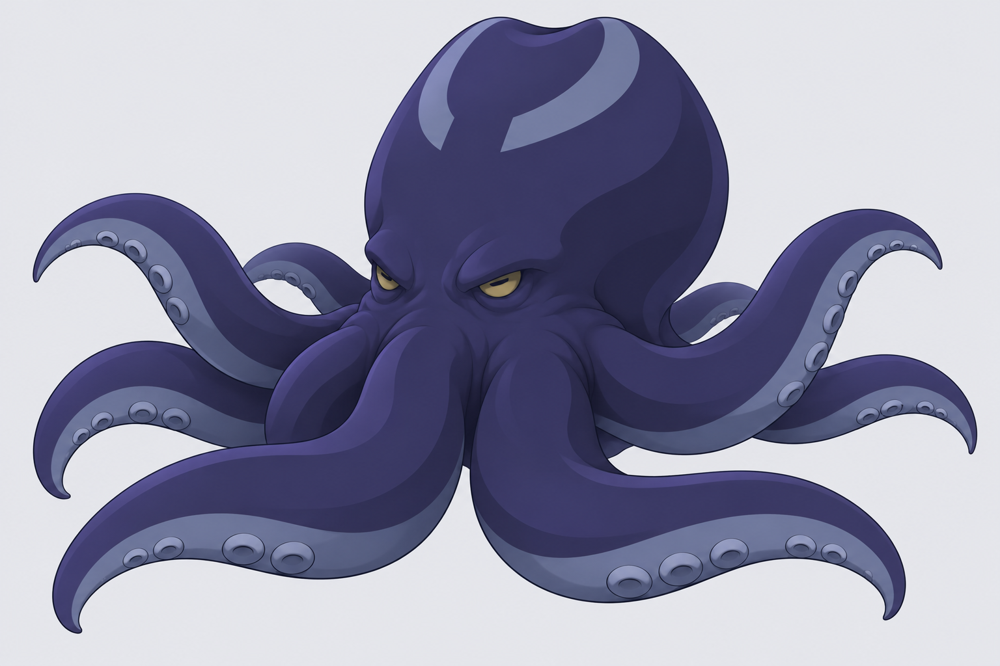

# 静潮 · 章鱼首领建模参考

「静潮」是一只沉静的深海巨型章鱼。头囊从低位的眉骨上方隆起，向后鼓出；腕根接在头囊下方，先下垂，再向不同高度舒展。正面用来看头有多高，左侧用来看眉骨到后脑有多厚。八张图由内置 ImageGen 绘制。

## 参考图与分镜提示词

生成时先用下方的共用提示词画整体，再把整体图作为其他视角的造型参考。每次取表中的一行作为附加提示词。

| 图 | 附加提示词 |
| --- | --- |
| [整体](01-master.png) | 前侧四分之三视角，镜头接近眼高。画完整个身体，露出头囊侧面。两条前腕向镜头垂落再翻出，侧腕拱起，后腕从身体两侧露出。 |
| [正面](02-front.png) | 沿脸的正中线平视。两眼等高，头顶中间有浅浅的凹口。画出眼睛上方整块高额和下方粗厚的腕根。 |
| [左侧](03-left.png) | 严格从左侧平视，脸朝画面左，近侧单眼位于头囊前下方。让额头、头顶、后脑到腕根连成可辨认的侧轮廓。 |
| [背面](04-back.png) | 水平看向后脑正中。用大块明暗画饱满的后脑和下方收紧的腕根，只画从背面能见的那段环纹。 |
| [顶面](05-top.png) | 垂直俯视，脸朝画面上边。八条腕围绕身体成四对，腕尖分别露出，头囊的开口环纹顺着上背弯曲。 |
| [腹面](06-bottom.png) | 垂直仰视，脸仍朝画面上边。八条腕汇到一枚很小的闭合口喙。每腕腹侧有四对并排的浅吸盘，从根到尖递减。 |
| [头部特写](07-head.png) | 从前侧接近眼高看头，画完整头顶，下边裁在腕根。用眼睑包住眼球，画清眉骨向侧面、后脑转折的形状。 |
| [单腕特写](08-arm.png) | 粗腕根在左，细腕尖在右，斜看灰蓝色腕腹。沿腕长分四处，每处横向并排两枚吸盘，末端留一段光滑腕尖。 |

## 共用提示词

> 原创克苏鲁风格巨型章鱼首领「静潮」，二维暗黑手绘动画设定稿。姿态沉静，视线低垂。头囊高耸、肉质饱满，顶部有一处浅凹，后半部向后鼓出，前后厚度接近头宽。两只暗金色横瞳长在头囊下部，眼睑厚重。靛蓝皮肤，灰蓝腕腹，上背只有一圈开口朝脸的灰蓝色皮纹。八条柔软的腕从头囊下方伸出，根部粗圆，弯曲处有高低和前后层次，末端逐渐收尖。每腕腹侧有四对低矮圆吸盘，腹面中央是一枚小而闭合的口喙。用简洁墨线和两三块明暗交代体积。每张只画一个视角，只有角色和纯浅灰背景，完整轮廓四周留白，特写只裁指定部位。

## 在 Blender 中对图

先将正面和左侧图缩放到相同的头囊高度，再以眼睛中心和腕根高度对齐。用顶面摆八条腕的起点，用整体图决定各腕抬起的高度。吸盘的数量和大小顺序以腹面及单腕特写为准，每腕四对，共八枚。这些是分开绘制的视图，腕尖的弯曲角度以整体图的姿态为准。
