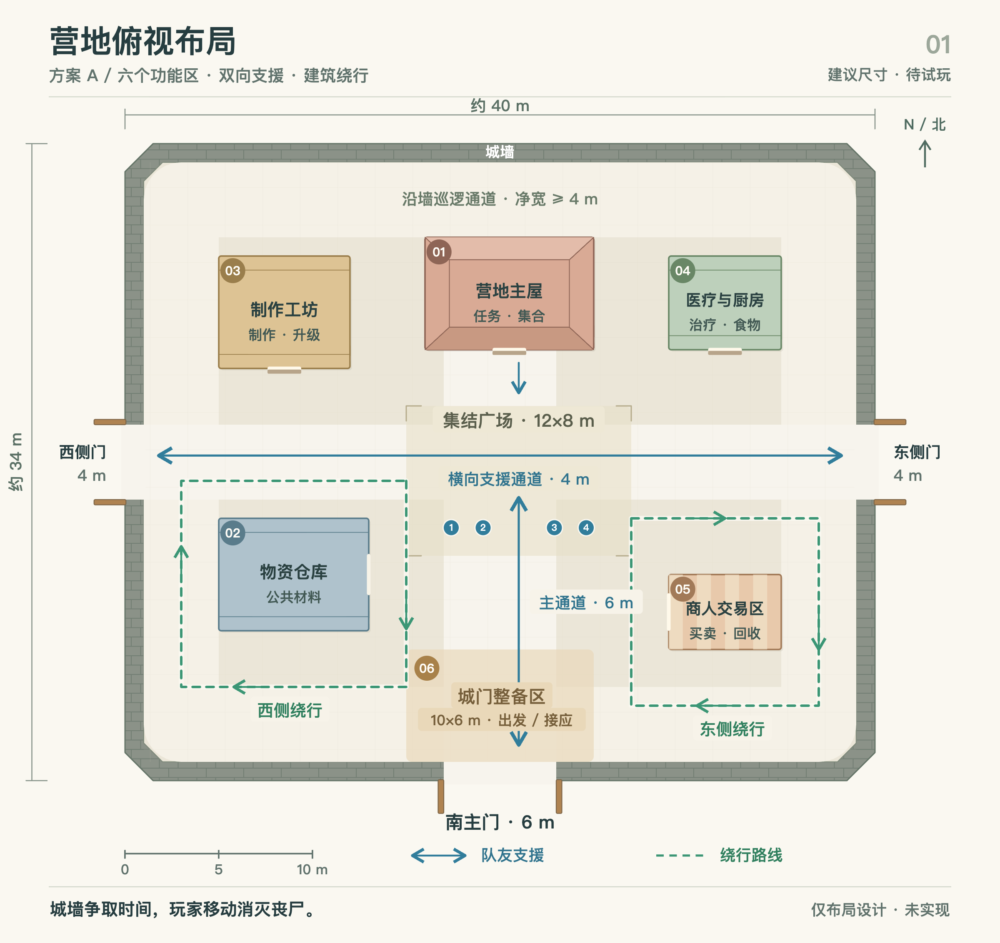

# 营地俯视布局 · 方案 A

日期：2026-11-03。状态：仅布局设计，未修改 Unity 场景、玩法、网络或存档。尺寸为首轮候选值，未验证实际移动、相机、交战与寻路手感。

依据用户确认的方向：营地外围有城墙，内部安排功能建筑与区域；丧尸主要由玩家消灭，空间支持绕行拉扯和队友支援。功能分区采用已讨论的六个区域，玩法总方向见[营地守夜](zombie-camp-defense-design.md)。

图源：[可编辑矢量平面图](images/camp-layout-a.svg)。图中蓝线为支援路线，绿虚线为绕行示例，浅色方形区域是可走地面，均不代表围栏或额外碰撞。线路可双向行走；绿色箭头只演示一种绕行方向。

## 尺度和通行

| 项目 | 建议尺寸 | 用途 |
|---|---|---|
| 城墙外包围范围 | 约 40×34 米，四角削角 | 容纳六个功能区和相互连接的移动空间 |
| 城墙厚度 | 图纸按约 1 米绘制 | 仅平面占地；墙高、耐久和射击口待另行设计 |
| 南主门 | 净宽 6 米 | 白天主要出入口，夜间门内缓冲和撤退起点 |
| 东、西侧门 | 各净宽 4 米 | 分向出入与侧翼接应；不要求开局同时承受三向尸潮 |
| 城墙内侧巡逻通道 | 连续净宽至少约 4 米 | 环绕营地的地面通路，不是城墙顶上的走道 |
| 东西支援通道 | 净宽 4 米 | 从两侧门横穿营地，建筑和装饰不得堵塞 |
| 南北主通道 | 净宽 6 米 | 南门连接广场和主屋前方 |
| 集结广场 | 12×8 米 | 换侧、集合、救援；避免在中央放大型实体 |
| 城门整备区 | 10×6 米 | 集合、整备和后撤空间，保持开放地面 |

按当前约 3 米/秒的陆地移速估算，从中央到侧门约 6–7 秒；这是距离推算，不是战斗实测。射击、换弹、转角和尸群阻挡都会改变实际支援时间。

## 功能区与体块

下表坐标以西北角为原点，X 向东、Y 向南，单位米。用来复现图纸，不代表当前游戏已采用此坐标布局。

| 编号 | 功能区 | 左上角 / 占地 | 战斗与交互关系 |
|---|---|---|---|
| 01 | 营地主屋 | (16,5) / 9×6 | 南面朝集结广场，两侧各保留约 4 米通路；主屋失败判定仍是待确认建议 |
| 02 | 物资仓库 | (5,20) / 8×6 | 西南侧，东面卸货；四面可绕行，作为西侧拉扯的主要遮挡体 |
| 03 | 制作工坊 | (5,6) / 7×6 | 西北侧，工作面朝南；与仓库之间保留宽通道，不以堆货连成死巷 |
| 04 | 医疗与厨房 | (29,6) / 6×5 | 东北侧组合补给点；面向院内，靠近广场，仍可能受到攻击 |
| 05 | 商人交易区 | (29,23) / 6×4 | 东南侧紧凑摊位，服务面朝西；外围可绕行，不扩成占满东院的大建筑 |
| 06 | 城门整备区 | (15,27) / 10×6 | 位于南门内侧；没有屋顶、围栏和妨碍撤退的大型物件 |

建筑优先从朝院子的门口或服务台交互，不假定首版必须做完整室内、二层或屋顶战斗。箱堆、货架、灯柱只能放在另行核准的边角，图纸预留的通道净宽不得被装饰侵占。

## 战斗动线

- 西侧绕行围绕仓库，向北接东西支援通道，向东接主通道，向南接整备区。可绕过建筑换弹，再从另一侧与队友会合。
- 东侧绕行围绕紧凑商人摊位及东侧空地，向北接东门一带，向西接中央。便于处理侧门压力，不要求穿过服务界面或建筑内部。
- 北部通道连接工坊、主屋和补给点的背面，使玩家有绕回中央的选择；沿墙外环是备用移动路线，不能变成保证无敌的安全带。
- 侧门进入的敌人会影响横向支援路。队友需要判断从广场穿过还是绕建筑背面支援，而不是始终有一条无威胁捷径。
- 南门被突破时，玩家可先利用整备区后撤，再分向仓库或东院；不要用额外围栏将门内做成只有一个出口的袋形空间。

城门在图上以打开状态表达连接关系，不意味着夜间必定打开或敌人可以穿过关闭的门。实际守门、破门、墙体阻挡、射击口和建筑耐久需后续设计与实现；不靠高处无风险射击点或自动炮塔替代玩家移动战斗。

## 验证边界

本轮仅核对图纸：五个建筑加一个整备区、三个门洞、路线与建筑不相交、主通道与横向通道不被建筑占用、标注没有越界或相互覆盖。平面图不能证明丧尸寻路、镜头遮挡和四人交战已成立。

后续获得搭建指令后，先用简单体块测试：四人能否在门口和转角相互通过；仓库侧面换弹后是否有合理反击窗口；双门受压时支援距离是否过长；封门是否导致敌人停摆；绕行是否演变成无成本无限遛怪。再依据结果调整尺度和遮挡。

图片生成服务两次未返回可用结果，本图最终采用直接绘制的矢量几何生成并导出 PNG，没有修改或合成现有游戏截图。
