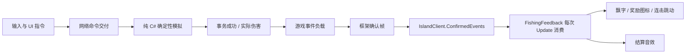

# 确认事件与 Unity 职责拆分

日期：2026-10-29。范围：现有钓鱼、材料和装备收入、受伤、队友钩中、连击及近战的一次性反馈，以及本地房间、存档和输入组织。玩法数值、确定性状态、存档格式和房间协议版本保持原样。

源码位置已按职责归类，当前路径见[游戏代码目录](game-code-organization.md)。本文说明的数据与表现边界保持不变。

## 现在的职责

| 对象 | 负责 | 不负责 |
| --- | --- | --- |
| `HookGame` / `InventorySystem` | 确定性规则、事务结算；成功时记录游戏事件 | Unity、音效、飘字、磁盘 |
| `IslandClient` | 命令交付、确认帧推进、交付本次轮询的确认事件 | HUD、设备输入 |
| `IslandRoomSession` | 本地房主和客户端生命周期、启动、重连、重新开局、错误状态 | 存档文件、相机和展示对象 |
| `IslandSaveCoordinator` | 本机身份、手动/自动保存排队、等待安全点、文件提交和读取校验 | 修改游戏状态、直接断开连接 |
| `FishingPlayerInput` / `FishingAimAssist` | 设备采样、相机控制、按钮暂存、屏幕瞄准辅助 | 判定命中、扣除资源、结算奖励 |
| `IslandFishingController` | 场景装配、更新顺序、既有 UI 入口和各指令适配器的组合 | 自行管理套接字、读写存档、推测收入 |
| `FishingFeedback` | 单一确认事件消费入口、生命周期重置、伤害/收入通知和连击跳动 | 结算金币、修改角色状态 |
| `FishingAudioFeedback` | 已确认结果的音效与展示计数 | 从预测状态或历史计数推测新结果 |
| HUD / `FishingPresentation` | 绘制通知、插值条形图、角色/鱼的姿态和视觉效果 | 写入权威状态、在 GUI 重绘时生产结算事件 |

控制器保留原来的公开接口和场景序列化配置，因此场景、商店、装备、复活、建造等入口无需重新绑定。相机仍在进入游戏时切换第三人称，鼠标锁定及打开界面时释放的行为不变。

## 一次结果如何变成反馈

`HookGameplayEvent` 不含 Unity 对象，只包含事件种类、角色槽位、实际数量、结果值、目标和位置等数据。每项结果由框架赋予 `(SessionId, Epoch, Tick, Index)` 身份。客户端读取两个 `Session.Poll` 调用的确认帧返回值，按顺序合并；不读取 `LastPredictionEvents`。

`ConfirmedEvents` 是本次轮询的只读视图，下一次轮询会清空。展示在轮询完成后立即消费；有需要留存的工具应复制事件值。网络和展示均使用有界批次/身份水位，避免为每次收获永久保存去重集合。显示通知另有数量与生命周期上限。

- 金币记录实际入账；木材、鱼骨记录实际放入背包的数量。金币同帧收入并支出、木材获得后被消费，都不会把奖励提示抵消掉。
- 多人奖励先检查全部候选结果。失败不发事件；溢出到地面的材料不冒充已进背包，后续拾取只报告实际取走的部分。
- 购买和拾取装备会提示；移动、装备已经属于自己的物品不产生重复收入提示。原有请求回执继续负责交易重试去重。
- 伤害在实际扣血后、后续复活或恢复之前记录。同帧回血不会遮掉受伤飘字；脱掉生命装备导致的上限钳制不是伤害事件。
- 连击显示值来自确认状态，跳动来自本次确认的增加事件。如果一批追赶帧中后来已断连，之前的成功事件不能重新显示连击。
- 角色移动、甩杆姿态继续允许本地预测，以保持即时操作；奖励和音效只消费确认结果。

## 存档和会话边界

事件列表和表现缓存不进入 `HookState`、状态摘要或存档。初态、读取存档和重连检查点只恢复已有数据，不枚举以前的收获和伤害；新确认帧仍正常产生反馈。重新开局更换代数，旧事件不会进入新一局。连接/轮次变化时，在新输入采样之前清空本地待发操作和展示缓存。

保存条件继续由房主确认态决定，等待全队收杆、钩救、近身救援等动作结束。保存协调器只有在原子文件提交成功后才返回“可以离开”；主控制器随后关闭连接。锁冲突或落盘失败保留旧文件和当前房间。详情见 [游戏存档接入记录](game-save-implementation.md)。

## 验证记录

- 纯模拟与输入/存档测试：360/360 通过。
- 确认事件专项：14/14 通过，包含失败/重试、同帧收支抵消、伤害后同帧复活、溢出与部分拾取、四客户端事件及完整检查点一致、预测不播放、重连/重开/读档基线。
- Unity 编译通过；整组 HookIsland EditMode 155 项中 154 项通过。另加真实控制器集成测试 2/2 通过，实际走 `Update → 网络确认 → 展示`，验证出钩音效仅计一次、默认第三人称和存档恢复不补播。
- 全组中失败的 `FisherAnimationTests.ForearmsAndHandsStayOutsideBodyAcrossCastAndLocomotionBlends` 报告 `Hand_L` 在第 24 个采样点穿入 `Spine`。该测试、直接被测 `FisherAnimationView` 和角色资源未在本次修改；记录为已有动画问题，不通过放宽断言隐藏。反馈及会话相关用例全部通过。
- 完整回归 `./scripts/verify.sh` 退出码 0；15 组具名测试合计 897/897 通过，记录/回放和多客户端预测验证也完成。最终结果记录于 `artifacts/presentation-separation/verification-summary.json`，过程输出为同目录 `verify.log`。专项用例与完整回归有重合，不重复计入总数。
- Unity 内的游戏、网络、存档程序集与本次验证构建逐项摘要一致，记录为 `artifacts/presentation-separation/unity-library-check.json`。编辑器停在 `HookPlatform` 场景，未运行自动验证或 Play Mode。
- 独立审查通过，报告 `artifacts/presentation-separation/final-review.md`；Unity 详情为同目录 `unity-suite.json`、`unity-controller-integration.json`。

本次未做跨电脑长时间联机、发布构建的听觉/手感验收或最大状态磁盘耗时压测。连续状态插值（血条、耐力、角色、鱼和水面）仍读取状态；将来新增一次性奖励或伤害来源，应在其正式结算点发事件，不能恢复为在 HUD 中比较余额。
