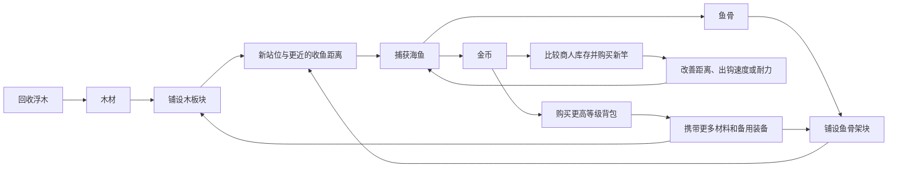

# 钩索小岛 · 核心玩法与循环

版本：0.21 · 2026-10-22

类型：1–4 人合作钩索捕鱼游戏  
定位：轻松、热闹、容易上手；技术好的玩家有表现空间，朋友之间可以互相救场，也可以制造无伤大雅的麻烦。

本文是完整玩法设计提案，包含已实现的阶段与后续设计；具体实现范围以对应实现文档和验收记录为准。最新确定的方向是：玩家从 3×3 木平台出发，回收浮木、捕鱼获得鱼骨，用材料在相邻位置扩建平台；钓竿具有距离、出钩速度和耐力三项属性，其中钓竿耐力与角色基础耐力相加，组成捕鱼和游泳共用的耐力池。停止钓鱼和主动游泳后，经过配置的等待时间缓慢恢复耐力，重新行动则中断恢复。角色有八个装备槽及五项基础属性，新增独立的游泳圈栏。未装备游泳圈时，落水持续掉血、无法出竿；装备后免于落水持续掉血，游得更快、更省耐力，并可在水中出竿。游泳圈先设计 10 级，等级越高游速越快、游泳消耗越低，可从商人处购买。落水者也可由队友用钓竿拖上岸。装备和材料放入可更换的格子背包，出生自带 Lv1 背包，背包先设计 10 级。商人出售钓竿、背包和游泳圈，默认每 10 分钟整批换货，隐藏等级决定商品档次及出现概率。鱼种、重量及普通／精英／Boss 等级共同决定挣脱力和收益。

本次新增食人鱼与水怪设定：食人鱼优先攻击落水者，攻击伤害由自身重量决定；初始海域暂放一只重量较大的水怪，朝玩家吐出水球，命中造成伤害并按等级击退（Lv1 为 4 米，每升一级增加 2 米），可能将玩家推出平台落水。水怪攻击有前摇，玩家可以用钩子打断。防御降低攻击伤害，但不抵挡水球击退；游泳圈不免疫这两类攻击。

平台、钓竿、格子背包和角色属性已进入实现与验收阶段，详见[平台地块](hook-platform-implementation.md)、[钓竿系统](fishing-rods-implementation.md)、[背包及个人金币](backpack-implementation.md)和[角色系统](hook-character-implementation.md)。当前平台金币属于每个玩家本人；旧 `HookIsland.unity` 的共享金币及按钮升级保留为历史原型，不作为新平台规则。游泳圈、落水、游泳与救援见[游泳实现](swimming-implementation.md)。食人鱼、水怪与攻击交互已进入实现，参数、实际验证范围与证据见[水中敌人实现](water-enemies-implementation.md)；倒地、救援、个人复活费用与判败见[复活实现](revival-implementation.md)。失败后房主可保留房间带全队重新开局，规则与联机验收见[重新开始实现](room-restart-implementation.md)。[多人合钓与反向抢钓](#多人合钓与反向抢钓)已确认主钓方向、耐力均摊、按人数加速、主钓交接与脱钩、最后挂线者均分收益且余数归主钓，食人鱼也适用；这些合钓规则已接入正式装备模式，实施范围与验证见[合钓实现](cooperative-fishing-implementation.md)。抵岸后的普通捕获与可上岸鱼的上岸流程分开，后者留待后续设计。

下文明确区分已确定的规则和待调参数。新设计中的平台尺度、4 米初始线长、三属性钓竿、有限商店库存、格子背包及落水／游泳圈规则，优先于旧小岛原型的数值和旧提案；本次不删除或改动已有岛屿场景。

## 一句话介绍

四名玩家从一座小木平台出发，钓浮木、钓海鱼，把材料装进背包并用于扩建，攒金币从商人处挑选钓竿、更大的背包和更高等级的游泳圈，逐步挑战更远、更难命中、更重、更名贵的鱼，也能把朋友钩到身边整蛊，或在朋友落水时把他拖上岸。

## 本轮确定的基础设定

### 世界尺度与初始平台

| 项目 | 设定 |
| --- | --- |
| 世界基本长度单位 | 米（m）；后续 Unity 场景以 1 个世界单位对应 1 米来统一比例 |
| 玩家身高 | 约 1 米 |
| 单块木质地块 | 水平尺寸 2 米 × 2 米 |
| 初始地块数量 | 3×3，共 9 块，连续拼接为木质平台 |
| 初始平台尺寸 | 6 米 × 6 米，可用水平面积约 36 平方米 |
| 玩家初始位置 | 1～4 名玩家出生在平台上，出生点分散安排，避免重叠 |
| 初始钓竿线长 | 约 4 米 |
| 初始背包 | 免费装备一只 Lv1 背包；本稿容量试配为 4×4，共 16 格 |

地块接缝可见，但不形成妨碍行走的缝隙。平台四周用于调整站位和抛钩，不能上岸的鱼被拉到平台的有效收获区域后完成捕获；能上岸的鱼抵岸后触发另行设计的上岸流程。下文的“上岸”也包括被拉上平台。平台已确定可以用木材或鱼骨扩建，所有地块水平尺寸统一为 2×2 米；高度、厚度和商店位置仍待定。

平台边缘保留向外扩散、逐渐淡出的波纹；贴边的泡沫浪花按最新反馈暂时关闭。波纹跟随已确认的平台形状更新，木板与鱼骨块共用同一效果；地块内部接缝不生成波纹，凹角和平台中间保留的水洞也沿水边生成。表现参数可以调整，不参与伤害、碰撞或联机结算。

本次确定的是**出生区域改为可扩建平台**。原有小岛是否继续保留在世界中、与平台如何连接，另行设计；平台扩建先限定为铺设相邻地块。

### 平台地块与铺设

玩家可以在已有地块旁铺设新地块，逐步改变平台形状。初始 9 块为赠送的木板块，进入游戏时不另扣建造材料。

| 地块 ID | 地块名称 | 尺寸 | 使用材料 | 每块消耗配置 | 默认值 | 外观方向 |
| --- | --- | --- | --- | --- | --- | --- |
| `tile_wood` | 木板块 | 2×2 米 | 木材 | `wood_tile_cost` | 4 块木材 | 暖棕色木板与横向木梁，接缝清楚 |
| `tile_fishbone` | 鱼骨架块，简称鱼骨块 | 2×2 米 | 鱼骨 | `fishbone_tile_cost` | 4 根鱼骨 | 象牙白骨架交织，边框与踏面平整可辨 |

两种地块可以相邻混铺。配方分别扣除对应材料：木板块消耗木材，鱼骨架块消耗鱼骨；本轮没有设置混合材料配方。两个消耗量均可独立配置，修改配置只影响后续铺设，不追溯已建地块。

**铺设细则暂按以下设计口径：**

- 地块吸附到统一的 2 米网格，新增位置必须与现有平台至少有一条完整边相邻；仅对角接触不算连接。
- 新位置必须为空，不能与已有地块、建筑或其他实体重叠。木板块和鱼骨架块使用相同的连接与行走规则。
- 预览显示将消耗的材料及可否铺设；成功确认后，一次性扣材料并生成地块。取消、非法位置或材料不足不扣材料。
- 初版两种材料主要体现外观和获取途径差异，暂不添加不同承重、耐久或移速加成。鱼骨架的视觉空隙不形成行走漏洞。
- 配合本轮背包设计，木材和鱼骨暂按实际收获者的个人背包收纳，铺地时消耗建造者背包里的对应材料；金币进入收获者的个人钱包，铺出的地块供所有人使用。这替换上一版共享材料库的建议，材料归属仍属于本稿暂定细则。
- 多人同时铺同一格，只允许一次成功并从成功者的背包扣除一次费用；连续建不同格但操作者材料不够时，按统一的同步顺序处理，不能透支或自动扣走队友背包材料。

拆除、返还、旋转异形地块、多层平台、结构损坏和自动铺路暂不展开。本轮确定的是同一平面上的相邻地块扩建。

### 浮木与木材

开局海面上存在持续漂动的浮木。玩家用钓竿钩住浮木并拉上平台，获得木材；木材进入收获者背包，用于铺木板块。背包放不下的部分按后文的材料包规则留在平台上。

| 浮木规格 | 外观识别 | 成功回收的木材 | 按默认配方可铺木板块 |
| --- | --- | --- | --- |
| 小浮木 | 一段短木条 | 4 块 | 1 块地块 |
| 中浮木 | 较粗的树枝或短木干 | 6 块 | 1 块地块，余 2 块木材 |
| 大浮木 | 长木干或明显较大的木束 | 10 块 | 2 块地块，余 2 块木材 |

浮木持续漂动，不需要等待跃出水面；开局应有一部分漂移路线经过初始 4 米钓竿可达的位置，让玩家能够获得第一块扩建材料。奖励在浮木被完整回收后发放一次，不能多人重复领取同一块浮木。

建议浮木不具有挣脱力，也不消耗钓鱼耐力，只占用出钩和回收时间，使它成为稳定的建设资源。浮木的刷新比例、数量、漂流速度和回收速度均可在后续调试；本稿不为大浮木额外增加多人合拉门槛。

### 角色面板与八个装备槽

**已确定：角色具有帽子、左手、右手、衣服、鞋子、背包、饰品、游泳圈八个槽位，每类各一个。**游泳圈有独立槽位，不占饰品栏或左右手。建议用 Tab 打开角色与背包组合面板：一侧显示角色和装备槽，中间显示当前背包格子，另一侧显示角色属性及选中物品详情。按键与排版为初稿，不是已经完成的界面。

| 槽位 ID | 槽位 | 放置内容与作用 | 本稿初始状态 |
| --- | --- | --- | --- |
| `slot_hat` | 帽子栏 | 帽子、头部装备；通常增加防御值 | 空 |
| `slot_left_hand` | 左手栏 | 辅助手持物，后续可设计盾、灯等 | 空 |
| `slot_right_hand` | 右手栏 | 当前主工具；本轮用于装备并使用钓竿 | 初始旧木钓竿 |
| `slot_clothes` | 衣服栏 | 身体装备；通常增加生命上限 | 空 |
| `slot_shoes` | 鞋子栏 | 足部装备；通常增加岸上移动速度 | 空 |
| `slot_backpack` | 背包栏 | 当前生效的背包，决定可用收纳格子 | Lv1 背包 |
| `slot_accessory` | 饰品栏 | 一件饰品；具体属性与效果后续设计 | 空 |
| `slot_swim_ring` | 游泳圈栏 | 装备 Lv1～Lv10 游泳圈，免于落水持续掉血、提高游速、降低游泳消耗并允许水中出竿 | 暂为空；从商人处购买，是否初始赠送仍待定 |

各槽位只接受适配的物品。同一件装备只能存在于一个位置，不能既放在背包里又占据装备槽。**已穿戴物品不占当前背包格子；备用装备需要占格。**角色默认外观可以自带普通衣鞋，但不因此自动获得可拆卸装备或属性加成。

本稿先按右手使用一根钓竿、左手预留辅助物设计，不额外加入双持钓竿或双手武器规则。装备只在穿戴时生效；槽位本身不提供属性，放在背包里的备用装备也不提供加成。“携带游泳圈”在本稿中按**装备到游泳圈栏**生效，放在背包里的游泳圈不提供保护。背包只扩展收纳容量，不默认提高血量、移速或耐力。

拖放装备时预览合法槽位与变化。替换下来的装备必须有可用背包位置；放不下则保留原装备，提示整理空间，不自动丢弃。换竿仍要求钩索已经收回。普通角色／背包面板不暂停世界，也不额外获得商店交互的免拖拽保护。

### 玩家五项属性

**已确定的属性为血量、移动速度、防御值（护甲）、饥饿值、耐力值；没有护盾资源。**血量、饥饿和耐力显示当前值与上限，移速显示实际米/秒数值；防御只显示最终生效数值，不设可消耗的当前值。

| 属性 | 配置字段 | 建议出生值 | 作用与边界 |
| --- | --- | --- | --- |
| 血量 | `health_current` / `health_max` | 100 / 100 点 | 战斗伤害经过防御减伤后扣血；无游泳圈落水时持续扣血，暂按直接扣血处理；归零进入 60 秒倒地救援窗口，超时最终死亡；队友免费救起或死亡后个人付费复活 |
| 移动速度 | `move_speed_mps` | 岸上 3 米/秒 | 决定普通行走速度；落水时改用游泳速度配置，面板显示当前状态实际速度；不改变钩子飞行或回收速度 |
| 防御值（护甲） | `armor` | 0 点 | 基础值加已穿戴装备加成；持续减少攻击伤害，不被受击消耗，不阻止击退；溺水直接扣血，绕过防御 |
| 饥饿值 | `hunger_current` / `hunger_max` | 100 / 100 点 | 数值越高表示越饱；随时间下降、进食补充的速度与食物表待定，不默认归零就扣血 |
| 耐力值 | `stamina_base` / `stamina_current` / `stamina_max` | 基础 100 点；初始竿加成 20 点，出生暂为 120 / 120 点 | 基础值与当前钓竿加成共同决定上限，钓鱼和主动游泳共用；停止动作后等待 2 秒、每秒恢复 5 点为本稿试配 |

**已确认：角色基础耐力与当前装备钓竿提供的耐力合并计算，钓鱼消耗同一个总值。**新增的游泳消耗也沿用这份耐力，每名玩家只有一份当前值。钓竿提供的是上限加成，不再各自保存一条可消耗耐力。没有装备钓竿时，其加成为 0；背包中的备用钓竿不参与相加。

```text
总耐力上限 = 角色基础耐力 + 当前装备钓竿的耐力加成
0 ≤ 当前耐力 ≤ 总耐力上限
钓鱼每秒耐力消耗 = 鱼种单位挣脱力 × 实际重量 × 鱼的等级倍率
```

角色面板、收鱼界面与游泳时显示同一份“耐力：当前值 / 总上限”，详情可展开“基础值＋钓竿加成”。钓竿商品显示“耐力 +X”，不显示独立的剩余耐力条。按现有试配值，基础 100 点加初始竿 20 点，总上限为 120 点；若一次收鱼消耗 12 点，剩余为 108 / 120。100、20 和出生时满耐力仍是数值草案，合并公式是已确认规则。

普通岸上走动、出空钩暂不新增耐力消耗。主动游泳扣除统一池中的耐力；装备游泳圈后若同时游泳和收鱼，两项消耗相加。停止钓鱼和游泳后按下一节恢复，恢复与使用中的消耗不同时生效。后续若加入冲刺等耗耐力动作，也从这同一个池扣除，并纳入恢复中断条件。

血量上限、移速、防御等最终属性按基础值加已装备物品的固定加成计算，耐力按上面的合并公式计算；本轮其他槽位尚未配置耐力加成。装备切换引起上限下降时，当前值不高于新上限；上限提高时不自动补满血量或耐力。新增三件基础衣装配置如下；饰品、随机词条、套装效果仍待后续设计。

| 基础衣装 | 槽位 | 加成 | 占格 | 暂定价格 |
| --- | --- | --- | --- | --- |
| 护额帽 | 帽子 | 防御 +20 | 2×2 | 150 金币 |
| 加固外套 | 衣服 | 生命上限 +25 | 2×3 | 150 金币 |
| 轻便鞋 | 鞋子 | 岸上移速 +0.3 米/秒 | 2×2 | 150 金币 |

以上数值为首轮平衡配置，定义在 `samples/HookIsland.Simulation/Data/apparel.csv`。只在穿戴时生效；商店保留四人初期钓竿、背包、泳圈供应后尝试加入轮换衣装，剩余货位混排。衣服不回复当前血量，鞋不改变游泳、钩索或被队友拖动的速度。

**换竿细则暂定：**仍只允许在钩索收回后换竿，换竿或卸竿只重新计算总上限，`换装后当前耐力 = min(换装前当前耐力, 新总耐力上限)`。例如剩余 108 / 120 时换成耐力 +60 的竿，结果为 108 / 160；随后卸竿，结果为 100 / 100，再装回则为 100 / 160。单纯购买、整理或反复切换钓竿都不直接增加耐力；符合休息条件时，统一游戏时间内的自然恢复照常计算。换装保留剩余恢复等待时间；初次出生初始化与普通换装区分处理。

饥饿本轮先确定面板和数值状态；耐力则已确定合并上限、捕鱼和游泳消耗，以及停止动作后的延迟恢复。食物来源、冲刺等动作及完整生存循环仍是待定内容。捕鱼继续按既定规则自动结算金币和鱼骨，不因新增饥饿值就自动改成保留整鱼或增加烹饪流程。

### 耐力恢复机制与配置

**已确定：停止钓鱼和游泳后可以缓慢恢复耐力，恢复等待时间与恢复速度可配置。**两个动作必须都已停止；只停下游泳但仍在收鱼，或收鱼结束却仍在游泳，都不能恢复。恢复作用于同一份 `stamina_current`，最多回到当前总耐力上限。

#### 首轮恢复配置

| 配置字段 | 含义 | 首轮默认值 | 单位与约束 |
| --- | --- | --- | --- |
| `stamina_regen_delay_seconds` | 两项动作都停止后，需要连续休息的等待时间 | 2.00 | 秒，≥ 0 |
| `stamina_regen_per_second` | 等待结束后每秒恢复的耐力 | 5.00 | 点/秒，> 0，按固定点数恢复 |

2 秒和 5 点/秒是本稿提出的平衡起点；**机制已确定，具体默认值待试玩校准。**岸上和水中先使用相同配置，钓竿与游泳圈不改变恢复速度或等待时间。总耐力上限更高时，从空到满需要更久，但玩家可以在未恢复满时重新行动。

#### 何时开始、何时中断

以下是对“停止动作”的具体衔接建议：

| 当前情况 | 恢复与等待计时 |
| --- | --- |
| 本人的钓竿正在出钩、牵引或回收 | 不恢复，等待进度清零；钩索回到可再次出竿的空闲状态后才算停止使用 |
| 正在主动游泳，或仍持续输入游泳方向 | 不恢复，等待进度清零；即使耐力已为 0，也需先松开游泳输入 |
| 本人钓竿空闲、无主动游泳输入，且未倒地 | 开始连续休息计时，到达配置的等待时间后恢复 |
| 岸上普通走动、瞄准、购物或整理背包 | 本身不打断休息；仍需同时满足钓竿空闲、没有游泳和未倒地 |
| 正由队友钩索拖动 | 被拖动本身不算主动游泳；被救者自己的钓竿若空闲，可以计时恢复 |
| 已经倒地 | 暂停恢复并清零等待进度；复苏后重新判定，耐力恢复不承担复活功能 |

本稿暂把**一次完整钓竿操作**作为恢复阻断区间，包括空钩、钓浮木及用钓竿救人。这些操作仍按原规则不额外消耗耐力，但钓竿使用期间不能休息恢复；无效的出竿请求不启动钓竿操作，也不单独重置等待。鱼仍被牵引时，即使玩家松开鼠标或目标停在水中玩家身边，也仍在操作中。

从两项动作都结束的时刻起连续计时；等待中或恢复中重新开始任意一项，立即停止恢复并将等待进度清零，之后必须重新连续休息 2 秒。成功收鱼、鱼挣脱或主动松钩都不返还已消耗的耐力，待钩索收回且停止游泳后再进入休息。

耐力耗尽会停止游动；界面提示“松开移动键休息”。持续按住水中移动输入时不自动恢复，以免出现自动恢复一点又立刻耗尽的反复小步移动。松开后按正常等待恢复，重新输入且已有可用耐力时即可游动，不要求回满。若被救援钩索接管位移，游泳输入暂停接受，不因此阻断被救者休息；施救者自己仍按使用钓竿处理。

#### 恢复量、落水与换装

设连续休息开始时耐力为 S，当前总上限为 Smax，等待时间为 D，恢复速度为 R。在上限不变、未被动作中断的连续休息 t 秒内：

```text
当前耐力 = min(Smax, S + R × max(0, t - D))
```

到达等待边界时开始计恢复时间，不在边界瞬间额外加一整秒的恢复量。每个统一模拟步只累计实际处于恢复阶段的时长，支持小数耐力并在上限处截断；不按客户端画面帧率累加，也不在同一步对相同时间重复执行消耗和恢复。

按默认等待 2 秒、每秒恢复 5 点举例：

| 情况 | 连续休息后的结果 |
| --- | --- |
| 初始上限 120 点，从 0 点开始休息 | 前 2 秒不增加；第 3 秒为 5 点，第 6 秒为 20 点，第 26 秒回满 120 点 |
| 剩余 108 / 120 点，开始休息 | 等待 2 秒，再恢复 2.4 秒；合计 4.4 秒回满 |
| 已休息 1.5 秒时重新出钩或游泳 | 本轮还未恢复，等待进度清零；动作再次结束后重新等待 2 秒 |
| 已达到恢复条件时换上更高耐力加成的钓竿 | 保留当前值和等待进度，之后按 5 点/秒恢复至新上限；不因换装立即补满 |

**水中停止动作也能恢复。**未倒地的有圈玩家可以停在水面休息，恢复后继续游泳或出竿；无圈玩家同样能恢复耐力，但落水持续掉血照常进行，休息不等于安全。落水扣血和其他普通受伤暂不重置耐力等待，只有动作条件和倒地状态决定是否恢复；倒地后按上表停止。仍在水中收鱼时无法靠停游恢复，必须完成回收或主动放弃目标后收回钩索。

买装备、换钓竿、换圈、进出水面、打开界面和被救上岸都不直接增加耐力，也不跳过或重新启动现有休息计时；实际发生新的钓竿操作或游泳输入时再按中断规则处理。更换钓竿引起上限下降时先裁切当前值，上限上升时以后续正常恢复填补差额。游泳圈的消耗折扣只作用于游泳，不放大每秒恢复量。

有圈玩家因此可以通过“游一段—停下休息—继续游”分段返回；下方游泳圈表的理论总路程只代表一次连续耗尽耐力的路程，不再用于判断累计探索范围。无圈时血量不足会进入下文倒地救援与付费复活流程；单人及全队适用相同规则。

#### 显示与联机状态

统一耐力条增加“钓竿使用中／游泳中”“休息等待：剩余秒数”“恢复中：+5/秒”“已满”的状态提示，数值随配置显示；倒地时显示恢复暂停。角色面板、钓鱼与游泳界面使用同一当前值，不新增第二条耐力。

恢复等待的剩余时间记为 `stamina_regen_delay_remaining_seconds`，与当前耐力、当前动作、是否倒地一起纳入统一游戏状态及存档。使用房间的统一模拟时间推进，晚加入和重连继承当前进度，不能把重连当成一次新的满耐力出生。房间持续模拟时自然恢复照常推进；存档停机期间不按现实离线时长补耐力。换装只改变对应装备效果，不重置该等待值。

**出钩移动限制：**有效出钩当帧起，直到钩索完全收回，玩家不能主动行走或游泳。空钩飞行、拉鱼、拉浮木、拉队友及取消后的空钩返回都适用；完全收回后恢复移动。队友钩索造成的外部拖动仍然有效，无效出钩请求不会锁定移动。被阻止的游泳输入不扣耐力，当前收鱼消耗照常。本次衔接建议：水球击退也属于外部位移，出钩锁定不能提供击退免疫；击退与队友拖拽同时生效时的控制顺序仍待细化。

### 落水状态、游泳圈与钓竿救援

**已确定：角色新增落水状态；无游泳圈时持续掉血，可以消耗耐力向选定方向游动，耐力不足就停止游动，且不能出竿。装备游泳圈后不受落水持续掉血影响，游泳耐力消耗更小、游速更快，并允许出竿。其他角色可以用钓竿把落水者拖上岸。**

离开可站立地面并进入海水后进入落水状态；泳向由移动输入控制，可随时改向，松开输入停止主动游泳。落水是所处环境状态，与是否倒地分别记录，落水者倒地后仍处于水中，直到被拖上有效地面。水中动作与岸上行走区分，但不新增第六项基础属性。以下对照适用于仍有行动能力、尚未倒地的角色：

| 落水时的行为 | 未装备游泳圈 | 已装备游泳圈 |
| --- | --- | --- |
| 持续掉血 | 持续发生，停下游泳也不会停止 | 免除落水持续掉血 |
| 主动游泳 | 按基础游速移动，消耗基础游泳耐力 | 游得更快，每秒消耗的耐力更少 |
| 耐力不足 | 停止主动游泳；松开输入且钓竿空闲后可等待恢复，仍持续掉血，也可求救 | 停止主动游泳；松开输入且钓竿空闲后可等待恢复，或由队友救援 |
| 出竿 | 禁止，界面提示“装备游泳圈后可在水中出竿” | 允许，仍受当前钓竿距离、速度和收鱼耐力约束 |
| 被队友钩住 | 可以，即使自身耐力为 0 也能被拖动 | 可以，即使自身耐力为 0 也能被拖动 |
| 其他伤害 | 食人鱼咬击、水球等攻击经过防御减伤后扣血；水球仍会击退 | 同左；游泳圈只免除落水持续掉血，不免疫攻击，也不阻止成为食人鱼的优先目标 |

游泳圈只改变水中的上述规则，不提高岸上行走速度，也不增加耐力上限。留在水面不主动游泳时，不扣游泳消耗；如果还在收鱼，鱼的消耗继续计算且无法恢复。耐力耗尽不妨碍外部钩索拖动，但不能靠按住移动键继续游泳。松开游泳输入且钓竿空闲后，按前文等待并缓慢恢复；落水、装备游泳圈或上岸本身不立即补满。

#### 消耗与速度配置

本轮将无圈基础游速试配为 **V = 1.00 米/秒**、无圈主动游泳消耗试配为 **C = 10.00 点/秒**，用于下方 10 级游泳圈表的计算。基础值、各级倍率和价格均是待试玩校准的数值草案；无圈落水每秒掉血量 D 默认配置为 **5 HP/秒**。

| 配置字段 | 含义 | 约束 |
| --- | --- | --- |
| `water_health_loss_per_second` | 无圈落水每秒掉血量，记为 D | 默认 5 HP/秒，D > 0；有圈时该项为 0 |
| `swim_speed_mps` | 无圈基础游速，记为 V | 首轮 1.00 米/秒，V > 0 |
| `swim_stamina_per_second` | 无圈主动游泳每秒耐力消耗，记为 C | 首轮 10.00 点/秒，C > 0 |
| `swim_ring_speed_multiplier` | 当前装备游泳圈的游速倍率，记为 A | 按等级查表，A > 1；有圈游速为 V × A |
| `swim_ring_stamina_multiplier` | 当前装备游泳圈的游泳消耗倍率，记为 B | 按等级查表，0 < B < 1；有圈游泳消耗为 C × B |

```text
无圈主动游泳：速度 = V，游泳消耗/秒 = C
有圈主动游泳：速度 = V × A，游泳消耗/秒 = C × B
未主动游泳、自己钩索未收回或正由队友拖动：游泳消耗/秒 = 0
统一耐力总消耗/秒 = 游泳消耗/秒 + 当前收鱼消耗/秒
```

总消耗只从当前耐力扣一次，最低为 0。耗尽后停止自主游动；若此时鱼仍未进入有效收获区域，则鱼挣脱，不发奖励。建议对最后不足一整步的耐力按能够支持的时间处理，不允许出现负数或免费继续移动。面板展示当前泳速、统一耐力，以及无圈时的持续掉血提示。

**本稿建议的扣血细则：**落水持续掉血直接扣血量，绕过防御，避免防御代替游泳圈的功能；装备圈后停止后续落水扣血，但不返还已经损失的血量。血量归零沿用倒地状态，停止自主游泳和出竿，仍可被队友拖回；拖上岸不等于自动复苏。倒地者按下节规则保留 60 秒救援时间，单人可在最终死亡后个人付费复活。

#### 装备变化与水中出竿

水中是否有圈以当前装备槽为准。**换装与已有钩索的衔接暂定如下：**允许在有行动能力时于水中装备或卸下游泳圈，沿用背包占格和换装检查；变更后立即按新状态计算掉血、游速、游泳消耗及出竿权限，不补血、不补耐力。

- 已装备游泳圈时被拖入水中，保留正在进行的出钩或回收；自己钩索未收回前不能主动游泳，收鱼仍照常消耗耐力。
- 未装备游泳圈时落水，或在水中卸下游泳圈，已有钩索暂按解除目标并收回空钩处理；尚未完成的鱼、浮木等不结算收益。收回后仍禁止再次出竿，直到重新装备游泳圈或上岸。
- 有圈时“允许出竿”不代表免费收鱼。当前耐力为 0 时，空钩本身仍按既有规则处理，但命中鱼后无法支撑回收，鱼按耗尽规则挣脱。
- 水中出竿沿用钓竿距离和出钩速度，距离从水中角色的实际抛钩点计算；游泳圈本身不额外增加线长。

**水中回收衔接暂定：**不能上岸的鱼和浮木仍须进入平台／岸上的有效收获区域才结算；仅拉到水中玩家身边不算上岸。目标到达身边后保持牵引，自己钩索未收回前不能主动游泳；需由队友拖回可站立地面，才结算收获，鱼在此期间继续消耗耐力。也可以主动松钩释放目标、不发奖励，等空钩完全收回后游回岸边。这样水中捕鱼仍要考虑回程耐力，材料也不会凭空在海面结算或生成平台外掉落包。能上岸的鱼抵岸后进入独立的上岸流程，不直接按普通收获结算。

**已确定：游泳圈从商人处购买，先设计 Lv1～Lv10；等级越高游泳速度越快、游泳耐力消耗越少。**当前出生槽位仍暂留空，是否额外赠送初始游泳圈另行确定；具体物品与商品配置见下一节。

#### 游回岸边与队友救援

以下操作细节为衔接现有平台与钩索系统的建议：

1. 自救：玩家主动游到可登岸边缘，岸上有足够的站立空间时自动登上低矮平台，结束落水状态；不额外要求一笔爬岸耐力。仅靠近水中岩石、平台侧壁或被占满的位置不算已上岸。
2. 施救：队友用钓竿命中落水角色后，将其向自己所在岸边拖回；照常检查射程、沿途障碍及岸上落脚点。没有游泳圈的玩家也能在岸上出竿救人；被救者不需要游泳圈、耐力或手持钓竿。
3. 被拖动时暂由救援钩索控制位移，暂停被救者的主动游泳及其消耗。救援暂不额外消耗双方耐力，不套用鱼的重量或挣脱力公式；救援仍占用施救者的钓竿及回收时间。被救者若有圈且仍在收鱼，其自身收鱼消耗继续。
4. 真正回到可站立地面后才停止无圈落水扣血；钩中、被拖动、靠近施救者都不提前免除掉血。若施救者也在水中，把队友拉到身边仍算落水，不能误判为救起。途中松钩或连接中断则解除拖动，双方保留实际位置与状态，落水者继续按有圈／无圈规则行动。
5. 同一落水者同一时刻只接受一根救援钩索，先成立的连接生效，避免多个客户端同时控制位置。上岸落脚点必须有效，不能为完成救援把角色穿过平台或放到另一侧海面。
6. 救援不受岸上整蛊的抗重复拖拽保护或房主“关闭友方整蛊”开关阻挡。落水时自动关闭商店交互并结束购物保护，避免被保护状态阻止施救；岸上的购物与整蛊保护仍按原规则执行。

落水本身不扣金币、不丢装备和背包内容；上岸也不自动回满血量或耐力。**旧提案中的“无人救援约 5 秒自动回岸”由本节规则取代。**有圈但耐力耗尽且无人救援时，可停止动作休息，恢复后继续游回岸边；无圈时血量可能不足以支撑完整休息和返岸。单人或全队倒地后采用下节的 60 秒救援与个人付费复活规则，不自动传送回岸。

### 倒地、免费救援与个人付费复活

**已确认：队友救起不扣金币；倒地 60 秒后死亡；死亡玩家各自支付复活费用；只有全队均已死亡且所有人都付不起自己的复活费用时才失败。**落水、倒地和最终死亡分别保存，不能把全队倒地直接判作失败。

血量归零后不能移动、游泳或出竿，保留装备、背包和金币。默认双方站在有效地面上、相距不超过 1.5 米，队友按住 **R 3 秒**即可免费救起，恢复最大生命的 30%（至少 1 点），不补耐力或饥饿。救援路径不能穿过障碍或水面。松键、走动、出钩、开菜单、受伤、拖拽、击退、离线或离开范围中断进度；多人同时救一人不加速，换施救者重新计时。

水中倒地者须先用钓竿拖上有效地面，再近身救起。钩救只解决位置，不自动治疗；拖拽时倒计时照常推进。同帧完成救援与倒地超时，优先成功救起。最终死亡后解除钩索及击退状态，不再允许钩救或近身扶起。

最终死亡时锁定自己的复活报价，默认：

`复活费用 = 10 G + floor(本局模拟游玩秒数 / 300) × 5 G + floor(死亡时个人金币 × 10%)`

例如本局第 7 分钟、死亡时持有 200 G，费用是 35 G。倒地和被队友救起不扣款；最终死亡后点击付费复活，成功时扣一次。等待不会继续涨价，金币不足全额不能复活，不扣成负数，也不动队友钱包。付费成功回到出生点附近可站立且无人占据的位置，默认恢复满生命与满耐力，保留装备、背包和饥饿；没有有效位置时不扣款，允许稍后主动重试。

| 配置 | 默认值 | 用途 |
|---|---:|---|
| `downedSeconds` | 60 秒 | 最终死亡前的救援时间 |
| `rescueSeconds` | 3 秒 | 持续施救时间 |
| `rescueRangeMetres` | 1.5 米 | 近身施救范围 |
| `rescueHealthFraction` | 0.30 | 免费救起恢复生命比例 |
| `baseFee` | 10 G | 初始固定费用 |
| `growthFee` | 5 G | 每段游玩时间增加的固定费用 |
| `growthIntervalSeconds` | 300 秒 | 固定费用增长间隔 |
| `balanceFeeFraction` | 0.10 | 死亡时个人余额的收费比例 |
| `respawnHealthFraction` | 1.00 | 付费复活生命比例 |
| `respawnStaminaFraction` | 1.00 | 付费复活耐力比例 |

以上初始参数集中在 `RevivalSettings.asset`，可调参；时间采用房间模拟帧，不计算停机期间的现实时间。倒地倒计时、施救目标与进度、死亡代号、锁定报价和个人支出账本均同步并存档。付费请求绑定本次死亡和唯一请求号，成功／失败都有回执，重发或读档不会重复收费。

界面显示倒地剩余时间、免费救援进度、死亡费用与个人余额。全队最终死亡时，仍有任何一人付得起自己的费用便继续等待其选择；无人付得起才显示失败并提供返回房间菜单入口。单人遵循相同规则，可在死亡后自行付费复活。实施边界和验收见 [倒地复活实现说明](revival-implementation.md)。

### 10 级游泳圈配置表（首轮草案）

所有等级都提供**免除落水持续掉血、允许水中出竿**两项基础能力；等级成长体现在游得更快和游泳时更省耐力。高等级游泳圈仍在耐力不足时停止游泳，其他伤害按原规则处理。购买得到一件独立装备，可以直接购买商人在售的更高等级，不要求先买齐低等级；每次只使用游泳圈栏中这一件的配置。

游泳圈的商店和背包占格统一暂按 **2×2**，每件独立占格，不堆叠；装备后释放背包占格。备用圈保留自己的等级与属性，但不叠加效果。换上高级圈时旧圈按装备替换规则回包，空间不足则先整理；购买、换圈和反复穿脱均不直接增加血量或耐力，符合休息条件时的自然耐力恢复照常进行。

表中的 A、B 分别对应前文两个游泳圈倍率配置字段；**实际游速与每秒消耗是按 V = 1.00、C = 10.00 推导出的显示值**，后续调整基础值时统一重算，避免同时维护两套生效数值。名称与售价均为草案，售价单位为金币 G。

| 游泳圈 ID | 等级 | 名称 | 游速倍率 A | 实际游速（米/秒） | 游泳消耗倍率 B | 游泳消耗（点/秒） | 售价（G） | 商店货档 |
| --- | --- | --- | --- | --- | --- | --- | --- | --- |
| `swim_ring_lv01` | Lv1 | 旧橡胶泳圈 | 1.20 | 1.20 | 0.90 | 9.00 | 150 | T1 |
| `swim_ring_lv02` | Lv2 | 加厚泳圈 | 1.30 | 1.30 | 0.85 | 8.50 | 260 | T1 |
| `swim_ring_lv03` | Lv3 | 水手泳圈 | 1.40 | 1.40 | 0.80 | 8.00 | 450 | T2 |
| `swim_ring_lv04` | Lv4 | 稳浮泳圈 | 1.50 | 1.50 | 0.75 | 7.50 | 750 | T2 |
| `swim_ring_lv05` | Lv5 | 轻便泳圈 | 1.60 | 1.60 | 0.70 | 7.00 | 1200 | T3 |
| `swim_ring_lv06` | Lv6 | 远游泳圈 | 1.70 | 1.70 | 0.65 | 6.50 | 1800 | T3 |
| `swim_ring_lv07` | Lv7 | 巡海泳圈 | 1.80 | 1.80 | 0.60 | 6.00 | 2700 | T4 |
| `swim_ring_lv08` | Lv8 | 探险泳圈 | 1.90 | 1.90 | 0.55 | 5.50 | 3900 | T4 |
| `swim_ring_lv09` | Lv9 | 领航泳圈 | 2.00 | 2.00 | 0.50 | 5.00 | 5500 | T5 |
| `swim_ring_lv10` | Lv10 | 远征泳圈 | 2.10 | 2.10 | 0.45 | 4.50 | 7600 | T5 |

每升一级，游速倍率提高 0.10、游泳消耗倍率降低 0.05；按当前基础值，相当于游速增加 0.10 米/秒、游泳消耗降低 0.50 点/秒。Lv1 已比无圈快 20%、每秒少耗 10%；Lv10 比无圈快 110%、每秒少耗 55%，其游速仍低于当前岸上 3 米/秒的试配值。

**倍率 B 只影响游泳消耗，不影响鱼的挣脱力或收鱼消耗。**例如，5 kg 普通蓝纹鲭鱼消耗 6 点/秒耐力，穿 Lv10 圈收鱼时仍消耗 6 点/秒，并锁定自主游泳；单独游泳时消耗 4.50 点/秒。游泳圈不增加统一耐力上限，也不改变钓竿线长、出钩速度或鱼的收益。

按初始统一耐力 120 点且满耐力计算，不计捕鱼、障碍与其他消耗，Lv1 可连续游约 13.33 秒、总路程约 16 米；Lv10 可连续游约 26.67 秒、总路程约 56 米。连续游泳期间不恢复，这是消耗完一次耐力的理论总路程，往返、绕路和收鱼要共享这份预算，不能直接当作安全离岸距离。停游且钓竿空闲后可以休息恢复，因此分段游动的累计路程可以超过这些数值。后续需把更高等级钓竿带来的耐力上限、游泳圈获取节奏、平台扩建与远海收益一起调试。

商店按每两级一档出售：T1 为 Lv1～2，T2 为 Lv3～4，T3 为 Lv5～6，T4 为 Lv7～8，T5 为 Lv9～10；与背包共用货档映射。新增游泳圈纳入后文的同批有限库存、个人金币、每 600 秒整批换货与联机抢购规则，购买后暂时留空，不单独即时补货。

### 背包收纳与物品占格

**已确定：玩家可以装备背包，装备和材料能够放入背包；背包等级越高，可用格子越多；从商人处购买，初始自带 Lv1，先设计 10 级。**具体容量、价格、堆叠和以下操作细则均是本稿提出的设计起点。

当前装备的背包提供一个矩形网格。物品按各自宽×高占据连续空格，不允许重叠或越界；空格总数足够但形状放不下时，也不能放入。建议允许将未装备物品旋转 90°，帮助整理。商店与背包暂共用同一物品占格配置，格子不对应世界中的米或平台地块。

| 物品类别 | 背包占格（宽×高） | 每组堆叠上限 | 规则 |
| --- | --- | --- | --- |
| 木材 | 1×1 | 20 块 | 同类先补未满堆叠，再占用新格 |
| 鱼骨 | 1×1 | 20 根 | 同类先补未满堆叠，再占用新格 |
| 钓竿 | 沿用各系列的 1×3、1×4、2×3 或 2×4 | 1 件 | 每根保存等级、距离、出钩速度与耐力加成，不保存独立当前耐力；初始旧木钓竿暂占 1×3 |
| 帽子／鞋子 | 暂各 2×2 | 1 件 | 具体物品单独配置，装备到对应槽位后属性生效并释放背包占格 |
| 衣服 | 暂 2×3 | 1 件 | 装备到角色后释放背包占格 |
| 左手辅助物 | 由具体物品配置 | 1 件 | 物品与尺寸后续设计，本轮不生成未知物品 |
| 饰品 | 暂 1×1 | 1 件 | 装备栏只有一个饰品位，备用饰品可存包 |
| 游泳圈 | Lv1～Lv10 均暂为 2×2 | 1 件 | 装备到独立槽位后按等级生效并释放占格；备用圈无保护效果 |
| 未装备的背包 | 统一暂按 2×2 | 1 件 | 只能收纳空背包，内部格子不生效，不允许背包套背包扩容 |
| 金币 | 不占格 | 每人独立钱包数值 | 收鱼者获得金币，购买只扣购买者的余额，不生成金币物品堆叠 |

堆叠上限 20 是配置值，不改变每块地板消耗 4 材料、浮木产出 4／6／10 或鱼骨产出公式。例如 10 kg 普通鱼的 20 根鱼骨占 1 格，同重量 Boss 的 60 根占 3 格。玩家可以拆分材料堆叠，建造时可跨多个同类堆叠扣够一次配方所需数量。

木材和鱼骨暂由完成收获的玩家保管，其他玩家不能直接从其背包扣走物品。为方便合作，建议允许玩家将选定数量的材料放在平台上，队友主动拾取后放入自己的背包；铺出的地块仍属于全队共同使用的场景。

**材料满包规则：**收获时先填同类未满堆叠，再填空格；剩余材料在平台的有效收获点生成可拾取材料包，不丢进海里，也不静默销毁。材料包记录尚未被取走的数量，全队均可拾取，有多少空间就取多少，其余保留。鱼的金币奖励仍只在成功收获时结算一次，之后拾取鱼骨不会再次发金币。材料包不阻挡行走与铺地；掉落包的保存与数量管理需在实现前细化，暂不加入定时销毁。

### 10 级背包配置表（首轮草案）

每名玩家出生时免费获得并装备一只 Lv1。后续购买的是新的背包物品，替换装备后获得新容量，不直接把旧包逐级点升级；只要商人在售、金币足够且换装能完整转移物品，就可以跨级购买。

| 背包 ID | 等级 | 名称 | 格子布局（列×行） | 可用格子数 | 售价（G） | 商店货档 |
| --- | --- | --- | --- | --- | --- | --- |
| `bag_lv01` | Lv1 | 旧帆布包 | 4×4 | 16 | 100；出生免费 | T1 |
| `bag_lv02` | Lv2 | 加固布包 | 4×5 | 20 | 200 | T1 |
| `bag_lv03` | Lv3 | 水手挎包 | 4×6 | 24 | 360 | T2 |
| `bag_lv04` | Lv4 | 双袋行囊 | 5×6 | 30 | 600 | T2 |
| `bag_lv05` | Lv5 | 渔夫工具包 | 6×6 | 36 | 950 | T3 |
| `bag_lv06` | Lv6 | 远航背包 | 6×7 | 42 | 1500 | T3 |
| `bag_lv07` | Lv7 | 深海行囊 | 6×8 | 48 | 2300 | T4 |
| `bag_lv08` | Lv8 | 探险箱包 | 7×8 | 56 | 3400 | T4 |
| `bag_lv09` | Lv9 | 领航大背包 | 8×8 | 64 | 5000 | T5 |
| `bag_lv10` | Lv10 | 舰队远征包 | 8×9 | 72 | 7200 | T5 |

容量从 16 格增加到 72 格，成长来自更多备用装备和材料堆叠的携带空间。本稿不增加负重、满包减速或容量附带战斗加成；鱼的 kg 重量仍用于鱼本身的收益、体型和挣脱力。背包等级可以通过配色、口袋和边框区分，世界模型不必随格子数放大到遮住角色。

### 换背包与购买时的空间检查

- 同时只能装备一只背包，容量取当前这只背包的配置，不把所有持有背包的容量相加。
- 更换时先预览新网格，把原有内容和卸下的旧空包全部安排进去。新包原本放在旧包内时，其占位在换装中释放；不需要在满包状态额外先腾出一份新包位置。
- 成功后一次完成装备替换和物品转移。旧包变为空包，默认按 2×2 放入新包；也可在预览中明确选择把旧空包放到平台交互点。放不下且没有选定其他去处时保持原状，允许整理或先取出部分物品，不自动删除或扔出任何装备、材料。
- 换更小的包同样检查真实占格，不能只比较已用格数。直接卸下当前背包，要求先清空内容并明确放到平台上；未装备背包时可用背包格子为 0，角色身上其他装备保留。
- 购买普通装备默认放入当前背包。空间不足则购买失败，不扣款、不移除商人库存；也可以选择“购买并装备”，但必须检查槽位适配、操作时机及旧装备的回包空间。
- 背包商品提供“购买并装备”：直接按新容量检查全部内容和旧包的转移，成功后才扣款并更换。这样无需先把商品塞进旧包；若新格子的形状放不下旧空包，可明确选择将旧空包放到平台上，再完成升级。

收纳满包的处理与购买失败不同：已经挣得的材料可以留在平台等待拾取；尚未成交的装备继续留在商人货架上。玩家已持有的背包及内容不受商人整批换货影响。

### 钓竿的三个核心属性

| 属性 | 配置字段 | 含义 | 对玩法的影响 |
| --- | --- | --- | --- |
| 距离，亦称线长 | `cast_range_m` | 允许抛出的最大距离，单位为米 | 决定哪些位置的目标能够钩到；初始约 4 米 |
| 出钩速度 | `hook_speed_mps` | 钩子向外飞行的速度，单位为米/秒 | 决定到达目标的时间，越快越容易抓住短暂跃起的机会 |
| 耐力值，即耐力加成 | `stamina_bonus` | 装备后加到角色基础耐力上的点数 | 提高统一耐力池的上限；能否拉鱼上岸取决于池内当前剩余耐力 |

抛投距离从玩家的抛钩起点计算，不从平台中心计算。走到不同边缘会改变可覆盖的海域。线长决定“够不够得着”，出钩速度影响“能否及时命中”，耐力决定“钩中了能不能拉回来”。

出钩速度只影响钩子向外飞行，不同时提高回收速度，也不直接降低鱼的挣脱力。回收速度先作为独立的全局手感参数调试，不增加第四项钓竿属性；这样快竿与高耐力竿各有用途。

**本节钓竿耐力表示对统一耐力上限的加成。**鱼上钩之前不因该条鱼而扣除耐力；当前单钩回收中，若鱼尚未上岸而玩家的统一耐力池耗尽，该鱼挣脱，本次捕获失败，不获得金币或鱼骨。已实现的多人合钓中，耐力耗尽只解除该玩家的钓线，其余有效钓线继续牵引，具体交接见[多人合钓与反向抢钓](#多人合钓与反向抢钓)。不能上岸的鱼抵岸完成捕获后，停止该次钓鱼消耗，并且只结算一次奖励；能上岸的鱼抵岸后的钓线、耐力与奖励处理，留待上岸逻辑设计。鱼没有单独的耐力条，也不先后扣除所谓“钓竿部分”和“角色部分”。

初始钓竿的耐力加成在下文中给出试配值。统一耐力池按前文恢复机制处理：钓竿空闲且停止主动游泳后，默认等待 2 秒，再以每秒 5 点缓慢恢复，两项数值均可配置。抛竿会中断休息；买竿或换竿本身不直接补充耐力，但不阻止正常休息恢复，也不默认需要花钱维修。装备表描述的是上限加成，不等于每次出钩都会获得该数值。

### 钓竿等级与种类

**先提出 5 个商品等级 T1～T5，每级 6 种，共 30 款可售钓竿。**开局赠送的旧木钓竿单列，不占每级 6 种的名额。等级数、名称、属性、价格和占格尺寸均为本稿的首轮调试配置；用户已确定的是有等级、有不同侧重，以及每级提供 5～6 种选择。

同一种类升一级，距离、出钩速度和耐力均提高。同级之间保留取舍：偏科竿在一两项属性上突出，均衡竿没有明显短板。跨种类比较时，高一级的短竿不必比低一级的远投竿更长，购买时直接显示三项属性差值，不只比较等级。

| 种类 ID | 系列名 | 属性侧重 | 适合的目标或位置 | 商店／背包占格（宽×高） |
| --- | --- | --- | --- | --- |
| `long` | 海风 | 距离最高，速度与耐力较低 | 站位有限时，尝试远处轻鱼与浮木 | 1×4 |
| `fast` | 飞燕 | 出钩最快，距离较短 | 近处游速快、跃起窗口短的鱼 | 1×3 |
| `tough` | 守礁 | 耐力最高，距离较短 | 平台边缘的重鱼、精英鱼与 Boss 个体 | 2×3 |
| `swiftlong` | 掠浪 | 距离和出钩速度较高，耐力最低 | 快速命中远处轻鱼，需要谨慎挑重量 | 2×3 |
| `deepline` | 深潮 | 距离和耐力较高，出钩较慢 | 远处重鱼，需要更准确地预判 | 2×4 |
| `balanced` | 渔人 | 三项均衡 | 初次换竿、目标混杂或频繁换站位 | 1×4 |

钓竿在商店和背包中暂使用相同的占格尺寸，与钓竿的世界尺寸和平台地块大小没有换算关系。同一种类各等级暂用相同占格，便于识别；装备到右手后释放其背包占位，其他物品按各自配置占格。

### 钓竿配置表（首轮草案）

初始旧木钓竿：`rod_starter`，**距离 4 米、出钩速度 4 米/秒、耐力加成 +20 点**，免费赠送，不参与商店抽取。其中约 4 米线长已确定，速度与耐力加成为本稿试配值。按角色基础耐力 100 点计算，装备初始竿后的总上限为 120 点。T1 的每一款都比初始竿的三项属性更高，保证第一次购买有明确改善。

下表价格单位为金币 G。商品名称采用“系列＋等级”，属性由该行配置直接决定，暂不加入随机词条或同款随机属性。耐力列的原数值保留，但统一解释为装备加成，不能直接当成玩家总上限或独立耐力池。

| 钓竿 ID | 等级 | 名称／种类 | 距离（米） | 出钩速度（米/秒） | 耐力加成（点） | 售价（G） |
| --- | --- | --- | --- | --- | --- | --- |
| `rod_t1_long` | T1 | 海风Ⅰ／远投 | 7 | 5 | 26 | 180 |
| `rod_t1_fast` | T1 | 飞燕Ⅰ／快钩 | 4.5 | 8 | 26 | 160 |
| `rod_t1_tough` | T1 | 守礁Ⅰ／强韧 | 4.5 | 5 | 60 | 180 |
| `rod_t1_swiftlong` | T1 | 掠浪Ⅰ／迅远 | 6 | 7 | 24 | 220 |
| `rod_t1_deepline` | T1 | 深潮Ⅰ／长韧 | 6 | 5 | 48 | 220 |
| `rod_t1_balanced` | T1 | 渔人Ⅰ／均衡 | 5.5 | 6 | 38 | 180 |
| `rod_t2_long` | T2 | 海风Ⅱ／远投 | 10 | 7 | 45 | 500 |
| `rod_t2_fast` | T2 | 飞燕Ⅱ／快钩 | 6 | 10 | 45 | 460 |
| `rod_t2_tough` | T2 | 守礁Ⅱ／强韧 | 6 | 7 | 100 | 500 |
| `rod_t2_swiftlong` | T2 | 掠浪Ⅱ／迅远 | 8 | 9 | 40 | 600 |
| `rod_t2_deepline` | T2 | 深潮Ⅱ／长韧 | 8 | 7 | 80 | 600 |
| `rod_t2_balanced` | T2 | 渔人Ⅱ／均衡 | 7.5 | 8 | 64 | 520 |
| `rod_t3_long` | T3 | 海风Ⅲ／远投 | 13 | 9 | 75 | 1200 |
| `rod_t3_fast` | T3 | 飞燕Ⅲ／快钩 | 8 | 13 | 75 | 1100 |
| `rod_t3_tough` | T3 | 守礁Ⅲ／强韧 | 8 | 9 | 160 | 1200 |
| `rod_t3_swiftlong` | T3 | 掠浪Ⅲ／迅远 | 11 | 12 | 65 | 1450 |
| `rod_t3_deepline` | T3 | 深潮Ⅲ／长韧 | 11 | 9 | 130 | 1450 |
| `rod_t3_balanced` | T3 | 渔人Ⅲ／均衡 | 10 | 10.5 | 105 | 1250 |
| `rod_t4_long` | T4 | 海风Ⅳ／远投 | 16 | 11 | 115 | 2600 |
| `rod_t4_fast` | T4 | 飞燕Ⅳ／快钩 | 10 | 16 | 115 | 2400 |
| `rod_t4_tough` | T4 | 守礁Ⅳ／强韧 | 10 | 11 | 250 | 2600 |
| `rod_t4_swiftlong` | T4 | 掠浪Ⅳ／迅远 | 14 | 14.5 | 100 | 3100 |
| `rod_t4_deepline` | T4 | 深潮Ⅳ／长韧 | 14 | 11 | 200 | 3100 |
| `rod_t4_balanced` | T4 | 渔人Ⅳ／均衡 | 12.5 | 13 | 165 | 2700 |
| `rod_t5_long` | T5 | 海风Ⅴ／远投 | 20 | 13 | 170 | 5200 |
| `rod_t5_fast` | T5 | 飞燕Ⅴ／快钩 | 12 | 20 | 170 | 4800 |
| `rod_t5_tough` | T5 | 守礁Ⅴ／强韧 | 12 | 13 | 380 | 5200 |
| `rod_t5_swiftlong` | T5 | 掠浪Ⅴ／迅远 | 17 | 18 | 150 | 6300 |
| `rod_t5_deepline` | T5 | 深潮Ⅴ／长韧 | 17 | 13 | 300 | 6300 |
| `rod_t5_balanced` | T5 | 渔人Ⅴ／均衡 | 15.5 | 16 | 245 | 5600 |

数值应结合鱼表和实际收鱼时间一起测试。例如，假设回收速度暂用 2 米/秒，一条 5 kg 普通蓝纹鲭鱼的挣脱力为 6 点/秒，从 4 米处拉回约需 12 点耐力，从 7 米处拉回约需 21 点，均从统一耐力池扣除。距离增加既提供机会，也提高耐力压力；此例忽略玩家移动与上岸判定距离，只用于比较装备，2 米/秒尚未定为回收速度配置。

合并后，初始总上限按草案从原钓竿单独的 20 点变为 120 点，初期可承受的收鱼消耗明显增大。因此角色基础耐力、钓竿加成、恢复方式和鱼的挣脱力需要一起重新校准，保留初始装备较弱、换好竿有价值的目标；本次先统一规则，不将这些试配数值视为已平衡。

价格先形成 T1 约 160～220 G、T2 约 460～600 G、T3 约 1100～1450 G、T4 约 2400～3100 G、T5 约 4800～6300 G 的梯度。开局数分钟能否买到第一根新竿，仍要结合初始轻鱼收益、各自捕鱼收入及耐力恢复规则验证；不能直接把旧原型的按钮升级费用套到新竿上。

### 商人交互与商品陈列

玩家靠近商人并交互后打开店铺页。页面包含商品陈列格、金币余额、当前装备和商品详情、购买按钮及距离整批换货的倒计时，并能查看自己的背包空间。选择钓竿时展示等级、种类、三项属性、售价和与当前装备的差值；选择背包时展示等级、网格尺寸、总格数、价格和比当前包多出的容量；选择游泳圈时展示等级、实际游速、游泳耐力消耗、售价与当前圈的差值，未装备时与无圈基准比较，同时标明免落水掉血和水中出竿能力。

本稿建议店铺使用 **8 列×6 行**的陈列网格，尺寸可配置。商品以整数格矩形占位，不能互相重叠或超出边界。不同占格既表现商品外形，也限制这一批能够陈列的件数；商品不是统一大小的小卡片。

每个商品实例默认只有 **1 件库存**。购买成功后该件商品从陈列格移除，原位置暂时空出，直到下一次整批换货，不立即补入新商品。相同型号可以出现多件，但每件独立占格、独立购买；已买走的装备不会因商人换货被收回。

每批先以 **最多 8 件商品，钓竿、背包与游泳圈合计**为陈列目标，实际数量受占格和排布限制；不能为了凑满件数让商品重叠。所有商人建议每批至少提供 1 件可售背包和 1 件可售游泳圈；初期 M1 的保底指定为 **Lv2 背包 1 件、Lv1 游泳圈 1 件、T1 钓竿至少 4 件**，允许同款重复，合计先安排 6 件。初期首批货即可购买游泳圈，其余位置再随机补入商品。保底与数量均为初稿建议，库存供全队共同购买，不代表每人预留或限购一件，也不保证首批每人都能买到游泳圈。

商店陈列和个人背包是两个独立的网格。购得装备按前文背包规则入包或直接装备；旧的简单装备列表建议由本轮格子收纳取代。购买获得独立物品，钓竿装备到右手时使用该竿的完整属性，耐力加成计入玩家总上限，不能把多根钓竿的属性叠加；旧竿保留，不自动出售。换竿只允许在钩索已收回时进行，按前文规则重算总耐力上限并保留当前值，必要时裁到新上限；购买或反复切换不补满耐力。游泳圈也可选择入包或“购买并装备”，替换时检查旧圈的回包空间，只更新该槽位带来的水中效果，保留当前血量与耐力。

### 库存与整批换货

**已确认：商人默认每 10 分钟整批换货，未售出的商品也重新随机生成。**间隔配置为 `restock_interval_seconds = 600`，不采用只补空位的规则。

- 商人首次在本局进入可交互状态时立即生成首批商品，并启动自己的换货计时。第一次买东西不需要等待 10 分钟。
- 计时跟随本局统一游戏时间持续推进，不因打开、关闭店铺或发生购买而重置。每个商人的计时独立；重新打开同一店铺不会提前换货。
- 到期时清除所有未售商品和旧批次占位，重新抽取并排布一整批库存，再开始下一个 600 秒周期。空位可能变成不同大小、不同种类的商品。
- 商店开启期间到期，页面同步更新商品和倒计时。先前选中的商品如果已失效，需要重新选择，不能把原购买操作套在相同格子的另一件商品上。
- 购买前检查商品仍在售、金币足够，且背包或合法换装方案能够接收物品，成功时才扣款并发装备。被队友买走、换货失效、余额不足或空间不足时不扣款，也不提前移除库存。
- 同一时刻的换货与购买按统一顺序结算。本稿建议先处理到期换货，再处理购买；旧批次商品的购买请求失效，不扣款。

整批换货让玩家在“现在买这根合适的竿”和“继续攒钱等下一批”之间选择。初始库存和后续地图商人提供其他购买机会，不能让队伍必须原地等待 10 分钟才能完成第一次成长。

### 商人的隐藏等级与商品池

商人具有隐藏等级，决定能出售的商品货档和抽到各档商品的概率。本稿将“商人等级”和“隐藏等级”视为同一项属性，**不再叠加第二套商人等级**。玩家能看到装备实际等级和属性，但不直接看到商人的隐藏数字或概率表。

商人仍有 M1～M5 五档，商品池仍用 T1～T5 五档。钓竿的等级与货档一一对应；10 级背包和 10 级游泳圈都按每两级归一档：T1 对应 Lv1～2、T2 对应 Lv3～4、T3 对应 Lv5～6、T4 对应 Lv7～8、T5 对应 Lv9～10。货档用于抽取，玩家看到的背包和游泳圈等级仍分别是 Lv1～Lv10。

先以 M1～M5 表示 5 档隐藏等级。商人生成时根据所在地图阶段配置等级，同一商人不会因为玩家打开店铺、买光库存或等到补货就自动升档。后期地图通过更高等级的商人提高好货概率。当前平台先用四条可选的扩建支路接入外围补给船，布局见下表；船位和等级均为可配置初值。

| 商人隐藏等级 | 建议分布 | T1 货档概率 | T2 货档概率 | T3 货档概率 | T4 货档概率 | T5 货档概率 |
| --- | --- | --- | --- | --- | --- | --- |
| M1 | 出生平台附近、早期区域 | 100% | 0% | 0% | 0% | 0% |
| M2 | 首批外侧区域 | 60% | 40% | 0% | 0% | 0% |
| M3 | 中期区域 | 15% | 55% | 30% | 0% | 0% |
| M4 | 后期区域 | 5% | 15% | 50% | 30% | 0% |
| M5 | 更深处的后期区域 | 0% | 5% | 20% | 45% | 30% |

上表是首轮概率草案，每行合计 100%，按**每件生成商品**抽取货档，不表示一批货必须严格满足该比例。先满足背包、游泳圈及初期钓竿的保底陈列；M2～M5 的保底背包和游泳圈分别按该商人货档概率抽取。其余位置的品类权重本轮调整为 **钓竿 60%、背包 20%、游泳圈 20%**，再按商人表抽货档。钓竿在对应档的 6 种中等权抽取；背包和游泳圈各自在该档的 2 个等级中等权抽取。M1 保底的 Lv2 背包、Lv1 游泳圈是 T1 档内的指定例外，额外随机背包或游泳圈仍各自按 Lv1、Lv2 等概率抽取。

同款允许重复，每件仍独立占格。保底商品先安排位置，再按可用空间补入随机商品；背包和游泳圈统一占 2×2，钓竿使用系列占格。容量受限时在可放入的品类与种类中选择，对可选品类按原权重重新归一，完全放不下则停止。60%／20%／20% 仅用于额外随机位置，实际陈列比例还会受到保底和占格影响，不作为每批的固定件数比例；此三品类权重替换旧的双品类抽取建议。

M1 只出售 T1 钓竿、Lv1～2 背包与 Lv1～2 游泳圈；M5 单件商品为 T4 或 T5 货档的合计概率为 75%，对应 T4～5 钓竿、Lv7～10 背包或 Lv7～10 游泳圈。每次换货仍在该商人的货档池内随机，不保证等待一次必出顶级装备。商人等级分布、概率、品类与种类权重及价格倍率如需调整，应分别配置；本稿暂按三张装备表的原价出售，同款不因商人不同而加价。

### 外围补给船与到达路线（2026-10-22 实现初值）

初始平台保留 M1 商店，中心位置 (0,1 m)。外围新增东／北／西／南四艘补给船，分别配置为 M2／M3／M4／M5；不显示隐藏等级。它们不要求先完成委托，也不要求先买上一档，不作为胜利门槛。

| 地标 | 船中心 x／z | 最短新增直路 | 原有配方的材料成本 |
| --- | --- | --- | --- |
| 东侧补给船 | 10／0 m | 3 格 | 12 |
| 北侧补给船 | 0／14 m | 5 格 | 20 |
| 西侧补给船 | -18／0 m | 7 格 | 28 |
| 南侧补给船 | 0／-22 m | 9 格 | 36 |

玩家正常捕鱼或钓浮木，再用木头／鱼骨铺路接近，没有免费桥。整个人站在有效平台且距商人不超过 3 m 时可购物；船体格不能建造、登船或穿越。第一次有可行动岸上玩家靠近即生成首批货，从该帧单独计时 600 秒；离开、重开面板或买空不重置时钟。每店库存与售出状态独立，同店同件只成交一次，不同店互不影响。

屏幕内地标与屏幕外相机相对方向／距离帮助选路。E 优先开启附近已抵岸宝箱，再开最近可交互商人；店铺绑定具体商人，切店／换批清空旧选择，离岸、被拖拽、受击退、倒地或离房关闭。具体实现与受控验收范围见 [外围商人实施说明](merchant-routes-implementation.md)。布局及经济节奏仍须在整体实测中评估，当前可达不代表平衡已完成。

### 商店与装备的联机规则

同一商人面向全队共享同一批商品、占格和倒计时。玩家花费自己的金币购买钓竿、背包或游泳圈，购得物品归购买者；谁先完成有效购买，谁获得该件商品。多人抢购同一件时只能有一人成功，只扣一次金币、只发一次装备，其他人的店铺立即同步售出结果。购买、扣款、物品入包或换装需要一并成功，不能先扣款再因满包发货失败。

商人隐藏等级、商品随机结果、库存批次、商品实例、下一次换货时间、金币扣除、装备归属、八个槽位、背包等级与内容、角色属性、基础耐力、当前钓竿加成、统一池的当前耐力及剩余恢复等待时间均由统一游戏状态决定。总耐力上限按同一公式计算，钓竿物品不再保存独立剩余耐力。游泳圈保存物品 ID、等级和归属，实际游速与游泳消耗使用同一配置版本计算；装备变更引起的掉血、游速、消耗和水中出竿权限变化也需同步。晚加入或断线恢复后看到同一份现存库存与剩余时间，不能为新连接重新抽货。商品批次与实例共同标识购买对象，避免换货后买错格子里的商品。

背包整理、旋转、堆叠拆分合并、换装、材料包拾取及建造扣料也需要同步判定。同一物品不能因并发移动同时进入两个位置；同一材料包被多人拾取时，只转移实际剩余数量。恢复状态时保留物品位置、朝向、数量、归属及地上包的剩余材料，不能重新发一份初始背包或通过重连补满属性。

购物不暂停世界和补货计时。岸上店铺交互继续沿用免疫友方拖拽的保护；落水时关闭店铺并结束该保护，不允许利用店铺界面阻断救援。水中暂不开放商店交互，当前商人摆放采用上述可配置外围补给船布局。

### 鱼种、重量与体型

每条鱼分别具有**鱼种、重量和等级**：鱼种决定外观、每公斤价格、每公斤挣脱力和基础稀有度；重量决定体型和基础产出；等级分普通、精英、Boss，提供额外倍率。

本节及下方 10 种海鱼表描述既有捕鱼目标。新增食人鱼使用独立重量与攻击配置，可用普通钩索捕获，结算金币和鱼骨后延迟刷新；水怪作为较重的独立敌人，不默认沿用普通海鱼的 1～10 kg 上限或捕获结算。

- 初始重量范围为 **1～10 kg**，随机生成。同鱼种、同等级下，越重的鱼体型越大，挣脱力与金币收益越高。
- 本稿建议以 **0.1 kg** 为重量精度，在 1.0～10.0 kg 的离散档位中等概率抽取；范围和精度作为配置。重量分布后续可单独调整。
- 每个鱼种有独立模型轮廓和配色。建议用 `体型缩放 = (重量 / 1 kg)^(1/3)` 相对该鱼种的 1 kg 基准模型缩放，避免把 10 kg 鱼直接拉长十倍。
- 鱼种稀有度与普通／精英／Boss 等级相互独立：常见鱼种也可能出现精英或 Boss 个体。等级不额外乘重量，避免把奖励和挣脱力重复放大。

### 首批 10 种海鱼配置表

以下是面向低多边形表现的游戏化海鱼设定。**名称、外观、刷新权重、价格和单位挣脱力为本稿提出的首轮调试配置，尚未经过试玩平衡。**10 种鱼统一使用上面的 1～10 kg 重量范围，鱼骨基础产出也统一为每向上取整后的公斤数 2 根。

单位挣脱力表示**每公斤、每秒从玩家统一耐力池消耗的点数**，记作 `耐力点/(kg·秒)`。表中均为普通等级的基础值。

| ID | 鱼种 | 轮廓与配色 | 物种稀有度 | 基础生成权重（占比） | 单价（G/kg） | 单位挣脱力 |
| --- | --- | --- | --- | --- | --- | --- |
| `fish_01` | 银背鲻鱼 | 修长银灰身、深绿背、分叉尾 | 常见 | 2600（26%） | 4 | 1.0 |
| `fish_02` | 蓝纹鲭鱼 | 流线身形、蓝背黑色波纹、银白腹 | 常见 | 2000（20%） | 6 | 1.2 |
| `fish_03` | 赤尾鲷鱼 | 高而扁的椭圆身、珊瑚红鳞、醒目红尾 | 常见 | 1600（16%） | 9 | 1.5 |
| `fish_04` | 斑点石斑鱼 | 粗壮大头、橄榄褐色块斑、圆尾 | 少见 | 1200（12%） | 13 | 1.8 |
| `fish_05` | 刺球河鲀 | 圆腹短尾、米黄短刺、受钩时鼓起 | 少见 | 900（9%） | 18 | 2.2 |
| `fish_06` | 翡翠鹦嘴鱼 | 明显喙嘴、绿松石身、粉橙鳍缘 | 稀有 | 700（7%） | 25 | 2.6 |
| `fish_07` | 月纹鲳鱼 | 银蓝菱形扁身、月牙斑、长镰形鳍 | 稀有 | 500（5%） | 35 | 3.0 |
| `fish_08` | 紫鳍狮子鱼 | 紫白条纹、展开的扇形胸鳍、放射状背刺 | 珍稀 | 300（3%） | 50 | 3.6 |
| `fish_09` | 金帆旗鱼 | 尖长吻、深蓝身、金色高帆背鳍 | 珍稀 | 150（1.5%） | 75 | 4.2 |
| `fish_10` | 星辉皇带鱼 | 银紫带状长身、红色冠鳍、星点亮纹 | 传说 | 50（0.5%） | 110 | 5.0 |

基础权重合计 **10000**，占比合计 **100%**；越名贵的鱼单价越高、出现越少。上表占比指十种鱼全部参与同一基础生成池时的条件概率，不包括浮木，也不代表精英／Boss 的概率。若后续按海域或阶段筛选鱼种，需要在有效鱼种中重新归一化权重，并检查实际稀有度。

建议将鱼种的基础模型、配色、生成权重、公斤单价和单位挣脱力分别配置，便于调试。体型和跳跃仍以玩家能识别、能预判为目标；表中外观差异不自动附带毒伤、额外攻击等新规则。

### 普通、精英与 Boss

已确认：这里的“耐力值 ×2／×3”按**鱼的挣脱力 ×2／×3**处理，即让统一耐力池消耗更快；不放大角色基础耐力或钓竿加成，也不增加一套鱼自身的耐力条。

| 鱼的等级 | 金币产出倍率 | 鱼骨产出倍率 | 挣脱力倍率 | 等级外观提示 |
| --- | --- | --- | --- | --- |
| 普通 | ×1 | ×1 | ×1 | 保留鱼种基础外观 |
| 精英 | ×2 | ×2 | ×2 | 更醒目的鳍缘与双色标识，名字带“精英” |
| Boss | ×3 | ×3 | ×3 | 冠状鳍或特殊纹路、明显水面预兆，名字带“Boss” |

等级仅对鱼的金币、鱼骨和挣脱力应用一次倍率，不影响浮木奖励、铺地成本或鱼的实际重量。Boss 是个体等级，尚不意味着已经具备终局巨物的分阶段战斗或强制多人合钩。最新设计允许具备上岸能力的鱼（例如 Boss）抵岸后触发独立的上岸流程；具体能力归类与上岸逻辑另行设计，不因现有奖励等级为 Boss 就默认已实现上岸行为。

**建议的基础等级抽取权重：普通 90、精英 9、Boss 1，对应 90%／9%／1%。**先抽鱼种，再独立抽重量和等级。等级概率是可调草案；开局仍需持续有初始装备可处理的普通轻鱼，不能被高等级鱼占满。

### 捕获奖励、鱼骨与耐力消耗

不能上岸的鱼被拉到有效平台／岸上收获区域后即视为垂钓成功，**同时结算金币和鱼骨**，无需在两种奖励中选择。普通单钩捕获的金币进入捕获者的个人钱包，鱼骨进入其背包，放不下的部分生成平台材料包；鱼骨用于铺设鱼骨架块。已实现的多人合钓中，先按下式计算同一条鱼的金币和鱼骨总产出，再由捕获时仍挂线的玩家均分，不能整除的余数全部归当前主钓，各自进入个人钱包与背包。捕获尚未完成时不发奖励，已脱钩者不参与最后的合钓分配。能上岸的鱼抵岸后触发上岸逻辑，其后续行为及奖励时机另行设计，不直接套用本段的抵岸即捕获结算。

设重量为 `W` kg，鱼种公斤单价为 `P` G/kg，鱼种单位挣脱力为 `K` 耐力点/(kg·秒)，鱼的等级倍率为 `M`（普通 1、精英 2、Boss 3）。结算口径为：

```text
普通基础金币 = 向下取整(P × W)        // 整数金币的取整方式为本稿建议
最终金币 = 普通基础金币 × M
普通基础鱼骨 = 向上取整(W) × 2
最终鱼骨 = 普通基础鱼骨 × M
总耐力上限 = 角色基础耐力 + 当前装备钓竿的耐力加成
实际挣脱力 = K × W × M               // 每秒从统一耐力池扣除的点数
本次钓鱼耐力消耗 ≈ 实际挣脱力 × 上钩至上岸所需时间
可坚持时间 ≈ 统一池当前剩余耐力 ÷ 实际挣脱力
```

鱼骨按用户指定的“**重量先向上取整，再每公斤 2 根**”解释：1 kg 普通鱼给 2 根，1.2 kg 给 4 根，2.3 kg 给 6 根，10 kg 给 20 根。金币和挣脱力均使用实际重量，不使用鱼骨计算时取整后的重量。

金币先算出普通基础产出、取整一次，再乘等级倍率，使同鱼种同重量的精英鱼金币恰好为普通鱼的 2 倍、Boss 鱼为 3 倍。鱼骨同样先算基础产出再乘倍率。

例如一条 **2.3 kg 蓝纹鲭鱼**，配置单价为 6 G/kg、单位挣脱力为 1.2：

| 等级 | 金币奖励 | 鱼骨奖励 | 实际挣脱力（耐力点/秒） |
| --- | --- | --- | --- |
| 普通 | 13 G | 6 根 | 2.76 |
| 精英 | 26 G | 12 根 | 5.52 |
| Boss | 39 G | 18 根 | 8.28 |

同一条鱼在更远处上钩，通常要被拉更久，会消耗更多耐力；更重或等级更高的鱼即使钩得到，也可能在上岸前挣脱。**线长解决可达距离，出钩速度影响命中时机，统一池中的剩余耐力决定能否完成回收。**上式的可坚持时间仅估算单独收鱼；钓竿使用期间不恢复耐力，所以收鱼公式不抵扣恢复量。若装备游泳圈后边游边收鱼，应以“收鱼消耗＋游泳消耗”作为总消耗计算；目标停在水中玩家身边时也继续计入收鱼时间。其他耗耐力动作同样从该池扣除，钓竿空闲且停止游泳后才开始恢复等待。本稿仍建议先固定回收速度，重量先通过挣脱力体现难度；角色基础耐力、钓竿加成、游泳消耗与具体回收速度要一起调试。

按本轮已定配方，一条 10 kg 普通鱼提供 20 根鱼骨，可铺 5 块鱼骨架；同重量 Boss 提供 60 根，可铺 15 块。这个扩张幅度是当前规则的直接结果。试玩要重点观察扩建节奏，先通过鱼的重量分布、等级概率和资源刷新量调节，费用本身保持显式配置。

### 一次捕获的完整过程

以下为不能上岸的鱼的单钩捕获流程。多人合钓的个人脱钩与接力按后文处理；能上岸的鱼抵岸后触发上岸流程，后续行为另行设计。

**观察潜游方向 → 选择距离与重量合适的鱼 → 调整站位 → 预判跃起位置并抛钩 → 命中后开始收鱼和消耗耐力 → 上岸成功或耐力耗尽挣脱 → 准备下一次抛钩。**

- 鱼上钩前，继续采用“水下游一段 → 向前跃出 → 落回水中”的运动方向，玩家需要预判。
- 没有钩到鱼时，正常回收空钩；这一阶段不进入鱼的挣脱消耗。
- 钩中后清楚显示鱼与绳索的连接、与角色面板一致的统一耐力条，以及鱼正在被拉向平台的过程。
- 成功上岸时，依据鱼种、重量和等级，同时结算金币与鱼骨；失败时表现鱼挣脱并回到海中的反馈。
- 当前实现支持单人及多人合钓，同一条鱼的耐力消耗由仍连接的有效钓线均摊，详见后文。落水救援暂按前文不额外消耗双方耐力；岸上整蛊、宝箱、海怪是否使用耐力仍留作独立规则，不能直接套用鱼的挣脱力。

### 近处练手、远处吸引升级和扩建

初始装备必须有能稳定尝试的目标：近处轻鱼在玩家走到平台边缘后，既能被约 4 米的钓竿够到，也有机会在初始耐力耗尽前拉回。更远海域持续出现鱼影和跃鱼，其中部分路线始终处于初始有效抛投范围之外；更重的高收益鱼则形成耐力成长目标。

初始远鱼应按**初始 9 块地块上的所有合法抛钩站位及整条游动路线**检查，包含平台角落和命中容差，确保开局确实有 4 米钓竿够不到的目标。之后，升级线长和铺设地块都是扩大可达范围的合法成长方式：长线能覆盖更宽的水面；扩建能提供更靠近目标的新站位，缩短收鱼路程、减轻耐力压力。

鱼群不会因为玩家刚铺出一块地板就自动向外退，让建设的收益能够兑现。需要更多远处机会时，通过更外侧的新鱼群或后续海域提供。扩建不提高总耐力上限，近处的重鱼、精英鱼和 Boss 仍可能挣脱。

装备游泳圈后，游泳可提供平台之外的抛钩位置，是新增的接近远鱼方式；“开局有够不到的鱼”仍按初始平台站位检查，不让鱼群随玩家游动自动后退。水中位置不成为收获平台，返程游泳与收鱼共用耐力，需一起调试游泳圈获取时机和远海收益，保留长线钓竿与平台扩建的价值。

旧小岛的 8 米初始射程、6 / 10.4 / 14.8 米鱼群距离，以及按距离固定 10 / 20 / 30 G 的安排，不作为新平台版的定值。鱼群距离需围绕 4 米初始线长和扩建后的站位重新安排，金币按鱼种单价、重量和等级设计；距离、游动速度、重量和等级共同形成不同目标，让三项钓竿属性和平台扩建分别产生选择价值。

### 食人鱼、水怪与攻击伤害

**2026-10-21 迭代实现。**两类敌人形成连续风险：水怪的水球迫使玩家留意站位与前摇，被击出平台后可能落水；食人鱼优先攻击落水者，让自救、队友救援和出钩打断具有更明确的价值。新增规则不改动既有捕鱼收益、游泳耐力或材料归属。用户确认沿用最新的持续防御减伤，不恢复可消耗护盾。

#### 食人鱼：优先攻击落水者

- 海域中增加食人鱼。选择攻击目标时，**优先选择落水玩家**；装备游泳圈的玩家仍属于落水者，也会成为优先目标。无圈落水持续扣血和食人鱼咬击是两个独立伤害来源。
- 食人鱼的有效咬击造成攻击伤害，经过玩家防御减伤后扣除血量；血量归零沿用角色倒地规则，不另设一套生命值。
- **单次攻击伤害由该食人鱼的实际重量决定。**首版配置 1～4 kg、每公斤 3 点原伤害（较上一版降低 25%），按克计算并向上取整。例如 1.5 / 2.5 / 3.5 kg 分别造成 5 / 8 / 11 点原伤害，之后再进行防御减伤。
- 首版海域 3 条食人鱼，重量在配置区间内按稳定顺序均匀分配（默认 1.5 / 2.5 / 3.5 kg）。仅索敌 20 米内水中、存活且在线的玩家；选最近者，同距按槽位。目标上岸、倒地或离线后重新选人，不攻击岸上玩家。追击速度 2.4 米/秒，咬击距离 0.8 米、间隔 1.5 秒；可从平台下方游过。平时以 1.2 米/秒在出生点附近巡游；有有效落水目标时转为追击，不随人数增减。
- **食人鱼可以被普通钩索捕获。**钩中后停止巡游和咬击，允许按合钓与反向抢钓规则接入其他钓线；回拉复用普通鱼耐力，初值每 kg 每秒消耗 1.2 点。收至岸上后按普通鱼公式结算：每 kg 6 金币，每向上取整 kg 2 鱼骨（普通品质）；10 秒后在出生点刷新。单根钓线取消、耐力耗尽、倒地或离线时退出；最后一根线退出才释放存活食人鱼，不发收益。配置可调整金币单价、耐力消耗、巡游速度与刷新时间。
- **食人鱼已接入合钓规则。**允许同向辅助、反向抢钓、耐力均摊及按人数加速；只要仍有有效钓线，就继续保持被钓状态，不能因其中一人脱钩而恢复巡游或咬击。捕获时由最后仍挂线者均分金币与鱼骨，余数归主钓；同一条食人鱼只结算一次并安排一次刷新。当前食人鱼未设计上岸行动，沿用抵岸即捕获的处理。

#### 水怪：前摇、吐水球与钩索打断

- **初始海域暂定有 1 只水怪**，作为当前海域的初始配置；不按玩家人数自动变成每人一只。后续海域数量与击败后是否刷新未定。
- 水怪初始 Lv1、50 kg，首次出水点优先为初始平台南侧 `(0, -6 m)`；等级与重量可配置。较重不自动代表必须多人合钩，也不意味着具备终局巨物的分阶段战斗。能否拉动、捕获或击败及其收益留待后续确定。
- 水怪朝玩家方向吐出水球，**每次出击前有前摇，玩家可出钩打断攻击**。前摇应通过可识别的朝向、蓄力动作和提示表现出来，便于玩家判断躲避或打断时机。
- **首版打断规则：**前摇期间，钩子实际命中水怪半径 0.9 米的有效部位才打断；钩空或命中别的目标不算打断。水怪平时潜在水底，前摇时浮出；潜水时不会挡住钩索。成功打断后取消本次发射，等待 3 秒再尝试下一次前摇；已射出的水球继续飞行。命中水怪后空钩返回，不拉动水怪、不发奖励。前摇最后一帧先判钩索，再判发射。
- 首次攻击等待 8 秒。每次选择在线存活玩家，在其射程内的开放水面出现，岸上和水中玩家都可成为目标；首次使用初始点（合法且目标在射程内时），随后按确定性随机序列换到与上次至少相隔 1 米的位置。首版优先在目标周围 3.5～6 米内随机选点；随机候选无效时，按确定顺序检查整个射程内的地块中心，覆盖平台缺口和较远水面。出水位置受射程和世界边界约束，身体不能与地板重叠；找不到合法点则继续潜水，推进并保存随机序列，1 秒后重试。前摇开始时锁定方向，蓄力 2 秒，发射后等待 6 秒再开始下一次前摇。目标在前摇中倒地、离线，或新铺地板占据出水点时取消本次发射；目标走开则仍沿原方向发射，允许主动躲避。
- 发射后和被打断后均在 0.5 秒内潜回水底，在冷却期间隐藏；下一次在新的随机合法位置浮出。前摇最初 0.5 秒浮出，仍计入 2 秒前摇，保留完整打断判定。
- 水球原伤害 20，速度 8 米/秒，半径 0.3 米，射程 24 米；每帧沿飞行线段检测，命中最近的首个有效玩家后消失，到达射程也消失。水球不追踪、不被钩子反弹；当前平台与低矮设施不拦截飞行水球。

#### 水球命中、等级击退与落水

**已确认：水球命中同时造成攻击伤害和等级对应的击退（Lv1＝4 米，每升一级＋2 米），不做击退概率判定；是否落水取决于玩家站位、击退路径及可站立地面。防御只减少伤害，不取消击退。**水球的原始伤害数值后续配置，按统一防御公式结算后扣血。

首版按以下方式衔接现有系统：

1. 水球命中时分别结算伤害与击退；减伤不会取消击退。角色血量与防御沿用同一套属性计算与状态。
2. 沿水球飞行方向以 **10 米/秒执行当前等级对应的目标击退距离**，逐帧检查沿途障碍与站立条件。有效障碍、世界边界或被占用的登岸点可截断实际位移。击退期间停止主动移动，解除冲突的队友牵引；新的水球命中从当前位置重新开始一次击退，不叠加剩余距离。致命水球仍执行击退，倒地角色不能主动行动。
3. 平台边缘不作为阻止敌方击退的安全墙；离开有效地面进入海水时，进入既有落水流程，不额外随机判定是否落水。友方钩索的防拖下海边界仅用于友方整蛊，不能用来阻止水球把玩家击出平台。
4. 落水后，无圈玩家持续扣血、不能出竿；有圈玩家免于落水持续扣血并可水中出竿，两者都可能继续受到食人鱼攻击。游泳消耗统一耐力，救援与有效登岸条件沿用已有规则；落水、被救或上岸都不自动补满生命或耐力。

Lv1 的 4 米击退是否落水取决于站位，高等级会越推越远，应重点试玩前摇可读性、初始竿能否从合理站位命中打断，以及被击落后是否有实际救援或自救机会。既有购物保护只针对友方拖拽，不作为敌方攻击、伤害或击退的免疫。

#### 防御与伤害统一结算

| 来源 | 生命与防御 | 位移或落水影响 |
| --- | --- | --- |
| 食人鱼咬击 | 按重量决定原始伤害，经防御减伤后扣血 | 本次未定义咬击击退，不额外添加 |
| 水怪水球 | 按配置的原始伤害，经防御减伤后扣血 | 命中触发等级对应的击退，防御不能抵挡；是否落水按实际位置和路径判断 |
| 无游泳圈的落水持续扣血 | 沿用直接扣生命、绕过防御的规则 | 按落水状态持续生效，与咬击和水球分别结算；装备游泳圈后免除此项 |

攻击伤害 D 暂按 `实际伤害 = ceil(D × 100 / (100 + 防御))` 结算；D 为 0 时不扣血，正伤害至少扣 1 点，生命最低为 0。防御是基础值加已穿戴装备固定加成，不消耗、不充能，不保存第二个“当前防御”。采用整数向上取整保证联机一致；例如防御 100 时原伤害 20 结算为 10。溺水等直接伤害绕过防御。公式和衣装数值为本轮实现的平衡初值；不新增自动回血。

#### 首版参数与后续边界

上述数值均为首版平衡初值。食人鱼重量、伤害、数量、范围、间隔，以及水怪位置、重量、伤害、前摇、冷却和水球参数集中在 `EnemySettings` 资产，改动后作为房间配置同步校验；等级 1～10、初始击退和每级增量同样可配置，首版其他攻击数值不随等级变化。后续内容集中为：

| 项目 | 待配置或待确定内容 |
| --- | --- |
| 食人鱼 | 试玩校准重量／伤害、数量与追击节奏，后续海域刷新方式 |
| 水怪 | 校准前摇可读性、攻击节奏与初始站位，后续海域数量及刷新规则 |
| 水球 | 校准躲避空间和伤害；未来如增加高墙等遮挡物，再接入水球阻挡规则 |
| 控制与钩索 | 校准击落后的救援机会；当前固定移动→钩索→食人鱼→水怪及水球→落水持续伤害顺序 |
| 敌人处理与收益 | 食人鱼已接入捕获、普通鱼收益与延迟刷新；水怪的牵引、捕获／击败和收益规则待定 |

### 待定规则与后续调参

1. 合并耐力池及停止钓鱼和游泳后等待恢复的机制已确认；角色基础 100 点、初始竿加成 20 点、出生时满耐力、等待 2 秒及每秒恢复 5 点仍需试玩校准。换竿保留当前值、超新上限裁切，以及空钩也阻断恢复等细则暂按本稿建议。挣脱后是否另设抛钩冷却仍待定；恢复等待只限制耐力值的增长，不等于禁止再次出竿。
2. 对本稿 10 种鱼的配置、重量抽样精度与分布、等级概率、整数金币取整方式进行试玩校准；1～10 kg 范围、每取整公斤 2 根鱼骨及等级倍率已确定。
3. 校准 30 款钓竿的距离、出钩速度、耐力和价格；确定全局回收速度、鱼群与浮木距离和刷新密度。按公斤收益、四人共享资金与有限库存需要一起匹配换竿节奏。
4. 上岸成功与耐力耗尽同时发生时的结算先后仍需确定；主动松钩暂按不返还已消耗耐力处理，钩索收回且停游后才开始恢复等待。
5. 商人的地图分布、接触后期商人的路径、隐藏等级概率和陈列数量；这些需要与每局时长一起验证。原小岛与平台的关系仍待定。多人合钓的方向、均摊、加速、脱钩及收益规则已确认；恰好 90° 可合钓、零耐力不能加入或切断旧线、空钩收回后可立即再次出钩抢钓也已确认，剩余状态衔接见后文。能上岸的鱼抵岸后的独立流程留待后续设计。
6. 铺设入口和操作距离、个人材料背包与建造权限的最终规则，以及浮木不消耗统一耐力池的建议是否采用。
7. 校准 10 级背包的格子数、价格、物品占格与 20 个一组的材料堆叠上限，以及钓竿／背包／游泳圈三品类混合售卖、60%／20%／20% 额外抽取权重与保底库存的节奏；材料包的保存与数量管理待细化。
8. 角色其他属性的基础数值与装备加成、冲刺等其他动作是否消耗统一耐力池、饥饿下降与食物来源仍需另行确定；倒地复活规则已在前文明确，游泳消耗已纳入统一池。
9. 确定无圈落水掉血量；校准基础游速 1.00 米/秒、基础游泳消耗 10.00 点/秒、10 级游泳圈的倍率与价格、统一 2×2 占格及首次购买节奏。商人出售 10 级游泳圈与逐级双属性提升已确定，是否初始赠送和具体外观仍待定。直接扣血绕过防御、水中换装、无圈落水解除已有钩索、水中目标保持牵引、无额外耐力救援等衔接细则为本稿建议。
10. 有圈且未倒地时可以休息回耐后自行游回；无圈时血量不足会倒地；单人／全队按 60 秒救援窗口、个人付费复活及全员死亡且无人付得起才失败的规则处理。还需明确登岸和血量归零同时发生时的优先级，以及救援回收速度、松钩、多个施救者和水中互拖的边界。既有原型的 12 米/秒、2 秒拖拽上限不能直接视为新救援配置。
11. 食人鱼、水怪和水球已按前节初值接入，后续校准伤害、追击、打断和救援窗口；食人鱼捕获、金币／鱼骨、耐力耗尽挣脱与延迟刷新已接入，水怪捕获与战利品仍未定义。

默认 600 秒整批换货、未售商品一起重抽、钓竿三项属性、背包先做 10 级并初始赠送 Lv1、八个装备槽、五项角色属性，以及“角色基础耐力＋当前钓竿加成”合并规则均已确定。停止钓鱼和游泳后等待并缓慢恢复耐力、等待时间与恢复速度可配置，也已确定。落水持续掉血、游泳消耗耐力且不足时停止、队友钓竿救援，以及游泳圈免落水掉血和允许水中出竿沿用已定规则；游泳圈先做 10 级、从商人购买、等级越高游速越快且游泳消耗越低也已确定。商人五档、30 款钓竿、背包容量与价格、10 级游泳圈的具体倍率与价格、品类抽取权重、保底商品、堆叠上限、个人材料归属、恢复等待 2 秒与每秒 5 点的数值及标注为建议的衔接细则仍为初稿。各系统当前实现范围以对应实施文档为准；标为后续或待定的内容继续保留设计边界。

## 最值得先做出来的十秒

一条大鱼向前跃出。玩家预判命中，鱼开始挣扎，耐力条持续下降；朋友此时把持竿者钩到平台另一边，收鱼距离随之变化。大家盯着最后一点耐力，看鱼能否及时被拉上平台。多人合钩、螃蟹等更复杂的配合留待后续验证。

这个场景应该直接产生笑声。核心吸引力是**观察、预判、出钩、命中、拖回、现场变化**；升级系统负责延长这种乐趣。

## 核心操作

默认采用俯视斜角视角，让玩家看清平台上的同伴与附近海面。原型先做键鼠操作，后续再适配手柄。

| 操作 | 作用 |
| --- | --- |
| WASD | 岸上移动；落水后控制游泳方向，消耗耐力，不足时停止 |
| 鼠标指向 | 瞄准钩索方向，显示落点或最大距离 |
| 左键 | 发射钩索；常规目标命中后按既有规则回收，也用于命中并打断前摇中的水怪，中钩后空钩返回；落水时须装备游泳圈才可出竿 |
| 右键 | 提前收钩或松开队友；主动放鱼不返还已消耗耐力，钩索收回且停游后开始恢复等待 |
| E | 在岸上开启附近已抵岸的大宝箱；没有可开启宝箱时与商人交互，已打开店铺时关闭店铺 |
| Tab，建议按键 | 打开／关闭角色和背包面板，查看八个槽位、五项属性并整理物品；界面不暂停落水掉血 |
| 建造入口，按键待定 | 选择木板块或鱼骨架块，在相邻空格预览并确认铺设 |

钩索有明确的飞行速度、最大距离和回收时间，不会自动锁定鱼。出钩落空会损失一次机会，但等待应当短：初始钓竿的短距离空钩循环先以约 1.5–3 秒为手感目标；更长距离的实际循环需要结合飞行与回收速度重新核对。

普通鱼在跃出水面的短窗口内可以被钩中。稀有鱼应有更明显的起跳预兆和更大的奖励，而不只是更短的反应时间。读懂水纹、背鳍和起跳方向，比乱点更有效。

鱼采用连续的“潜游 → 向前跃起 → 落水潜行”轨迹，用水下鱼影、尾迹和起落水圈传达方向。新平台版的鱼群分布遵循上文的 4 米初始线长与装备成长规则，钓竿表需配合具体鱼群距离和速度调试；旧小岛的难度调整代码尚在验证中，不代表新设计已经实现。

钩到鱼后自动回收，同时消耗玩家统一耐力池中的当前值；若角色正在主动游泳，游泳消耗也计入同一池。水中回收到玩家身边时，按前文保持牵引；不能上岸的鱼进入有效岸上收获区域才结算，能上岸的鱼则触发后续设计的上岸流程。重量首先通过更高的挣脱力影响捕获难度。同一条鱼已支持多根钓线协作或反向抢钓，规则见后文；该规则不要求所有大鱼都必须两人捕获。

## 钩上来的目标

浮木作为木材来源，鱼提供金币和鱼骨。食人鱼可捕获，按普通鱼公式获得金币和鱼骨后延迟刷新；水怪的捕获、击败和奖励未确定，钩子打断不结算捕获。宝箱已接入独立的回收、合作搬运及开启流程；上岸螃蟹继续保留为后续内容；终局灯笼巨鱼使用独立的水中分阶段合钩流程。

| 目标 | 主要乐趣 | 收获方式 | 风险或代价 |
| --- | --- | --- | --- |
| 不能上岸的鱼 | 看预兆、抢窗口、预判运动，选择装备能承受的重量 | 拉到平台有效收获区域即捕获；合钓由最后仍挂线者分配收益 | 本人耐力耗尽会脱钩，已脱钩者不参与收益 |
| 能上岸的鱼，例如后续具备该能力的 Boss | 拉到岸边后进入后续玩法 | 抵岸触发上岸流程，完整逻辑与奖励时机另行设计 | 上岸后的行为与风险待定 |
| 浮木 | 看漂流方向、预判拦截，为团队扩建 | 完整拉上平台后获得 4／6／10 块木材 | 漂过可达海域后会失去眼前机会，回收占用钓竿时间 |
| 落水队友 | 发现求救、判断射程与安全岸边，及时拉回 | 拖至有效可站立地面，完成救援，不产生捕鱼奖励 | 占用钓竿；无圈队友在真正上岸前仍持续掉血 |
| 食人鱼 | 留意落水后的优先攻击风险，选择自救或及时救援 | 可钩住并捕获，获得金币和鱼骨后延迟刷新 | 咬击伤害由重量决定，按防御减伤后扣血；游泳圈不免疫 |
| 水怪 | 识别前摇，出钩打断，注意水球方向与平台边缘 | 钩索可打断攻击；牵引、捕获、击败和收益待定 | 水球造成伤害并按等级击退（Lv1 4 米，每级＋2 米），可能将玩家击出平台落水；初始海域暂放 1 只 |
| 宝箱 | 发现机会、多人搬运、开出意外 | 小箱抵岸直接回收；大箱至少两根有效钩索才能移动，抵岸后按 E 开启 | 稀有箱漂得更快；挂箱占用钩索；单人房间不刷大箱 |
| 上岸海怪，后续螃蟹提案 | 主动选择风险，制造岛上混乱 | 钩上岸后利用冲撞硬直和钩索完成击败 | 会追人、打断收鱼，处理期间损失捕鱼时间 |

鱼和宝箱给玩家“我要出钩”的理由；水怪让玩家考虑先打断攻击还是继续捕鱼；后续可拖上岸的海怪则让玩家考虑“现在适不适合把它拖上来”。

海怪必须有可识别的轮廓或预兆。玩家偶尔判断失误可以好笑，但不应反复把长得一样的目标当作随机惩罚。

原有螃蟹海怪方案保留为后续提案，不作为本次水怪的行为：上岛后短暂预警，再朝最近玩家直线冲撞。撞到商店外墙会翻身；其他玩家此时可以钩住暴露部位，连续命中两次即可击败。普通状态的钩索只能拖偏、打断，不能靠原地无脑连点解决。

## 宝箱回收与合作搬运

2026-10-21 已接入正式平台；详细配置和验证见[宝箱实施说明](treasure-chests-implementation.md)。下面的奖励、速度和分配细则是实现者提出的可配置首版口径，已发出可选澄清，不视为用户逐项确认。

- 小箱、稀有小箱只接一根钩，拉进有效平台收获区域后自动发奖。大箱可接多根钩，至少两根有效线才能移动，最早仍连接者决定方向；一根线时原地等待。不使用鱼的反向抢钓、耐力比较换主或人数加速。
- 箱子不额外消耗耐力，但占用钩索并停止耐力恢复；零耐力可钩箱。取消、击退、倒地、离线、无圈落水、卸竿、超线长都会解除自己的连接，最后一根退出后继续漂流。
- 大箱抵岸时固定有效参与者和主拉者并释放钓线。任意可行动的岸上玩家在 1.6 米内按 E 开启，金币、木材、鱼骨分别由固定参与者均分，全部余数归固定主拉者。仅负责开启的旁观者不分奖，抵岸前退出者不分奖。
- 每帧先处理伤害、死亡和失效钓线，再处理箱子抵岸；移动后再次剔除超长线。移动开始时满足双钩且抵岸时仍有有效线，本次抵岸成立。
- 奖励、库存与箱子消失同时提交，满背包的材料落在箱子所在平台。大箱失败的开启请求不会隐式重试；再次按 E 才发新请求。刷新代次和请求编号防止重复发奖，恢复快照保留结果。
- 默认小箱、稀有箱、大箱各一个槽位，单人省略大箱；首次 4 秒、各槽位间隔 6 秒，回收或漂失后 30 秒刷新。漂速分别为普通 0.2 米/秒、稀有 0.5 米/秒，未挂钩机会持续 45 秒；挂钩暂停计时。箱子生成于当前平台边缘外约 1.8 米，避开平台、世界边界和其他在场箱子（间隔至少 1 米）。
- 小箱回拉 1.8 米/秒，大箱 0.9 米/秒。基础奖励依次为金币／木材／鱼骨：小箱 18／4／2、稀有箱 45／6／6、大箱 61／13／9；每次刷新固定随机一项增加 50%（向下取整）。

## 三层核心循环

### 每 5–15 秒：一次钩索机会

**观察海面 → 选择回收浮木或捕获海鱼 → 判断距离与难度 → 调整站位、预判出钩 → 拉回材料，或在耐力耗尽前收鱼 → 转向下一次机会。**

海面应当持续提供可见目标。玩家落空后，可以立即发现另一个机会；等待下一条鱼不应成为主要体验。

命中需要明显的顿挫、绳索绷紧、目标反应和回收音效。落空也要看得懂：钩子从哪边擦过、是否被朋友或其他目标挡住，应当清楚。

### 每 2–4 分钟：扩建或换竿，改变可捕获的目标

**回收浮木／捕获海鱼 → 材料入包、金币进入捕获者的个人钱包 → 用材料扩建站位，到商人处选择换竿或扩充背包 → 尝试更远、更快或更重的目标，携带更多物资 → 获得更高收益。**



铺一块地板是比装备升级更小的进展单位：一块小浮木即可支付一块木板块；鱼骨则让持续捕鱼自然推动平台建设。平台变化让团队每次收获都有可见去向。

第一根明显改变体验的新竿，应在开局数分钟内获得。换竿后，玩家要能立即感受到“我现在能抛得更远／更容易钩中快鱼／能撑到这条大鱼上岸”。每 2–4 分钟的成长也可以来自平台扩建，不要求商人按这一频率换货；商人的默认整批换货间隔仍为 10 分钟。

商店保持小占地、无需独立加载；新平台的商店位置待定，不直接把原岛中央建筑搬到 6×6 米的平台中央。打开商店时，角色停在安全交互区，不能被友方钩索拖走。购物不暂停全局。

### 每局约 15–20 分钟：共同完成一个大目标

**开局捕鱼 → 完成委托、升级 → 迎来更大的鱼群和海怪 → 集齐巨物诱饵 → 四人合力捕获巨物 → 结算并选择下一局的打法。**

每局给出一个清晰的公共目标，例如“完成三份渔业委托，召来并捕获灯笼巨鱼”。诱饵通过委托获得，不从升级金币中扣除，避免团队为了终局目标一直不敢买装备。

**2026-10-22 共享委托已接入。**可配置初值依次为“6 条鱼或 2 条稀有鱼”“10 条鱼或 3 条稀有鱼”“14 条鱼或 4 条稀有鱼”，各给 1 份团队诱饵；这是实现者初值，顺序方案的可选澄清尚未收到回复。只统计当前委托生效后的成功捕获，合钓的一条鱼仅计一次，普通鱼种与食人鱼都能推进总鱼获。稀有条件按物种稀有度判断，与精英／Boss 等级独立。完成自动结算、不花金币、不消耗鱼骨；存档保留结果，新局清零。默认 30 条普通鱼路线及原生 1／2／4 人验收已通过，详见[共享委托实施说明](commissions-implementation.md)。诱饵召唤巨物和胜利流程现已接入，见下文。

终局巨物分阶段需要不同岸边位置合钩，迫使玩家移动和交流。单人模式下，相应减少同时需要的钩索数量。它是前面学过的预判、收线、救援和合钩的综合使用。

**2026-10-22 终局灯笼巨鱼已接入。**全部委托完成后消费 3 份公共诱饵，等待 10 秒召来水中巨鱼。三轮优先选择南、东、北不同合法岸边；每轮连续合钩 5 秒，轮间潜水换位 6 秒。1／2／3／4 名未离线且未最终死亡角色分别要求 1／2／2／3 钩，倒地仍计人数；达标时每秒总消耗 12 点耐力并均摊，不足则本轮进度归零。耗尽、受击、拖拽和超长先解除钓线再判断完成。巨鱼没有主钓或反向抢钓，不提供普通捕获收益，不进入上岸流程。三轮完成后冻结玩法，显示实际本局统计，房主可带全队原房间重开。数值为实现者可配置初值，详见[终局实施说明](finale-implementation.md)。

## 一局的初始节奏

以下时间是测试起点，不是固定承诺。鱼群和事件依照团队委托进度推进，避免新手尚未理解操作就被时间表推入高难度。

**2026-10-22 海域进度已接入。**完成第一／第二份委托分别开放中圈／远圈鱼群，普通近圈始终保留；每档还提供一次近岸轻鱼机会。连续 90 秒无成功鱼获，或 30 秒内处理 3 次水怪攻击后，提供 20 秒恢复窗口和最多 2 条可正常捕获的普通轻鱼，恢复至少间隔 60 秒。既有前摇与水球继续，临时鱼挂线后不因到期消失。上述均为实现者可配置初值，详见[海域进度实施说明](ocean-progression-implementation.md)；后期商人仍待后续实现。

| 阶段 | 主要内容 | 希望产生的体验 |
| --- | --- | --- |
| 开局约 0–3 分钟 | 普通轻鱼、可达浮木，铺出第一块新地板，从首批店货中尝试第一次换竿；初始海域 1 只水怪，等待 8 秒后开始首次前摇；3 条食人鱼平时巡游，可捕获并在 10 秒后刷新 | 理解捕鱼、材料与扩建，认识水球前摇、打断与落水风险 |
| 中段约 3–8 分钟 | 跳跃方向不同的鱼、双人宝箱、第一只螃蟹 | 开始喊队友帮忙，分清收益与风险 |
| 升温约 8–14 分钟 | 稀有鱼群、同时出现的不同目标、首轮商人换货；后续地图提供更高等级商人 | 玩家形成临时分工，比较换竿机会，产生抢机会和互相救场 |
| 终局约 14–20 分钟 | 诱饵完成，巨物围岛活动 | 全队集中协作，得到一次共同完成的高潮 |

委托有多个可替代目标，例如“收获 6 条普通鱼或 2 条稀有鱼”，避免最后一条随机鱼迟迟不出现。普通鱼不会因为推进到后期就消失，新手始终有贡献途径。

15–20 分钟仍是包含委托与终局玩法的早期时长提案，尚未确定要在一局内走完 T1～T5 钓竿、Lv1～10 背包和 Lv1～10 游泳圈。外围商人已有可扩建到达的初版路线，正式战斗与成长节奏仍需整体试玩；早期 M1 商人即使换货，也仍只出售 T1 货档，即 T1 钓竿、Lv1～2 背包与 Lv1～2 游泳圈。

## 合作怎么发生

合作来自同一件事里需要多人介入，而不只是在地图上各钓各的。

- **多人合钓：**同一条鱼可以由多根钓线共同牵引。新钓线与主钓方向夹角小于或等于 90° 时辅助主钓、均摊耐力；大于 90° 时切断旧线并独占主钓。零耐力者不能加入或切断旧线。每次钓线退出后按剩余耐力重选主钓，详细规则见下节。大宝箱采用前节独立的双钩搬运规则，不发生反向抢箱。
- **一人控怪、一人输出：**一个玩家诱导螃蟹冲撞，另一个玩家等待翻身窗口出钩。其余人可以继续捕鱼，或帮忙清场。
- **打断与救援分工：**有人观察水怪前摇并出钩打断，其他人继续捕鱼或留意落水队友；水球将人击落后，队友可及时出钩救援，缩短其暴露在食人鱼攻击下的时间。有圈者仍需要防范攻击，防御也不能替代站位与打断。
- **救回朋友：**无圈落水者一边掉血一边消耗耐力游向岸边，队友预判位置出钩，将其拖上有效平台；有圈者更容易自救，也能在水中出竿。队友不需要先拿到游泳圈才能被救，救援按前文落水规则执行。
- **临时分工：**快竿玩家处理游动较快的鱼，长线玩家尝试远处目标，高耐力玩家尝试重鱼。没有强制职业；多人可暂时协作搬运大宝箱，再恢复各自捕鱼。引怪分工仍需结合后续完整流程验证。
- **一起建设：**有人回收浮木提供稳定木材，有人捕鱼同时赚金币与鱼骨，队友讨论向哪个方向铺出新站位。各自可以用背包材料铺地，也能将材料放在平台交给队友；两种地块都服务全队。

两个人以上参与的目标，系统明确标记协作参与者。普通单钩捕获的金币和材料归捕获者；多人合钓成功时，金币和鱼骨由最后仍挂线的玩家均分，已脱钩者不参与。金币进入各人的独立钱包，鱼骨进入各自背包，不引入公共金币池，也不重复生成同一条鱼的奖励。

### 多人合钓与反向抢钓

**2026-10-21 已接入正式装备模式。**本节确定多名玩家钩住同一条鱼时的方向、耐力分担、回收速度、交接及收益分配，食人鱼也适用。食人鱼使用同一套规则；旧无装备小岛原型保持原有捕获行为。浮木、宝箱、水怪以及终局巨物不自动套用本节规则。不能上岸的鱼抵达有效平台／岸上收获区域即完成捕获；能上岸的鱼则进入后续设计的上岸流程，详见本节抵岸处理。

#### 新钓线加入

第一根有效钓线成为主钓，鱼朝主钓玩家方向拉取。其他钓线命中同一条鱼后，依据其与当前主钓方向的夹角处理：

**新钓线命中时先检查玩家当前耐力。**耐力为 0 时加入失败，不建立连接，也不切断已有钓线或改变主钓；有剩余耐力才继续按下表判断合钓或抢钓。

| 命中时的夹角 | 已确认的处理 |
| --- | --- |
| 小于或等于 90° | 加入合钓，作为辅助线；鱼继续向当前主钓方向拉取，全部有效钓线均摊收鱼耐力消耗。新加入者耐力更高也不因此立即更换主钓。 |
| 大于 90° | 反向抢钓：切断该鱼全部已有钓线，新加入者成为唯一主钓，鱼转向新主钓；此时由其独自承担收鱼消耗。 |

**夹角测量口径：**以鱼的当前位置为顶点，比较“鱼指向主钓玩家”和“鱼指向新玩家”在水平面上的方向，在钩子实际命中时判断。恰好 90° 已确认归入合钓；只有大于 90° 才触发反向抢钓。

抢钓中的断旧线与接新线属于同一次目标交接，中间不触发旧钓线的逐根主钓竞选，也不将暂时无旧线误判成鱼已挣脱。这里的“断线”指解除目标连接，未定义消耗鱼线道具或损坏装备。

**不额外设置抢钓保护时间。**被抢钓切断钓线的玩家，在空钩完全收回后即可立即再次出钩抢回来；再次命中时仍须满足当前耐力和夹角等加入条件。

#### 耐力均摊、加速与脱钩

同一条鱼的收鱼耐力消耗按其既有鱼种、重量和等级计算，再平均分给当前仍连接的有效钓线；不按角色耐力上限、剩余耐力或夹角加权。

```text
每条有效钓线的每秒收鱼消耗 = 该鱼的每秒收鱼总消耗 ÷ 当前有效钓线数
```

例如鱼的总消耗为 12 点／秒，三人合钓时每人承担 4 点／秒；其中一人退出后，若剩余两根线均有效，则每人承担 6 点／秒。该分摊仅用于这条鱼的收鱼消耗，个人其他耗耐力动作仍由本人承担。

任何参与者的当前耐力耗尽时，该玩家脱钩；只要仍有有效钓线，鱼继续被牵引。已消耗耐力不返还，退出后的恢复等待沿用现有钩索回收与休息条件。

**多人合钓提高回收速度，初值为每增加一名有效参与者增加单人速度的 50%，数值可配置。**按实际仍挂线的参与人数计算，房间中未参与这条鱼的玩家不提供加速。

| 有效钓线数 | 回收速度倍率 |
| --- | --- |
| 1 | 1 倍 |
| 2 | 1.5 倍 |
| 3 | 2 倍 |
| 4 | 2.5 倍 |

```text
回收速度 = 单人基础回收速度 × [1 + 0.5 × (有效钓线数 - 1)]
```

钓线加入或退出后，速度和耐力分摊都按最终有效连接数量更新。每秒总收鱼耐力消耗仍由鱼决定，速度加成不再次放大这份每秒消耗。

**被击退者立即解除自己的钓线，无论与主线的夹角是多少。**主钓或辅助者受击退都适用，随后按下节重选主钓；只扣血但没有击退的伤害不额外套用此规则。**钓线超过对应钓竿标注的最大线长时，也自动脱钩**，不能因鱼已上钩而无限延长辅助线。

#### 主钓重选与反向旧线

**任何钓线退出都会触发重选，包括辅助线退出。**从仍连接的有效钓线中，选择玩家当前剩余耐力点数最高的一根作为主钓；平时不因耐力排名变化而持续切换主钓。

1. 先移除本次退出的钓线，再比较剩余参与者的当前耐力。
2. 最高耐力并列时，若原主钓仍连接且属于并列最高者，优先保留原主钓；否则选择并列者中最早加入的钓线。
3. 主钓发生更换后，以新主钓方向检查其余旧线。夹角大于 90° 的旧辅助线自动脱钩；这些旧线不会触发“切断全部钓线”的抢钓行为。
4. 鱼朝新主钓方向拉取，由最终保留的有效钓线重新均摊消耗。清除反向旧线时，刚选出的主钓仍是剩余者中的最高耐力者，不在这次清理中反复更换方向。

例如 A 原为主钓，A 剩余 30 点、B 剩余 60 点、C 剩余 20 点；C 松钩后，即使 A 仍在钓鱼，也改由 B 主钓。若 A 与 B 的新方向夹角大于 90°，A 也脱钩，由 B 单独继续。

另一种情况是 B、C 加入时分别位于 A 方向的左右 70°，都可辅助；A 退出后若 B 剩余耐力最多，则 B 接替。此时 C 与 B 相差 140°，C 自动脱钩，不会反过来抢走 B 的主钓资格。

**仅因鱼在牵引过程中移动，导致某根旧辅助线与主线夹角超过 90° 时，继续保持连接。**这根线继续计入人数、速度和耐力均摊；仍须遵守线长上限及耐力耗尽等脱钩条件。夹角大于 90° 的旧线自动脱钩发生在更换主钓后的检查，不能把这条规则扩展成牵引期间的持续角度断线。玩家被击退则按前节直接脱钩。

#### 抵岸后的两种处理

- **不能上岸的鱼：**到达有效平台／岸上收获区域，即视为垂钓成功，按下节结算该鱼的金币和鱼骨；只到达水中玩家身边仍不算成功。
- **能上岸的鱼：**例如后续具备上岸能力的 Boss，抵岸后触发上岸流程。上岸后的移动、战斗、钓线是否保留、捕获或击败条件及奖励时机，留待后续单独设计，不能直接复用普通鱼的抵岸即结算。

“能否上岸”的记录方式建议采用独立能力配置，与普通／精英／Boss 的收益和挣脱力等级分开；具体哪些 Boss 具备该能力由后续设计确定。本轮只确定抵岸时的分支，不定义上岸后的玩法。

#### 捕获时均分收益

**已确认：合钓成功后，金币和鱼骨由捕获时仍挂着有效钓线的玩家均分，已经脱钩的人不参与分配。**名单以捕获结算确认、统一释放钓线之前的有效连接为准。

- 同一条鱼先按鱼种、重量和等级计算一份金币及鱼骨总产出，再在最终参与者之间分配，不因多人参与而重复生成整份奖励。
- 主钓与辅助者先获得相同的整数基础份额，不能整除的余数全部给捕获时的当前主钓；金币与鱼骨分别计算。不按加入时间、累计消耗耐力或此前主钓身份加权。临近上岸才加入、但捕获时仍挂线的玩家同样参与分配。
- 耐力耗尽、主动松钩、反向抢钓切断或换主钓后反向脱钩等造成的已退出者均无份额。曾经脱钩后重新钩住、且捕获时仍挂线的玩家按最终连接状态参与。
- 抢钓后也使用同一规则：若最后只剩抢钓者一根线，该玩家获得全部收益；若又有其他玩家加入并坚持到捕获，则由最终仍挂线者均分，旧参与者的历史投入不保留分配资格。
- 各人分得的金币进入自己的钱包，鱼骨进入自己的背包；背包放不下的部分沿用平台材料包规则。

例如，一条鱼总产出 12 金币、6 鱼骨，捕获时 A、B、C 都挂线，则每人获得 4 金币、2 鱼骨；如果 A 已脱钩而 B、C 仍挂线，则 B、C 各获得 6 金币、3 鱼骨，A 不获得奖励。若总产出为 10 金币、5 鱼骨且三人仍挂线，则主钓得到 4 金币、3 鱼骨，两名辅助者各得到 3 金币、1 鱼骨。

```text
设某一种奖励总量为 R，最终仍挂线人数为 N：
每人基础份额 = 向下取整(R / N)
主钓额外份额 = R 对 N 取余
```

该分配保持总产出不变；奖励数量少于人数时，基础份额可以为 0，剩余奖励仍全部归当前主钓。

#### 实施边界与后续设计

- 夹角以鱼为顶点，使用水平面方向，在实际命中或更换主钓后检查；整数点积保证 90° 边界一致。
- 最后一根有效钓线退出沿用既有挣脱动画。抢钓保留目标当前重量、位置和运动余量，不在交接中重新生成鱼。
- 主动松钩、无圈落水、倒地或离线会退出；重连不会恢复已断开的旧线。有圈水中玩家可以继续主钓；只到其水中位置不结算，其他玩家可接力或反向抢钓。
- 已挂线鱼与水中挂线者重叠（中心距离不超过 0.55 米），且钩子瞄准该玩家身体范围时，优先保留落水救援：鱼避让钩子，继续按玩家命中规则救援。普通鱼和食人鱼一致，避免扩大合钓命中范围后让鱼挡住救人。
- 同帧先处理成员离线与玩家动作，再检查有效线、按槽位处理新命中；同一目标统一均摊扣除耐力，移除耗尽者后牵引，再按抵岸时的有效连接一次结算。水球在本帧牵引之后处理，命中立即切断受击退者的钓线。
- 确定性状态保存主钓、有效参与者、加入顺序和消耗余量，Unity 只显示结果。具体事务、格式与验证范围见[合钓实施说明](cooperative-fishing-implementation.md)。
- **可上岸鱼的完整流程仍未设计、未实现。**现有普通／精英／Boss 只是收益和挣脱力等级，暂不表示能上岸；不新增上岸战斗、移动或 Boss 捕获分支。

## 整蛊怎么好笑，又不毁掉这一局

**旧小岛原型已实现的第一步：**左键钩中队友后以 12 米/秒拉回，距离自己约 1 米时松开，右键可提前释放；单次最多 2 秒，释放后提供 3 秒保护。拉拽检查沿途岸线与障碍，购物期间受同步保护，被拉者已有的鱼继续正常回收。新平台版需要结合 1 米角色与 6 米平台尺度重新检查拉拽手感，落水与救援则采用前文新规则；已有岸线限制和拖拽参数不能直接当作落水救援已实现。反向抢钓已按前节接入，房主友方整蛊开关已接入游戏菜单；拖怪仍待后续设计。

朋友可以被钩中，正在拖回的小鱼可以被截走，海怪也可以被拖向朋友附近。整蛊改变眼前几秒钟的局面，并给别人还手的机会。

采用以下默认边界：

- 友方钩索只产生短距离位移，不造成伤害、不直接把站在安全地面的队友拉下海。
- 被友方钩中后获得约 3 秒的抗重复拖拽保护；岸上商店交互期间免疫友方拖拽。落水救援不受上述保护阻挡，落水时自动结束购物交互。
- 普通单钩捕获的金币和鱼骨归捕获者；多人合钓及抢钓后，由捕获时仍挂线的玩家先分得相同整数份额，余数全部归当前主钓，已脱钩者不参与。鱼骨按个人背包规则保管并可交给队友，不能按共享金币假设处理。
- 落水不丢金币、已装备物品或背包内容；通过游回有效岸边或钓竿救援脱离落水。有圈且未倒地时可休息恢复耐力、分段游回；无圈血量不足和单人／全队倒地后采用 60 秒救援与个人付费复活规则，不自动回岸。
- 队友救起免费且保留装备。最终死亡后个人付费回安全出生点，只有全队死亡且每个人都付不起自己的费用时失败；不清怪、不重置已建平台。
- 房主可在 Esc 菜单关闭“友方整蛊”，默认开启。关闭当帧立即释放现有岸上拖拽，在途钩子也不能再挂住岸上队友；落水救援始终允许，被救者登岸后释放。队友菜单只读状态。规则随存档保存，同房间重开保留、新房间恢复开启；具体同步和验证见[房主开关实施说明](room-rules-implementation.md)。

整蛊不应比正常捕鱼更高效。如果最优策略变成不断钩队友，需要调整碰撞优先级、保护时间或位移幅度。

## 收益和成长

### 金币规则

**已确认：金币不公用，每位玩家有自己的金币。**普通单钩成功收鱼时，金币只进入捕获者的个人钱包；多人合钓及抢钓后，由捕获时仍挂线的玩家均分该鱼收益，已脱钩者不参与，金币分别进入各人的独立钱包。在共享货架购买钓竿、背包或游泳圈时，只检查和扣除购买者自己的余额。队友有钱不能替代自己的付款条件。金币不占背包格子，拾取或转交材料、装备不会再次发金币，也不会把原购买者的支出转给接收者。

存档分别记录每人的当前余额、累计收入和累计支出。若保留全队合计，只用于诊断和展示，不是可被共同花费的钱包。旧原型的共享钱包和“个人额度＋公共资金”候选方案不再用于新平台设计。商店商品库存、地块和场景仍由全队共享，金币归属与库存归属分别判断。

### 三种资源各自的用途

| 资源 | 本轮获取途径 | 本稿存放方式 | 本轮主要用途 |
| --- | --- | --- | --- |
| 金币 | 成功捕鱼，按鱼种单价、重量和等级结算 | 收获者的个人钱包，不占背包格子 | 在商人处为自己购买钓竿、背包和游泳圈 |
| 木材 | 回收小／中／大浮木，分别获得 4／6／10 块 | 收获者背包，暂每 20 块一格，溢出留在平台 | 默认每 4 块铺一块木板块 |
| 鱼骨 | 成功捕鱼，基础为重量向上取整后每公斤 2 根，再乘等级倍率 | 收获者背包，暂每 20 根一格，溢出留在平台 | 默认每 4 根铺一块鱼骨架块 |

木板块与鱼骨架块是两条替代建设路线，无需同时交两种材料或额外金币。浮木提供稳定、低门槛的建设来源；鱼骨是捕鱼的同步副产出，随着钓到更重或更高等级的鱼，扩建效率也提高。材料不足时保留零头，后续收获可以继续累加。

### 新平台的换竿选择

| 选择方向 | 直接改变 | 取舍 |
| --- | --- | --- |
| 偏重距离 | 增加最大抛投距离，解锁更远处的目标 | 收鱼路程变长，仍需足够耐力撑到上岸 |
| 偏重出钩速度 | 缩短钩子飞到目标所需的时间，更容易抓住跃起窗口 | 不提高回收速度，重鱼仍可能耗尽耐力 |
| 偏重耐力 | 提供更高耐力加成，统一池充足时可承受更大挣脱力或更长收鱼时间 | 换竿不立即恢复当前值；同级距离、速度可能较低，够不到或没命中的鱼仍无收益 |
| 双属性或均衡 | 按当前海域、平台形状和队伍分工选择组合 | 同级不同时拥有三项最高值，需要比较实际目标 |

各档位和价格见前文 30 款钓竿表，均需试玩校准。每次购买获得一根完整的竿，不是在当前竿上永久叠加一个属性按钮；每次抛钩使用当时装备的一根竿。游泳圈作为独立角色装备按前文规则生效。旧提案中的快速绞盘、重型钩、倒刺、分叉和其他救援装备暂放入后续候选，不与本轮三属性钓竿叠加。

首个版本不依赖跨局永久数值养成。后续可增加鱼类图鉴、角色外观、钩索皮肤和新改装选项解锁；新老玩家一起玩时，不应因账号攻击力差距无法合作。

## 木质平台和海面怎样服务玩法

初始 3×3 木平台提供紧凑、可共享的活动空间。2×2 米地块与约 1 米高的角色形成直观比例，玩家可以消耗材料，沿任意相邻空格向外铺设木板块或鱼骨架块。四周留出抛钩位置，建筑和装饰不遮挡鱼影或挤占主要站位。

鱼群和浮木分布在平台多个方向。鱼持续潜游、前跃和落水，浮木缓慢漂移；各个边缘都应有值得观察的目标。远鱼、重鱼与稀有鱼提供不同的成长动机。起跳预兆通过水纹、背鳍、影子和声音表达；可钩窗口出现时再给出更清晰的提示。镜头应让玩家看见一部分当前够不到的目标，形成扩建和升级的期待，并适应后续平台形状变化。

既有小岛、椰子树、商店和码头保留为已制作的场景资源，其在新地图中的用途与连接关系待定。

玩家、目标与钩索需要高于装饰的视觉优先级。四条绳索用不同颜色区分；特效短而清楚，海面波纹和泡沫不能掩盖鱼的预兆。

## 失败、难度和人数适配

倒地有 60 秒免费救援窗口；队友靠近按住 R 救起不扣金币。最终死亡后可个人付费复活，费用随本局模拟时间阶梯增长，并加上死亡时余额的一定比例。全队最终死亡且所有人都付不起自己的费用时失败，装备和背包不因倒地或复活清空。

**失败后重新开始：**失败页由房主点击“全队重新开始”，原房间内的所有队友自动同步进入新局，不用退出或重新建房。普通队友显示“等待房主重新开始”。保留房间连接、玩家身份和席位；平台恢复初始 3×3，金币、材料、装备、背包、生命、耐力、商人库存、鱼群／敌人、死亡记录和本局游玩时间全部按普通开局规则重置。初始钓竿与 Lv.1 背包重新配发，不保留上一局收益。重开仅在全队失败或终局胜利后可用，不能用于绕过正常游玩中的资源损耗或复活费用。胜利页由房主点击“全队开始下一局”，使用相同的新局屏障与清零规则。

重开通知带新局号；所有队友确认并完成初态同步后才开局。重复点击不重复开局，旧局延迟输入和交易请求不进入新局。界面关闭旧局背包／商店／建造窗口并清除待处理操作。重开等待时显示同步状态；队友断线或超时则提示房间连接失败，不让部分队伍先自行开始。

普通失败主要消耗时间与机会：钩空、鱼挣脱、被怪追走。不要让普通捕鱼频繁扣钱，否则玩家会倾向于站着不动。

当前捕鱼难度主要来自鱼的运动预判、离玩家的距离、鱼种与重量对应的挣脱力、精英／Boss 倍率，以及耐力能否支持整段回收。1–4 人模式优先调整目标数量和机会分布；同鱼种、重量和等级的鱼，不因房间人数增加而额外提高挣脱力。多人合钓按有效钓线数均摊同一条鱼的消耗，速度按 1／1.5／2／2.5 倍的可配置初值递增；最后仍挂线者均分收益，余数归当前主钓。灯笼巨鱼的人数门槛见终局规则；可上岸鱼的后续流程继续设计。

同一局内，对已经明显落后的队伍延缓危险事件、补充普通鱼群。若一段时间内连续处理怪物，就让后续事件偏向收益机会，避免岛面一直无法恢复。

## 原型优先级

以下是设计验证顺序；各项已实现范围和验收记录见对应实施文档，未实现部分保留为后续目标。重点验证平台扩建、两条材料来源和耐力捕鱼是否形成清楚的选择：

1. 3×3 木平台、2 米地块、约 1 米角色与约 4 米初始线长的比例。
2. Lv1 初始背包、八个装备槽、物品占格与堆叠、角色五项属性的显示；包含游泳圈穿戴与备用圈不生效的区别。
3. 漂动浮木、小中大三档木材奖励、材料入包与溢出材料包、木板块与鱼骨架块的相邻铺设和个人材料扣除。
4. 10 种鱼的外观、1～10 kg 重量、潜游前跃，以及初始可达鱼与远处鱼的分布。
5. 普通／精英／Boss 倍率、角色基础耐力与钓竿加成合并、统一池消耗、停止动作后的等待与缓慢恢复、再次行动中断恢复、上岸成功或挣脱失败、个人金币与入包鱼骨的双奖励。
6. 三属性钓竿、10 级背包、10 级游泳圈、购买与换装的空间检查、三品类混合陈列、购买后留空、600 秒整批换货和隐藏等级；验证换竿、换包、换圈与扩建后的体验。
7. 落水状态、无圈掉血和禁出竿、游泳共用耐力、停游且钓竿空闲后的水中恢复、游泳圈的三项增益与水中出竿、游回岸边及钓竿救援；同时验收免费近身救援、60 秒倒地超时、个人付费复活和全队失败条件。
8. 食人鱼的落水目标优先级和重量伤害、水怪初始数量与前摇、水球伤害和等级击退、防御减伤但不挡击退、钩索打断与落水后救援；已接入可配置规则、确定性模拟和 Unity 表现，单人及多人验证见[食人鱼与水怪实施说明](water-enemies-implementation.md)。
9. 在已有四人联机和友方互钩基础上，统一同步鱼、浮木、统一耐力池与其加成来源、恢复等待进度、奖励、背包物品和八个装备槽、角色属性、落水与救援状态、食人鱼与水怪、水球及击退进度、材料包、平台地块及商人库存与换货时间。
10. 多人合钓、反向抢钓、宝箱搬运与共享委托链已接入，按进度推进的事件已接入，终局巨物已接入，继续验证与成长节奏的衔接；螃蟹上岸、饥饿和冲刺等留待后续设计。

已有联机能力应继续保留；后续实现时，单人与多人使用同一套捕获、耐力、游泳和铺地规则。原型本轮包含两种地块的平面扩建及平台周围的落水／游泳，复杂制作、多层建筑、开放海域航行、装备词条库和永久数值养成留待后续。

房间选择的 1～4 人表示容量。人数到齐自动开始；已准备的房主可点击“现在开始”，其余从未使用的空位允许好友后来加入。未入场角色不可见，不参与伤害、碰撞、救援、人数门槛或判败；晚加入只取得初始个人装备，不补发此前收益，世界进度保持不变。

已入场掉线者保留原席位和实际状态，自己的钓线解除。当前实现者初值为身体继续留在世界：停止主动操作，已有击退、敌人伤害、落水失血、倒地计时和自然耐力恢复继续，队友仍可救援。该掉线危险策略尚非用户单独确认。应用内可点击“重新连接”，校验原房间与私有凭据后同步到当前确认帧；同步期间不能操作，不重放未确认购买或建造，不免费回血、回岸、补耐力或恢复旧钓线。房主本地玩家连接中断不停止独立服务器；房主进程退出则房间结束。

胜利／失败后仅允许原席位恢复，新人不能加入。房主重新开始时只等待当前在线成员，离线身份保留，回来进入新一局。凭据仅保留于当前应用内存，不提供退出应用后的自动找回、账号和主机迁移。规则与验证范围见[晚加入与断线恢复](live-room-recovery-implementation.md)。

钩索命中、鱼种与随机重量、鱼的等级、统一池当前耐力及恢复等待进度、捕获或挣脱、浮木归属、金币和材料结算、地块坐标与材质，都必须由统一的游戏状态决定，避免各客户端各自随机或重复发奖。断点恢复应保留上钩归属、基础耐力、当前钓竿加成、统一池当前耐力、剩余恢复等待时间、资源与已铺地块，总上限按同一公式重算，铺地消费也只发生一次。背包等级、每件物品及堆叠的格子位置与朝向、八个装备槽、角色五项属性和地上材料包同步保存。商人的隐藏等级、随机库存、商品批次与占格、下一次换货时间也需保留，重连本身不能补满血量／耐力、换货、重发装备或重复扣费；房间持续模拟期间的正常耐力恢复仍按统一时间推进。

落水判定、游泳方向与位移、掉血、游泳与收鱼的合计耐力消耗、停止动作后的恢复等待与恢复量、游泳圈装备状态、水中出竿权限、救援双方及钩索连接、有效上岸判定也由统一游戏状态处理，不能由各客户端各自扣除或增加一次资源。保存当前位置、岸上／落水状态、是否倒地、恢复进度及有效钩索关联；恢复时重新校验连接，缺失或已断开的连接解除，角色留在实际位置按其状态继续，不能凭重连免费上岸。海面波纹、泡沫和装饰动画只是表现；捕鱼、建造、背包、角色属性、落水救援与商店规则留在游戏示例中，不加入通用帧同步核心。

新增敌人的位置、重量、目标、攻击与冷却进度、食人鱼巡游与独占钩索归属／刷新时间、水怪等级和随机换位序列，水怪前摇及是否已打断，水球的位置、方向、生命周期与命中结果，以及角色血量、装备与防御计算配置和剩余击退状态，都应由纯 C# 玩法模拟统一推进并进入快照。目标选择、同帧打断与发射、同帧多次命中的顺序必须确定且可重放；存读档和重连保留已结算结果，不重发同一次攻击、不重复扣血或重施完整等级击退，也不额外生成初始水怪。Unity 仅展示前摇、水球、咬击与受击效果，不通过动画事件或本地物理另行修改权威状态；敌人行为不加入通用帧同步核心。

## 用试玩判断，而不只看功能是否齐全

首轮组织四人试玩，观察这些信号：

| 观察项 | 原型希望看到的结果 | 未达到时优先检查 |
| --- | --- | --- |
| 首次成功收鱼 | 新手约 30 秒内能完成一次 | 提示、鱼的轨迹、钩速与窗口 |
| 首次有感换竿 | 开局约 2–3 分钟，不必等待首次补货 | 初期库存、目标密度、价格、耐力恢复和回收节奏 |
| 主动交流 | 玩家自然喊出“帮我拉”“那边有大鱼”“救我” | 是否真的有值得合作的目标 |
| 整蛊反应 | 被钩的人能很快还手或继续玩 | 位移、控制时间和重复拖拽保护 |
| 目标可读性 | 玩家能说出一次失手的原因 | 镜头、遮挡、绳索颜色与海面特效 |
| 耐力可读性 | 玩家能分清“钩不到”和“钩到但撑不到上岸” | 距离提示、耐力条和挣脱反馈 |
| 三项属性与种类的价值 | 长线覆盖远鱼、快竿便于命中、高耐力竿拉回重鱼；队友愿意选不同种类 | 鱼群分布、运动窗口、重量与消耗曲线 |
| 店铺可读性 | 能看懂商品占格、属性差值、售价、售出后的空位及整批换货倒计时 | 详情对比、空位反馈和到期换货提示 |
| 联机购物一致性 | 四人看到同批商品，同件抢购仅一次成功；换货时不误买、不重复扣款 | 库存批次、结算顺序、金币与装备同步 |
| 背包容量成长 | 能感受到多放备用装备、少腾挪材料的价值 | 各等级格子数、装备占格、堆叠上限和价格 |
| 满包与换包 | 溢出材料可找回；满包可以买更大包，缩容失败不丢物品 | 入包空间、旧包去处、转移预览和购买结算 |
| 装备与属性可读性 | 能找到八个槽位，看懂基础耐力＋钓竿加成，角色面板、收鱼和游泳显示同一当前值 | 加成明细、统一当前值／总上限和换竿后的属性变化 |
| 换竿耐力一致性 | 买竿、换竿与重连不直接补耐力、不重置休息进度；自然恢复照常，上限降低时正确裁切当前值 | 出生初始化、统一耐力存储、剩余等待与换装顺序 |
| 恢复等待与速度 | 同时停止两项动作后等待 2 秒，再按每秒 5 点恢复；0 / 120 约 26 秒回满，108 / 120 约 4.4 秒回满 | 两项配置、等待边界、部分模拟步的恢复量及上限截断 |
| 恢复中断 | 出钩、牵引、回收及主动游泳均不恢复；重新行动清零等待，普通岸上走动不打断 | 钓竿空闲判定、游泳输入、统一动作状态与提示 |
| 水中休息 | 松开游泳输入且钓竿空闲后能恢复；无圈仍掉血，有圈可回耐后续游，倒地不恢复 | 零耐力输入处理、落水扣血独立计算与倒地状态 |
| 联机耐力恢复 | 四人看到同一恢复结果，重连保留当前值与等待进度，停机读档不额外获得离线耐力 | 统一模拟时间、状态快照、配置版本与重复累加 |
| 无圈落水反馈 | 持续掉血，游泳扣耐力，不足即停，无法出竿但仍可被救 | 状态识别、血量／耐力提示、出竿拦截与救援命中 |
| 游泳圈价值 | 穿戴后免落水掉血、游得更快且消耗更少、能水中出竿；放背包不生效 | 八槽换装、泳速倍率、消耗倍率、权限与其他伤害区分 |
| 游泳圈等级成长 | 同样耐力和钓竿下，每升一级游得更快、更省游泳耐力；收鱼消耗保持原值 | 10 级数值表、倍率应用对象、返程预算与等级价格 |
| 游泳圈购买 | 首批 M1 有 Lv1 可买，高级商人能出更高等级；售出留空、换货和抢购一致 | 三品类权重、保底陈列、货档映射、旧圈空间与一次扣款 |
| 水中捕鱼成本 | 边游边收鱼的消耗相加，耐力耗尽停游且未上岸的鱼挣脱；水中靠近玩家不发奖励 | 统一资源结算、牵引目标和有效收获区域 |
| 救援衔接 | 无圈、零耐力、近期被拖拽的队友均可被救；到有效岸上才停止掉血 | 路径、落脚点、保护例外、多人争抢连接与断线恢复 |
| 单人及无人施救 | 有圈且未倒地时，能停止动作回耐后自行游回；无圈血量不足时倒地，超时死亡后个人付费复活；全员死亡且无人付得起才失败 | 救援窗口、个人复活费、有效出生位置及全队失败同步 |
| 食人鱼目标与伤害 | 优先攻击有效范围内的落水者，有圈也不免疫；按配置的重量关系计算伤害，按防御减伤后扣血 | 目标有效性、重量伤害曲线、咬击间隔与无圈环境扣血的区分 |
| 水怪前摇与打断 | 初始海域暂为 1 只；玩家能识别前摇并用有效钩子命中打断，被打断的一次攻击不再生成水球 | 前摇时长、有效命中部位、钩速／距离、同帧命中与发射顺序 |
| 水球击退与落水 | 命中同时结算伤害与等级击退，防御减伤不取消击退；按路径进入落水，游泳／救援接续有效 | 位移路径、障碍截断、平台边缘、外部拖拽冲突，以及初始平台与钓竿的救援可达性 |
| 敌人联机与恢复 | 各端目标、攻击阶段、扣盾扣血与击退一致；读档不重发水球、不重复伤害或重置击退 | 确定性结算顺序、完整快照、命中去重及表现与权威状态分离 |
| 联机物品一致性 | 整理、换装、拾取、扣料、重连后数量与归属一致 | 物品唯一归属、堆叠数量、同步顺序与存档 |
| 后期商人的吸引力 | 更愿意接触新商人，期待买到更高等级的竿 | 隐藏等级分布、商品概率、价格和地图到达节奏 |
| 首次扩建 | 一块小浮木即可铺出第一块木板块 | 可达浮木、铺设预览与材料反馈 |
| 建设节奏 | 玩家看得见平台增长，也愿意继续升级钓竿 | 每条鱼的骨头收益、等级概率与鱼群距离 |
| 鱼种与等级识别 | 玩家能区分名贵鱼种和精英／Boss 个体 | 轮廓、配色、鳍纹和等级提示 |
| 重复游玩意愿 | 结算后想试另一种钩索打法 | 升级差异、局内变化和终局高潮 |

最关键的验收是：**拿掉复杂成长，只留钩索、几种目标和四个朋友，十分钟内仍然能自然产生合作与笑点。** 如果这一点不成立，应先修正基础互动，再扩充内容。
