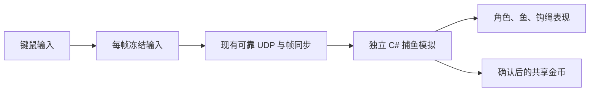

# 钩索小岛：可玩的联机基础版

2026-10-20。Unity 2022.3.62f1，Built-in 管线。

当前实现了 **1～4 人移动、瞄准出钩、捕获跃鱼、拉回岸上和共享金币**。继续使用已批准的岛屿、中央商店、椰子树、码头及动态海面。商店目前提供场景外观；交易、升级、怪物、玩家互钩和存档属于后续玩法。

## 开始试玩

打开 Unity 工程 `samples/TacticalGame.Unity`，加载 `Assets/HookIsland/Scenes/HookIsland.unity`，点击 Play。

- **先自己玩**：直接进入单人房间，使用与多人相同的模拟规则。
- **创建联机房间**：选择 2、3 或 4 人，设置端口。人数到齐后自动开始。
- **加入好友**：输入房主 IPv4 地址和相同端口。玩家编号和颜色自动分配。
- 同机多进程使用 `127.0.0.1`；不同电脑使用房主局域网 IP，默认 UDP 端口 `7778`。
- 按 Esc 打开菜单，可继续捕鱼或离开房间。打开菜单或切换窗口时本地输入停止，房间继续推进。

此版采用固定开局人数。开局后不支持中途加入；任意已入局玩家离开或断线后，本局结束，返回菜单可重新创建。金币在本局内共享，重新开局从零开始。

这是本机和可信局域网 IPv4 直连版本。尚未接入 Steam 邀请、公网中继或 NAT 穿透；不同电脑的局域网连接仍需实际网络环境验证，两端使用同一构建。

| 操作 | 按键 |
| --- | --- |
| 移动 | WASD |
| 瞄准 | 鼠标 |
| 出钩 | 鼠标左键 |
| 提前收回空钩 | 鼠标右键 |
| 缩放视角 | 滚轮 |
| 打开 / 关闭菜单 | Esc |

鱼跃起前出现水圈。把准星移到鱼附近，在鱼离开水面时出钩；命中后自动回收，回到角色所在岸面才结算金币。普通、青色及金色鱼分别提供 10、20、30 金币。右上角显示全队金币，下方显示每个人的捕获数量与贡献。

钩索射程 14 米，飞行速度 18 米/秒，回收速度 24 米/秒。鼠标在空中鱼附近有小范围瞄准辅助，命中仍由同步模拟检查距离与跃起时机。商店与树干会阻挡出钩。角色受岛屿和码头边界约束，不能走入海中；此版没有玩家互撞。

## 运行独立客户端

macOS 开发构建输出为 `artifacts/hook-island-playable/HookIsland.app`，双击后使用相同的房间菜单。

在仓库根目录启动两个真实窗口：

```sh
python3 scripts/run-island-party.py --players 2
```

也可使用 `--players 4` 同机开启四个窗口。脚本自动选择空闲端口。普通试玩窗口保持打开；关闭时可先通过菜单离开房间。

重新构建时，在 Unity Build Settings 中仅选择 `Assets/HookIsland/Scenes/HookIsland.unity`，输出到上述路径。仓库已有 Yard 默认场景列表没有被替换；使用脚本或 MCP 构建时应显式传入小岛场景。自动验收需要 **Development Build**。

## 模拟和表现



| 位置 | 职责 |
| --- | --- |
| `samples/HookIsland.Simulation/` | 毫米整数移动、岸线与码头范围、鱼跃起、钩索扫掠命中、归属和金币；完整状态编码、捕获和恢复 |
| `samples/HookIsland.Network/` | 1～4 人固定房间、自动分配槽位、地图兼容检查、输入冻结与预测、连接清理 |
| `proto/hook-island-room.proto` | 小岛房间 Protobuf 协议，与庭院房间独立 |
| `Assets/HookIsland/Runtime/` | Unity 键鼠、中文菜单、角色与鱼模型、钩绳、水圈、音效与金币提示 |
| `Assets/HookIsland/Editor/HookIslandGameplayBuilder.cs` | 在既有场景中添加玩法入口和连续的码头行走面 |
| `scripts/prepare-hook-island-map.py` | 从 Blender 导出的 156 点海岸线生成碰撞边界、四个出生点及 24 个鱼点 |

逻辑固定为 30 Hz。本地移动读取预测状态以降低操作延迟；钩鱼归属、奖励和音效读取确认状态。同一帧内多个钩子碰到同一条鱼时，按玩家槽位顺序决定唯一捕获者，其他钩子继续飞行；所有玩家获得同一个团队钱包结果。

角色逻辑使用岛岸与码头多边形的并集，加上店铺和树干的阻挡范围。Unity 模型碰撞仅用于读取脚下的视觉高度，木板间隙由 `Pier Walk Surface` 连续碰撞面覆盖，斜坡顶面与可见模型对应。没有让 PhysX 参与共享模拟。

帧同步核心未加入 Unity 或捕鱼依赖，现有庭院示例保留。

## 修改、重建和验证

修改独立模拟或房间代码后，从仓库根目录运行：

```sh
./scripts/sync-hook-island.sh
```

它构建现有核心和小岛示例 DLL、复制到 Unity 的忽略目录，并更新 `IslandMap.bytes`。让 Unity 刷新编译后，再进入 Play。不要直接修改生成 DLL。

如果重建了美术场景，重新运行 **Tools → Hook Island → Set Up Playable Fishing**，添加玩法入口与码头行走面。该操作不会重建岛屿美术。修改岛形、码头位置或商店布局后，需要同步更新地图导出和行走面数据；当前参数对应 v2 小岛。

```sh
# 规则、恢复重放、四客户端真实 UDP、房间兼容和断线检查
./scripts/verify-hook-island.sh

# 仓库完整回归入口，包含上述小岛测试
./scripts/verify.sh

# 四个独立 Unity 进程，正常输入、真实出钩、收鱼，再比较服务器及四端最终快照
python3 scripts/run-island-party.py --players 4 --smoke
```

Unity Test Runner 中选择 EditMode 的 `Advanture.HookIsland.Tests`，检查场景引用、出生点、离岸鱼点与码头衔接。`FishingSmokeDriver` 仅在编辑器或开发构建中提供自动输入；普通试玩不会启用。

日志、客户端截图、验收报告和构建均保存在 `artifacts/hook-island-playable/`，不提交 Git。

## 本次验证结果

2026-10-20 在本机 macOS / Unity 2022.3.62f1 上完成：

- `./scripts/verify.sh` 完整回归通过，包含小岛规则及真实 UDP 的 **8/8** 项检查。
- Unity EditMode 的 **3/3** 项检查通过，包括出生点、离岸鱼点、场景引用和码头连续行走面。
- 四个独立 Unity 客户端经过正常输入、出钩与回收运行至第 **600** 帧，四位玩家分别捕获 **12 / 7 / 17 / 2** 条鱼，全队 **530** 金币。服务器和四个客户端的最终状态哈希一致，均呈现四名角色和 38 次收鱼，最终角色表现位置与模拟位置一致。
- 通过实际菜单进入单人房间；在未启用自动输入的情况下，确认角色移动、出钩和金币累积。检查时为 35 次出钩、25 次捕获、310 金币，Unity Console 无错误或警告。

四端验收记录位于 `artifacts/hook-island-playable/smoke-20261020-204854-5c4660/`，包含各端日志、截图和最终快照摘要。macOS 开发构建已运行通过；跨电脑局域网、Windows 构建与公网连接不在本次实测范围内。
