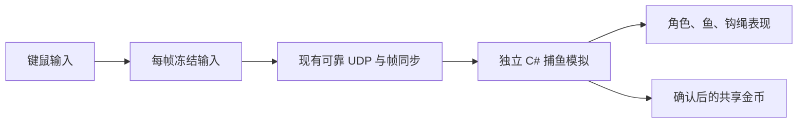

# 钩索小岛：可玩的联机基础版

2026-10-21。Unity 2022.3.62f1，Built-in 管线。

可扩建平台的入口是 `HookPlatform.unity`，木板／鱼骨铺设、材料与联机规则见[平台地块实现](hook-platform-implementation.md)。下文记录原 `HookIsland.unity` 的岛屿玩法和数值。

平台的 31 支钓竿、个人金币购买、捕鱼耐力及恢复规则见[钓竿系统实现](fishing-rods-implementation.md)。格子背包、材料转交、换包与个人钱包见[背包实现](backpack-implementation.md)，角色属性与装备页见[角色实现](hook-character-implementation.md)。

落水、10 级泳圈与救援规则见[落水与游泳实现](swimming-implementation.md)。出钩期间通常限制主动移动，钩住普通鱼或食人鱼回拉时允许以正常速度的 30% 移动；队友拖拽仍可改变位置。联机需使用地图、规则和房间协议一致的构建，旧构建不能混用。防御为持续生效的属性，没有护盾资源；商店新增增加移速的鞋、增加生命上限的衣服和增加防御的帽子，装卸与属性同步见[角色实现](hook-character-implementation.md)。

**单人血量归零时自动扣费复活，金币不足立即失败，不弹救助窗口。多人倒地即可点击“立即复活”**，也可继续等待 **60 秒**免费救援：队友在岸上靠近并按住 **R 3 秒**救起，水中倒地先用钩索拖上岸。报价在倒地时锁定，成功复活只扣一次个人金币；多人全队最终死亡且无人付得起自己的费用时失败。费用和同步见[倒地复活实现](revival-implementation.md)，本次验证与开发包见[即时复活记录](immediate-revival-implementation.md)，食人鱼与水怪见[水怪实现](water-enemies-implementation.md)。失败页由房主点击“全队重新开始”（单人显示“重新开始”），队友无需退房；本局进度恢复初始，详见[重开实现](room-restart-implementation.md)。

当前平台试玩使用 **HookPlatform.unity**：Tab / I 打开角色与背包，E 优先开启附近岸上的大宝箱，否则打开商店，F 拾取，B 建造。**金币归每名玩家自己，购买只扣本人的余额。** 下文的共享金币是旧岛屿实验版的历史规则，不用于平台玩法。

普通鱼和食人鱼支持[合钓与反向抢钓](cooperative-fishing-implementation.md)。[宝箱](treasure-chests-implementation.md)采用独立规则：小箱拉上平台自动回收，大箱至少两根钩才能拉动，抵岸后靠近按 E 开启；单人只刷新小箱和稀有小箱。[共享委托](commissions-implementation.md)按成功捕获推进，完成后自动获得独立团队诱饵。[海域进度](ocean-progression-implementation.md)随委托开放鱼群，久无鱼获或连续处理水怪后提供恢复窗口与可钓普通鱼。当前地图格式 **HIMF**，规则／房间协议版本 **24**，状态格式 **23（HISF）**，输入版本 **11**，旧构建和旧存档不能混用。

2026-10-23 增加[拉鱼时慢速移动](reeling-movement-implementation.md)：钩住普通鱼或食人鱼后，按 **30% 正常移速**移动，默认岸上为 **0.9 米/秒**；合钓主钓和辅助都适用。装备移速或泳速加成先计算，再乘 30%；拉鱼与游泳仍各自扣耐力。空钩、拉物资及拉队友保持原移动限制。

游戏内已使用极简图标 HUD：左上队伍状态、右上个人资源、底部带刻度耐力条，右下为背包／建造／帮助。常驻教学说明已收起，按 **F1** 查看操作指南；布局、资源及验收记录见[极简 HUD](minimal-hud-design.md)。

2026-10-23 试玩后改为 **V 切换俯视角／第三人称**，两个场景均支持。第三人称完整显示人物，镜头默认在右后上方，距脚底高约 2.3 米、向后约 2.8 米、向右 0.6 米。采用类似 CS 的鼠标自由转向，无需按住鼠标键：水平可连续旋转，俯仰可向上／向下各 89°，移动时不自动回正；中心准星瞄准，WASD 按视角方向移动，滚轮拉近／拉远。Esc、Tab / I、E、B 打开对应界面时释放鼠标；关闭后恢复转向，切回俯视保留原缩放。每个客户端独立选择视角；视野 75°、水平灵敏度 1.2、垂直灵敏度 0.9。Inspector 的 `Third Person Pivot Height`（1 米）、`Third Person Distance`（3.1 米）、`Third Person Shoulder Offset`（0.6 米）、`Third Person Field Of View`、`Mouse Look Sensitivity` 和 `Vertical Look Sensitivity Multiplier`（0.75）可继续微调。

第三人称自由转向版 macOS 试玩包：`artifacts/camera-freelook/HookPlatform.app`，Development 构建成功，0 错误、0 警告。本轮将转向入口改为 Input System 鼠标相对位移，保留仅在状态变化时设置鼠标锁定。30 项相关 Editor 测试通过，包含设备事件驱动镜头、完整转向范围、肩后瞄准、转向／调距、游泳镜头位置与双真实 UDP 客户端的一致性。另在实际运行的单人 Controller 中注入相对位移，连续 70 帧记录确认镜头和瞄准方向响应；该验证不等同于人工鼠标手感验收。记录位于 `artifacts/camera-freelook/`，历次变更及验证范围见[视角实施记录](superpowers/plans/2026-10-23-camera-perspectives.md)。

旧岛屿基础版实现了 **1～4 人移动、瞄准出钩、捕获跃鱼、拉回岸上、共享金币、商店升级及队友互钩**。继续使用已批准的岛屿、中央商店、椰子树、码头及动态海面。怪物、抢鱼、落水救援和跨局存档属于后续玩法。

## 开始试玩

打开 Unity 工程 `samples/TacticalGame.Unity`，加载 `Assets/HookIsland/Scenes/HookIsland.unity`，点击 Play。

- **先自己玩**：直接进入单人房间，使用与多人相同的模拟规则。
- **创建联机房间**：选择 2、3 或 4 人，设置端口。人数到齐后自动开始。
- **加入好友**：输入房主 IPv4 地址和相同端口。玩家编号和颜色自动分配。
- 同机多进程使用 `127.0.0.1`；不同电脑使用房主局域网 IP，默认 UDP 端口 `7778`。
- 按 Esc 打开菜单，可继续捕鱼或离开房间。房主还能开启／关闭“友方整蛊”：关闭会释放岸上拖拽，落水救援始终有效；队友可查看当前状态。打开菜单或切换窗口时本地移动与出钩输入停止，房间继续推进。

房间人数为容量；人数到齐自动开始，房主也可点击“现在开始”，其余空位允许好友稍后加入。已入场玩家断线后保留席位，可在同一应用点击“重新连接”，继承当前世界和个人状态；已入场离线身体继续承受危险。房主进程退出仍结束房间，不支持主机迁移。旧小岛金币共享，正式平台钱包归个人；重新开局清零本局资源。详见 [恢复实现](live-room-recovery-implementation.md)。

这是本机和可信局域网 IPv4 直连版本。尚未接入 Steam 邀请、公网中继或 NAT 穿透；不同电脑的局域网连接仍需实际网络环境验证，两端使用同一构建。

| 操作 | 按键 |
| --- | --- |
| 移动 | WASD；第三人称按视角方向 |
| 瞄准 | 俯视角鼠标指向；第三人称鼠标转向、中心准星 |
| 切换俯视角 / 第三人称 | V |
| 出钩捕鱼或拉队友 | 鼠标左键 |
| 提前收回空钩 / 放开队友 | 鼠标右键 |
| 靠近商店后打开 / 关闭商店 | E |
| 俯视角缩放 / 第三人称拉近拉远 | 滚轮 |
| 关闭商店；商店未打开时切换菜单 | Esc |

先观察水下移动的鱼影和尾迹，再朝鱼的前方预判出钩。鱼先潜游约 2 秒、前进 2.4 米，接着向前跃出约 1.6 秒、飞行 3.6 米，再落水潜行约 1 秒；整段航线长 7.2 米，在水下折返。起跳前有水圈，落水时有扩散水花。只有跃出水面且高度超过约 0.3 米时能够钩中，水下鱼影不能直接捕获。

鱼群分为三档，每档 8 条，按整个游动路线到岛岸及码头的最近距离检查：

| 鱼群 | 距离陆地至少 | 单条奖励 | 所需射程等级 |
| --- | --- | --- | --- |
| 近海橙鱼 | 6 米 | 10 G | 初始 Lv.0，需靠近岸边 |
| 中海青鱼 | 10.4 米 | 20 G | Lv.1 |
| 远海金鱼 | 14.8 米 | 30 G | Lv.2 |

远处鱼群开局即可出现，但不会游进上一档装备的射程；提升射程能够解锁新的捕鱼区域。Lv.3 提供更宽松的站位。命中后自动回收，回到角色所在岸面才结算金币。右上角显示全队金币，下方显示每个人的捕获数量与贡献。

钩索初始射程 **8 米**、出钩速度 **9 米/秒**，收鱼和空钩回收速度 **12 米/秒**。鱼的鼠标瞄准辅助缩小到 14 像素，不会自动计算提前量；队友瞄准辅助保持原有范围。商店与树干会阻挡出钩。角色受岛屿和码头边界约束，不能走入海中；此版没有玩家互撞。默认视角略拉远，可用滚轮在正交尺寸 12～28 之间缩放，观察外围鱼群。

## 队友互钩

把鼠标移到队友身上，按 **左键**。钩索碰到队友后，自动以 **12 米/秒** 将其拉向自己，距离约 **1 米** 时松开；已在身边 1 米以内的队友不再重复钩住。出钩后施钩者不能主动移动，按 **右键** 可提前放开，等空钩收回后恢复移动。

- 被拉期间暂时不能移动或新出钩，最多持续 2 秒；已经钩住的鱼继续回收并正常结算。
- 拖拽沿途检查岛岸、码头、商店和树干，遇到不可站立的位置便停止并放开，不会穿过窄水湾或障碍。
- 放开后有 **3 秒防连续拖拽保护**，脚下显示浅青色光圈和保护倒计时。商店打开期间也受保护，关闭后结束购物保护。
- 同一个人只能被一根钩索拉住；正在拉人的玩家暂时不能被另一根钩索钩住，防止循环互拉。多人同时抢同一目标按同步的槽位顺序裁定。
- 命中沿飞行线首先碰到的有效目标。拉人时绳索变橙色，被拉者倾斜身体、摆腿，并显示拉拽者编号；双方播放命中音效。

互钩不造成伤害、不扣金币，也不增加捕鱼奖励。射程和出钩速度升级同样适用于钩队友，拖拽速度保持 12 米/秒。当前默认开启友方钩索，房主开关仍属后续设计。

## 商店升级

靠近中央商店，在提示出现后按 **E** 打开商店，点击升级按钮购买。商店四周都能交互，交互半径为距店铺中心 4.2 米。打开商店会停止自己的移动和出钩，并获得同步的购物保护，全局及好友的捕鱼继续进行。正在拉人或被拉期间不能打开商店。

| 等级 | 延长钩索：射程 | 加速出钩：速度 | 每条升级路线的购买费用 |
| --- | --- | --- | --- |
| Lv.0 | 8 米 | 9 米/秒 | 初始 |
| Lv.1 | 12 米 | 12 米/秒 | 50 G |
| Lv.2 | 16 米 | 15 米/秒 | 100 G |
| Lv.3 | 20 米 | 18 米/秒 | 180 G |

两项分别升级，费用从**全队共享钱包**扣除，能力仅提升购买者的钩索。买齐某一项共花费 330 G；回收速度维持 12 米/秒。射程升级开放更远的鱼群，速度升级缩短飞行时间、降低预判难度。队伍栏显示所有玩家的等级。贡献金币表示该玩家累计赚取的金额，不随消费减少；右上角显示当前可用余额。

金币不足、达到 Lv.3 或钩索尚未收回时，购买按钮不可用。离开交互范围会自动关闭面板。购买请求携带同一编号重发到同步确认，避免某帧输入超时后卡在“购买中”；重复请求只结算一次。同一帧多人争用不足以支付全部订单的余额时，按玩家槽位顺序结算，余额不会变为负数。

## 运行独立客户端

macOS 开发构建输出为 `artifacts/hook-island-playable/HookIsland.app`，双击后使用相同的房间菜单。

在仓库根目录启动两个真实窗口：

```sh
python3 scripts/run-island-party.py --players 2
```

也可使用 `--players 4` 同机开启四个窗口。脚本自动选择空闲端口。普通试玩窗口保持打开；关闭时可先通过菜单离开房间。

重新构建时，在 Unity Build Settings 中仅选择 `Assets/HookIsland/Scenes/HookIsland.unity`，输出到上述路径。仓库已有 Yard 默认场景列表没有被替换；使用脚本或 MCP 构建时应显式传入小岛场景。自动验收需要 **Development Build**。

## 模拟和表现



| 位置 | 职责 |
| --- | --- |
| `samples/HookIsland.Simulation/` | 毫米整数移动、岸线与码头范围、鱼跃起、钩索扫掠命中、队友拉拽与保护、归属和金币；商店价格、购买规则、个人等级及完整状态恢复 |
| `samples/HookIsland.Network/` | 1～4 人固定房间、自动分配槽位、地图兼容检查、输入冻结与预测、连接清理 |
| `proto/hook-island-room.proto` | 小岛房间 Protobuf 协议，与庭院房间独立 |
| `Assets/HookIsland/Runtime/` | Unity 键鼠、中文菜单与商店面板、角色与鱼模型、钩绳、水圈、音效与金币提示 |
| `Assets/HookIsland/Editor/Scenes/HookIslandGameplayBuilder.cs` | 在既有场景中添加玩法入口和连续的码头行走面 |
| `scripts/prepare-hook-island-map.py` | 从 Blender 导出的 156 点海岸线生成碰撞边界、四个出生点及 24 个鱼点 |

逻辑固定为 30 Hz。本地移动读取预测状态以降低操作延迟；钩鱼归属、奖励和音效读取确认状态。同一帧内多个钩子碰到同一条鱼时，按玩家槽位顺序决定唯一捕获者，其他钩子继续飞行；所有玩家获得同一个团队钱包结果。

升级种类、单调递增的购买编号和购物状态纳入同步输入。距离、钩索状态、费用、上限和重复请求检查均在独立模拟执行；界面只展示确认后的扣款和等级。快照包含个人等级、购买回执、拉拽归属、持续帧数、保护倒计时、购物状态，以及鱼的游动方向和阶段计时，恢复重放不会丢失游动轨迹。当前房间、规则和状态版本为 **4**，输入版本保持 **3**、18 字节；新版离岸游鱼不能与之前的构建混用联机。

互钩碰撞和拉拽均在 30 Hz 整数模拟内执行，不直接同步 Unity Transform。参与拉拽的角色使用确认位置表现，避免仅预测自己移动时抵消队友拖拽。扫掠碰撞按实际进入目标碰撞范围的先后顺序处理，高速升级也不会跳过玩家或树干。

角色逻辑使用岛岸与码头多边形的并集，加上店铺和树干的阻挡范围。Unity 模型碰撞仅用于读取脚下的视觉高度，木板间隙由 `Pier Walk Surface` 连续碰撞面覆盖，斜坡顶面与可见模型对应。没有让 PhysX 参与共享模拟。

帧同步核心未加入 Unity 或捕鱼依赖，现有庭院示例保留。

## 修改、重建和验证

修改独立模拟或房间代码后，从仓库根目录运行：

```sh
./scripts/sync-hook-island.sh
```

它构建现有核心和小岛示例 DLL、复制到 Unity 的忽略目录，并更新 `IslandMap.bytes`。让 Unity 刷新编译后，再进入 Play。不要直接修改生成 DLL。

如果重建了美术场景，重新运行 **Tools → Hook Island → Set Up Playable Fishing**，添加玩法入口与码头行走面。该操作不会重建岛屿美术。修改岛形、码头位置或商店布局后，需要同步更新地图导出和行走面数据；当前参数对应 v2 小岛。

```sh
# 规则、恢复重放、四客户端真实 UDP、房间兼容和断线检查
./scripts/verify-hook-island.sh

# 仓库完整回归入口，包含上述小岛测试
./scripts/verify.sh

# 四个独立 Unity 进程，正常输入、真实出钩、收鱼，再比较服务器及四端最终快照
python3 scripts/run-island-party.py --players 4 --smoke

# 四端实际捕鱼赚钱、回商店购买两种升级、升级后继续捕鱼，并检查钱包和最终状态
python3 scripts/run-island-party.py --players 4 --shop

# 四端先捕鱼，再两两互钩、交换角色，检查拉拽、保护、释放和最终状态
python3 scripts/run-island-party.py --players 4 --prank
```

Unity Test Runner 中选择 EditMode 的 `Advanture.HookIsland.Tests`，检查场景引用、出生点、离岸鱼点、码头衔接与商店交互区。`FishingSmokeDriver` 仅编译进编辑器或开发构建，并且仅在 `HookIsland` 场景显式提供 `-island-report` 后临时挂载；正式场景不常驻此组件，发布包不含该类型。自动输入会走到岸边并预判移动鱼的位置。商店验收使用实际捕鱼收入及正式购买入口，升级后专门瞄准中海鱼；互钩验收也通过实际移动、瞄准和出钩输入完成，不直接设置位置、奖励或拉拽状态。

日志、客户端截图、验收报告和构建均保存在 `artifacts/hook-island-playable/`，不提交 Git。

## 本次验证结果

2026-10-21 完成离岸游鱼与难度调整验证：

- `./scripts/verify.sh` 完整回归通过，小岛规则及真实 UDP 检查 **42/42** 通过。新增覆盖潜游距离、向前跃起与连续落水、初始装备实际距离和速度、方向及阶段恢复、整条航线的装备门槛、水下不能捕获，以及升级后真实命中移动鱼。升级后可达性也检查了鱼跃出水面的有效捕获窗口。
- Unity 编译无错误，EditMode 检查 **5/5** 通过。新增的“首帧购买输入超时”用例先复现原有购买卡住问题，修复为同一编号重发后通过；购买去重和共享钱包仍由模拟保证。
- 四个独立 Unity 客户端使用初始装备捕鱼，至第 **600** 帧累计捕获 **9 条**近海鱼、获得 **90 G**。四端均观察到潜游和向前跃起，服务器及四端最终快照一致。
- 四端商店验收至第 **2374** 帧完成：每人买到射程 / 速度 Lv.1，随后分别捕获新解锁的中海青鱼，按玩家槽位顺序为 **1 / 1 / 2 / 1 条**。全局累计赚取 **500 G**、消费 **400 G**、余额 **100 G**，服务器及四端快照一致。修正了自动试玩选中同一鱼群导致抢鱼等待的选点逻辑，未直接设置金币、位置或捕获结果。
- 新数值下的四端互钩回归至第 **1207** 帧完成，每人钩中和被钩各一次，均已释放；四端观察到拉拽与保护，服务器及四端快照一致，表现位置误差小于 0.25 米。互钩前获得的 **90 G** 没有因拉人变化。
- 已检查实机捕鱼、商店和互钩截图：水下鱼影与尾迹可见，鱼群明显离岸，远海金鱼可作为升级目标；商店正确显示 12 → 16 米、12 → 15 米/秒及解锁提示。三组成功验收的客户端日志没有运行异常。
- 已更新 macOS 开发构建，0 错误、1 条 Unity “uncompiled code changes” 提示；上述商店与互钩验收使用最终构建，确认新运动、数值和购买重试已进入产物。编辑器停留在小岛场景的 Edit Mode，可直接 Play。

记录位于 `artifacts/hook-island-playable/`：

- 基础捕鱼：`smoke-20261021-114554-b7475f/`
- 升级解锁：`shop-smoke-20261021-115623-689de0/`
- 互钩回归：`prank-smoke-20261021-115837-1d4430/`
- 完整回归：`fishing-difficulty-full-verification.log`

本次多人实测为同机四个独立进程，通过正式输入和真实 UDP 运行；跨电脑、Windows、公网连接未列为已验证。

### 上一版互钩验证记录

2026-10-21 完成互钩版验证：

- `./scripts/verify.sh` 完整回归通过，其中小岛玩法和真实 UDP 检查 **35/35** 通过。新增覆盖相互出钩不形成循环、同时争抢唯一归属、右键释放、受害者输入限制、购物与短时保护、快速钩索命中顺序、凹形海岸及障碍阻挡、已有鱼奖励保留、持续时间上限、恢复重放和四客户端互钩一致性。
- Unity 编译无错误，场景 EditMode 检查 **4/4** 通过。macOS 开发构建成功，0 错误、1 条与商店版相同的 “uncompiled code changes” 构建提示；以下实机验收使用本次构建，确认新的互钩表现与状态已进入产物。
- **四个独立 Unity 进程**先各自捕鱼，再两两互钩并交换角色，运行至第 **600** 帧。每人钩中队友一次、被钩一次；全部已释放，四端都观察到拉拽和保护。服务器与四端最终快照哈希一致，各端呈现四次玩家钩中，最终角色位置误差小于 0.001 米。共享 **160 G** 全部来自十次捕鱼，互钩没有额外奖励。
- 用同一构建重新跑四端商店回归，至第 **930** 帧，四人均买到两项 Lv.1 升级并继续捕鱼；累计赚取 **890 G**、消费 **400 G**、余额 **490 G**。服务器与四端最终快照一致，升级后的本地捕获数分别为 **9 / 7 / 2 / 11**。
- 已检查互钩实机截图：橙色钩绳连接玩家、被拉姿态及编号、右键释放提示显示正常。两组四端日志均无运行异常。

互钩记录：`artifacts/hook-island-playable/prank-smoke-20261021-112342-b78843/`；商店回归：`artifacts/hook-island-playable/shop-smoke-20261021-112502-b5d52f/`；完整回归日志：`artifacts/hook-island-playable/player-hook-full-verification.log`。本次多人实测为同机独立进程，通过正式输入采样和真实 UDP 运行；未将跨电脑、Windows 或公网联机列为已验证。

### 上一版商店验证记录

2026-10-20 在本机 macOS / Unity 2022.3.62f1 上完成商店版验证：

- `./scripts/verify.sh` 完整回归通过，包含小岛规则及真实 UDP 的 **18/18** 项检查。覆盖同时购买不超扣、重复请求不重复收费、距离与钩索状态限制、满级、余额不足、实际飞行距离和速度、快照恢复与四端升级同步。
- Unity EditMode 的 **4/4** 项检查通过，包括出生点、离岸鱼点、场景引用、码头连续行走面和商店四侧可接近范围。
- 四个独立 Unity 客户端完成捕鱼、靠近商店、购买两项 Lv.1 升级及升级后继续捕鱼，运行至第 **2897** 帧。累计赚取 **2550 G**，四人共花费 **400 G**，共享余额 **2150 G**；四人升级后分别继续捕获 **59 / 2 / 61 / 1** 条鱼。
- 服务器和四个客户端的最终状态哈希一致，各端都呈现四名角色与累计 171 次收鱼，角色表现位置与模拟位置误差小于 0.001 米。四端日志无运行异常，商店截图中的数值、购买成功提示与队伍等级显示正常。
- macOS 开发构建成功，0 错误、1 条 Unity “uncompiled code changes” 构建提示；上述完整四端验收使用该产物，确认新版商店与升级效果已进入构建。此次未修改资源导入器或构建后处理器。

商店四端验收记录位于 `artifacts/hook-island-playable/shop-smoke-20261020-212259-9a99eb/`，包含各端日志、截图和最终快照摘要；完整回归日志为 `artifacts/hook-island-playable/shop-full-verification.log`。独立构建中的商店界面已通过截图检查；本轮原生键鼠补充检查因 macOS 锁屏未完成，未将其计入验证结果。跨电脑局域网、Windows 构建与公网连接不在本次实测范围内。
