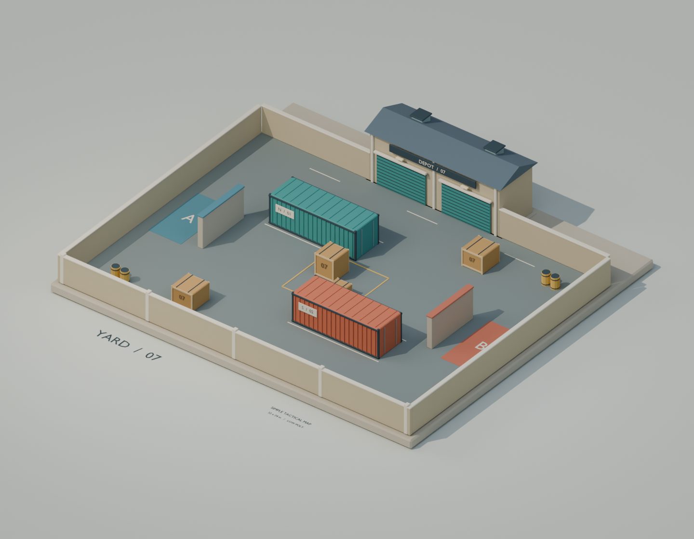
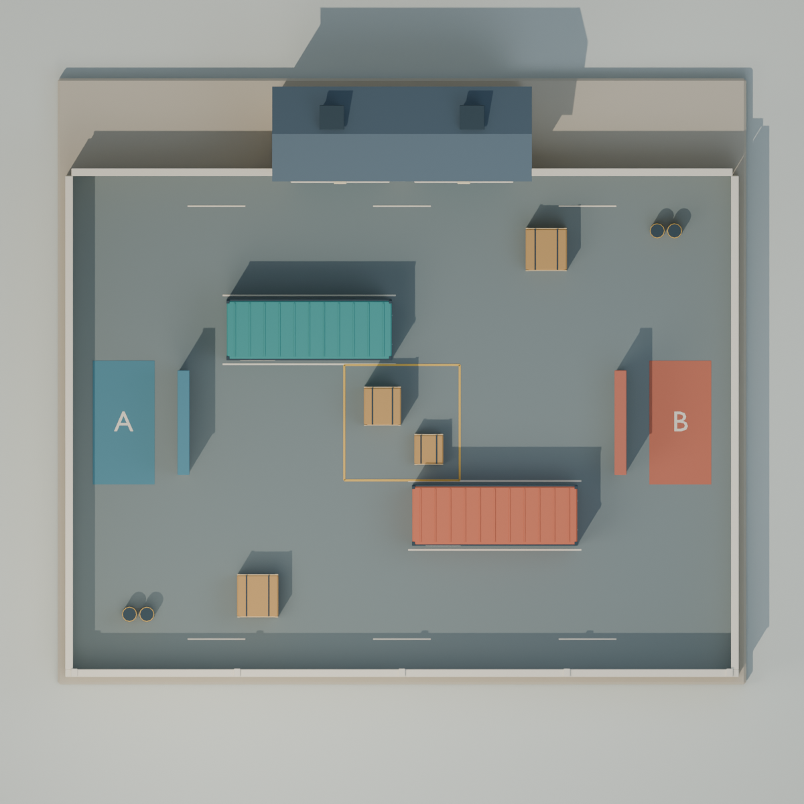

# 七号转运站：简单地图设计

这是一张用于后续第一人称射击原型的低多边形工业庭院，先验证跑动、观察和绕掩体射击。它是独立的静态地图资源，不依赖帧同步框架或游戏引擎。



## 第一版布局

活动区为 **32 × 24 米**，全部在同一平面，暂按 2～4 人测试。左右各有一个出生区，两端可绕过遮挡墙离开，出生点之间没有直接视线。

场内只有两个错开的集装箱、中央一高一低两个箱子，以及南北两侧各一个箱子。玩家可以从中央或集装箱外侧绕行。北侧仓库只做封闭外观，不做室内、二层和可到达屋顶。中央黄线只标记交战参考区，暂不实现爆破规则。

示意如下；精确摆放以 Blender 模型和俯视图为准：

```text
               北侧封闭仓库
    ┌──────────────────────────────┐
    │          北侧绕行      □     │
    │     [青色集装箱]             │
    │ A  │          ▣              │
    │出生│          ▫          │ B │
    │    │                     │出生│
    │              [橙色集装箱]    │
    │     □     南侧绕行           │
    └──────────────────────────────┘
```



## 尺寸和美术

- 以 1 Blender 单位 = 1 米制作；X/Y 为地面，Z 为高度。
- 集装箱为 8 × 2.8 × 2.65 米。中央高掩体高 2 米，低掩体高 1.05 米。出生区遮挡墙高 2.8 米。
- 角色暂按身高 1.8 米、视线高 1.65 米、碰撞半径 0.35 米考虑。这是这张地图的设计假设。
- 使用青色、橙色集装箱帮助识别方位；米色墙体、简化木箱和少量黄色标线保持场地清楚。使用纯色材质和少量倒角，不依赖外部贴图。

## 文件与后续接入

资源位于 `samples/TacticalMap/`，包含可编辑 Blender 文件、GLB/FBX 模型、单独的盒形碰撞体、两个出生标记和预览图。房屋、集装箱、掩体、标线分别管理，可以直接移动或删减。

这次只完成地图设计和建模。角色控制、射击、导航、联网以及实际对战平衡属于后续工作。静态检查会核对出生点通路、直接视线遮挡和导出结构；这些检查不能代替实际游戏试玩。接入后首先检查移动速度、角色尺寸和绕箱时的视野，再调整掩体位置。

## 本次验证

已在 Blender 5.2.1 LTS 生成并打开模型。可视模型共 10,952 个三角形，单独保存 17 个盒形碰撞体。静态检查通过：两侧出生点与中央、南北参考点连通，站立高度下出生点之间有直接视线遮挡。GLB 与 FBX 重新导入后，集装箱尺寸和出生点位置保持一致。实际角色移动和对战平衡仍待接入游戏后试玩。
