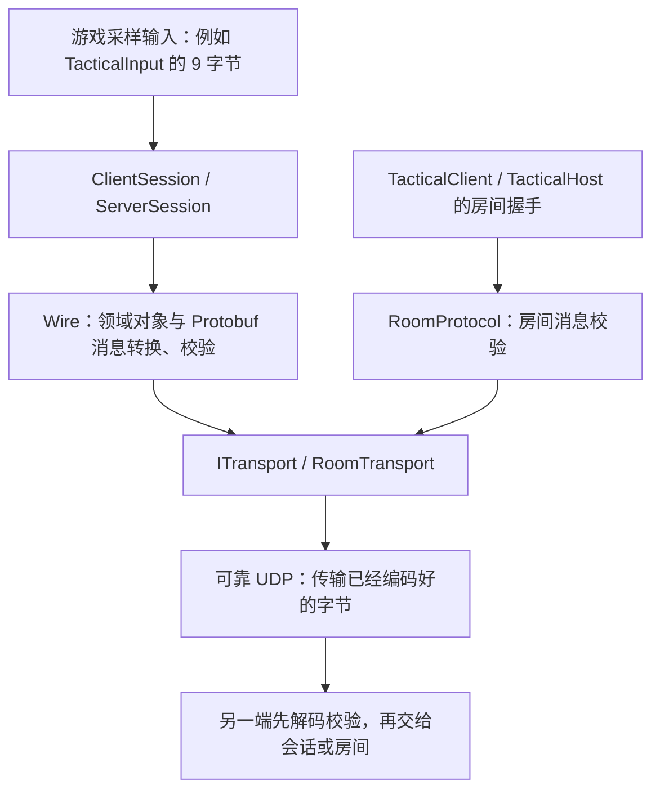

# Protobuf 房间与帧同步协议

本次替换的是“消息如何变成网络字节”。房间握手和帧同步消息都采用 Protobuf，版本号为 3；可靠 UDP 继续负责连接、重传、分片和有序交付。输入冻结、预测、回滚、确认帧和状态摘要的规则保持原样。

## 数据从哪里走



Protobuf 可以理解为按一张“字段清单”装箱和拆箱。清单就是 `.proto` 文件；工具从清单生成 C# 消息类。`oneof` 表示外壳中的消息类型，例如一条包是输入、确认帧或关闭通知中的一种。它不负责网络送达，也不负责保证各端模拟结果一致。

| 数据 | 当前处理方式 |
| --- | --- |
| 加入、欢迎、欢迎确认、拒绝 | 游戏示例自己的 `room.proto` |
| 初始快照分块、Ready、Start、输入、最终帧、进度、结束、失败 | 通用框架的 `session.proto` |
| 可靠 UDP 包头、确认、分片、重传 | 原有 ReliableUdp，格式未改 |
| 游戏输入 | 原始 `bytes payload`，不改变游戏自己的编码 |
| 检查点、存档、录制 | 原有 `CheckpointCodec`、`SaveCodec`、`ReplayCodec`，格式未改 |
| 确定性状态摘要 | 继续针对规范检查点字节计算 SHA-256，不对 Protobuf 包计算 |

## 协议文件目录

所有手写 `.proto` 文件统一放在仓库根目录的 [proto/](../proto/README.md)：

```text
proto/
├── session.proto   # 通用帧同步会话协议
└── room.proto      # 庭院试玩房间协议
```

两个项目直接引用这里的源文件，各自只生成自己的消息类型。新增协议也放到此目录，并在所属项目的 `.csproj` 中明确列出，保持框架与游戏的依赖边界。

## 源码阅读顺序

| 顺序 | 文件 | 职责 |
| --- | --- | --- |
| 1 | [session.proto](../proto/session.proto) | 会话消息的字段和类型；含中文字段注释 |
| 2 | [ProtobufCodec.cs](../framework/src/FrameSync.Protocol.Protobuf/ProtobufCodec.cs) | 编码前检查大小、解码前限制包长、统一解析错误 |
| 3 | [Wire.cs](../framework/src/FrameSync.Sessions/Wire.cs) | 消息与不可变领域对象转换、字段校验、最终帧比较、最大容量计算 |
| 4 | [ClientSession.cs](../framework/src/FrameSync.Sessions/ClientSession.cs) / [ServerSession.cs](../framework/src/FrameSync.Sessions/ServerSession.cs) | 收发转换后的消息，沿用原有会话状态机和帧执行流程 |
| 5 | [room.proto](../proto/room.proto) / [RoomProtocol.cs](../samples/TacticalGame.Network/RoomProtocol.cs) | 示例房间的加入、地图摘要和身份检查 |
| 6 | [ProtobufSessionTests.cs](../framework/tests/FrameSync.Tests/ProtobufSessionTests.cs) / [RoomProtocolTests.cs](../tools/TacticalGame.Tests/RoomProtocolTests.cs) | 协议边界和真实会话、UDP 入房回归测试 |

`FrameSync.Protocol.Protobuf` 是独立的 `netstandard2.1` 模块，只依赖 Protobuf 运行库。`FrameSync.Sessions` 使用它，模拟接口和运行器不依赖它。地图和房间规则仍在 `samples/TacticalGame.Network`，没有搬进核心。

## 消息里主要放什么

每条会话消息都有协议版本、16 字节会话身份和运行编号 `epoch`。运行编号用于隔离旧运行的迟到输入；Guid 字节继续使用 `.NET Guid.ToByteArray` 顺序。不同消息使用不同的正文。

| 消息 | 正文 | 可靠有序通道 |
| --- | --- | --- |
| Snapshot | 分配位置、总长、分块偏移、原始检查点字节 | 3 |
| Ready | 初态摘要、客户端未来帧缓存窗口 | 1 |
| Start | 初态摘要 | 1 |
| Input | 目标帧、玩家位置、控制权版本、游戏输入字节 | 0 |
| Final | 确认帧号、按位置排序的所有输入、成员事件、状态摘要 | 0 |
| Progress / Close / Fault | 已执行、结束或失败时的帧号 | 1 |
| 房间消息 | 加入位置、地图摘要，或欢迎身份、确认、拒绝原因 | 2 |

输入的 `origin` 表示真实提交还是服务器缺失补位。成员事件的 `generation` 表示控制权版本。所有这些原本会影响模拟的字段都保留，不能只传输入内容而遗漏来源或成员变化。

## 校验为什么还要自己写

能被 Protobuf 解码，不代表消息可以执行。当前实现继续检查：版本和会话身份、通道、阶段、帧窗口、输入截止时间、位置归属、控制权版本、输入规范格式，以及初态和最终状态摘要。

接收前限制整个包大小；接收后检查输入字节数、人数、枚举值、严格递增的位置、成员事件顺序、32 字节摘要，以及快照的总长、偏移和块大小。声明的快照总长合法后才分配完整缓冲区。将整数转换为较小类型前先检查范围，避免例如 257 被截断成合法的枚举值 1。坏客户端消息被服务器拒绝；不合法的服务器消息使客户端结束会话并记录原因。

同一个 Protobuf 消息可以采用不同字段顺序，所以不能继续用网络包逐字节比较判断重复帧。[官方编码说明](https://protobuf.dev/programming-guides/encoding/)解释了字段编号、长度前缀和编码顺序。当前 `FinalFrame.SameAs` 比较会话、帧号、每个输入的位置/版本/来源/字节、成员事件以及状态摘要。相同含义的重复帧被忽略，真正改了字段的重复帧仍使客户端失败。未知扩展字段解码后丢弃，不进入模拟或状态摘要。

Protobuf 整数和长度前缀占用的字节数会变化。`Wire.MaxFinalMessageBytes` 和 `MaxSnapshotMessageBytes` 按最大值计算预算；实际发送前再用生成类的 `CalculateSize()` 检查完整包大小。服务器仍先确认广播队列有空间，再执行下一帧。

## 构建和 Unity 导入

固定使用 `Google.Protobuf 3.36.2` 与 `Grpc.Tools 2.84.0`。`Grpc.Tools` 只运行代码生成器，配置了 `GrpcServices="None"` 和 `PrivateAssets="all"`，没有引入 gRPC 通信。项目通过 `Protobuf Include` 引用统一目录，并用 `ProtoRoot` 指定协议根目录。生成的 C# 分别位于 `framework/src/FrameSync.Protocol.Protobuf/obj/Release/netstandard2.1/Session.cs` 和 `samples/TacticalGame.Network/obj/Release/netstandard2.1/Room.cs`；修改 `proto/` 中的定义后，普通 `dotnet build` 自动重新生成，不编辑或提交生成文件。

```sh
dotnet build framework/FrameSync.sln -c Release
./scripts/verify.sh
./scripts/sync-unity-libraries.sh
```

首次构建需要 NuGet 网络访问，缓存写入仓库 `.build/nuget`。同步脚本复制协议程序集、Protobuf 和 Unsafe 运行库；代码生成器不会进入游戏。许可证保存在 [Unity 包第三方声明](../adapters/Unity/ThirdPartyNotices.md)。

Unity 工程无需安装 Protobuf 插件，也无需把 Unity 类型传给框架。以后其他游戏可引用同一套 Sessions/Protocol 程序集，另行定义自己的游戏输入和房间流程。

## 协议后续如何修改

新增可选的辅助字段可以保留现有版本；字段编号不能改含义，删除后应使用 `reserved` 保留编号。未知消息类型会被拒绝，未知枚举不会被当成默认值执行。会影响模拟结果或握手规则的改动仍需提高协议版本，不能依赖“旧端能跳过字段”就认为可混用。

v3 不兼容旧版手写网络包，所有参与联机的程序要一起更新；没有保留双协议自动探测。原有游戏输入、检查点、存档和录制版本无需升级。

## 本次验证

2026-10-19 在 macOS 执行完整 `./scripts/verify.sh` 成功，共 262 项控制台测试通过：核心 131、存储 23、示例/命令行 24、同步工具 6、可靠 UDP 30、UDP 集成 16、游戏示例 32。其中新协议测试为 22 + 9 项。

另完成两种模型各 100000 帧保存恢复和独立进程重放、各 10000 帧四客户端同步、故障网络预测回滚与成员停用。迁移前后的两份检查点和两份输入录制逐字节相同；新构建重放迁移前的 100000 帧录制，摘要与旧结果一致。

完整日志在 `artifacts/protobuf/verify.log`，旧录制重放报告在同目录的 `legacy-counter-replay.json` 和 `legacy-grid-replay.json`。Unity EditMode 22 项通过，macOS 构建 0 错误/0 警告，两个独立 Unity 客户端完成 360 帧自动对战，三端摘要一致且无不同步。详细结果见 [试玩验证记录](../samples/TacticalGame.Unity/VERIFICATION.md)。Windows、IL2CPP 和跨机器网络验证仍按原计划后置。
