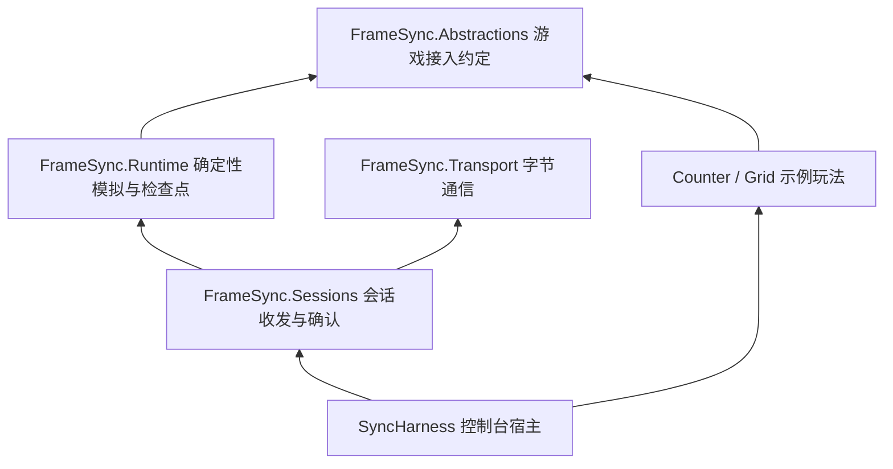

# 阶段 B：服务器与客户端的首个可运行闭环

> 2026-10-15 更新：本文保留阶段 B 首个通信闭环的说明和当时测试数量。当前已补齐确定性成员事件、停用、预测回滚和保存重开；最新接口与限制见 [C/D 实现说明](stage-c-d-implementation.md)。

本次完成的是阶段 B 的第一部分：一个服务器和 1～4 个客户端各自计算，通过字节消息收集和广播输入。默认演示两个客户端，A 输入 +5，B 收到同一帧输入并执行，三端结果都是 5；再由 B 输入 +3，三端结果都是 8。

这里的服务器和客户端是**同一进程里的独立对象与独立世界**。它们通过内存传输端点收发字节，不共享可变游戏状态。启动多个终端进行网络连接要等阶段 E 的 UDP 适配器；当前没有真实 Socket、Unity 或 Steam 依赖。

## 1. 先运行，再读代码

在仓库根目录执行：

```bash
cd /Users/lizujin/Documents/project/git_project/Advanture
dotnet run --project tools/SyncHarness -c Release
```

关键输出：

```text
B 收到 A 输入: +5
frame=1 server=5 A=5 B=5 一致
A 收到 B 输入: +3
frame=2 server=8 A=8 B=8 一致
PASS game=counter clients=2 frames=2 hash=...
```

收到的输入来自客户端的 `LastFrame`，不是回显输入文本。“一致”同时验证完整检查点字节、确认帧号和游戏事件；还用工具独立计算的预期值校验示例结果。

手动操作：

```bash
dotnet run --project tools/SyncHarness -c Release -- --interactive
```

依次输入 `a 5`、`b 3`、`a -2`，观察全部客户端的状态。`q` 或输入结束关闭房间。每行推进一帧，未操作者使用中性输入；这是可观察的逐步演示，没有连接真实键盘驱动或后台定时器。

切换另一种玩法或人数，框架代码不用修改：

```bash
dotnet run --project tools/SyncHarness -c Release -- --game grid --clients 4 --frames 10000
dotnet run --project tools/SyncHarness -c Release -- --game counter --clients 1 --frames 10000
```

## 2. 分层和文件职责



通信库没有引用游戏接口；会话库知道输入是字节，不知道什么是移动、装备或技能。`TState` 由游戏定义，不是框架里的通用世界对象。

| 文件 | 承担的功能 | 建议阅读顺序 |
| --- | --- | --- |
| `tools/SyncHarness/DemoApp.cs` | 解析命令、把示例输入变为字节、显示各端结果 | 1 |
| `tools/SyncHarness/DemoWorld.cs` | 创建独立服务器和客户端，驱动虚拟时间，验证状态与事件 | 2 |
| `framework/src/FrameSync.Transport/ITransport.cs` | 定义连接编号、通道、交付要求与发送背压 | 3 |
| `framework/src/FrameSync.Transport/InMemoryNetwork.cs` | 独立收件箱、消息复制、队列数量和字节限制 | 4 |
| `framework/src/FrameSync.Sessions/SessionContracts.cs` | 会话生命周期、宿主验证过的连接与位置绑定 | 5 |
| `framework/src/FrameSync.Sessions/SessionOptions.cs` | 帧窗口、工作量、消息大小、队列和准备超时限制 | 6 |
| `framework/src/FrameSync.Sessions/ServerSession.cs` | 开局分发、输入校验、截止组帧、参考计算、广播与关闭 | 7 |
| `framework/src/FrameSync.Sessions/ClientSession.cs` | 初态恢复、冻结本地输入、按确认帧执行、核对状态、反馈进度 | 8 |
| `framework/src/FrameSync.Sessions/Wire.cs` | 明确版本的二进制格式、长度检查、完整输入帧编码 | 9 |
| `framework/src/FrameSync.Sessions/Outbox.cs` | 有界待发队列，传输暂时不能接收时保留原消息重试 | 10 |
| `framework/tests/FrameSync.Tests/Session*.cs` | 正常流程、时间与身份边界、慢客户端、错误与一致性测试 | 随对应模块阅读 |

阶段 A 的 `SimulationRunner` 仍然只接受一整帧合法输入并计算。网络等待、连接身份和截止时间都放在新的会话层，没有把网络职责塞进游戏模拟。

## 3. 开局怎样建立相同的世界

1. 宿主提供固定名单，以及每条连接能控制哪个位置。连接编号不是玩家编号；稳定玩家身份、位置和控制代数分别保留。
2. 服务器新建自己的模拟，捕获第 0 帧完整检查点。检查点包含初始化参数、游戏版本、名单、容量与游戏状态。
3. 服务器按块发送检查点，默认每块数据最多 16 KiB。发送失败就保留当前位置，下次继续，不同时排队所有玩家的整份大快照。
4. 客户端先检查总大小、分块位置和完整检查点校验值，再检查游戏兼容信息。用检查点初始化参数新建自己的模拟并恢复。
5. 客户端回复 `Ready`，表示初态已恢复，同时声明自己可以缓存多少帧。
6. 服务器确认所有客户端准备完毕，广播 `Start` 并确定自己的起始时间。任何一人没准备好，都不会计算第 1 帧。

本次把连接验证和名单分配交给宿主。还没有大厅发现、登录认证、邀请或途中加入流程。准备超过默认 10 秒时服务器进入失败状态，不会绕过缺少的客户端直接开局。

## 4. A 输入怎样到达 B

以 10 帧/秒的演示为例，服务器开始于 0 ms，第 1 帧截止于 100 ms：

| 时刻/步骤 | A | 服务器 | B |
| --- | --- | --- | --- |
| 截止前 | `TrySubmit(1, +5)`，冻结一份输入字节 | 尚未计算 | 尚未计算 |
| 收包 | 发送输入 | 按真实连接检查位置、控制代数、会话和帧号，保存第一次接受的字节 | 尚未计算 |
| 100 ms | 等待确认 | 收集 A 的 +5；B 没提交则用 B 的中性输入，计算第 1 帧 | 等待确认 |
| 广播 | 收到完整确认帧 | 广播输入、来源标记和完整状态摘要 | 收到包含 A +5 的完整确认帧 |
| 执行 | 本地执行并核对摘要 | 已确认第 1 帧 | 本地执行 +5 并核对摘要 |
| 反馈 | 返回本次帧事件并反馈进度 | 记录各客户端已执行到第几帧 | 返回本次帧事件并反馈进度 |

`TrySubmit` 返回 true 只代表输入已进入本地发送队列，不能当成服务器接受。输入格式不合法直接报错；队列满返回 false，让调用方保留原输入稍后再试。

服务器使用**处理消息时传入的单调时间**判断迟到。等于截止时间也迟到；迟到输入不会塞进下一帧，也不会改写已确认帧。重复输入若完全相同就去重，若内容不同则拒绝，保留第一次接受的版本。

“中性输入”是游戏提供的合法无操作命令，服务器构造时校验并复制。框架不猜测某个技能应该释放，也不假定上一帧按键可以持续。阶段 B 单独使用时没有预测；现在可以显式开启 C 的本地输入/远端中性输入预测。

## 5. 慢客户端、乱序和失败怎么处理

- **背压**：意思是下游暂时没有空间。传输返回 false 时，会话保留原消息，下次 Poll 重试；已确认帧不会被重新组装。
- **执行进度**：客户端反馈真正完成计算和状态核对的帧。服务器的领先量不超过双方约定的帧窗口，任何客户端跟不上时都会限制继续推进。传输送达不能代替游戏执行完成。
- **有界追赶**：每次 Poll 默认最多处理 64 条接收消息、尝试发送 64 条消息、计算 8 帧。服务器不会用一个超大时间步跨过逻辑帧。
- **确认帧顺序**：客户端只执行连续的下一帧。提前到达的确认帧保留在有上限的缓存里；重复帧不再执行，窗口内的冲突副本使会话失败。
- **状态摘要**：本次每帧比较 SHA-256，覆盖完整检查点，包括输入来源和历史。它用于发现不一致，不代替身份认证或防作弊。
- **游戏失败**：Step 或捕获检查点抛异常时，服务器停止确认。客户端计算或摘要不一致时也停止；对外仍暴露最后正确确认的检查点，不交付出错帧事件。
- **关闭**：服务器 Close 后停止计算，但宿主要继续 Poll 把排队的确认帧和关闭通知送完。客户端收齐关闭帧号之前的确认帧才进入 Closed。

宿主应持续检查 `Status` 和 `Failure`。当前会话层不读取 Socket 或自行推断断线；某个客户端停止反馈，服务器会在窗口上限处等待。宿主可根据可靠 UDP 的连接事件调用 `Deactivate`，在下一确认帧停用成员并继续；自动恢复仍待后续。服务器失败通知也需要后续 Poll 继续送出。

所有会话和内存端点都由单个宿主线程串行调用；重入会被拒绝。这是主动驱动接口，不是线程安全容器。

## 6. 协议与容量约定

公共消息头共 31 字节：4 字节标记 `FSB1`、2 字节版本 1、1 字节消息类型、16 字节会话 Guid、8 字节运行编号。整数小端，Guid 采用 .NET `ToByteArray()` 的固定布局；外部语言适配器应按这一布局实现，不能直接替换成网络 UUID 字节顺序。

| 类型 | 内容 | 通道 |
| --- | --- | --- |
| Snapshot | 分配位置、完整长度、当前偏移、分块字节 | 3 |
| Ready | 初态摘要、客户端帧接收窗口 | 1 |
| Start | 开局检查点摘要 | 1 |
| Input | 帧号、位置、控制代数、游戏输入字节 | 0 |
| Final | 帧号、排序后的完整输入及来源、计算后的检查点摘要 | 0 |
| Progress | 客户端已经执行并核对通过的帧号 | 1 |
| Close / Fault | 服务器最后确认帧号 | 1 |

**本次所有消息要求可靠、有序交付**。内存网络满足此要求，并且跨通道也保持到达顺序；客户端额外覆盖确认帧与关闭通知交错的情况。传输接口已区分不可靠、可靠无序、可靠有序，后续接入不可靠实时通道时仍需实现输入冗余、历史补帧及分片传输，不能直接把交付模式改成不可靠就宣称支持 UDP。

实时消息默认不超过 900 字节。框架在构造时按“人数 × 每人最大输入 + 头部与摘要”检查最坏情况；若整个确认帧装不下，拒绝配置，不截断输入。读取外部长度字段时，先检查上限和剩余字节，再分配或切片。

本次核对每帧完整检查点、复制状态和消息，优先保证行为可验证。它不是性能测试结果；大世界的快照成本、带宽和分配优化仍要后续测量。

## 7. 验证方式和范围

```bash
./scripts/verify.sh
```

统一脚本同时回归阶段 A 和阶段 B，包括核心行为测试、示例/命令行测试、Counter/Grid 各 100000 帧的保存恢复与新进程重放，以及阶段 B 两个示例各 10000 帧、一个服务器加四个客户端的逐帧完整检查点和事件比较。

2026-10-13 最终实测：**89 项测试全部通过**（70 框架、13 原示例/命令行、6 同步演示）；上述两种 100000 帧恢复重放及两种 10000 帧四客户端同步均通过。构建和中文 XML 注释检查为 0 警告、0 错误。独立复核发现的“关闭先于快照到达时误报失败”已用先失败后通过的测试修复，覆盖同一次和不同次 Poll 到达的情况。

单独运行阶段 B 测试：

```bash
dotnet run --project framework/tests/FrameSync.Tests -c Release -- session
dotnet run --project framework/tests/FrameSync.Tests -c Release -- transport
dotnet run --project tools/SyncHarness.Tests -c Release
```

这些是带断言的控制台测试入口，`dotnet test` 不会运行它们。输出日志写到 `artifacts/stage-b/`，具体执行记录见 [工作记录](superpowers/plans/stage-b-progress.md)。当前实际验证机为 macOS arm64、.NET SDK 8.0.403；Windows 尚需在对应环境实测，不能用跨平台目标框架代替测试结果。

## 8. 后续范围

本次先把最小通信闭环跑通，同时提前加入消息版本、会话隔离、控制代数、初态分块、有界缓存、状态诊断和进度反馈，避免后续重做基本数据边界。

目前已补齐确定性成员事件、停用与核心控制权重绑定规则，接入 C/D/E，并提供可重复故障网络验证。客户端时间安排使用固定提前量；自动时间安排修订、更完整的连接恢复、途中加入、Unity 表现层和 Steam 房间继续按原分期推进。

阶段 B 单独就能展示“客户端 A 输入、客户端 B 执行同一输入”；完整功能与跨平台验收状态以最新说明为准。
