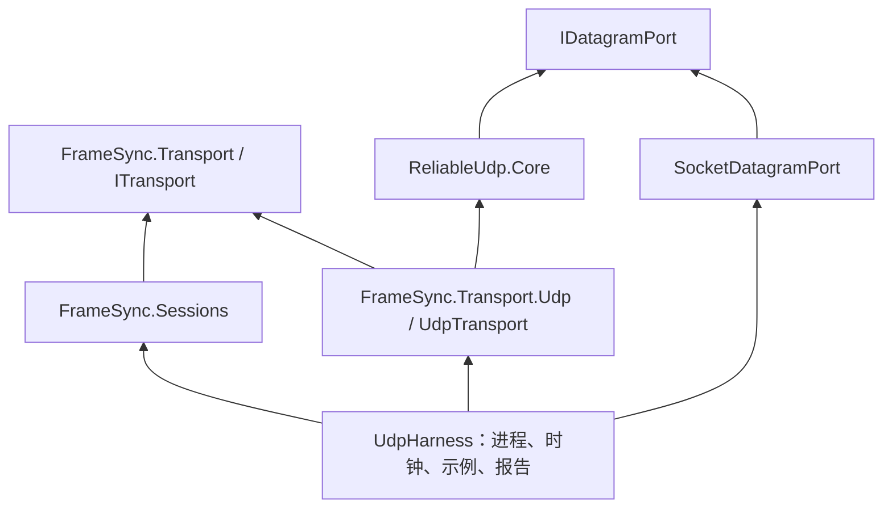

# 阶段 E 实现：可靠 UDP 与真实多进程联机

更新：2026-10-13。按本次决定，开发顺序调整为 A → B → E；C（预测回滚）和 D（正式玩家存档）暂缓。阶段 E 复用阶段 B 的“服务器确认后再执行”，没有引入预测或正式存档。

## 1. 现在能运行什么

一个服务器进程和 1～4 个客户端进程，通过操作系统 UDP 交换字节。服务器发送初始检查点，客户端恢复各自的世界；客户端提交输入，服务器确认并广播完整输入帧；各客户端独立计算，并逐帧核对完整检查点哈希。

自动示例中，第 5 帧 A 提交 +5，第 10 帧 B 提交 +3。B 的日志会出现 `received=A tick=5 input=5 total=5`。这里的日志读自 B 真正执行的确认帧，不是发送端的本地回显。

框架没有增加任何 Counter 示例规则。Counter 只是控制台验收使用的游戏模块，和阶段 A/B 一样放在 `samples/`。传输算法甚至不引用 `FrameSync.Transport`，可以直接用于其他只传字节的程序。

## 2. 怎样启动

需要 .NET 8 SDK，在仓库根目录执行。先构建一次，避免多个 `dotnet run` 同时构建相同依赖。

```bash
dotnet build tools/UdpHarness -c Release
```

打开三个终端，分别启动（终端顺序只需保证服务器先启动）：

```bash
# 终端 1：服务器，等待两名客户端，运行 40 帧。
dotnet tools/UdpHarness/bin/Release/net8.0/UdpHarness.dll server --port 7777 --clients 2 --frames 40

# 终端 2：客户端 A。
dotnet tools/UdpHarness/bin/Release/net8.0/UdpHarness.dll client --port 7777 --slot 0

# 终端 3：客户端 B。
dotnet tools/UdpHarness/bin/Release/net8.0/UdpHarness.dll client --port 7777 --slot 1
```

默认自动提交操作。运行结束时各端打印同一个 `tick / total / hash`；进程之间还会交换最终结果，服务器核对所有客户端结果后才关闭连接。每次开房生成新的会话 ID，所以不同次运行的哈希不同；**同一房间各端必须相同**。

手动输入版本：

```bash
# 服务器 --manual 关闭自动输入；默认 20 帧/秒，1200 帧约 60 秒。
dotnet tools/UdpHarness/bin/Release/net8.0/UdpHarness.dll server --port 7777 --clients 2 --manual --frames 1200 --timeout 120

# A 开启键盘输入。
dotnet tools/UdpHarness/bin/Release/net8.0/UdpHarness.dll client --port 7777 --slot 0 --interactive --timeout 120

# B 观察；也可添加 --interactive 让 B 同时输入。
dotnet tools/UdpHarness/bin/Release/net8.0/UdpHarness.dll client --port 7777 --slot 1 --timeout 120
```

在 A 终端输入 `5`，观察 B 收到并执行；输入 `-2` 会减去 2。`q` 请求服务器在当前已确认帧关闭，尚未确认的操作不会因此变成已执行。手工输入安排在当前确认帧之后第 4 帧；这是演示宿主的输入提前量，**不是预测**。网络延迟超过输入截止时间时，服务器会采用中性输入，传输可靠不等于操作永远赶得上截止时间。

在受控局域网测试时，服务器使用 `--bind <本机局域网 IP>`，客户端使用 `--host <服务器局域网 IP>`，并允许对应 UDP 端口。当前只实测本机回环，多台真实设备的局域网与 Windows ↔ macOS 验证仍待执行。

更多参数：`--rate 1..200`（逻辑帧率）、`--clients 1..4`、`--frames 1..100000`、`--report <json>`、`--timeout <秒>`。服务器支持 `--port 0 --ready <json>`，由系统分配端口并输出实际端口，自动测试使用此方式避免端口冲突。`--help` 查看用法。

## 3. 工程边界和阅读顺序



| 建议顺序 | 文件 | 读这一份要理解什么 |
| --- | --- | --- |
| 1 | `framework/src/ReliableUdp.Core/Contracts.cs` | 节点只接收地址、时间、字节；消息、数据报、发送回执是三种不同对象 |
| 2 | `framework/src/ReliableUdp.Core/UdpOptions.cs` | 消息能有多大、缓存能占多少、多久无进展就失败；所有配置建立连接前冻结 |
| 3 | `framework/src/ReliableUdp.Core/UdpNode.cs` | 握手和多连接入口；Poll 如何限制每次收发工作；Cookie 为什么不需要为陌生地址先分配连接 |
| 4 | `framework/src/ReliableUdp.Core/Peer.cs` | 单连接生命周期、消息调度、心跳、关闭和消费后释放额度 |
| 5 | `framework/src/ReliableUdp.Core/Peer.Reliability.cs` | 消息分片、片窗口、乱序缓存、按序交付；只有完整消息才交给宿主 |
| 6 | `framework/src/ReliableUdp.Core/Peer.Congestion.cs` | 包确认、迟到确认、快速重传、超时、发送节奏和降速 |
| 7 | `framework/src/ReliableUdp.Core/Packet.cs` | 字节级读写、固定端序、CRC32C 和严格长度检查 |
| 8 | `framework/src/FrameSync.Transport.Udp/SocketDatagramPort.cs` | 非阻塞 UDP Socket；系统差异集中在这里 |
| 9 | `framework/src/FrameSync.Transport.Udp/UdpTransport.cs` | 通用字节传输怎样适配已有 ITransport；Sessions 无需修改 |
| 10 | `tools/UdpHarness/UdpApp.cs`、`HostMessages.cs` | 服务器/客户端进程怎样组装模块；示例开局、输入设备、最终验收怎样放在框架外 |
| 11 | `framework/tests/ReliableUdp.Tests/` | 用虚拟时间模拟丢包、重复、乱序、限速和异常报文，不靠 Sleep 实现协议单测 |
| 12 | `tools/UdpHarness.Tests/Program.cs` | 真正启动多个操作系统进程并核对结果；只有真实 Socket 集成测试用真实时间 |

核心与接入库均为 `netstandard2.1`，工具和测试为 `net8.0`。`ReliableUdp.Core.csproj` 没有项目依赖，也没有第三方包。它不创建 Socket、不读取墙上时钟、不调用 Unity 或 Steam、不解释输入帧。中文注释解释公开接口和关键不变量。

## 4. 顺着一次输入理解完整流程

1. 客户端宿主把“+5”编码为 Counter 的输入字节，调用 `ClientSession.TrySubmit`。
2. 会话层把会话 ID、帧号、玩家槽位和输入封装为消息，经 `ITransport.TrySend` 发出。
3. UDP 接入层把这段不透明字节交给 `UdpNode.TrySend`。此时返回 `Accepted` 只表示已复制并接受，不表示网络已经送达。
4. 可靠 UDP 为消息分配消息编号和分片编号；大消息拆片，小消息通常只有一片。发送速度同时受网络拥塞预算与接收端额度限制。
5. 对端先验证报文，再保存分片，之后才回 ACK。ACK 是“接收确认”，不能先确认再因为队列满把片丢掉。
6. 消息拼完整后，通过适配器交给服务器会话。服务器在截止前接受输入，按时间确认完整输入帧并广播。
7. A/B 分别执行该确认帧并计算检查点哈希。与服务器一致后，才发布该帧的事件和可观察状态。

传输确认、完整消息到达、游戏确认帧执行是三个不同阶段。`SendReceipt.Acknowledged` 只证明第一层传输责任完成；最终状态一致由 Sessions 证明。

## 5. 可靠 UDP 的初版机制

| 机制 | 当前实现 |
| --- | --- |
| 建立连接 | Hello → RetryCookie → CookieEcho → Accept → AcceptAck；随机连接 ID，来源 IP/端口绑定，重复握手不重复通知或重置窗口 |
| Cookie | 标准 HMAC-SHA-256；包含地址、双方随机值、期限和配置指纹；5 秒有效；签名正确但已过期的 Echo 会获取新挑战，握手总期限仍为 10 秒 |
| 消息模式 | 可靠有序、可靠无序、不可靠无序；不可靠消息不分片，可指定过期时间 |
| 分片 | 默认 900 字节/片、64 KiB 最大消息；接受一条可靠消息前，为其全部片和额度预留位置 |
| 去重 | 包号和片号分开；重传使用新包号、相同片号；重复片不重复交付，也不延长无进展期限 |
| ACK | 最大包号 + 前 256 位接收图；空闲时最多等待 10ms；拒绝未来 ACK 和越过 0 的位图 |
| 重传 | 3 个不同后续数据包得到新确认触发快速重传；否则由 1～60 秒超时触发；保留最多 256 项失包映射处理迟到 ACK |
| 窗口 | 每通道最多 128 片；每连接最多 64 个在途数据报；后面的 ACK 不能让发送窗口跨过未确认的首片无限前进 |
| 公平调度 | 三种消息模式共用通道轮转；大包等待额度时保留位置；宿主读取消息也按连接轮转，避免一个客户端长期占满消费预算 |
| 接收额度 | 每通道默认 256 KiB / 64 条消息；TryReceive 转移所有权后释放额度；额度通知每秒重复，通知丢失可以恢复 |
| 背压 | 容量或额度不足返回 Backpressure；没有接受、没有分配新序号，调用者保留消息稍后重试 |
| 内存界限 | 每连接发送载荷最多 1 MiB；接收载荷最多通道数 × 256 KiB（最多 8 通道即 2 MiB）；描述信息另受片/消息窗口限制 |
| 降速 | 初始拥塞窗口 4 × 1200 字节；ACK 后增长、失包减半、超时降到 1200；按往返时间分散发送，突发预算 2400 字节 |
| 总带宽 | 节点总速率默认 4 MiB/s；通道 3 另限 512 KiB/s，仍共享连接拥塞窗口 |
| 超时关闭 | 空闲约 1 秒发心跳，10 秒无有效入站则断开；可靠消息或消费 30 秒无进展则失败关闭；正常关闭最多等待 1 秒 |
| 回执 | 可靠消息返回 `SendReceipt`；收齐为 Acknowledged，断开前仍未完成为 Failed；回执不是无限积累的事件队列 |

消息无进展关闭后，框架没有自动重连或自动更换房主。旧连接尚未确认的应用任务不能自动搬到新连接，业务恢复属于后续阶段。

本次采用的可运行简化也已写入实施记录：每个数据报最多一个子记录；双方的通道/片大小/初始额度配置必须精确一致；流控每秒重复通告，未做自适应探测退避；通道轮转使用简单调度，未实现设计稿中的复杂优先级调优或多记录合包。

阶段 B 目前要求可靠有序，因此 `UdpTransport` 明确要求所有通道可靠有序。核心的另外两种模式有独立测试，但不能只把阶段 B 的输入通道改成不可靠：还需要会话层一起增加输入冗余/补帧策略。后续 Steam 接入继续实现 ITransport，不需要修改确定性模拟。

## 6. 当前线协议实现

公共头为 80 字节，`Magic=RUDP`，版本 1，固定小端序；Guid 按 `.ToByteArray()` 的明确字节布局读写，CRC32C 的字段在计算时视为 0。测试包括 CRC32C 标准向量和固定头部向量。不会把 C# 对象内存布局直接作为网络格式。

每包记录数严格为 0 或 1，1 条记录有 4 字节头（类型、通道、长度）。CRC 只检查损坏。握手包编号为 0；连接后的每次实际发送使用递增包号。片描述的 32 字节字段与设计稿相同。

| Kind 值 | 内容 |
| --- | --- |
| 1 Hello | 16 字节客户端随机值 + 32 字节配置指纹 + 填充，总 UDP 载荷 192 字节 |
| 2 Retry | 双方随机值各 16 字节 + 8 字节有效期 + 32 字节 HMAC |
| 3 Echo | Retry 的 72 字节内容 + 32 字节配置指纹 |
| 4 Accept | 16 字节客户端随机值 + 32 字节配置指纹；连接 ID 在公共头 |
| 5 AcceptAck | 16 字节客户端随机值 |
| 6 Fragment | 32 字节片描述 + 固定片位置上的消息字节 |
| 7 Unreliable | 一条完整消息，不分片 |
| 8 Credit | 8 字节最大累计字节位置 + 8 字节最大消息编号 |
| 9 Ping | 空载荷，参与包确认；ACK 已可采样 RTT，因此未单设 Pong |
| 10 / 11 Close / CloseAck | 空载荷；线上的连接 ID 已区分关闭对象，详细本地原因只进本地事件 |

当前关闭不保证业务提交；控制台演示专门先交换并核对最后检查点，再关闭 UDP。公共头和实现格式今后变化时必须升级协议版本，不能默默兼容不同布局。

## 7. 验证与范围

完整入口：

```bash
./scripts/verify.sh
```

只验证阶段 E：

```bash
dotnet run --project framework/tests/ReliableUdp.Tests -c Release
dotnet run --project tools/UdpHarness.Tests -c Release
```

测试是控制台断言程序，`dotnet test` 不会运行它们。

本次完整验证通过 **125 项测试**，构建为 0 警告、0 错误：

| 测试组 | 通过数量 |
| --- | ---: |
| A/B 核心与会话 | 70 |
| A 示例与控制台 | 13 |
| B 通信控制台 | 6 |
| 独立可靠 UDP 核心 | 30 |
| 真实 Socket 与多进程集成 | 6 |

此外，A 的两个模型分别完成 100000 帧、六个检查点恢复和新进程重放；B 的两个模型分别完成四客户端 10000 帧一致性验证。完整输出在 `artifacts/stage-e/full-verification.log`。

故障测试覆盖握手重复、Accept/ACK 丢失、随机丢包/重复/乱序、最大消息、可靠无序、通道独立交付、背压、额度通知丢失、停止消费、断流、关闭、错误配置、矛盾分片、重叠范围、未来/迟到 ACK、超过 256 包历史、控制回复上限、拥塞退让和时钟倒退。独立审查新增了混合通道公平性、过期 Cookie 恢复、多连接有限消费预算的回归；三项问题均已修复。网络组合包括 RTT（往返时间）60/120/200ms × 丢包 1/5/10%，带宽从 32 降到 16 KiB/s。这些是可重复的模拟网络结果，不等于公网测量。

真实进程测试自动启动一服务器两客户端、一服务器四客户端，并测试 A 从标准输入提交操作、B 观察。它们同时核对：不同进程 ID、成功退出码、最终帧号、手算总值、所有提交输入的观察记录、完整检查点哈希。报告和各进程日志位于 `artifacts/stage-e/`，不进入 Git。修复审查问题后，另完成了一次 **1 个服务器 + 4 个客户端、5000 帧**验证：五个独立进程各观察到相同的 1000 条输入，总值均为 3008，完整检查点哈希一致。对应报告为 `artifacts/stage-e/longrun-4/verification.json`；这次运行约 50 秒，不代表多小时稳定性验收。

本次实际平台为 macOS arm64 / .NET SDK 8.0.403。Windows 编译运行、双系统互联、多小时长稳和实际公网环境尚未验证。Socket 已处理非阻塞、发送背压和有界接收；当前 macOS 运行环境不支持 `Socket.DontFragment` 选项，因此接入层公开 `DontFragmentEnabled`，不能声称所有路径都禁止 IP 分片或已经完成 MTU 探测。属性含义参见 [Microsoft Socket.DontFragment 文档](https://learn.microsoft.com/en-us/dotnet/api/system.net.sockets.socket.dontfragment)。

当前能力名是 TrustedNetwork（受控网络）。Cookie、随机连接 ID 和 CRC 不提供玩家身份认证、加密或认证完整性；要求安全传输的配置会明确拒绝，不能静默降级。公网发行后端、Steam、NAT 打洞和中继尚未接入。

这里跑通的是阶段 E 的基础传输和确认帧联机。初版整体仍未完成：C/D、途中加入、断线重连，以及 B 设计中的完整成员停用/恢复流程仍有后续工作。
