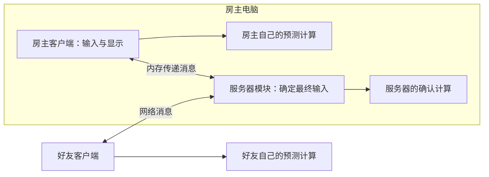

# 帧同步框架总体方案：供自己的多个游戏复用

日期：2026-10-10  
修订：v0.5，将核心实现细节集中到独立技术方案。  
状态（2026-10-15）：A～E 初版代码链路已接通；实际接口、测试和限制见 [C/D 实现说明](../../stage-c-d-implementation.md)。Windows 跨系统验收和下述后续接入仍待完成。

## 1. 我们要做什么

这是一套你自己维护、供你后续不同游戏重复使用的帧同步代码。使用它的游戏可以商业发行；框架本身按内部基础库维护，不设置销售、授权收费、客户支持或对外开发工具包产品的目标。

每做一个新游戏，你实现这个游戏的规则、输入和状态，再接入同一套同步框架。已有游戏可以继续使用旧版本，新游戏按需要选择新版本，不必一起升级。

**复用成功的标准：换一个玩法不同的游戏，不需要修改同步框架内部代码。**

框架仍需可靠，因为它会随你的游戏一起运行。这里保留确定性验证、存档兼容、网络故障测试和性能检查，目的是保护游戏体验与玩家数据。

### 1.1 已确认的整体需求

| 需求 | 本方案如何处理 |
| --- | --- |
| C# + Unity | 框架用纯 C#；Unity 是第一个接入的引擎 |
| 不绑定引擎和平台 | 引擎调用、平台账号、邀请和具体网络实现放在独立接入层 |
| 单机、房主开房、最多四人 | 先验证 1～4 人；人数由配置决定，不在算法中写死为 4 |
| Windows + macOS | 首批构建、联机和结果一致性验证平台 |
| 自研可靠 UDP | 独立通信模块，可以单独测试或替换 |
| 后续 Steam | 后续接入好友邀请、身份验证和平台网络 |
| 存读档、途中加入、掉线恢复 | 框架提供恢复流程，游戏定义保存的内容 |
| 房主退出 | 先保存，再关闭房间；首版不自动更换房主 |
| 第一个游戏采用二维玩法 | 属于游戏自己的选择；框架不规定坐标、物理或实体结构 |

可配置不代表所有组合都已经支持。超过四人、其他平台和不同运行环境，之后按实际项目需要补充验证。

整体需求不等于初版一次做完。初版先完成纯 C# 可运行核心、预测回滚、基础存读档与自研 UDP，参与者在开局前加入。Unity 接入、途中加入和自动重连逐步补上；具体范围以[初版核心模块](2026-10-10-initial-core-scope-design.md)为准。

### 1.2 阅读顺序

先看[初版核心模块](2026-10-10-initial-core-scope-design.md)确定先做什么，再读本文第 2～8 节理解整体流程。准备实现同步核心时，查阅[独立帧同步框架技术方案](2026-10-10-frame-sync-core-design.md)；准备接游戏时读[工程拆分与游戏接入](2026-10-10-framework-integration-design.md)；准备实现网络底层时读[可靠 UDP 方案](2026-10-10-reliable-udp-design.md)。

本文先解释概念与流程；具体数据结构、消息约定和执行算法在独立技术方案中维护。先理解各部分为什么存在，再看它们在代码中叫什么。

## 2. 先认识六个概念

| 概念 | 直白解释 | 例子 |
| --- | --- | --- |
| 逻辑帧 | 游戏规则向前计算一次；英文常写 Tick | 每秒计算 30 次，第 100 次就是第 100 帧 |
| 输入 | 玩家在某一逻辑帧提交的意图 | 游戏定义的一段数据，框架不解释它代表什么操作 |
| 状态 | 从当前时刻继续计算，必须知道的全部数据 | 不仅是可见位置，还包括计数、随机数进度等 |
| 确定性 | 相同起点加相同输入，每次都算出相同结果 | 两种系统重放同一段输入，结果一致 |
| 快照／检查点 | 某一帧结束后的状态副本；完整检查点还包括框架自己的记录 | 留下第 99 帧的副本，之后从那里重新计算 |
| 适配器 | 把框架需要的能力接到具体环境的一小层代码 | Unity 驱动更新，文件适配器负责写入磁盘 |

逻辑帧和画面帧不同。游戏规则可以每秒计算 30 次，画面每秒绘制 60 次或更多，两者不用一一对应。

“状态”也不等于 Unity 场景。要保存的是能继续计算的数据，摄像机、按钮和网络连接等对象不应混入模拟状态。

## 3. 房主和好友各自在运行什么

“服务器”在这里是一份负责整理输入、决定最终帧的程序逻辑。房主开房时，它可以直接运行在房主电脑的游戏进程中，不要求租用一台常驻服务器。

服务器与客户端共享同一份游戏规则代码，但各自创建独立的状态对象。不能让房主客户端直接修改服务器正在计算的数据。

| 所在位置 | 每帧主要工作 |
| --- | --- |
| 服务器模块 | 收集输入；到时间补齐缺失项；确定本帧内容；执行规则；广播结果 |
| 客户端模块 | 采集本地输入；接收最终输入；暂时预测未知输入；必要时恢复旧状态重算 |
| 游戏代码 | 解释输入、执行规则、保存恢复自身状态、产生表现事件 |
| 引擎接入层 | 驱动框架更新，把游戏状态显示出来，接入键盘和手柄等设备 |

服务器保留一份只使用最终输入的计算结果，供存档、加入和重连使用。房主通常因此运行两份模拟：服务器的确认计算和本地客户端的预测计算。增加的 CPU 和内存开销需要测量。

单机使用同一套结构，只把网络传递换成内存传递，并可关闭预测。另提供不启动 Unity 的控制台宿主，方便测试和定位问题。“宿主”就是负责启动、驱动和停止这些模块的程序。

原生 UDP 能否连接朋友的电脑，还取决于网络可达性。家庭路由器、打洞和中继是另一层问题；可靠 UDP 不自动解决这些问题。后续平台接入参考 [Steam Networking](https://partner.steamgames.com/doc/features/multiplayer/networking)。

## 4. 一次输入怎样变成所有人共同认可的结果

以“给第 100 帧提交一条输入”为例。它表示移动、选择选项还是调整参数，由游戏解释。

1. **游戏采集操作。** 把玩家意图编码成字节，标明目标是第 100 帧。
2. **客户端保留并发送。** 这份输入一旦提交就不能修改；丢包重发仍使用同一份内容。
3. **服务器收集。** 检查来源、目标帧、长度和格式，放入第 100 帧的记录。
4. **到达收集截止时间。** 已收到的输入直接使用；没收到的调用游戏提供的“缺失输入规则”补齐。
5. **服务器执行并确认。** 按固定顺序执行本帧规则，成功后保存最终记录，发给所有客户端。
6. **客户端核对。** 自己之前算的内容相同就继续；不同则回滚重算。

“确认帧”表示服务器已经确定这一帧用了哪些输入，并成功计算完成，以后不再修改。

### 4.1 到时间还没收齐怎么办

首版选用**服务器按截止时间确认输入，客户端允许预测和回滚**。服务器不等待所有客户端完成计算，也不等待所有确认回执，避免一位玩家的网络阻塞整场游戏。

游戏必须给出“没有收到有效操作时使用什么”的输入，称为**中性输入**。它表示没有新的有效操作，不代表一定要清零坐标或删除某个对象。

客户端预测与服务器补齐可以使用不同规则。例如客户端暂时假设一个持续操作还在继续，服务器到期后采用中性输入；最终以服务器记录为准。一次性操作通常不凭空预测，具体规则仍由游戏决定。

迟到的第 100 帧输入会被拒绝，不偷偷搬到第 101 帧。游戏可决定重新提交玩家意图，但那是一份明确的新输入。

机制参考 [Quantum 的帧说明](https://doc.photonengine.com/quantum/v3/manual/frames)与[输入标记说明](https://doc.photonengine.com/quantum/v3/manual/player/input-flags)；本项目自行实现协议。

### 4.2 为什么提前发输入

输入需要经过网络。总是指定给即将截止的帧，就容易迟到。

初始配置让输入提前约 3 个逻辑帧发送；每秒 30 帧时，3 帧约为 100 毫秒。客户端可以先预测显示，服务器按正常时间确认。提前量以后根据测量调整，已发送输入不能因此改帧号。

没有预测的“等最终输入再计算”模式也保留，用作简单运行模式和验证基准。

## 5. 预测错了，怎样回滚

**预测**是先用暂时的输入往前算。**回滚**是发现输入不同后，恢复之前的状态，用正确输入重算；不是把画面上的物体反向移动。

客户端已经计算到第 104 帧，此时收到服务器通知：第 100 帧的最终输入与之前预测不同。

| 步骤 | 做什么 | 为什么 |
| --- | --- | --- |
| 1 | 找到最早不同的是第 100 帧 | 后续结果可能都受影响 |
| 2 | 恢复第 99 帧结束后的检查点 | 从第 100 帧尚未执行的位置重算 |
| 3 | 重新计算 100、101、102、103、104 | 已知部分用最终输入，未知部分重新预测 |
| 4 | 替换这些帧的状态和事件 | 旧预测结果失效 |
| 5 | 把新状态交给显示层 | 游戏可按需要做平滑过渡 |

恢复“第 100 帧执行完”的状态才使用第 100 帧检查点；纠正第 100 帧本身必须从第 99 帧开始。

回滚读取已保存输入，不重新询问键盘或鼠标，否则同一帧会变成新的操作。

### 5.1 预测不是无限向前猜

初始最多领先已正确确认的进度 12 帧，每秒 30 帧时约为 400 毫秒。达到上限就停止继续预测，仍然收包、补帧和恢复。

一次更新也限制重算量，避免长回滚卡住画面。初版缺少必要检查点时明确结束该客户端会话；后续再增加从服务器取完整状态、追赶进度的在线恢复流程。

### 5.2 音效和其他外部操作怎么办

重算可能再次产生同一个事件。框架用运行编号、帧号和该帧内序号标识事件，并比较内容，让游戏分清新增、保留、失效或内容变化的事件。

可撤销效果可以先显示再纠正。成就提交等不宜重复的外部操作，应等帧确认后再触发。加载存档、加入追赶和历史重放默认不重复触发过去的外部操作。

框架控制本次会话中的重复通知；跨崩溃、跨读档还需要游戏或外部服务用持久操作编号去重，不能仅靠内存记录保证只执行一次。

状态保存、恢复和重演要求也可对照 [GGPO 接入说明](https://github.com/pond3r/ggpo/blob/master/doc/DeveloperGuide.md)。

## 6. 游戏接入时必须满足什么

框架安排“何时算、用哪些输入、从哪里重算”；游戏保证“同样的条件算出同样结果”。

| 要求 | 容易出问题的写法 | 推荐做法 |
| --- | --- | --- |
| 时间一致 | 直接读取电脑当前时间 | 使用逻辑帧与固定步长 |
| 输入可重放 | 规则执行中读取键盘 | 只读取传入的本帧输入 |
| 随机可恢复 | 只存初始种子，漏掉运行进度 | 保存随机算法当前内部状态 |
| 顺序一致 | 依赖未规定顺序的集合遍历 | 明确排序与相同优先级时的规则 |
| 状态完整 | 只存可见数据，遗漏队列或计数器 | 保存所有影响未来的数据，或规定重建方法 |
| 实例隔离 | 多份模拟共用可变静态对象 | 每份模拟有自己的状态 |
| 平台一致 | 认为“都是 C#”就必然一致 | 在目标系统和实际构建上重放验证 |

模拟中不做文件读写、网络请求或引擎对象调用。这些由模拟外处理，再以明确输入或事件进入指定帧。

框架不强制同一种定点数、随机数、物理或实体系统。可提供数值和随机工具，游戏按需选用；选好后锁定算法版本并验证结果。

## 7. 存档和读档怎样工作

### 7.1 三种状态副本

| 用途 | 保存在哪里 | 可以包含预测结果吗 |
| --- | --- | --- |
| 回滚 | 客户端内存，短期保留 | 可以，只供客户端重算 |
| 加入或重连 | 服务器截取固定状态，发给客户端 | 不可以，只取已确认帧 |
| 正式存档 | 文件或其他存储 | 不可以，只取已确认帧 |

框架负责取状态的时机、版本标记与安全写入。游戏负责保存哪些字段及其含义。

### 7.2 保存流程

服务器完成某帧 → 捕获独立状态副本 → 在模拟计算之外编码与写入 → 写入临时文件 → 成功后替换正式文件并保留上一份有效版本 → 返回实际保存帧。

“原子替换”指读取者看到完整旧文件或完整新文件，不会读到半份。具体磁盘持久性由文件适配器按系统能力实现并测试。

同一存档位置的请求顺序提交，防止较早的慢写入覆盖较新的存档。失败保留旧档，返回真实错误。

### 7.3 读档与升级

先检查文件完整性与版本，再恢复游戏和框架状态。重新开房时使用新运行编号，旧连接和数据包不能污染新进度。

**存档迁移**就是把旧格式转为新格式。例如游戏增加字段，要规定旧存档中该字段的初值。框架处理文件外壳，游戏处理自己的内容。

转换保留原档，验证成功后另存。没有转换办法时报告版本不兼容，不覆盖原文件。框架版本变化不意味着各游戏存档必须一起变化。

## 8. 途中加入、重连和关房

途中加入和自动重连属于后续功能。初版实现它们依赖的状态恢复、输入重放、成员事件和身份分离，不实现这里的完整网络恢复流程；正常保存后关房在初版实现。

### 8.1 途中加入

1. 连接并检查身份与游戏版本。
2. 服务器取第 500 帧的确认状态，暂时保留第 501 帧起的输入记录。
3. 客户端收到状态，从第 501 帧快速重放，追赶当前进度。
4. 双方在同一帧比较状态摘要，确认计算一致。
5. 服务器指定未来某帧，例如第 560 帧，让新参与者正式提交输入。

**状态摘要**是对完整数据计算出的固定长度校验结果，常称哈希，用来快速发现不同，不用于证明玩家身份。

不能为慢连接无限保留历史。超出时间或内存上限就终止本次尝试。结束通知早到，也要等全部块到齐并检查完整后才能恢复。

### 8.2 掉线后恢复

框架分清“是谁”和“本次用哪条连接”：

- 参与者编号长期标识同一个人，重连后可保留。
- 连接编号只标识本次网络连接，重连后更换。
- 控制权另有更新编号，拒绝旧连接继续发送的输入。

参与者对应哪个角色、座位或其他数据，由游戏保存映射。框架恢复状态并重新绑定合法控制权，游戏按映射恢复原有对象。

初始配置保留断线占用的位置 60 秒，不意味着到期删除持久身份或存档。断线对象怎样处理由游戏决定，并在服务器确定的一帧统一生效。

### 8.3 房主退出

正常退出：通知停止帧 → 运行到该帧 → 保存 → 报告结果 → 关房。保存失败由游戏提供重试或退出选项，不能显示虚假的成功。

崩溃只能恢复到最近有效存档。初始建议每 120 秒自动保存一次，之后按游戏需求调整。首版不自动更换房主。

## 9. 代码分成哪几部分

先按职责理解四层，再看工程名称。层之间通过接口调用；“接口”就是约定好可以调用的方法及其输入、输出。

| 层 | 做什么 | 是否理解具体玩法 |
| --- | --- | --- |
| 游戏代码 | 规则、输入、状态、表现、玩家与游戏数据的映射 | 是 |
| 同步核心 | 帧顺序、确认、预测、回滚、恢复协调 | 否 |
| 通信模块 | 连接、收发字节、丢包补发、限速 | 否 |
| 环境适配器 | Unity 更新、操作系统网络、文件、Steam | 不应包含玩法规则 |

游戏给核心一段输入，核心保存和传递它，不知道里面表示移动还是选择。核心给通信模块一条消息，通信模块负责传递，不知道里面是第几帧。

框架既可以换游戏，也可以换引擎和网络。这两个方向都需要测试，不能仅靠目录命名判断已经独立。

| 工程工作名 | 中文职责 |
| --- | --- |
| `FrameSync.Abstractions` | 游戏与框架之间的接口定义 |
| `FrameSync.Runtime` | 实际执行同步流程的核心 |
| `FrameSync.Protocol` | 同步消息的字节格式与检查 |
| `FrameSync.Persistence` | 存档外壳、读写协调与版本检查 |
| `FrameSync.Diagnostics` | 重放、统计与不同步定位 |
| `FrameSync.Deterministic` | 可选数值与随机工具 |
| `Transport.Abstractions` | 独立通信接口，不引用帧同步接口 |
| `ReliableUdp.Core` | 自研可靠 UDP 算法 |
| `Transport.ReliableUdp` | 把可靠 UDP 接到通用通信接口 |
| `Transport.Memory / VirtualNetwork` | 内存通信与可复现的网络故障测试 |

这是计划中的工程划分，还没有创建代码目录。Unity、文件、操作系统网络与 Steam 分别适配，示例单独存放。更具体的接口和接入步骤见[工程拆分与游戏接入](2026-10-10-framework-integration-design.md)。

## 10. 为什么还需要可靠 UDP

UDP 只负责发送数据报，不保证每份都送到、按顺序到达或只到一次。自研可靠 UDP 在它上面补上确认、重发、拆分重组和限速。

| 消息 | 交付方式 | 原因 |
| --- | --- | --- |
| 最新输入、最近几帧的最终记录 | 不可靠发送，携带少量近期重复数据 | 优先及时送达；最终记录缺失另行补齐 |
| 连接、成员变化和保存结果等控制消息 | 可靠且按顺序交付 | 丢失后补发，避免顺序混乱 |
| 缺失的历史帧 | 可靠交付，不要求不同消息按发送先后交付 | 缺哪段补哪段，上层按帧号整理 |
| 大状态副本 | 分块可靠交付 | 避免一份大数据阻止其他消息交付 |

“不可靠”只表示这条网络消息本身不自动重传。同步层仍通过近期重复发送、历史补发或完整状态恢复，把最终记录补齐。

可靠 UDP、内存通信、测试网络以及后续 Steam 都实现同一种通信接口。使用平台已有可靠通道时，不在其上重复包一层自研可靠重发。

[可靠 UDP 单独方案](2026-10-10-reliable-udp-design.md)先解释这些概念，再给出报文和算法细节。

## 11. 首批参数与验证方法

**运行配置**是一组一起使用的参数，英文有时称 Profile。它决定人数、频率、历史长度和内存上限，不是玩法规则或另一套算法。

### 11.1 初始参数

| 参数 | 初始值 | 为什么要限制 |
| --- | --- | --- |
| 人数 | 1～4 | 先验证实际需要的规模 |
| 逻辑频率 | 每秒 30 帧 | 固定规则计算步长 |
| 输入提前量 | 默认 3 帧，初版开局后固定；自适应调整后做 | 给网络传递留时间 |
| 最大预测领先 | 12 帧 | 不在断网后无限猜测 |
| 客户端检查点 | 32 份，同时限制总字节数 | 保存回滚起点 |
| 客户端输入历史 | 至少 128 帧 | 支持重新计算 |
| 服务器普通历史 | 900 帧，即约 30 秒 | 补帧与短期恢复 |
| 最远未来输入 | 32 帧 | 避免过远输入占内存 |
| 加入时额外历史保留 | 最多 30 秒，并设字节上限 | 避免慢连接无限拖住历史 |
| 单份完整状态 | 上限 8 MiB，初期测试目标 2 MiB | 控制复制、存储、传输成本 |
| 每人每帧输入 | 最多 128 字节 | 控制实时消息尺寸 |
| 状态一致性检查 | 每 30 帧一次 | 尽早发现分歧 |
| 一次更新中的重算 | 最多 8 帧，并限制耗时 | 避免主循环长时间无响应 |

这些是尚未测量的起点。不能只提高单人输入大小而忘记总消息尺寸，或只增加历史帧数而不检查内存。1 KiB 为 1024 字节，1 MiB 为 1024 KiB。

### 11.2 怎样证明能给自己的游戏使用

下表是整体功能完成后的验证目标。初版不把尚未实现的加入、重连、旧版迁移和 Unity 构建作为完成条件；初版检查见[核心范围](2026-10-10-initial-core-scope-design.md)。

| 验证 | 应当看到的结果 |
| --- | --- |
| 相同输入重复运行至少 10 万帧 | Windows/macOS 与各实例状态一致 |
| 随机保存恢复、预测错误与重算 | 与直接执行最终输入的结果一致 |
| 两个不同的小型模拟接入 | 更换输入与状态结构，无需修改核心 |
| 独立游戏工程引用框架 | 不需要复制内部实现或引用示例资源 |
| 加入、断线、重连、旧包迟到 | 控制权正确，进度可恢复 |
| 写入中断、坏档、旧版存档 | 旧档受保护，失败可识别，支持的旧版可转换 |
| 弱网测试 | 丢包、乱序、重复、限速时仍一致；必要时等待或明确失败 |
| 四人连续运行至少 24 小时 | 没有未知分歧、未处理异常或持续内存增长 |

弱网测试包含往返延迟 60/120/200 毫秒、丢包 1%/5%/10% 及短时断网。目标是结果正确、内存受控和失败可解释。

性能分别记录框架、游戏规则、状态复制和网络开销。后续优化目标是稳定运行时复用内存，框架普通更新的 99% 不超过 1 毫秒；这个统计通常写作 P99。初版先记录数据、保证内存有上限，不要求完成这些优化；具体游戏还需自己的完整性能预算。

记录实际设备、系统、Unity/运行时版本和构建方式。只在编辑器里跑通，不等于实际发行的游戏已经验证。

## 12. 自己的多个游戏怎样长期共用

独立工程维护一份核心，各游戏锁定使用版本。可以引用固定版本的源码或本地包；项目数量和构建流程需要时，再用私有包仓库。不要求公开发布框架或维护对外开发工具包。

| 版本 | 回答的问题 |
| --- | --- |
| 框架代码版本 | 游戏集成的是哪份框架代码？ |
| 网络协议版本 | 两端能否理解彼此消息？ |
| 游戏规则与数据版本 | 相同输入能否算出相同结果，旧存档能否理解？ |

内部更新记清改动、接入调整和存档影响，保留可回退的旧版本。同一个版本标记不要偷偷指向不同代码。

不预先设计无限扩展点。第二个游戏有真实需求时，先检查现有接口能否表达；确实通用再扩展框架，特有规则留在游戏中。

自研网络能传数据，不等于已经解决身份验证和加密。游戏准备联网发行时，按所选传输方式验证这些能力，不自行设计密码算法。同步核心与各通信方式分别记录测试结果。

## 13. 先完成初版核心，再叠加功能

| 阶段 | 实际完成的事 | 阶段检查 |
| --- | --- | --- |
| 初版 A：单份模拟 | 接口、完整状态保存恢复、两个无画面模拟、输入重放 | 无 Unity 也能跑；更换模型不用改核心 |
| 初版 B：内存同步 | 输入记录、服务器确认、客户端、开局成员管理 | 1～4 人最终记录和状态一致 |
| 初版 C：预测回滚 | 有限预测、历史、恢复重算、事件记录 | 迟到与错误预测能纠正，不重复提交事件 |
| 初版 D：基础存读档 | 确认状态文件保存、退出后读取、新会话开始 | 结果可继续、失败保留旧档 |
| 初版 E：真实网络 | 自研可靠 UDP、开局状态分发、多进程与双系统互联 | 不依赖内存通信也能正确运行 |
| 后续：游戏接入 | Unity 输入和显示、游戏自己的模拟实现 | 框架保持独立 |
| 后续：加入与恢复 | 中途加入、掉线重连、运行中整状态重同步 | 在核心状态恢复与成员事件上补齐网络协调 |
| 后续：体验与性能 | 自适应参数、状态压缩、内存复用、调试界面、存档完善 | 按测量结果验证改进 |
| 后续：Steam 与上线验证 | 邀请、身份、平台网络、长时间运行和实际发行检查 | 在具体游戏真实环境下通过 |

每完成一个初版阶段都有可运行成果。可靠 UDP 可独立开发验证，集成时保留同一通信接口。初版 A～E 全部通过后，再把中途加入等功能叠加上去；它们依赖的基础不能只留空接口。阶段 A 的当前实现和验证结果见 [实现说明](../../stage-a-implementation.md)。

## 14. 实现时查阅独立技术方案

帧号、数据结构、输入记录、服务器更新、客户端回滚、检查点、同步消息与错误处理的具体约定，集中维护在[独立帧同步框架技术方案](2026-10-10-frame-sync-core-design.md)。

本文负责解释整体思路，不再重复维护另一份核心算法细节。准备实现时，先用[初版核心范围](2026-10-10-initial-core-scope-design.md)确定本轮工作，再按独立技术方案落实，并用[工程拆分与游戏接入](2026-10-10-framework-integration-design.md)核对依赖边界。

本稿只描述应如何实现和验证，流程、参数与测试要求不表示已有代码或测试结果。
