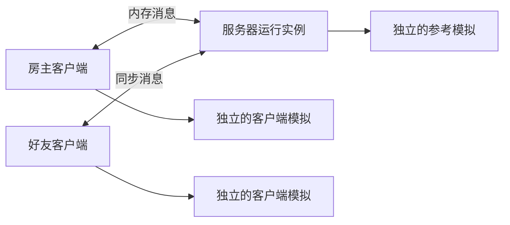

# 独立帧同步框架技术方案

日期：2026-10-10  
修订：v0.1  
状态（2026-10-15）：A～E 初版代码链路已接通；成员事件、停用、预测回滚与存档重开已落地，实际命名、调用方式和验证结果见 [C/D 实现说明](../../stage-c-d-implementation.md)。设计稿中的途中加入、完整重连和自适应调度仍属后续；Windows 待实测。
适用目标：供自己的不同游戏复用的纯 C# 帧同步框架；使用它的游戏可以商业发行。

本文回答**帧同步框架内部怎样设计、怎样实现、怎样验证**。示意接口和伪代码用于说明约定；实际源码名称以实现说明为准，不要求按每个职责建立一个程序集。

文档分工如下：

| 文档 | 负责回答 |
| --- | --- |
| [初版核心范围](2026-10-10-initial-core-scope-design.md) | 先实现哪些能力，每个阶段怎样跑起来 |
| [总体方案](2026-10-10-deterministic-frame-sync-design.md) | 为什么选择这种同步方式，整体如何运作 |
| **本文** | 核心数据、服务端确认、客户端预测回滚、状态恢复和内部调用关系 |
| [工程拆分与游戏接入](2026-10-10-framework-integration-design.md) | 游戏与环境需要提供哪些接口，工程如何引用 |
| [可靠 UDP 方案](2026-10-10-reliable-udp-design.md) | 连接、数据包确认、重传、分片和网络限速 |

初版范围以范围文档为准；帧同步内部的具体约定集中维护在本文。阅读时可先看第 1～3 节，再看第 5～7 节的执行流程，其余章节在实现对应模块时查阅。

## 1. 核心方案与边界

采用**服务器确定最终输入，客户端预测并在必要时回滚**的方式：

1. 所有端从同一份完整状态开始，按固定时间步执行同一套规则。
2. 客户端提交某一帧的输入。服务器到截止时间后补齐缺失输入，成功计算后确认这一帧。
3. 客户端可以先算尚未确认的帧；收到最终输入后核对，不同就恢复旧状态重算。
4. 已确认输入不再修改，服务器自己的参考模拟只使用最终输入。

“参考模拟”是服务器保存的一份正确计算结果，用来取存档、检查点和校验摘要。它使用游戏提供的规则，不需要另外写一套服务端玩法。

| 核心负责 | 由外部接入 |
| --- | --- |
| 帧号、输入记录、确认顺序、预测回滚 | 游戏输入的含义与规则 |
| 何时捕获状态、恢复和重放 | 游戏状态的字段、数值算法、随机算法 |
| 成员身份和控制权的同步时机 | 参与者对应哪个游戏对象 |
| 同步消息、存档协调、事件交付 | 字节传输、文件系统、账号验证、输入设备、画面 |

核心不引用 Unity、Steam、操作系统 Socket 或具体游戏类型。可靠 UDP 是可替换的独立通信实现，本文只规定核心如何使用它。

初版先做无画面的控制台运行，验证 Windows/macOS 与 1～4 人。人数可配置，但超过四人不视为已经验证。框架没有二维或三维坐标假设。

## 2. 运行实例与内部模块

### 2.1 房主进程中的关系



服务器和客户端通过同一个游戏工厂创建实例。规则代码相同，状态、随机数进度和历史记录各自独立。房主输入也经过提交与确认，不直接修改参考模拟。

单机可以使用服务器加一个本地客户端，并关闭预测。无画面服务器使用同一服务器运行实例，不需要复制一套服务器逻辑。

### 2.2 内部职责

下列英文名称是建议的代码工作名；右侧说明实际职责。

| 内部模块 | 职责 | 持有的数据 |
| --- | --- | --- |
| 会话协调 `SessionCoordinator` | 开局、准备、开始、停止、错误收尾 | 房间阶段、兼容信息、连接绑定 |
| 帧调度 `TickScheduler` | 固定频率、截止时间、输入目标帧 | 计时参考、输入提前量、调度更新编号 |
| 输入记录 `InputTimeline` | 冻结输入、去重、整理最终帧、查询缺口 | 有上限的本地输入与最终帧历史 |
| 服务端驱动 `ServerRunner` | 补齐输入、执行参考模拟、确认广播 | 待确认输入、服务端确认进度 |
| 客户端驱动 `ClientRunner` | 预测、比较、恢复重算、追赶 | 客户端各项进度、重算任务 |
| 状态历史 `CheckpointHistory` | 捕获与查找恢复点、保护必要历史 | 游戏副本与框架副本 |
| 事件记录 `EventJournal` | 对比重算前后事件、交付确认事件 | 按帧事件、外部交付位置 |
| 协议／存储／诊断 | 编码、保存、重放、统计 | 有上限的收发与写入任务 |

这些职责可以先放在少量工程内。职责分开不等于初版要实现插件系统或创建许多空项目。

### 2.3 谁驱动运行，谁可以改状态

宿主定期调用 `Poll(now)`，即“用当前单调时间处理一次工作”。单调时间只向前走，用于网络计时；不使用两台电脑的日历时间直接相减。

每个运行实例初版只有一个线程拥有修改权。网络线程和文件任务只把完成结果放进有上限的队列，不能直接调用游戏 `Step` 或修改成员表。对外通知在本次内部更新完成后交付，不允许回调重新进入当前更新。

游戏计算使用整数帧号和固定步长，例如每秒 30 次。宿主两次调用间隔变长，也不能把游戏步长改大或跳过某些帧。帧率最好以整数或明确的分数表达，避免反复累加近似时间。

## 3. 数据结构：先把几种记录分清

### 3.1 帧号与进度

完整状态用 `S[f]` 表示，含义是“第 f 帧执行完后的状态”。`S[0]` 是第一帧执行前的初始状态。

| 名称 | 含义 |
| --- | --- |
| `SessionId` | 本次房间运行的编号；重新开房生成新编号 |
| `Epoch` | 同一会话内的一轮运行编号，重置时变化 |
| `Tick / f` | 本轮逻辑帧号，从 1 开始；0 留给初始状态 |
| `PersistentTick` | 跨存档保留的累计帧数，等于载入时基础帧数加本轮帧号 |
| `C` | 服务器已经成功执行的最大连续确认帧 |
| `A` | 客户端已经连续收到的最大最终帧 |
| `V` | 客户端已经用正确输入算出的最大连续确认帧 |
| `P` | 客户端当前算到的帧，可能包含预测 |
| `W` | 最多允许领先 V 多少帧 |
| `E / L` | 客户端估计的服务器当前帧／输入提前量 |

例如客户端收到了最终帧 100，却只算到 98，那么 A 可以是 100，V 和 P 仍是 98。不能因为收到消息就把游戏状态标成已确认。

保持 `V <= A`、`V <= P`。预测推进不能越过 `V + W`；已经收到但尚未计算的最终帧可以继续计算，每算完一帧就相应推进 V。

帧号与递增编号使用明确的整数宽度；帧号采用 64 位无符号整数。接近上限时结束本轮，不使用自然溢出回绕比较。

### 3.2 输入、最终帧与实际执行记录

| 记录 | 最少保存什么 | 是否可以修改 |
| --- | --- | --- |
| 单人输入 `InputRecord` | 会话、运行、目标帧、位置、控制权编号、游戏输入字节 | 第一次接受后不能修改 |
| 最终帧 `FinalFrame` | 帧号、有序成员事件、按位置排序的输入及其来源 | 服务端确认后不能修改 |
| 执行记录 `UsedFrame` | 实际用于这次计算的输入、成员事件和预测依据 | 回滚时丢弃并重建 |
| 完整检查点 `Checkpoint` | 对应帧、兼容信息、框架状态、游戏状态 | 捕获后不可变 |
| 模拟事件 `SimulationEvent` | 帧号、帧内序号、游戏定义的事件字节 | 重算后重新比较 |

“输入来源”只区分玩家提交与服务器缺失补齐，供框架维护输入历史。它不等于本地“这帧曾经预测过”的标记。

输入唯一键为 `(SessionId, Epoch, Tick, Slot, SlotGeneration)`。同一键、相同字节直接去重；不同字节拒绝并记录冲突。输入的规范格式在冻结前确定，之后不重新编码出另一种写法。

客户端保存原始冻结输入，网络重发与回滚都读取同一份数据。网络接收确认、服务端采用输入、游戏操作成功是三个不同结果。

### 3.3 身份与成员事件

| 数据 | 用途 |
| --- | --- |
| `ParticipantId` | 稳定参与者身份，游戏可用它关联自己的持久数据 |
| `Slot` | 房间内的位置，用来固定输入排序 |
| `SlotGeneration` | 该位置控制权的更新编号，旧编号不能继续控制 |
| `ConnectionId` | 当前连接，由通信层提供；不会写进游戏状态 |

初版测试由宿主的身份适配器分配并校验身份，不相信客户端自行声称的 ParticipantId。

成员事件包括激活 `Activate`、停用 `Deactivate`、重绑定 `Rebind`。它们有目标帧与服务器分配的事件序号，只能由服务器确定。初版运行使用开局激活和断线停用；重绑定的核心状态转换需要测试，完整重连流程以后接入。

同一帧先按事件序号应用成员变化，再按 Slot 顺序整理有效参与者输入，再调用游戏计算。同一位置同一帧不安排相互冲突的控制权变化。事件处理结果及已处理序号进入检查点；临时连接到参与者的认证映射留在会话层。

断线表示安排一次未来帧的停用，不表示网络回调直接删除游戏对象。游戏通过成员事件决定自己的数据如何变化。

## 4. 游戏接入接口与确定性要求

### 4.1 最小接口

```text
游戏工厂：Create() → 一份独立模拟

游戏模拟：
  Initialize(初始化数据)
  Step(帧上下文, 有序输入, 有序成员事件) → 本帧事件
  Capture() → 不可变状态副本
  Restore(状态副本)
  ReadView() → 一份完整的只读结果

输入策略：
  ValidateCanonical(输入字节)
  CreateNeutral(上下文)
  Predict(明确给定的历史与上下文)
  FinalizeMissing(明确给定的历史与上下文)

状态编解码：
  Encode(副本) → 确定字节
  Decode(受限字节) → 验证后的独立副本
```

实际 C# 接口名称沿用 `ISimulationFactory`、`IDeterministicSimulation`、`IInputPolicy`、`IStateCodec`；调用方的详细接入约定见[接入文档](2026-10-10-framework-integration-design.md)。

游戏 Step 获得输入内容与成员事件，不依赖“当前运行于服务器还是客户端”“是不是回滚”等分支改变规则。预测与确认的差别由框架协调。游戏需要知道的额外信息必须成为所有端共同执行的显式数据。

帧上下文同时提供本轮帧号、累计帧号和固定步长。游戏希望读档后继续计时的规则使用累计帧或自身保存的计时状态，不能误把每次开房都会重新编号的 Tick 当成永久世界时间。

### 4.2 必须可重复计算

同样初始状态与输入，必须产生相同状态与事件。这要求游戏：

- 不在规则中读设备、真实时间、网络或引擎对象。
- 随机数保存当前内部状态；只保存初始种子不够。
- 集合遍历、相同优先级的排序、数值溢出处理有明确规则。
- 捕获所有会影响下一帧的数据，包括队列、计数器和延迟任务。
- 不在多份模拟之间共享可变静态状态。

框架不强制某一种定点数、物理或实体系统。首批测试用简单整数模型，具体游戏以后选择自己的算法并验证跨平台结果。

### 4.3 内存归属

传给游戏的输入只在约定调用期内借用，跨帧保留必须复制。Capture 返回的副本不能随当前模拟继续运行而变化；Restore 也不能把历史副本变成可被直接改写的当前对象。

初版使用完整副本。池化、压缩和增量状态以后优化，但副本不可变、大小检查和归属约定现在就生效。

## 5. 服务端：如何确认一帧

### 5.1 输入截止时间

初版固定每秒 30 帧。以初始状态对应的服务端时间 t0 为参考，第 f 帧的截止时间为 `t0 + f / TickRate`。

截止判定采用服务端处理并接受有效输入时的单调时间：早于截止时间才可以纳入，等于或晚于截止时间就算迟到。客户端填写的发送时间不能替自己延长截止时间；仍在系统或应用接收队列里的数据不视为已接受。

检查顺序包括：会话与运行编号、连接权限、目标位置与控制权、帧窗口、长度、规范格式、重复冲突。将来某帧的控制权有已安排变化时，按该目标帧的授权规则检查；最终整理该帧时再核对一次。

输入迟到不改变过去，也不自动挪到下一帧。缺失由 `FinalizeMissing` 补齐。服务端不等待客户端完成计算，也不等待网络确认回执。

### 5.2 更新流程

```text
Server.Poll(now):
  处理限量的网络消息和宿主请求
  对每份输入按实际接受时间检查截止条件

  在步数与耗时预算内，处理已经到期的下一帧 f = C + 1:
    从上一帧成员状态，应用本帧已确定的成员事件
    按 Slot 顺序取有效参与者输入
    对缺失项调用 FinalizeMissing，并记录“缺失补齐”
    冻结这份候选 FinalFrame

    用候选帧执行参考模拟，更新框架输入历史
    如果计算失败：停止会话计算，保留错误；不要确认该帧
    如果成功：
      记录最终帧，令 C = f
      按周期捕获检查点与状态摘要
      将最终帧加入发送队列

  交付本次产生的通知与诊断
```

“成功后确认”要求所有可能失败的准备步骤有明确处理：记录与发送所需的框架容量应提前预留。不能先丢失最终记录，再声称这一帧已确认。

网络发送暂时失败不会撤销确认帧。客户端通过近期冗余与历史请求补齐；持续无法发送则按连接失败处理。参考模拟执行中抛出异常时，不继续使用可能被部分修改的状态，也不将它存档。

### 5.3 记录与时钟卡顿

服务端初始保留 900 帧最终历史，每 30 帧保存一个确认检查点；清理时配套保留从最早可用检查点向后的连续输入。正式保存时可以额外捕获当前 C。

一次 Poll 限制推进量；落后时分多次追赶。持续跟不上时暂停或重设后续帧的时间参考，并用带递增编号的 `ScheduleUpdate` 通知客户端。已确认帧与已冻结输入不改号，不把真实停顿转成一次超大的游戏步长。

## 6. 客户端：采集、预测、确认与回滚

### 6.1 输入采集独立于模拟推进

采集层根据估计服务器进度 E 和提前量 L，向未来帧提交输入。初版 L 固定为 3；输入不能依赖“模拟先推进到目标帧”才采集，否则等待会互相阻塞。

开局先准备早期帧的输入；没有操作也提交明确的中性输入。宿主卡顿跨过多个采集时刻时，由采集层明确决定每帧内容，不能自动把一次性操作复制到所有补出的帧。

本地 `TrySubmit` 成功表示框架已冻结这份输入，不表示服务器已经采用。若本地发送队列已满而返回 false，该帧还未在框架中冻结；宿主保留同一帧号与已采样字节重试，不重新读设备覆盖。若已进入队列而底层传输暂时接不下，框架保留同一份输入稍后发送。

### 6.2 一帧暂时用什么输入

| 优先顺序 | 使用的数据 |
| --- | --- |
| 1 | 已收到该帧最终记录：整帧按最终记录执行 |
| 2 | 尚无最终记录，本地参与者已有冻结输入：使用该输入 |
| 3 | 尚无最终记录，本地活跃但未冻结输入：停止预测，等待采样；不能自动补中性值 |
| 4 | 本地输入已确定或本地未启用，远端未知项：调用 Predict |
| 5 | 仅确认模式：没有最终记录就等待，不预测 |

初版默认 Predict 和 FinalizeMissing 都返回游戏定义的中性输入。它们以后可以采用不同策略；客户端必须接受预测被否定。

输入策略不在自身对象里隐藏可变计数。框架显式提供有限近期历史、连续缺失次数、帧号和成员信息；相关记录随检查点保存。

预测期间，本地必须已有冻结输入；远端未知输入默认猜测为中性值，两者都暂按“玩家提交”更新框架历史，符合逐帧显式提交的正常流程。预测中的来源不是接受凭证；服务器真正超时补位或收到其他字节时，最终来源到达后仍重新核对。初版未知成员事件不自行猜测；服务器后来确认的事件可能触发回滚。

### 6.3 哪些差异需要纠正

核对不只检查其他人的输入，也检查自己提交的输入。自己的输入可能迟到，被服务器替代。

出现以下情况，需要修正最早受影响帧及其后续：

- 游戏实际使用的输入字节不同。
- 成员事件、输入位置或控制权不同。
- 最终输入来源改变了框架保存的缺失计数或预测历史。

例如预测远端提交中性输入，但最终确认服务器做了超时补位，即使中性字节完全相同，连续缺失次数也应增加。不能只改当前计数却保留错误的旧检查点。

**初版统一采用恢复后重算来处理这些语义差异。** 后续可以在游戏输入未变时复用游戏副本，但仍要重建框架状态并检查后续预测。仅仅从本地“暂未确认”变成“已经确认”，没有任何执行数据或框架状态变化时，不触发回滚。

### 6.4 回滚算法

```text
收到新的最终帧:
  检查来源、版本、范围与重复冲突
  按帧号存入 FinalFrame 历史，更新连续接收进度 A
  与已经执行过的记录比较，找最早需要纠正的帧 m

如果存在 m:
  保存原来的推进目标 oldP
  查找完整检查点 S[m - 1]
  找不到则按“历史不足”处理
  恢复游戏状态和框架状态，令 P = m - 1
  使 m 及之后的旧检查点、执行记录失效
  保留旧事件列表供稍后对比
  设定重算目标 oldP

在本次步数与耗时预算内:
  优先完成重算，再追赶已收到的连续最终帧
  每次计算 f = P + 1:
    已知最终帧就使用最终数据
    否则若本地活跃且该帧没有冻结输入，停止推进并继续处理网络
    否则在预测上限内使用本地冻结输入、生成远端预测
    执行一帧，捕获 S[f]，保存输入与事件，令 P = f
    按连续核对结果推进 V

还有余量时:
  朝约 E + L 推进，但预测部分不能越过 V + W

完成一致的可交付结果后:
  发布只读状态
  比较新旧预测事件
  只交付已经正确确认的外部事件
```

第 100 帧错误、当前算到 104 时，恢复 **S[99]**，重算 **100～104**。重算读取冻结输入与最终记录，不重新采集键盘。

需要纠正的 m 必须大于 V。已经正确确认的帧后来又出现不同最终内容，属于协议错误；不能退回已交付外部事件的历史继续回滚。

单次最多执行 8 帧并受耗时预算约束，重算可以跨 Poll 继续；期间仍接收网络和提交本地输入。若又收到更早的纠正，以新的最早受影响帧重新定位。

V 只能越过已经正确计算、且最终记录连续齐全的帧。重算未完成时，显示端保留上一份完整视图，不能读取半次 Restore 或半帧 Step 的数据。

### 6.5 追不上或缺历史怎么办

到达预测上限就停止新增预测，继续接收和补帧。不能把“网络断开”变成无限本地模拟。

所需检查点不存在、最终历史无法补齐，或队列达到无法恢复的上限时，初版结束受影响客户端会话并给出原因，由宿主重新开局。服务端安排相应成员停用。

以后加入运行中整状态恢复时，替换这里的恢复协调流程；完整检查点、Restore 和最终帧重放算法仍沿用。

## 7. 完整状态、历史保留与一致性校验

### 7.1 完整检查点包含什么

| 部分 | 必须包含 |
| --- | --- |
| 框架状态 | 成员与控制权、累计帧、已处理成员事件位置、预测所需的有限输入历史与缺失计数 |
| 游戏状态 | 游戏明确提供的全部模拟数据，包括随机数当前状态 |
| 检查点说明 | 对应会话／运行／帧、状态格式与兼容信息、长度及完整性信息 |

以下数据不属于确定性模拟状态：连接对象、认证票据、系统时钟、文件句柄、显示对象、发送队列，以及“某个客户端曾预测过”的本地标记。

外部事件已经通知到哪里的记录由当前客户端保存，不能随回滚倒退。它与框架已经处理到哪个成员事件是两种记录。

### 7.2 保留规则比缓存大小更重要

“环形缓存”指容量固定、逐步替换旧记录的存储方式。可以用它保存历史，但不能无条件覆盖最旧项。

客户端至少保住 S[V] 到 S[P]，以及当前重算仍需要的恢复点、输入与事件。初始检查点容量为 32，预测上限 W 为 12，输入历史为 128 帧；运行前检查它们与输入策略的历史需求是否相容。

检查点总字节上限必须能容纳至少 W + 1 份配置允许的最大完整检查点。不满足就拒绝配置或在开局前明确降低状态／预测上限。运行中不能为了塞进新预测而删除唯一恢复点。

初始单份编码状态上限为 8 MiB，早期测试目标为 2 MiB。编码长度不等于游戏副本在堆内存中的占用；游戏副本的内存开销也需要单独报告与测量。框架自己的字节缓冲、记录数量和队列有明确上限。

服务端清理历史时，检查点与后续最终帧一起维护。正式存档任务持有的不可变副本，在任务完成或取消前不能释放。

### 7.3 怎样编码与比较

“规范编码”表示同一状态总能变成完全相同的字节：

- 框架整数使用明确宽度与小端字节序，不能直接复制 C# 对象内存。
- 字段顺序固定，变长数据先写受限长度，列表规定排序。
- 游戏编码器明确自己的格式；禁止依赖无序集合或运行时对象地址。
- 先校验版本和长度，再分配内存与解码；不从网络数据任意构造类型。

对规范编码后的确定性状态计算 SHA-256 摘要。只比较同一兼容清单、同一会话与运行、同一帧的结果；未确认的预测状态不能拿来判断最终不同步。

“摘要”是由完整数据算出的固定长度校验值，可理解为数据指纹。先用它快速发现差异，再用保存的完整状态与输入定位具体字段。

初版每 30 帧比较一次确认摘要。摘要用于发现差异，不证明玩家身份。不同则记录双方帧号、版本、最近输入和检查点，停止受影响客户端；不把猜测性的修补继续当作正确状态。

恢复测试还要证明：从任意保留的确认检查点开始，重放后续最终帧，能到达相同结果。只验证 S[0] 开局不足以证明回滚和后续加入可用。

## 8. 模拟事件：重算不能重复执行外部操作

事件是游戏交给表现层或外部系统的通知，框架只记录编号与字节内容。一次确定性 Step 应产生顺序确定的事件列表。

一个会话内的事件键为 `(Epoch, Tick, EventIndex)`；跨会话使用时再加 SessionId。相同编号还要比较内容，不能仅凭编号判断它是相同效果。

| 事件状态 | 框架如何处理 |
| --- | --- |
| 预测中新出现 | 通知可撤销的表现接入层，初版记录在测试输出中 |
| 重算后相同 | 保留，不重复当作新事件 |
| 重算后消失或内容改变 | 通知失效／替换，由表现接入层纠正 |
| 已正确确认 | 按序交付需要确认后执行的外部操作 |
| 载入、历史重放、未来加入追赶 | 默认抑制已经发生的外部效果 |

客户端保留“确认事件已交付到哪一帧”的位置，只有 V 前进且对应事件正确时才能推进它。这个位置不放进会随回滚恢复的游戏副本。

框架保证当前运行过程不因回滚重复通知。跨崩溃、跨读档要保证某项业务只执行一次，需要游戏保存持久操作编号或由外部服务去重，单靠内存位置不能保证。

## 9. 同步消息与通信边界

### 9.1 核心只使用消息接口

`ITransport` 接收连接、字节和交付要求，不认识帧号、玩家或存档。它报告消息大小上限、通道能力、发送是否被接受，以及连接失败。

“背压”表示通信层暂时接不下消息。核心保留有上限的待发送记录并稍后重试，不无限排队。已经冻结的输入不能因背压改写。

| 用途 | 交付方式 | 初始通道 |
| --- | --- | --- |
| 最新输入、最终帧近期副本 | 不可靠、不要求顺序，带少量重复 | 0 |
| 开始／关闭等控制 | 可靠、有序 | 1 |
| 历史帧补发 | 可靠，不要求消息间顺序 | 2 |
| 状态数据块 | 可靠，不要求块间顺序 | 3 |

不同通道之间也不能假定到达顺序。状态结束通知可能先于最后的数据块；状态机必须等完整条件满足。

自研 UDP 如何实现这些交付要求，见[通信方案](2026-10-10-reliable-udp-design.md)。切到平台网络时，只要满足接口约定，就不再套一层自研 UDP 重传。

### 9.2 初版消息清单

每类消息有明确类型、协议版本和受限长度。初次握手尚无会话编号；绑定后所有会话消息都校验 SessionId 与 Epoch。

| 消息 | 关键内容与作用 |
| --- | --- |
| `Hello / Welcome / Reject` | 身份材料、兼容清单、房间阶段、接受或失败原因 |
| `SnapshotBegin / Ready / Chunk / End / Abort` | 传输编号、总长度、块信息、摘要、准备或取消 |
| `ClientReady / Start` | 已验证的初始状态摘要、初始成员安排、帧率与时间参考 |
| `InputBatch` | 若干冻结输入，每份都保留目标帧与控制权编号 |
| `FrameBatch` | 若干不可变最终帧，含成员事件和输入来源 |
| `FrameRangeRequest / Response` | 请求编号、缺失区间、分段结果或历史已不可用 |
| `StateHash` | 对应确认帧、兼容信息与状态摘要 |
| `Ping / Pong / ScheduleUpdate` | 估计时间关系、往返时间与新的调度参考 |
| `CheckpointRequest / Result` | 受权限约束的保存请求、实际保存帧和结果 |
| `SessionClosing / SessionClosed / Error` | 停止帧、关闭结果、结构化失败原因 |

成员变化最终以 FinalFrame 内的事件为准，单独的提前通知不能直接修改模拟。远端保存请求是否开放由宿主权限决定；初版可以只由房主发起。

兼容清单包括游戏标识、协议版本、规则版本、输入与状态格式、内容摘要、确定性算法摘要和本次配置摘要。首版要求兼容清单匹配，不做不同规则版本实时联机。

### 9.3 消息预算与补帧

初始每人每帧输入最多 128 字节，整条实时同步消息最多 900 字节，状态块数据为 16 KiB。这是同步层编码后的预算，还需满足所选传输方式的实际能力。

开房前验证最坏情况：完整最终帧连同消息头、所有输入和允许的成员事件必须装得下。放不下就拒绝配置，不截掉某个参与者的数据。历史响应与状态传输按块分页，不把数百帧硬塞进一条消息。

近期冗余只加入仍有空间的完整记录，不能假定每个实时包都能装下三帧。客户端发现最终帧缺口后合并区间请求，限制请求大小、并发数量和重试次数。

收到相同最终帧就去重；服务器对同一帧发出不同最终内容视为协议错误。网络包序号用于传输，逻辑帧号用于同步，两者不能混用。

## 10. 开局、基础存读档与关闭

### 10.1 初版房间状态机

“状态机”表示只允许按规定阶段执行操作，避免尚未恢复初始状态就开始提交游戏结果。

```text
创建／载入初始状态
  → 等待开局参与者连接
  → 验证身份与兼容信息
  → 分配位置，准备唯一的 S[0]
  → 分发初始检查点
  → 各端恢复并回报正确摘要
  → 发送 Start，成员在指定帧激活
  → Running：正常运行
  → Stopping：运行到停止帧并保存
  → Closed：关闭
```

错误进入明确的失败状态。初版只有开局前可以加入；运行中收到新加入请求直接返回当前阶段不支持。

每次初始状态传输有独立编号。接收方先按长度和内存预算回复准备好，发送方再发块；全部块到齐、整体摘要正确、解码通过才算恢复完成。超时、取消、重复块和过期传输都明确处理，不依赖某条结束消息先后顺序。

初版在开始计帧前完成状态分发，无需一边推进世界一边为新玩家保留追赶历史。

控制消息与实时帧可能跨通道乱序。在初始状态已经验证、正在等待 Start 的阶段，客户端可在限额内暂存提前到达的最终帧，收到 Start 后再处理；未完成状态恢复时不执行它们。每个准备阶段都有超时，不能无限占住房间或内存。

### 10.2 基础保存

```text
宿主请求保存
  → 在服务器完成某帧后捕获不可变的确认检查点
  → 记录实际保存帧与累计帧
  → 编码完整内容，生成长度与校验信息
  → 文件适配器写临时文件
  → 完成必要刷新与校验，再按平台能力原子替换
  → 保留上一份有效版本，返回成功或具体失败
```

存档外壳记录格式版本、存档实例编号、兼容清单、累计帧、框架状态与游戏状态版本、编码标记、长度和校验值。初版无需压缩，预留明确格式标记即可；以后加解压也必须限制展开大小。

同一保存位置串行提交，防止较早的慢任务覆盖较新的存档。只保存确认状态，文件任务不能读一个还在变化的模拟对象。

原子替换表示读取者看到完整旧档或完整新档；断电后的磁盘持久性取决于文件适配器和系统能力，必须在目标系统单独验证。

### 10.3 恢复检查点与重新开房不同

同一运行内回滚或重放时，Restore 精确恢复检查点和框架历史，不擅自清空成员或预测依据。

退出后读档则建立新会话：先验证原存档，再由服务器统一构造新的 S[0]。保留游戏数据、稳定参与者映射和累计帧；清除旧连接、旧输入提交与本轮预测记录，重新建立控制权。新一轮输入策略历史从约定的中性初值开始。

新的成员表在开始前统一构造为未激活状态，并分发同一份检查点；成员在第一帧通过激活事件进入运行。游戏根据已有参与者映射接回自己的数据，不能因开局通知隐式重复创建数据。各客户端不得独自修改加载结果。

旧存档的摘要用于验证原文件，新 S[0] 的摘要用于新房间一致性检查。二者框架运行字段不同，不能要求完整字节相同。

初版只支持当前格式读写。版本不兼容就报告失败并保护原档；旧版迁移、多存档、云同步与自动保存策略后续再做。

### 10.4 正常关闭

房主请求退出后，服务器确定停止帧，通知各端并执行到该帧，停止继续推进，保存确认状态，再报告结果并关闭。

保存失败保持可重试的停止状态，由宿主决定重试或明确放弃保存；不能报成功。房主异常崩溃只能恢复最近有效存档。初版不自动更换房主。

## 11. 错误处理、诊断与测试

### 11.1 明确失败范围

| 问题 | 初版处理 |
| --- | --- |
| 版本不符、非法长度、无权输入 | 拒绝消息或连接，不进入模拟 |
| 输入迟到或相同键内容冲突 | 拒绝该提交，记录原因，不修改最终帧 |
| 最终帧缺失 | 请求历史；恢复不了则结束该客户端会话 |
| 预测达到上限 | 暂停预测，继续收包与补帧 |
| 客户端计算异常或确认摘要不同 | 停止该客户端，保留诊断；服务器安排停用 |
| 服务器参考模拟异常 | 停止房间计算，不确认半帧、不保存损坏状态 |
| 通信暂时拥塞 | 有界等待；超过时间或容量限制后报告失败 |
| 文件写入或读取失败 | 保留已有有效文件，返回实际错误 |

错误用稳定编号与结构传给宿主，界面文案由游戏决定。每条解码入口、历史队列、状态任务和未来输入都有数量、字节或时间上限。

### 11.2 最小可观测信息

记录 C、A、V、P、输入迟到次数、缺失替代次数、回滚起点与深度、Step／Capture／重算耗时、队列和快照占用。

重放文件记录初始检查点、兼容清单、最终帧、周期摘要与必要诊断。重放采用最终输入，外部事件默认不执行。日志不记录认证密钥，默认不上传。

### 11.3 初版必须覆盖的验证

| 验证 | 应证明的结果 |
| --- | --- |
| 两种无关的简单模拟 | 换游戏数据和输入，无需改核心 |
| 同一输入至少运行 10 万帧 | Windows/macOS 的对应确认状态一致 |
| 从不同确认检查点恢复 | 重放后与连续运行一致 |
| 第 100 帧出错、已推进到 104 | 从 99 恢复，正确重算且不重复交付事件 |
| 输入字节相同但最终来源不同 | 缺失计数、后续预测和历史检查点都正确 |
| 本地输入迟到 | 也能被服务器替代并正确回滚 |
| 最终帧丢失、重复、乱序 | 补齐、去重、按帧整理，不改最终内容 |
| 断线停用与旧控制权消息 | 统一帧生效，旧连接不能继续控制 |
| 开局分块状态与文件故障 | 未完整验证不开始；写入失败保护旧档 |
| 重算跨多次 Poll、新纠正继续到来 | 输入采集不阻塞，V 不虚报，视图不暴露半成品 |
| 历史与内存达到边界 | 等待或明确失败，不无限分配、不覆盖必要恢复点 |
| 内存、测试网络、真实 UDP | 同步算法共用；真实多进程下仍符合以上规则 |

先跑通确认模式，再开启预测回滚，最后完成真实网络集成。各阶段入口与验收范围见[初版核心范围](2026-10-10-initial-core-scope-design.md)。

以上是待执行的测试要求，不是已有通过记录。

## 12. 后续能力怎样接在这套核心上

| 后续能力 | 复用的初版基础 | 新增工作 |
| --- | --- | --- |
| 中途加入 | 完整状态、任意确认点恢复、最终历史、成员事件、分块传输 | 运行中选择基准帧、限时保留后续历史、追赶验证、指定激活帧 |
| 自动重连 | 稳定身份、控制权编号、重绑定规则、旧包隔离 | 重新认证、恢复进度、保留期与网络协调 |
| 运行中整状态重同步 | Checkpoint、Restore、重放 | 暂停客户端、取状态并追赶、重新交付完整视图 |
| Unity 或其他引擎 | 宿主驱动、只读视图、事件记录 | 输入设备、显示插值、可撤销表现 |
| Steam 通信 | ITransport、身份接口、能力检查 | 邀请、房间发现、平台认证和通信适配 |
| 性能改进 | 不可变副本、明确所有权、有界记录、统计 | 内存复用、增量状态、压缩、自适应参数 |

中途加入时应只比较同一确认帧的摘要；慢连接需要的历史保留同时受时间和内存限制。重连只有在旧检查点与连续历史可验证时才走短恢复，否则使用完整状态。这些协调流程后续实现，不提前塞进初版更新循环。

本文件集中维护同步算法和内部约定。新增功能时先检查是否需要改动这里，再同步更新范围与接入文档；工程任务和实际完成情况另行记录。
