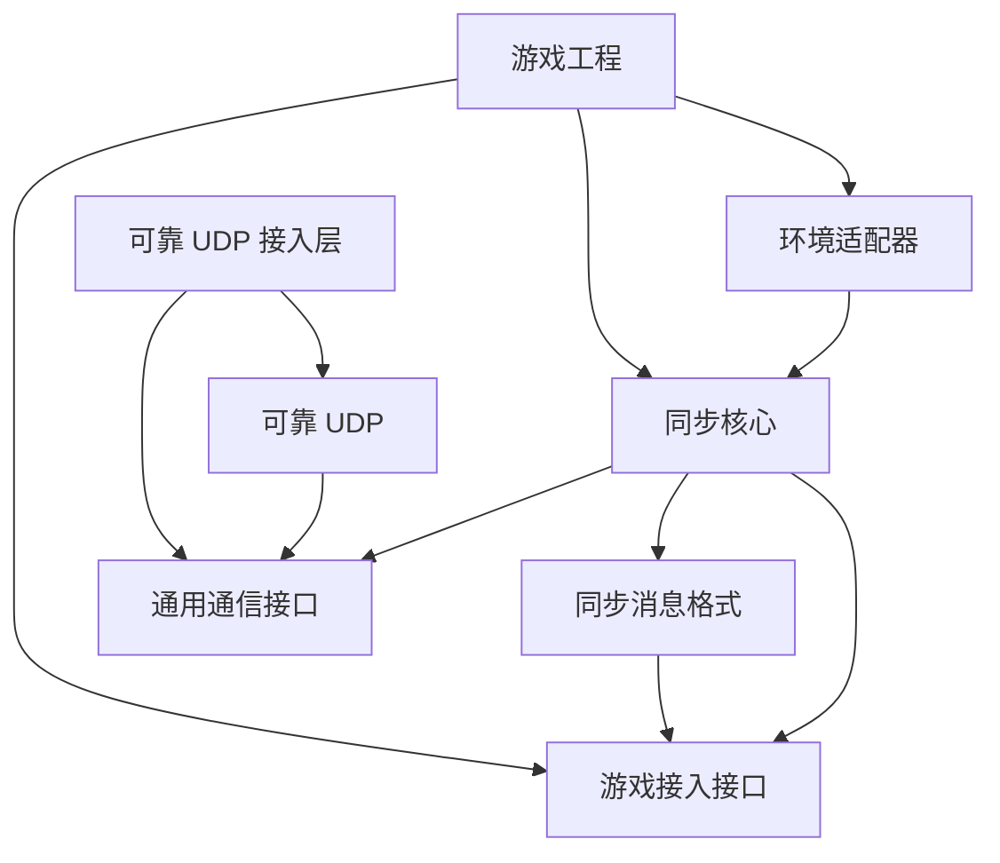

# 工程拆分与游戏接入：哪些由框架做，哪些由游戏做

日期：2026-10-10  
修订：v0.5，与总体方案及独立核心技术方案配套。  
状态（2026-10-15）：接入设计稿；A～E 初版工程已实现，实际接口和程序集见 [项目入口](../../../README.md) 与 [C/D 实现说明](../../stage-c-d-implementation.md)。下文后续接入目录与接口仍为计划。

目标是维护一份内部框架，让你自己的多个游戏各自接入。本文先解释接入方要做什么，再给出工程名称与较细的实现约定。

服务器、客户端和回滚历史内部如何实现，集中在[独立帧同步框架技术方案](2026-10-10-frame-sync-core-design.md)；本文维护游戏接口、环境适配与工程依赖。

初版先完成[核心模块与可运行范围](2026-10-10-initial-core-scope-design.md)。本文的 Unity、Steam、中途加入和完整重连描述保留作为后续接入设计，不要求在第一次运行核心前完成。

## 1. 怎样判断一段代码该放哪里

问一个问题：**它需要知道具体玩法是什么意思吗？**

需要理解玩法就放在游戏里；只负责安排计算、保存通用记录或传递数据，才有可能放在框架里。

| 工作 | 放在哪里 | 原因 |
| --- | --- | --- |
| 第 100 帧用了哪些人的输入 | 同步核心 | 所有接入游戏都有帧和输入 |
| 某个输入能否执行，执行后改变什么 | 游戏 | 不同游戏规则不同 |
| 何时保存、何时恢复旧状态 | 同步核心 | 这是回滚流程 |
| 保存哪些字段、怎样读回这些字段 | 游戏 | 只有游戏了解自己的数据 |
| 数据包丢了怎样补发 | 可靠 UDP | 与帧同步和玩法均无关 |
| 从 Unity 获取按键、显示动画 | 游戏与 Unity 接入层 | 与引擎及交互有关 |
| 玩家对应哪个游戏对象 | 游戏 | 框架不规定对象模型 |
| 文件保存在哪、Steam 如何邀请好友 | 环境适配器 | 与运行环境有关 |

例如框架可以要求游戏提供“没收到操作时的输入”，但不能规定它一定是“移动方向清零”。框架通知“某个参与者已断线”，也不能自行决定删除角色。

## 2. 游戏最少需要提供哪些能力

**接口**是双方约定的方法与参数。这里的英文名字是后续 C# 接口的工作名；先理解右侧职责即可。

| 游戏提供的接口 | 中文含义 | 框架什么时候调用 |
| --- | --- | --- |
| `ISimulationFactory` | 创建一份独立的游戏模拟 | 开房或启动客户端时 |
| `IDeterministicSimulation` | 推进一帧，保存和恢复状态 | 正常计算、回滚、加入恢复时 |
| `IInputPolicy` | 检查输入格式，生成中性输入和预测输入 | 收到输入或缺输入时 |
| `IStateCodec` | 把游戏状态写成字节，再从字节读回 | 存档、传状态、比较结果时 |
| `IApplicationEventCodec` | 编码游戏产生的事件 | 游戏需要通过事件驱动表现时 |

`Codec` 是编码器与解码器的合称。框架不直接遍历你的角色对象，不通过反射猜测哪些字段应该保存；你明确提供数据转换方式。

另外提供一份说明：这是哪个游戏、规则版本是什么、输入与存档是什么格式、内容和算法有哪些影响结果的配置。它们组成总体方案中的“兼容清单”，用来在进入房间前发现版本不符。

这些对象可统一装入 `ApplicationModule`，中文可理解为“游戏接入模块”。它只是把依赖放在一起，不是框架新增的一套游戏架构。游戏可以继续使用自己的面向对象或实体组件组织方式。

## 3. 一份游戏模拟怎样被调用

```text
宿主启动
  → 创建游戏接入模块
  → 检查配置和版本
  → 为服务器、每个客户端分别创建模拟实例
  → 正常运行时：一帧一帧调用 Step
  → 需要回滚时：Restore 旧状态，再调用 Step 重算
  → 需要状态副本时：Capture
  → 退出时：释放实例和历史
```

“宿主”是负责启动和驱动框架的程序；可以是 Unity 游戏，也可以是一个无画面的控制台程序。

| 方法 | 直白解释 | 约束 |
| --- | --- | --- |
| `Step` | 用传入的输入把规则计算一帧 | 只读本帧输入，不自己读设备或网络 |
| `Capture` | 取一份当前状态副本 | 后面继续运行不能改坏这份副本 |
| `Restore` | 把模拟恢复成副本记录的状态 | 不播放声音、不发网络请求、不写文件 |
| 只读状态查询 | 让显示层读取完整的当前结果 | 显示层不能反过来修改模拟 |

传给 Step 的内容包括本帧编号、固定时间步长、排序好的参与者输入、已经确定在这帧生效的成员事件，以及可选的游戏事件。

框架保证传入内容的顺序和时机，游戏保证规则确定性。游戏不能在 Step 里自行跳帧，也不能修改框架的确认进度。

## 4. 保存状态为什么分成几步

| 步骤 | 谁做 | 结果 |
| --- | --- | --- |
| 捕获 Capture | 游戏模拟 | 当前帧的一份独立状态 |
| 编码 Encode | 游戏状态编解码器 | 相同状态产生相同字节 |
| 保存／传输 | 框架和适配器 | 文件或网络消息 |
| 解码 Decode | 游戏状态编解码器 | 从字节构造通过检查的独立状态 |
| 恢复 Restore | 游戏模拟 | 用该状态替换当前状态 |

这样可以把耗时的编码、压缩、磁盘写入移出每帧计算；前提是捕获的副本不会再变化。

框架还保存自己的成员表、时间和预测历史，与游戏副本组成完整检查点。只恢复游戏可见数据而漏掉这些记录，也会导致重算错误。

初版使用完整复制，先明确谁持有内存并限制总量。**缓冲池**就是保存一批可重复使用的内存块，减少反复申请内存；它和增量复制都按后续测量逐步引入，不改变游戏的保存恢复接口。

### 4.1 谁可以修改或保留这块内存

“所有权”就是明确谁可以修改、谁负责释放。接口必须写清：

- 调用期间临时借用的数据，调用结束后不能继续使用。
- 要跨帧保留，就取得属于自己的副本或明确的持有权。
- 输入第一次提交后不可修改。
- 历史状态不能与当前模拟共用可变对象。
- 释放缓冲后不能再读写它。

这些要求用于避免“旧存档副本随着当前游戏一起变化”或“回滚恢复到已经被覆盖的内存”。

## 5. 输入策略具体要写什么

| 操作 | 含义 | 注意事项 |
| --- | --- | --- |
| `ValidateCanonical` | 检查输入字节是否符合约定格式 | 只检查；不要在首次发送后偷偷改写 |
| `CreateNeutral` | 生成没有新有效操作时使用的输入 | 游戏自己定义什么叫没有操作 |
| `Predict` | 为客户端尚不知道的输入给出暂时值 | 最终输入到达后允许纠正 |
| `FinalizeMissing` | 服务器到期仍没收到时生成最终替代值 | 替代结果一经确认不再改写 |

“Canonical”在这里表示规范表示：同一份输入有确定的字节写法。首次发送前可把数据整理成这种写法；之后保持不变。

默认接入模板让预测和缺失补齐都返回中性输入。某个游戏希望预测持续行为，再实现自己的规则。框架不解释哪一个位代表持续动作或一次性动作。

策略获得明确的近期历史、目标参与者、帧号与缺失次数，不读当前 UI，不在对象里偷偷保存递增计数。这些历史由框架保存，回滚时一起恢复。

输入字节虽然相同，“玩家确实发来了”与“服务器因为缺失而补的”仍可能影响后续预测，所以确认后需要更新相关历史。

还要区分三种反馈：

1. 网络收到了消息。
2. 服务器把输入纳入了最终帧。
3. 游戏规则执行后，玩家意图真正成功。

前两项不代表第三项。游戏执行结果通过游戏状态或游戏事件表达。

## 6. 参与者编号和游戏对象分开

| 名称 | 含义 |
| --- | --- |
| `ParticipantId` | 稳定参与者编号，用于重连识别 |
| `Slot` | 本次房间中的位置，便于固定输入排序 |
| `SlotGeneration` | 位置控制权的更新编号，防止旧连接继续控制 |
| `ConnectionId` | 临时网络连接编号，重连后变化 |

身份验证适配器确认凭据后给出 ParticipantId，不能让任意客户端报一个编号就接管已有数据。

游戏保存“参与者编号 → 自己的数据记录”的映射。第一个游戏可以映射到角色，另一个游戏可以映射到座位或其他数据，核心接口不必变化。

读取旧存档不会隐式创建新游戏对象。新成员激活和控制权重绑定，都通过明确帧的事件进入游戏规则。初版实际运行开局激活与断线停用，并测试重绑定的核心状态转换；运行中的加入与重连网络流程后补。

## 7. 环境适配器提供哪些能力

| 接入层 | 主要接口或能力 | 作用 |
| --- | --- | --- |
| Unity | 驱动更新、显示只读状态 | 接到引擎循环与开发工具 |
| 通信 | `ITransport`：连接、消息收发、交付结果 | 替换内存、可靠 UDP 或 Steam 通信 |
| 操作系统 UDP | `IDatagramPort`：发送和接收数据报 | 调用系统网络接口，不实现帧同步 |
| 身份 | `IIdentityProvider`：验证凭据、映射参与者 | 拒绝未经授权的控制权申请 |
| 文件 | `ICheckpointStore`：读、提交、备份 | 管理路径和读写失败 |
| 计时 | `IMonotonicClock`：只向前走的计时器 | 驱动网络超时，不决定游戏结果 |
| 安全随机源 | `IEntropySource` | 生成不可预测的连接标识或凭据材料 |
| 诊断 | `IDiagnosticsSink`：接收统计和错误 | 交给日志或调试界面，默认不上传 |

游戏模拟中的可重放随机数，与安全随机源用途不同，不能混用。

Steam 适配器后续负责发现房间、邀请、认证和平台通信。它不解释游戏输入，不改变同步算法。

每种通信实现说明消息大小上限、可靠与顺序保证、线程和内存使用方式，以及认证、加密能力。所选方式不满足游戏配置时明确拒绝，不能悄悄退回能力较弱的网络。

错误信息先以稳定编号和结构交给游戏，再由游戏决定文案和按钮；开发日志不直接成为玩家界面。

## 8. 独立工程如何组织

下面是完整目标的建议布局。`src` 存放实现，`tests` 存放测试，`adapters` 存放环境接入，`samples` 存放示例。初版只创建有实际实现的部分；同步内部职责可以先在同一纯 C# 工程内划分，通信库仍独立，不先搭一批空包。

```text
repository/
  framework/
    FrameSync.sln                  # 不依赖 Unity 的 C# 解决方案
    src/
      FrameSync.Abstractions/      # 游戏接入接口
      FrameSync.Runtime/           # 同步流程
      FrameSync.Protocol/          # 同步消息格式
      FrameSync.Persistence/       # 存档协调
      FrameSync.Diagnostics/       # 重放、统计、定位
      FrameSync.Deterministic/     # 可选工具，按需要后补
    transport/
      Transport.Abstractions/      # 独立通信接口
      ReliableUdp.Core/            # UDP 可靠传输算法
      Transport.ReliableUdp/       # 接到通用通信接口
      Transport.Memory/           # 内存传递
      Transport.VirtualNetwork/   # 模拟故障的测试网络
    tests/
      SimulationContracts/        # 游戏接入规则测试
      Runtime/
      Protocol/
      Persistence/
      ReliableUdp/
      ExternalConsumer/           # 验证独立工程能引用
  adapters/
    Unity/                        # 核心跑通后接入
    Sockets/
    FileSystem/
    Steam/                        # 后续再做
  samples/
    CounterHeadless/               # 无画面的整数例子
    GridHeadless/                  # 另一种无画面输入与状态模型
    GridUnity/                     # 后续给同一模型接 Unity 显示
  tools/
    HeadlessHarness/               # 无画面测试宿主
    ReplayInspector/               # 先命令行重放，界面以后补
  docs/
```

不要求现在新建仓库。框架工程可以暂时在当前仓库维护；各游戏通过固定版本引用，不各自复制一份后分开修改。

### 8.1 依赖方向

“依赖”指一个工程需要引用另一个工程才能工作。



箭头表示使用。核心不反过来引用 Unity、Steam、游戏或示例。可靠 UDP 也不引用同步核心的帧号与玩家类型。

保存、诊断模块通过约定好的接口接入，不能直接修改同步核心的内部历史。可选数值工具只由需要它的游戏引用，同步核心不强制引用。

## 9. 第二个游戏怎样接入

1. 选定框架版本，通过项目引用或固定版本的包接入。
2. 实现自己的模拟、输入策略、状态与事件编解码。
3. 先在无画面程序中重放输入，验证状态一致和恢复正确。
4. 接上输入设备、显示与表现事件。
5. 配置游戏版本、身份映射、存档位置与必要的旧档转换。
6. 先用内存／测试网络，再接实际通信；测试加入、重连和保存。
7. 在该游戏的实际构建上测量性能与长期运行情况。

接入过程不编辑 `FrameSync.Runtime` 或 `ReliableUdp.Core`。确有公共能力缺失时，统一修改框架并标记新版本；不要给某个游戏添加隐藏分支。

### 9.1 怎样保存可复用版本

最开始可以使用固定提交的源码引用或本地构建包。后续需要自动管理依赖时，再采用：

- **NuGet**：.NET 库的包格式与管理方式，可用于本地或私有包。
- **UPM**：Unity Package Manager，Unity 的包管理方式，可用于独立引擎接入包。
- **DLL**：编译后的 .NET 程序集文件，可把同一份核心供不同工程引用。

这些是内部组织代码的选择，不需要把框架发布到公开市场。参考 [NuGet 打包说明](https://learn.microsoft.com/en-us/nuget/create-packages/creating-a-package)与 [Unity 包布局](https://docs.unity3d.com/Manual/cus-layout.html)。

Unity 接入包区分运行代码 `Runtime`、编辑器代码 `Editor`、测试 `Tests` 和示例 `Samples~`。不能因为引用框架就顺带要求第一个游戏的场景或资源。

更新内部版本时记录变动、接入调整、存档影响及已测环境。旧游戏可继续锁定旧版；不要求同时升级。

## 10. 怎样验证没有绑定某个游戏

准备两个很小、输入与状态结构不同的例子：

| 例子 | 做什么 | 验证什么 |
| --- | --- | --- |
| CounterHeadless | 无画面的整数状态，接收离散操作 | 核心不需要引擎或坐标 |
| GridHeadless | 整数平面上的持续输入，无画面运行 | 输入策略可变，核心无需懂移动 |

例子只用于测试，不是框架内置玩法。初版两者都完成确认、回滚、基础存读档；中途加入和重连随对应功能增加验证。以后再把其中一份模拟接到 Unity 展示。自动测试另有自己的模拟数据，不能依赖示例工程；删除 samples 后核心测试仍可运行。

再建一个独立引用工程，只用允许游戏使用的接口接入，不能访问内部字段。准备包交付时，再验证它能仅靠生成的包运行。

| 检查 | 失败表现 |
| --- | --- |
| 无引擎构建 | 未安装 Unity 就无法构建核心 |
| 依赖检查 | 核心引用具体游戏、Steam 或样例 |
| 接口检查 | 参数里出现某个游戏的操作枚举或 Unity 类型 |
| 替换模拟 | 换输入结构就必须改核心分支 |
| 替换网络 | 从 UDP 换到其他方式必须改游戏规则 |
| 独立引用 | 依赖仓库内部相对路径、隐藏资源或私有字段 |
| 升级检查 | 同一版本代码变化却没有记录，旧档损坏无法回退 |

## 11. 可选数值和随机工具

这部分是辅助库，游戏按需使用；没有使用它也可以接入框架。

| 工具 | 通俗解释 | 计划中的精确规则 |
| --- | --- | --- |
| Fix32 定点数 | 用整数表示带小数的数值，例如原始整数 65536 表示 1 | 采用 Q16.16：32 位存储，缩放比例 65536；乘除使用 64 位中间值，向零截断，溢出或除零报错 |
| PCG32 随机数 | 可保存内部进度、重放得到相同序列的随机算法 | 固定 XSH-RR 这一具体变体、初始化与整数环绕规则，保存内部状态和序列参数 |
| 固定数值编码 | 每个数字怎样写成字节有明确规则 | 固定宽度、字节顺序及验证样例 |
| 稳定排序辅助 | 相同数据总按相同顺序处理 | 明确比较规则及相等时如何处理 |

固定这些细节，是为了不同平台计算一致，不是要给所有游戏规定数值范围或地图大小。比如距离平方可能需要更宽的中间值，仍由游戏选择合适计算方式。

随机算法参考 [PCG 使用说明](https://www.pcg-random.org/using-pcg-c-basic.html)。框架不因此内置二维物理、碰撞、寻路或实体系统。

## 12. 编写接口时还要写清的规则

- 每个方法在哪个线程调用，能否在回调里再次调用框架。
- 输入、状态副本、接收消息什么时候失效，由谁释放。
- 解码接受多大数据，超过上限怎样失败。
- 模拟或游戏回调抛出异常时，停止受影响会话，不吞掉异常后继续算。
- 影响结果的算法、格式与规则如何标记版本。
- 必须在实际运行环境验证；Unity 编辑器可运行不代表最终构建可运行。

需要提前编译代码的运行方式常称 AOT；代码裁剪可能删除被判定为未使用的内容。核心因此不依赖运行时生成代码或自动扫描游戏类型，实际 Unity 构建中验证接口注册与数据转换。

这些规则的作用是让你将来接入新游戏时知道可以依赖什么。维护范围由自己的项目需要决定，不额外建立对外销售或客户支持流程。
