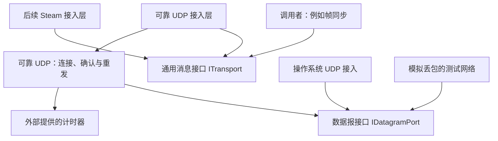
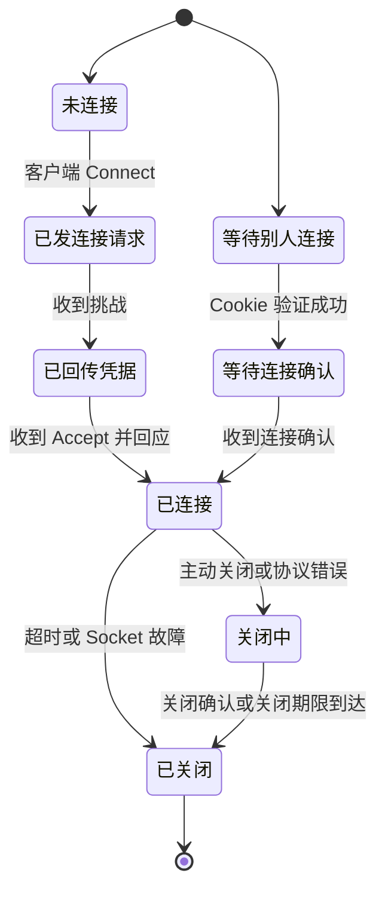

# 可靠 UDP 方案：先理解传输流程，再看协议细节

日期：2026-10-10  
修订：v0.4，补充与初版核心的阶段关系。  
状态：设计稿，尚未实现和测试。  
对应主文档：[确定性帧同步总体设计](2026-10-10-deterministic-frame-sync-design.md)。

这个模块供你自己的游戏和同步框架使用，是内部通信代码。它只负责传递消息，不理解帧号、玩家操作或存档内容，也不按对外销售的网络库规划。

帧同步如何使用本库的消息通道，见[独立帧同步框架技术方案](2026-10-10-frame-sync-core-design.md)。同步算法与本库的传输算法分别维护。

首批在 Windows/macOS 验证，后续可换用 Steam 通信。下文参数都是测试起点，尚无实测结果。

初版顺序见[核心模块范围](2026-10-10-initial-core-scope-design.md)：同步先在内存与故障测试网络中运行，再接本库验证真实多进程联机。本库的确认重发、分片、通道与内存上限仍是基础能力；状态压缩、复杂调参和运行中的加入协调不在本库初版扩展范围内。文中的快照传输例子说明通道用途，不表示初版已支持中途加入。

**第一次阅读建议先看第 1～3 节与第 12 节。** 第 4～10 节是实现时查阅的细节：连接如何建立、数据包怎么写、丢失如何判断、内存和速度怎样限制。英文缩写在首次相关位置解释，保留代码名便于以后对照实现。

## 1. 这个模块解决什么问题

UDP 是操作系统提供的一种数据报通信方式。你交给它一段字节，它尝试发送；送没送到、是否重复、是否乱序，需要本模块处理。操作系统提供的收发入口称为 Socket，可理解为程序的网络收发端口对象。

调用本库的代码统称“上层”。上层可能是帧同步，也可以是其他程序；本库只看字节，不解释字节代表的业务操作。

### 1.1 先分清消息、分片与数据包

| 名称 | 含义 | 例子 |
| --- | --- | --- |
| 消息 | 上层一次要求发送的完整内容 | 一份 2000 字节的数据 |
| 分片 | 消息太大时拆出的小块 | 按 900 字节上限，分成 900、900、200 三块 |
| 数据包／数据报 | 一次实际交给 UDP 发送的内容 | 协议头加某个分片，也可以带少量控制信息 |
| 子记录 | 数据包里面的一条内容记录 | 一个数据分片或一条关闭通知；不是游戏逻辑帧 |

比如第二片丢了，只需要补发第二片。三片完整后，接收方才向上层交付原来的 2000 字节消息，不交付半份内容。

### 1.2 可靠传输靠哪些机制

| 名称 | 直白解释 |
| --- | --- |
| 接收确认 ACK | 对端告诉我们“哪些包已经收到” |
| 自动重传 ARQ | 没有确认、判断丢失后再发；选择性重传只补缺失部分 |
| 去重 | 同一片到了两次，只记录一次 |
| 重组 | 把一条消息的全部分片重新拼完整 |
| 往返时间 RTT | 一个包发出到收到其确认的耗时 |
| 重传超时 RTO | 最久等多久还没确认，就按超时处理 |
| 通道 | 为不同种类消息设置的独立交付队列 |
| 流控 | 接收方内存快满时，让发送方少发 |
| 拥塞控制 | 网络路径承受不住时，降低发送速度 |
| 背压 | 本库暂时接不下新数据时，通知上层稍后再提交 |

这些机制合起来才构成可靠消息传输，不能只加一个重发定时器。后文“有界”表示有明确的数量、大小或时间上限，不允许无限增长；“载荷”指实际携带的字节，例如 UDP 载荷包括本库的协议头和数据。

可靠性指：连接持续有效、双方遵守协议且网络最终恢复时，已接受的可靠消息最终完整交付；连接失败时报告失败，不能无限等待。不保证进程崩溃、重新连接后的恰好一次业务执行。

首版先验证本机、局域网和可以直接访问的地址。NAT 是路由器常见的地址转换；打洞尝试建立两台路由器后设备的直接通路，中继则让第三台服务器转发。这些都不由可靠重发自动提供，首版不自建公共打洞或中继服务，也不做连接地址迁移、多路径传输或自研密码算法。

### 1.3 参考与自研边界

- 参考 KCP 的选择性重传、快速重传和由调用者驱动更新的思路；不复制其协议，也不引入 KCP 替代本模块。[KCP 项目与源码](https://github.com/skywind3000/kcp)
- 按 UDP 使用建议考虑拥塞退让、发送速率和报文尺寸；不能只实现 ACK 和重发就宣称完成可靠传输。[RFC 8085](https://www.rfc-editor.org/rfc/rfc8085.html)
- RTT 平滑与超时估计参考 RFC 6298；下述协议不是 TCP，也不宣称完整实现某个标准传输协议。[RFC 6298](https://www.rfc-editor.org/rfc/rfc6298.html)

自己实现连接流程、数据格式、重传、窗口和测试网络。复用操作系统 UDP、只向前走的计时器、安全随机源以及标准校验算法。HMAC 是带密钥的消息校验方法，具体用于第 4 节的握手凭据。游戏重放使用的确定性随机数不能用来生成连接密钥或认证材料。

## 2. 代码怎样分层、怎样调用



接口是代码间的方法约定。“通信后端”只是接口背后的某一种具体实现，例如自研 UDP 或 Steam。宿主是负责创建并驱动这些模块的程序。

`ReliableUdp` 只接收“某时刻收到了哪些字节”“现在是什么单调时间”“要发送什么消息”，输出待发数据报、完整消息和连接事件。不读取引擎循环、平台接口、系统文件或应用状态。

`ReliableUdp.Core` 是独立 C# 工程，只依赖通用通信接口 `Transport.Abstractions`。`Transport.ReliableUdp` 把它接到 ITransport；调用系统网络或提供安全封装的代码放在外面。这个库不引用任何 FrameSync 类型。目录与依赖见[工程拆分与游戏接入](2026-10-10-framework-integration-design.md)。

给调用者的方法与事件至少包括：

| 操作或事件 | 含义 |
| --- | --- |
| `Connect / Listen` | 发起连接或接收连接；返回本地连接句柄 |
| `TrySend(channel, bytes, options)` | 返回已接受 Accepted、暂时满了 Backpressure、过大 TooLarge、未连接 NotConnected；已接受表示库接管这份数据，上层不能再修改 |
| `MessageReceived` | 交付完整消息及连接、通道；缓冲区必须显式释放或复制 |
| `SendCompleted` | 该可靠消息的所有分片均被对端传输层确认；不等于业务逻辑已经执行 |
| `Disconnected / SendFailed` | 返回原因及尚未完成的可靠发送句柄 |
| `Poll(now) / OnDatagram(...)` | 定期推进收发工作／提交收到的数据包；不等待画面或逻辑帧完成 |
| `GetStatistics` | RTT、丢包估计、窗口、重传、队列、流控和重组占用 |
| `Capabilities / SecurityProperties` | 可用能力说明：大小、交付方式、验证身份、防窃听、防篡改、防重放旧包；不能隐含保证 |

单个连接状态由一个执行线程拥有。Socket 接收线程仅入队不可变数据；发送完成回调也经队列汇入协议线程。每次 Poll 限制处理包数和字节，避免网络流量让宿主主循环长时间失去响应。

收到传输连接事件后，上层仍需完成自己的版本、访问权限与业务身份验证。`ConnectionId` 只标识本次传输连接，库不包含玩家、房间或角色类型。

## 3. 不同消息走什么通道

“可靠有序”表示完整消息按发送顺序交付；“可靠无序”表示哪条先完整就先交付；“不可靠”表示本库不保证补发。它们都不代表上层业务已经执行成功。

1 B 是 1 字节，1 KiB 是 1024 字节，1 MiB 是 1024 KiB。下面是首批参数组合，不是所有游戏必须使用的常量。

| 通道 | 交付方式 | 用途 | 首批配置的消息上限 |
| --- | --- | --- | --- |
| 0 | 不可靠、允许乱序；不做传输分片 | 有时效的数据 | 900 B |
| 1 | 可靠有序，通道内按 MessageId 交付 | 小型控制 | 4 KiB |
| 2 | 可靠无序，重组完成即可交付 | 修复及普通可靠数据 | 16 KiB |
| 3 | 可靠无序，重组完成即可交付 | 大块数据 | 16 KiB |

可靠传输的默认通用单消息上限为 64 KiB；上表较小的上限属于首批使用配置，不是固定业务字段。通道策略与预算在建立连接时验证并冻结；大对象由上层继续分块。FrameSync 如何使用这些通道仅在总体方案中定义。

通道 0 的代码名称为 UnreliableUnordered，意思是不可靠、无顺序保证。新包号不会直接覆盖旧消息；是否过时、如何拼接和去重由调用者决定；库不读取载荷内的帧号或版本号。该通道允许重复消息，上层必须容忍。

可靠通道分别拥有消息序号、分片序号、重组队列与流控额度。快照缺一个分片不会阻止控制消息完成交付；但它们仍共享同一网络的拥塞预算，无法承诺完全没有时延影响。

不可靠发送可附宿主单调时间定义的过期时间；过期或队列满时丢弃并计数，不能为赶上旧输入而无限排队。可靠消息一旦接受并分配序号，不能用同样方式静默丢弃。

## 4. 先建立连接，再交换数据

“握手”是正式通信前交换版本、随机值和连接参数的过程。Cookie 在这里是一份短期回传凭据，用于检查发送者是否能收到我们发回那个地址的内容，与浏览器 Cookie 无关。Nonce 是本次握手新生成的随机值，用来区分不同尝试。

端点指对方的 IP 地址和端口组合。下面的状态图同时列出发起方和监听方，后续条目规定具体步骤。



握手顺序：

1. 客户端发 `TransportHello`：协议版本、客户端随机 Nonce 和固定填充，初始长度 192 B。
2. 服务器返回小型 `RetryCookie`：服务端 Nonce、有效期限、HMAC Cookie。未验证前不分配大连接状态、传输大对象或创建大接收缓冲。
3. 客户端回传 Cookie。服务器校验来源 IP/端口、双方 Nonce、协议版本、有效期限及 HMAC。
4. 验证后服务器分配随机 128 位 ConnectionId，发送 `TransportAccept` 与协商的通道、报文和窗口参数。
5. 客户端回应连接确认；服务器确认后才上报正式连接。丢失时重发对应握手步骤，相同握手不得重复创建连接。

Cookie 使用标准 HMAC-SHA-256 和服务器临时密钥；覆盖地址的规范二进制表示。初始回复不大于请求，避免有人伪造别人的地址，用小请求诱导服务器向那个地址发送大量数据；这类问题称为反射放大。Cookie 有效期默认 5 秒，过期后重新挑战；握手总期限 10 秒。

握手重试逐步拉长间隔，称为指数退避，例如 1 秒、2 秒、4 秒；服务器短期缓存“已验证握手 → ConnectionId”的有界映射，使 Cookie 重复回传得到同一结果。最大已连接数、待接受连接数及总资源由宿主配置。首批集成配置的待接受连接上限为 4，业务层另行限制活跃参与者；传输库不硬编码玩家数量。不能根据任意 UDP 来源无限创建对象。

服务器在 PendingAccept 状态收到当前 ConnectionId 下有效的连接确认或首个正常数据包时，都可确认握手完成。重复 Accept 只重发确认，不重置已建立连接的包号和窗口，以免连接确认丢失造成状态分叉。协商参数包括通道预算、最大内层报文、分片载荷和可靠消息上限，任何组合必须满足资源约束。

握手 Cookie 仅验证返回路径，不证明业务身份，也不提供机密性或抗中间人能力。业务授权属于上层；公网部署还必须满足第 13 节的安全能力要求。

心跳是一条说明连接仍活着的小消息。连接空闲时每 1 秒发送一次；连续 10 秒没有有效入站报文则断开。业务会话是否继续保留由上层决定，不能把传输超时直接解释为删除业务记录。对方地址改变时重新建立连接，首版不自动搬迁原连接。

## 5. 数据包中写哪些内容

这里开始给出可用于实现的格式。序号分别回答“哪次连接”“哪个包”“哪条消息”“哪一片”。类型名 uint8/16/32/64 分别表示 1/2/4/8 字节无符号整数，不用一个编号代替全部。

### 5.1 不混用不同层的序号

| 标识 | 范围与用途 |
| --- | --- |
| ConnectionId | 一次传输连接，随机 128 位；重连后更换 |
| PacketNumber | 每连接、每方向单调递增的 uint64；每次实际发送使用新值 |
| ReliableSequence | 每方向、每可靠通道的分片序号；同一分片重传保持不变 |
| MessageId | 每方向、每可靠通道的消息序号；按接收发送请求的顺序分配 |
| FragmentIndex / Count | 消息内的位置与总分片数 |
| ByteOffset | 每可靠通道为新消息累计分配的载荷字节区间起点，用于流控 |
| 应用标识 | 只存在于不透明消息载荷；传输库不解释其格式 |

PacketNumber、ReliableSequence 和 MessageId 从 1 开始；ByteOffset 从 0 开始，FragmentIndex 从 0 到 FragmentCount−1。uint64 不设计回绕比较；接近耗尽时结束连接并新建，解析和加法先检查溢出。重新连接不能复用旧连接的未完成消息，需要应用层按新会话规则恢复。

### 5.2 数据报公共头

公共头是每个包最前面的一段说明。CRC32C 是检测数据损坏的校验值，不能阻止别人伪造内容。小端序表示多字节数字先写低位字节，双方采用同一规则，避免不同机器理解不同。

MTU 表示路径可承载的最大包尺寸；下文将它换算为本库可用的 UDP 载荷预算。加密封装也占字节，不能只计算游戏数据大小。

未加安全封装的配置的整个 UDP 载荷上限为 1200 B，包括以下 80 B 公共头、子记录头和数据。接入安全数据报封装时，外层上限仍为这组配置的路径预算，内层报文上限必须扣除封装开销；不能加密后再无条件增加包长。

| 字段 | 字节数 | 含义 |
| --- | --- | --- |
| Magic | 4 | ASCII 字节 RUDP，即小端 uint32 的 0x50445552 |
| ProtocolVersion | 2 | 线协议版本；首版为 1，要求严格相等 |
| Flags | 2 | 报文种类、ACK 有效标记；未定义位必须为零 |
| ConnectionId | 16 | 握手分配前为零 |
| PacketNumber | 8 | 已建立连接的发送编号 |
| LargestAck | 8 | 已接收的最大包编号 |
| AckBits | 32 | LargestAck 之前 256 个包的接收位图 |
| PayloadLength | 2 | 后续所有子记录的总长度 |
| FrameCount | 2 | 首版 0～8 条子记录，纯 ACK 时为 0；与游戏逻辑帧无关 |
| CRC32C | 4 | 计算时该字段归零，覆盖整个数据报；仅用于损坏检测 |

位图用每一位的 1 或 0 表示一个包是否收到。LargestAck 本身表示已收到；位图第 0 位对应 LargestAck−1。首包尚无可确认数据时 AckValid=0。所有多字节整数采用固定小端序，位图按明确位序编码；不用 C# 对象内存布局作为协议。

握手也使用公共头，但在分配前 ConnectionId、PacketNumber 为零且 ACK 无效；握手报文不进入数据包重传账本。建立后两个方向各自从 PacketNumber=1 开始。传输 ACK、Cookie 和 CRC 都不代表应用状态校验。

### 5.3 包内子记录格式

TLV 是“类型、长度、内容”这种编码方式的简称。本协议再包含通道号，每条子记录有 4 B 头：`Kind:uint8 + Channel:uint8 + BodyLength:uint16`。

首版子记录如下；这些“记录”与游戏逻辑帧无关：

| 子记录类型 | 内容 |
| --- | --- |
| UnreliableData | 完整的不可靠消息，不超过 900 B |
| ReliableFragment | 分片描述信息与至多 900 B 载荷 |
| FlowCredit | 指定可靠通道的 MaxByteOffset、MaxMessageId |
| Ping / Pong | 单调采样标记，供传输活性与统计使用 |
| Close / CloseAck | 有界原因码及关闭标识 |
| 握手子记录 | Hello、RetryCookie、CookieEcho、Accept、连接确认 |

ReliableFragment 描述信息共 32 B：ReliableSequence 8 B、MessageId 8 B、ByteOffset 8 B、TotalLength 4 B、FragmentIndex 2 B、FragmentCount 2 B。默认完整分片占用最多 `80 + 4 + 32 + 900 = 1016 B`；剩余空间可携带小型控制子记录，但必须同时满足协商的内层上限和封装后的外层路径预算。

默认可靠消息长度为 1～65536 B。分片载荷在握手时固定，初值为 900 B；只有最后一片可以较短。FragmentCount 必须等于向上取整的 TotalLength/协商分片载荷。片位置由索引推导，禁止任意重叠区间。同一消息的 ReliableSequence 连续，`ReliableSequence - FragmentIndex` 必须恒定。

后端能力降低内层报文尺寸时，同步降低分片及最大消息预算。开连前必须验证 `最大可靠消息 <= 分片窗口 × 分片载荷`，否则全消息预留策略会无法取得足够位置。参数不兼容直接拒绝，不能发送到一半才发现死锁。

实时数据不拆成传输分片。解析器在分配内存前检查长度、通道、子记录类型、分片数、整数溢出及协议状态；未知版本拒绝，未知子记录类型在首版视为协议错误。

1200 B 是本项目保守起点，不是所有路径都保证可达的值。Socket 报告报文过大时明确失败或重新协商更小配置，不交给 IP 层任意分片；首版不实现完整路径 MTU 探测。[UDP 报文尺寸建议，RFC 8085](https://www.rfc-editor.org/rfc/rfc8085.html)

## 6. 收到确认后，更新哪些记录

“账本”就是本机保存的已发送记录，包含发了哪个包、什么时间发、带了哪些片。`bytesInFlight` 表示仍等待确认或丢失判断的字节总数，中文称在途字节。

例如包 10 带着分片 7，没等到确认后用包 14 再带一遍分片 7。包号变了，分片号没变；任一副本被确认，就无需再补这片。

每次发送含数据或其他需要响应内容的包，记录 PacketNumber、发送时间、总字节数及所携可靠分片的引用；不可靠载荷只用于拥塞统计，不进入可靠重传队列。纯 ACK 包不要求再收到 ACK，也不计入普通数据在途窗口，避免 ACK 循环。

接收方完成合法性检查后，只有在可靠分片已经保留到受预算保护的缓冲区、或确认为已经接收的重复分片时，才记录该包已接收。不能先 ACK，再因队列满丢掉可靠数据。遵守流控的包应有预留容量；内部资源异常必须失败关闭，不能虚假确认。

发送方处理 ACK：

1. 仅接受当前连接及匹配端点的报文；忽略已结束跟踪记录的重复 ACK。
2. 拒绝不可能的编号，例如确认尚未发送的未来 PacketNumber；ACK 位图越过零的位不得置位。
3. 每个在途包只结算一次，减少 bytesInFlight，更新 RTT 或丢失统计。
4. 只要任一携带某分片的包被确认，该分片即完成；不要等待它所有重传副本都得到 ACK。
5. 重传副本拥有新 PacketNumber，仍引用相同 ReliableSequence 和 MessageId。一个副本的迟到 ACK 不能让在途字节重复扣减。

包 ACK 只表示传输接收，不表示上层操作已经执行。消息全部分片确认后才发 SendCompleted；调用者仍通过自己的执行结果消息判断是否成功，传输库不认识玩法或存档。

### 6.1 ACK 发送与历史上限

ACK 优先捎带在出站包中。没有出站数据时，对需要确认的入站包在 10 ms 内发送 ACK；重复包也能触发有速率上限的重复 ACK。纯 ACK、单独流控通告不引起无限应答链。

接收包去重窗口与 256 位 ACK 历史一致。更旧包可丢弃，不再尝试无限保留包历史；其中仍未确认的可靠分片最终会用新 PacketNumber 重发。已经收到的分片依靠可靠序号去重，不能因此再次交付消息。

每连接最多 64 个计入拥塞的在途数据报。包记录在确认或判定丢失后删除；仍未确认的分片保留在独立可靠发送窗口。不能为了一个永久丢失的旧包无限保留每次重传的全部包副本。

## 7. 什么时候补发丢失的数据

有两种判断：后续多个包已经到了，前面的可能丢了；或者等得足够久仍无确认。前者叫快速重传，后者靠重传超时 RTO。

### 7.1 为什么只保留一个有限窗口

“滑动窗口”是当前允许处理的有限序号范围。例如只允许 1～128 号分片，前面连续确认后，再把范围向后移动。这样不会为很久以前的缺口无限占内存。

每个可靠通道维护 128 个分片的滑动窗口：

- 发送窗口基准为最小未确认 ReliableSequence。只允许分配和发送窗口范围内的新分片；已确认的后续分片可标记完成，但不能越过尚未确认的窗口头无限前进。
- 接收窗口基准为第一个尚未收到的 ReliableSequence。窗口内分片可乱序保留；连续片到齐时推进接收基准。
- 已经过接收基准的分片及窗口内已置位的分片为重复，只确认、不再次写入或交付。
- 一个消息开始分配时，必须为其全部分片预留窗口位置与流控额度。默认 900 B 分片下，最大 64 KiB 消息需要 73 片，小于 128 片窗口；改变协商参数时重新验证此约束。

分片确认基于第 6 节包 ACK，不再额外叠加一套独立分片 ACK 协议。通道 1 必须等更早消息交付后才交付后续消息；通道 2、3 可在各自消息完整时交付。重复接收不能增加完成计数或反复延长资源保留时间。

### 7.2 丢失判断

当某个未确认数据包之后已有至少 3 个不同的更大 PacketNumber 被新确认时，将该包判定丢失；只计入原本属于在途数据账本的后续包。相同 ACK 重复到达不累计次数。重新排队其中仍未确认的可靠分片，不重发已经过时的不可靠消息。

乱序可能触发多余重传，因此接收去重必须正确，拥塞降窗每个恢复周期最多一次。没有足够后续包时依靠超时，例如房间暂时没有新消息也能恢复最后一片。

### 7.3 RTT 估计与 RTO

RTT 是一次往返的实际耗时；SRTT 是把多次 RTT 平滑后的估计，RTTVAR 是波动程度估计。RTO 用这两者决定等多久重发。公式中的 clamp 表示把结果限制在给定最小和最大值之间。

使用本机单调时间计算发送到 ACK 的往返间隔，不相减两台电脑的日历时间。新 PacketNumber 使 ACK 可以定位具体包副本；对有效在途记录采样，并限制高频 ACK 对估计器的过度加权。10 ms ACK 等待计入观测 RTT，首版不使用对端提供的 ACK 延迟修正。

初次有效样本 R：

```text
SRTT = R
RTTVAR = R / 2
```

后续样本先更新 RTTVAR，再更新 SRTT：

```text
RTTVAR = 3/4 × RTTVAR + 1/4 × abs(旧 SRTT - R)
SRTT   = 7/8 × 旧 SRTT + 1/8 × R
RTO    = clamp(SRTT + max(时钟粒度, 4 × RTTVAR), 1 秒, 60 秒)
```

无样本时 RTO 初始为 1 秒，超时后指数退避；快速重传通常先处理持续数据流中的缺口。这些系数与保守起点参考 RFC 6298，后续如需更短的定时器，应先测量乱序、抖动和误重传，而非直接套用一个“低延迟”常数。[RFC 6298](https://www.rfc-editor.org/rfc/rfc6298.html)

使用连接级最早在途期限驱动计时，超时触发一次拥塞退让，并将到期的未确认分片纳入受节奏限制的重传队列。超时包从 bytesInFlight 结算为丢失，新副本发送时重新计入；不能超时一次就立即重发整个历史队列。

## 8. 网络堵了怎样降速

“发送调度”决定下一次先发哪条消息、发多少。“拥塞”表示数据超过网络路径承受能力，开始排队或丢失。继续加速重发可能让情况更差，因此必须减速。

流控解决接收方是否装得下；拥塞控制解决网络路径是否承受得住。两者都必须满足才能发送新数据。

### 8.1 首版拥塞控制

首版采用慢启动加 AIMD：开始时逐步增长，之后温和增加，一旦判断拥塞就按比例降低。AIMD 的含义就是“加法增加、乘法减少”。

cwnd 是拥塞窗口，表示同时允许在网络中等待确认的字节量。下表的 MSS 是本方案的报文预算单位，初值 1200 B，按完整 UDP 载荷计数；它不是 TCP 的实际有效载荷参数。发送节奏把这些字节分散发出，避免一瞬间全部发送。

| 项目 | 首版规则 |
| --- | --- |
| MSS | 1200 B，按完整 UDP 载荷计费 |
| 初始 cwnd | 4 × MSS；初始慢启动阈值 32 × MSS |
| 慢启动 | 每确认新数据增加相应确认字节数 |
| 拥塞避免 | 每 RTT 约增加 1 × MSS，使用累计的 `MSS × ackedBytes / cwnd` |
| 快速丢失 | 每恢复周期至多减半，阈值最低 2 × MSS |
| 超时 | 阈值减半，cwnd 降至 1 × MSS；重传定时器退避 |
| 硬上限 | 64 个数据报在途，字节窗口同时生效 |
| 发送节奏 | 约 cwnd/SRTT；单次突发不超过 2 × MSS，且不能超过剩余窗口 |

握手可提供初始 RTT 估计；没有有效估计时采用保守初值。原本分散的 ACK 可能挤在很短时间里到达，称为 ACK 压缩；它不能让一次 Poll 突然发出大量数据；长时间无数据后不直接沿用过大的历史发送速率。

一个恢复周期记录进入恢复时最大的已发送包编号，在确认越过该边界后才结束；同一批丢包不多次减半。包 ACK 即使只确认不可靠消息，也参与该方向路径的拥塞估计。所有数据与重传都计入同一连接的预算；安全封装后的实际或保守估计上网字节数也必须计费。

纯 ACK/必要的连接响应使用很小的独立速率预算，避免双方窗口满后无法确认；它们不能成为绕开拥塞控制的大数据通道。各连接分别估计自己的出站路径，宿主所有连接的总出站流量还受总带宽预算约束。[UDP 拥塞与聚合流量建议，RFC 8085](https://www.rfc-editor.org/rfc/rfc8085.html)

### 8.2 队列优先级

先处理有界 ACK/连接控制，然后在小型控制、实时消息、补帧与大块数据间按字节配额调度。控制优先；同等级重传先于新数据；大块数据通道只能使用剩余预算，初始每连接另限 512 KiB/s。帧同步可用它传快照，但本库不识别快照格式。

每次调度保留其他非空队列获得服务的机会，不能让不断重发的一个快照永久饿死新输入，也不能用无限实时排队让恢复所需的补帧永远发不出。实时队列丢弃过期消息；可靠队列满时把 Backpressure 返回上层。

速率上限并非最低带宽保证。上层大对象传输的期限与重试策略独立于库；库提供背压与失败事件，不擅自延长上层业务的保留期限。

## 9. 对方装不下时怎样停下来

网络不堵，对方也可能来不及处理。流控是接收方发给发送方的额度：“你最多还能发多少字节、多少条消息”。额度是许可，不是收到多少的确认。

例如初始允许 256 KiB，对方已占用这些空间又没释放，就不能继续塞入新消息。等上层真正释放 16 KiB，接收方才可以增加相应额度。这与丢包重发是两回事。

每可靠通道初始允许 256 KiB 载荷和 64 条尚未处理释放的消息；连接总接收预算初始 2 MiB，包含重组数据、已完成待交付消息和描述信息。三条可靠通道不能分别按连接总额无界分配。

接收方通告单调递增的两项绝对额度：

- `MaxByteOffset`：新消息载荷区间的末尾不能超过该值。
- `MaxMessageId`：新消息编号不能超过该值。

发送方为每条消息一次性分配连续字节区间并预留其全部分片；只有字节额度、消息额度和分片窗口都足够才能开始。分片带同一消息的 ByteOffset 和 TotalLength；重传不再次占用新的额度。

接收方必须验证所有分片对消息范围的声明一致，不同消息不能重叠或复用范围。不能先分配一个大消息的半数分片，再无限等待永远不足以容纳整条消息的额度。

接收端保留连续消息描述已完成到的位置以及窗口内尚未完成的描述，校验相邻消息的编号、字节区间和分片序号连续关系。旧 MessageId 不能用新的 ReliableSequence 重新引入。已收分片由滑动窗口去重，已交付消息的历史可随连续完成位置压缩，不能为每条已交付消息永久留一份对象。

消息交付后，直到上层释放缓冲，才增加已释放字节/消息计数，并相应扩大 MaxByteOffset/MaxMessageId。乱序通道可以按实际释放量增加额度；不能将“包已 ACK”误当成“接收内存已释放”。

流控通告重复收到也只产生相同效果，这叫幂等；旧值不得缩小额度；定期捎带最新值。零额度时允许有界探测，初始 1 秒并退避到 5 秒，防止唯一一次额度更新丢失后双方永久等待。FlowCredit 本身不依赖需要该额度才能发送的可靠数据队列。

发送方每连接已接受的应用可靠载荷最多 1 MiB，实时队列另设小额上限。上层大对象读取器按背压逐块提供数据，不能先复制完整对象到每个连接的发送队列。缓冲分配、溢出、上层未释放和长时间无进展都须有可查询统计。

## 10. 怎样拼完整、取消和关闭

分片到齐后才能交付完整消息。已经告诉对方“收到了”的片必须保留到上层处理并释放；否则对方可能已删除发送副本，无法再补。

取消是停止上层需要这份结果，不等于可以任意挖掉传输序号中的一段。第一版选择把已经开始的可靠消息发完并丢弃其业务结果，或者明确关闭连接。

重组验证必须覆盖：总长度、片数、索引、最后一片长度、连续序号关系、字节范围、通道、同一分片内容稳定，以及消息大小硬上限。只有所有片齐全且总长度精确匹配时才交付。

**已经 ACK 的可靠分片不能因为普通清理或超时被悄悄删除。** 对端收到 ACK 后可能已释放该分片，继续等待无法修复这个缺口。资源故障或可靠消息长期无进展时，明确失败关闭连接，让应用层重新同步。

首版每条已开始消息连续 30 秒没有可靠进展则失败关闭；上层长期不释放接收缓冲也有同样的可配置故障期限。重复片、重复 ACK 或只有心跳不能重置“有效进展”计时。

应用取消一项大块传输时：

1. 停止提交尚未被传输接受的块。
2. 尚未分配可靠序号的队列项可以按明确取消协议撤销并报告。
3. 已经分配的可靠消息继续排空，应用层按 TransferId 忽略旧传输；需要立即释放时关闭整个连接。

不能在有序或滑动窗口中直接删除中间序号后继续发送后续数据。首版不实现传输级“跳过可靠序号”协议。

正常 Close 进行有限次重复通知，最多等待 1 秒；CloseAck 后清理，不保证进程突然被终止时对端必然收到关闭包。上层需要提交的事务及最终结果应在关闭前协调完成，传输关闭结果不代表业务提交成功。

## 11. 两端分别做什么

发起端主动请求连接，监听端等待请求。连接建立后，两端都有相同的确认、重传和接收逻辑。

“队头阻塞”指后面完整的消息被前面缺失的消息挡住，只能等它补齐。独立通道能隔开各自的交付顺序，但仍共享同一条网络带宽。

| 角色 | 传输层职责 | 不属于传输层的职责 |
| --- | --- | --- |
| 发起端 | 握手、连接、通道、RTT/ACK/重传、断线事件 | 业务时间线和业务身份恢复 |
| 监听端 | 有界握手、独立连接状态、总带宽与资源调度 | 帧确认、持久化内容和应用权限 |
| 双方共享 | 相同编码器、窗口、拥塞算法、消息重组与统计 | 引擎调用及平台大厅操作 |

FrameSync 的本地连接可使用 MemoryTransport；该选择发生在上层装配，ReliableUdp.Core 不特殊处理“房主本地玩家”。

后续平台后端通过相同 ITransport 暴露自己的能力，是否使用自研 UDP 由宿主显式选择。后端保证更强或存在额外队头阻塞时如实报告，并通过适配器一致性测试验证，不以接口名称掩盖差异。

## 12. 用四个例子看传输结果

### 12.1 不可靠消息丢失

消息丢失 → 库不重发 → 上层按自身时效决定冗余、修复或接受丢失。库不能替应用重排业务操作或承诺事务完成。

### 12.2 可靠分片丢失

包 10 携带分片 7 后丢失 → 包 11、12、13 获得确认 → 分片 7 以新包号 14 重发 → 接收方补齐消息。原包 10 随后到达时按重复分片处理。

### 12.3 ACK 丢失

分片 7 已被接收，但 ACK 丢失 → 发送方以新包号重发 → 接收方确认新包、丢弃重复片 → 发送方完成该片。256 个包的 ACK 历史不要求永久保留旧包。

### 12.4 大块数据与控制并行

通道 3 缺片 → 通道 1 的控制消息仍可独立重组和按本通道顺序交付 → 共享拥塞窗口可能增加等待，但不会等待大对象整体完整。上层取消不导致库静默删除已经 ACK 的可靠片。

## 13. 游戏通过公网联机前检查什么

可靠传输解决“完整送达”，身份验证与加密解决其他问题：

| 能力 | 解决什么 |
| --- | --- |
| 身份验证 | 对方是不是允许连接的人 |
| 加密 | 传输内容不被途中的第三方直接读取 |
| 认证完整性 | 被篡改或伪造的内容能被识别 |
| 重放防护 | 旧的合法包被再次发送时，不能被当作新操作 |

CRC 只检查损坏，ConnectionId 只区分连接，Cookie 只检查回传路径并减少伪造来源导致的资源浪费；它们不能替代上述能力。

按实际使用情况选择通信方式：

| 配置名称 | 含义 | 使用范围 |
| --- | --- | --- |
| TrustedNetwork | 受控网络配置 | 本机、自动测试或明确受控的网络 |
| AuthenticatedSecure | 带身份验证和安全封装的配置 | 所选组件与目标环境验证后用于公网 |
| 平台通信 | 例如后续 Steam 接入 | 按平台实际能力和游戏测试结果使用 |

安全封装放在数据报接入层，告诉库可用的字节数和额外开销。使用合适的成熟组件，不自行设计密钥交换或拼接密码算法。具体组件在实施该接入层时选择；未验证之前不能将原生裸 UDP 当作游戏公网发行的默认方式。

游戏配置说明需要哪些能力，缺少就明确失败。UDP 接入暂未具备能力，不影响同步核心继续开发，也不影响选择另一个已验证的通信方式。

游戏使用该通信方式前，检查异常数据处理、内存和连接上限、连接与密钥更新、能力不足时拒绝、双系统互联和长时间运行。依赖库的许可证也要适合随游戏发行。这些检查服务于自己的游戏，不是框架对外销售或认证流程。

错误输入应在有限时间和内存内失败；密钥与认证材料不写日志。本库不自动上传统计，不内置平台账号或存档路径。

## 14. 不启动游戏也能验证的测试

“模糊测试”是自动产生大量异常、残缺或随机数据，检查解析器是否会崩溃或无限占内存。“测试向量”是固定的输入与期望结果，便于两种系统逐字节比较。“长稳测试”是长时间持续运行，观察内存和连接是否泄漏。

先在不启动游戏的无画面程序中测试。VirtualNetwork 使用可重放的测试随机种子和虚拟单调时间，模拟包队列、链路带宽、传播延迟、突发丢包、重复、重排与断流；不得用真实 Sleep 拼出不可复现的单元测试。

| 测试组 | 场景 | 验收结果 |
| --- | --- | --- |
| 编解码 | 固定字节向量、边界长度、未知版本、截断、溢出 | 两系统编码完全一致；无效包有界拒绝 |
| 可靠有序 | 随机大小消息、单片和多片丢失、乱序、重复 | 活连接内仅交付一次，顺序与发送顺序一致 |
| 可靠无序 | 后消息先完整、前消息持续重传 | 后消息不被前消息阻塞；最终均完整 |
| 不可靠 | 旧包晚到、重复、时效过期 | 按约定交付或丢弃，不擅自解释或覆盖业务载荷 |
| ACK 丢失 | 数据已收但 ACK 丢失，旧 ACK 迟到 | 新包号可恢复确认；在途字节不为负，不重复交付 |
| ACK 边界 | 超过 256 包历史、未来 ACK、全重复 ACK | 历史有界，旧分片可通过新包恢复；不确认未发送数据 |
| 快速重传 | 三个不同后续包被 ACK；大量重复 ACK | 前者触发丢失判断，后者不会错误累计阈值 |
| 超时退避 | 单条最后消息丢失、持续断流 | 能重试尾片；退避、发送节奏及故障期限正确 |
| 滑动窗口 | 窗口首片丢失、窗口满、64 KiB 最大消息 | 无越窗、死锁或无界序号分配 |
| 流控 | 上层停止消费、零额度、旧额度晚到、额度通知丢失 | 内存有界；探测后能恢复，不超出已授予额度 |
| 重组 | 不同长度声明、重叠范围、重复片、长期缺片 | 不虚假 ACK；错误关闭后资源全部回收 |
| 拥塞 | 突然降低带宽，增加排队，恢复带宽 | cwnd/速率退让并逐步恢复，不出现无界发送队列 |
| 并行通道 | 慢快照期间不断发控制与实时消息 | 不存在跨通道有序交付依赖；记录实际控制延迟 |
| 握手关闭 | Cookie 重复/过期、Accept 丢失、Close 丢失 | 不重复分配连接；超时有限，旧连接包隔离 |
| 取消 | 大块传输取消时仍有已确认片和未确认片 | 排空或失败关闭，不静默遗失可靠片 |
| 独立使用 | 不引用 FrameSync、Unity、Steam 或示例的测试工程 | 可独立收发任意字节消息，无业务依赖 |
| 安全能力 | 游戏配置拒绝能力不足的通信方式；检查安全封装的尺寸开销 | 不静默降级，大小限制与协商参数一致 |
| 长稳 | 高频小消息与多轮快照、异常输入模糊测试 | 队列、包记录和缓冲持续有界，无句柄泄漏 |
| 实际平台 | Windows ↔ macOS，真实 UDP 和虚拟网络 | 所有语义一致；统计中的时间单位、端序正确 |

先验证正确性，再测量延迟和吞吐。记录 RTT 60/120/200 ms、丢包 1%/5%/10%、抖动及带宽受限组合；结果可包含等待或失败关闭，不以“任何网络条件都流畅”为验收目标。

## 15. 参数速查与实现顺序

| 参数 | 首版值 |
| --- | --- |
| UDP 载荷总上限 | 1200 B |
| 公共头 / TLV 子记录头 | 80 B / 4 B |
| 实时消息 / 可靠片载荷 | 默认最多 900 B / 最多 900 B；安全封装或较小 MTU 时协商降低 |
| 通用可靠单消息上限 | 默认 64 KiB；首批使用配置的控制 4 KiB、普通/大块可靠消息 16 KiB |
| ACK 位图 / 数据包在途数 | 256 位 / 最多 64 个 |
| 每可靠通道分片窗口 | 128 片 |
| 接收初始额度 | 每可靠通道 256 KiB、64 条尚未处理释放的消息 |
| 每连接总接收 / 可靠发送排队载荷 | 2 MiB / 1 MiB |
| 快照额外速率上限 | 每连接 512 KiB/s，同时受拥塞窗口约束 |
| Cookie / 握手期限 | 5 秒 / 10 秒 |
| 心跳 / 入站空闲超时 | 1 秒 / 10 秒 |
| ACK 等待 | 最多 10 ms |
| RTO 初始与最小 / 最大 | 1 秒 / 60 秒，另受连接故障期限限制 |
| 可靠消息或上层消费无进展期限 | 30 秒 |
| 快速丢失阈值 | 3 个不同的后续包新确认 |
| cwnd 初始 / 初始慢启动阈值 | 4 × MSS / 32 × MSS |
| 关闭等待上限 | 1 秒 |

本稿定义了消息如何交付、连接怎样变化、各编号的用途、确认时机、内存责任与失败方式。代码放在独立工程，内部更新记录接口、网络格式、参数及安全能力的变化。以上测试尚未运行，参数尚未实测。

实现顺序：消息格式与测试网络 → 单连接可靠交付 → 分片和独立通道 → 窗口与内存限制 → 拥塞与发送节奏 → 握手关闭及异常处理 → 两系统网络接入 → 独立工程引用 → 同步集成与游戏实际网络验证。每阶段保留能重现故障的输入；一次收发成功不代表长期运行和恢复已经正确。
