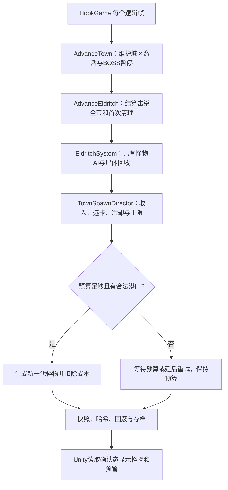

# 沉钟镇持续刷怪导演

沉钟镇现在采用“攒预算、选怪物、分批投放”的持续刷怪规则。走过的战区不再永久清空；游戏时间和实际参与城区探索的人数越多，导演买怪越快。本文是实现说明，完整取舍见 [设计方案](superpowers/specs/2026-11-10-town-director-design.md)。

## 如何工作

这里的“卡”就是一个允许生成的怪物槽位，包含固定种类和所在城区；“预算”只供导演使用，与玩家金币无关。当前地图仍用九种既有异怪、15个成体槽位和4个子代槽位，不生成新美术对象或替换导航算法。

单人初始预算20，最多存80；开始城区探索后等3秒首次投放。每秒收入从2开始，每探索2分钟增加1，10分钟封顶7。每增加一位正在活跃城区附近探索的玩家，收入增加60%。退出城区、购物、倒地、离线的玩家不贡献人数，BOSS战暂停普通怪和导演。

每批2只，4分钟后每批3只；成功投放间隔至少1.5秒，每批结束休息5～3秒。选中贵怪后先攒够预算，出生点被看见或占用则不扣钱、1秒后重选。成体仍受设置中的硬上限约束（默认4只），母巢子代另限4只。时间压力不会无限增加怪物数量或直接放大血量伤害。

出生港口仍须有合法地面/水域，距在线玩家至少8米且没有直接视线，并避开其他怪物。俯视摄像机仍可能看到远处出场，不能把障碍物视线判定理解为“画面之外”；判断不依赖客户端摄像机。

## 哪些代码负责什么

| 文件 | 职责 |
| --- | --- |
| `Data/Catalogs/TownDirectorRules.cs` | 成本、权重、收入梯度、冷却和预算上限 |
| `Data/State/TownDirectorState.cs` | 预算、收入余数、有效探索时间、待选卡、冷却、批次、随机数 |
| `Logic/Combat/TownSpawnDirector.cs` | 什么时候尝试哪一张卡，以及成功后的扣款 |
| `Logic/Combat/EldritchSystem.cs` | 怪物AI、港口生成、代数、尸体回收、母巢子代 |
| `Logic/World/TownEncounters.cs` | 六城区固定怪物池、首次清理目标与区域边界 |
| `Logic/Simulation/HookGame.Town.cs` | 区域排队、休眠/恢复、BOSS互斥、委托一次性支付 |
| `Logic/Simulation/HookGame.Eldritch.cs` | 击杀金币与首次清理计数同帧结算 |
| `Serialization/TownDirectorStateCodec.cs` | 导演字段顺序与非法值拒绝 |
| `Serialization/EldritchStateCodec.cs`、`TownStateCodec.cs` | 快照整合、生成槽位和区域进度校验 |

以上路径均相对 `samples/HookIsland.Simulation`。建议先看 `TownDirectorRules` 和 `TownSpawnDirector.Advance`，再看 `EldritchSystem.Advance`，最后读两个 `HookGame` 分部和测试。框架目录 `framework/` 没有引入游戏规则或 Unity 依赖。

## 清理、奖励和存档

区域的 `Cleared` 现在表示“首次目标已完成”，不是“没有怪物”。A～F 分别累计结算3、2、3、3、2、2次成体击杀即可完成；子代不计。计数封顶，后续生成不清空它。后续击杀仍给该次金币，委托的90/120金币仍按每位玩家的支付位各发一次。

旧尸体只有奖励已结算才可回收，新的生成代数 `Generation` 增加，攻击和奖励回执清零。休眠中的活怪仍保留血量和本代召唤额度，不通过离开区域刷满血。

全程使用整数和独立的固定随机序列，预算余数、冷却、待购卡和随机状态都保存，读档后不重新抽卡。规则/输入/状态版本为45/18/40，异怪EDR3、城区TWN3；不兼容旧版本房间和快照，应新建房间。可靠UDP及输入消息格式不变。

## 验证入口

- `dotnet run --project tools/HookIsland.Town.Tests -c Release -- --director-only`：导演专项。
- `./scripts/verify-hook-town.sh`：城区、机关、BOSS、经济、存档和四客户端真实UDP一致性。
- `./scripts/verify-hook-eldritch.sh`：原异怪能力、旧地图和四客户端回归。
- `./scripts/sync-hook-island.sh`：编译并同步 Unity 引用的纯C#程序集。

本次执行结果记录于 `artifacts/town-director/`（本地验证产物，不提交）。未跑传输全量 `verify.sh`，本次没有修改传输、重连或文件存档事务；修改的是玩法快照格式，已用专项存档恢复和联机一致性覆盖。数值节奏和Unity实机观感仍需人工试玩，不把控制台一致性测试当作完整游戏通关。

城镇服务边界按建筑入口三米范围统一判定：门口玩家不占用战区、不贡献预算人数，原战区经过12秒无人宽限后休眠。这样即使本地服务窗口未发送旧 `Shopping` 位，各端也会得出相同结果；无需改变输入格式。此范围不是伤害无敌，已经释放的攻击仍可命中。

## 本次验收记录（2026-11-10）

- 城镇专项73项、异怪专项27项通过，共100项检查；其中新增导演专项15项。
- 城镇四真实UDP客户端运行至确认帧360，导演有效探索266帧；各端完整检查点哈希相同。旧地图四客户端运行至210帧，实际覆盖伤害与子代，也保持一致。
- 实际状态编码/解码、输入重放、文件保存再加载后的继续模拟一致；非法导演数据拒绝，旧EDR2/TWN2格式明确不兼容。
- `sync-hook-island.sh` 完成，Unity内模拟/网络DLL的SHA-256与刚构建的产物相同。
- 使用Unity 2022.3.62f1自带C#编译器及该工程缓存的引用参数编译运行时和测试程序集：均成功，运行时0警告；测试保留既有 `FishWaterEffectsTests.cs` 的 `BakeMesh` 弃用警告。此操作不代表运行了Unity Editor测试。
- Unity MCP当前连接实例数为0，本轮未进入用户编辑器Play，也未验证手动操作下的难度、节奏和画面。
- 独立代码审查发现服务面板未同步旧Shopping位的问题；用军火铺入口的真实Step测试复现失败，再按确定性三米服务范围修复并重跑上述专项。
