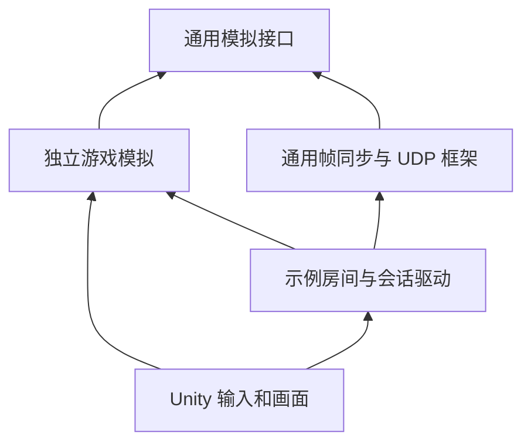

# 七号转运站：双客户端帧同步接入说明

2026-10-19：房间和会话消息已迁移为 Protobuf v3，双端需更新到同一协议版本；可靠 UDP、游戏输入和存档格式保留。见 [协议实现说明](protobuf-protocol.md)。

当前能在两个独立 Unity 客户端里进入同一庭院，互相看到移动、左右转身和抬头低头。房主程序里同时运行一个服务器和自己的客户端；另一位玩家只运行客户端。三份模拟各自计算，使用现有可靠 UDP 传递输入。

所有新增玩法和房间代码放在 `samples/`。`framework/` 保持纯 C#，没有加入地图、角色、Unity 或 Steam 依赖，可以继续用于其他游戏。

## 先运行起来

在仓库根目录准备 Unity 使用的程序集：

```sh
cd /Users/lizujin/Documents/project/git_project/Advanture
./scripts/sync-unity-libraries.sh
```

用 Unity **2022.3.62f1** 打开 `samples/TacticalGame.Unity`，打开 `Assets/TacticalGame/Scenes/Yard07Network.unity`。这是联机场景；原 `Yard07.unity` 仍是本地移动试玩。

当前 macOS 构建在 [Yard07Network.app](../artifacts/tactical-network/Yard07Network.app)。本机一次启动两个客户端：

```sh
python3 scripts/run-yard-pair.py
```

脚本会选择空闲端口，自动让一个窗口创建房间、另一个窗口加入。两人准备好后才开始推进。点击要操作的窗口开始控制，按 Esc 释放鼠标，再切换另一窗口。

也可直接双击程序，在菜单中创建房间。第二个进程选择加入；同一电脑填 `127.0.0.1`，不同电脑填房主的局域网 IPv4 地址，两端端口一致，默认 `7777`。编辑器 Play 和独立程序也可以分别充当两个客户端。两端需要相同的地图和程序版本。局域网需系统允许该程序收发 UDP；本次实测使用同机回环网络，没有把跨电脑网络视作已验收。

| 操作 | 按键 |
| --- | --- |
| 水平移动 | WASD |
| 加速 | 按住 Shift |
| 左右转身、抬头低头 | 鼠标 |
| AK-47 连射 / 换弹 | 左键 / R |
| 释放鼠标，再次点击恢复控制 | Esc |
| 查看确认帧、预测帧、回滚次数 | F3 |
| 结束本次连接 | Esc 后点击“离开房间” |

切换窗口后会停止本地移动、提交中性输入，网络继续推进。中性输入就是明确表达“这一帧没有操作”的输入，不能用“没有提交”代替。

## 三层代码分别负责什么



箭头表示依赖方向。Unity 可以读取模拟结果；框架不会反过来调用 Unity 的角色组件或读取键盘。

| 目录 | 职责 | 换一个游戏时 |
| --- | --- | --- |
| `framework/` | 收发输入、确认帧、预测回滚、检查点、存档和可靠 UDP | 继续复用 |
| `adapters/Unity/` | 把框架程序集作为本地包导入 Unity | 可复用，无庭院玩法 |
| `samples/TacticalGame.Simulation/` | 定义本例输入、地图、移动、碰撞、角色状态和编码 | 换成新游戏的规则 |
| `samples/TacticalGame.Network/` | 双人房间、地图一致性检查、驱动会话、连接资源清理 | 参考或改成新游戏的开局流程 |
| `samples/TacticalGame.Unity/Assets/TacticalGame/Network/` | 键鼠、相机、模型、菜单、表现平滑 | 按游戏和引擎修改 |
| `tools/TacticalGame.Tests/` | 不启动 Unity 验证规则、恢复重放和真实 UDP 会话 | 可沿用测试思路 |

`TacticalHost` 和 `TacticalClient` 属于这个示例。通用服务器与客户端仍是框架里的 `ServerSession`、`ClientSession`，不要把庭院房间搬进框架。

## 按一次 W，会发生什么

1. Unity 的 `NetworkInputSource` 读取当前键盘和鼠标意图，暂时保存在本地。
2. `TacticalClient.Poll` 先接收服务器已经确认的帧，再计算应该提前准备到哪一帧。当前是每秒 30 个逻辑帧、提前 3 帧。
3. 对尚未提交的每一帧调用一次采样，把移动方向和朝向编码成固定的 9 字节输入。此后该帧输入被冻结，不再跟着新按键变化。没有控制角色时也提交中性输入。
4. 输入交给 `ClientSession.TrySubmit`。发送队列暂时满了，就保留相同帧号和原字节，下次重试，不再次采样或重复消费换弹按键。如果已经过了服务器截止时间，则丢弃过期样本，不能偷偷换到后面的帧。
5. 本地输入冻结后，客户端才向前预测。目前只预测其他玩家的输入为中性；缺少自己的输入就停在该帧前面。收到服务器最终输入后，框架比较预测记录，必要时恢复此前状态并重算。
6. 服务器接收两端输入，在规定时间内汇总；截止时缺失的输入按已有规则补中性。最终帧广播到双方，每份模拟执行同样的游戏规则。
7. Unity 用自己的预测位置更新第一人称相机，用对方的已确认位置和朝向更新模型。鼠标视角可以立即响应，远端模型用平滑过渡减少逐帧移动的生硬感。

“确认帧”是服务器已经决定最终输入的帧；“预测帧”是客户端为了及时反馈而先算的帧。画面上的平滑过程不写回模拟，也不参与状态一致性校验。

## 游戏规则怎样保持一致

- 位置使用整数毫米，角度使用百分之一度。键鼠采样阶段允许浮点计算，编码后的输入才进入独立模拟。
- 输入传世界 X/Z 方向，方向长度不能超过 1000，避免斜走更快。正常速度 4.5 米/秒，加速 7 米/秒。
- 地图由 1 个边界矩形和 16 个障碍矩形组成。编辑器从实际地图碰撞盒导出 `Yard07Map.bytes`；所有模拟收到相同初始化字节。
- 碰撞按固定的 X 后 Z 顺序检查整段移动路径。角色用半宽 0.35 米的正方形占位，所以转角比原胶囊碰撞保守。地图墙体和箱子会阻挡移动；第一版没有跳跃、坡面和玩家互撞。
- 位置除法的余数也保存进状态。否则存档恢复或回滚后，微小位移可能与原来不同。
- 中性输入不会把朝向清零。没有新朝向时保留原朝向；R 请求换弹；死亡后 3 秒恢复出生位置、朝向和装备。
- 地图或协议不一致时，开局前拒绝连接。完整状态编码包含玩家编号、位置、朝向和余数，可独立保存、恢复和输入重放。

这里没有把 Unity `CharacterController` 或 PhysX 用作联机模拟。原本地场景仍保留这套角色组件，方便对比和独立体验。

## 建议阅读顺序

| 顺序 | 文件 | 阅读重点 |
| --- | --- | --- |
| 1 | [TacticalInput.cs](../samples/TacticalGame.Simulation/TacticalInput.cs) | 一帧要表达哪些操作；中性输入与朝向标记 |
| 2 | [TacticalState.cs](../samples/TacticalGame.Simulation/TacticalState.cs)、[TacticalMap.cs](../samples/TacticalGame.Simulation/TacticalMap.cs) | 哪些内容必须保存；地图从哪里来 |
| 3 | [TacticalGame.cs](../samples/TacticalGame.Simulation/TacticalGame.cs) | CreateModule、Initialize、Step、Capture、Restore 怎样对接框架 |
| 4 | [TacticalClient.cs](../samples/TacticalGame.Network/TacticalClient.cs) | Poll 中先接收、逐帧冻结、重试、再预测的顺序 |
| 5 | [TacticalHost.cs](../samples/TacticalGame.Network/TacticalHost.cs)、[RoomProtocol.cs](../samples/TacticalGame.Network/RoomProtocol.cs) | 两人准备后才开局；房间消息和会话消息如何分开 |
| 6 | [NetworkYardController.cs](../samples/TacticalGame.Unity/Assets/TacticalGame/Network/NetworkYardController.cs) | Unity Update 如何驱动纯 C# 房间并更新画面 |
| 7 | [NetworkInputSource.cs](../samples/TacticalGame.Unity/Assets/TacticalGame/Network/NetworkInputSource.cs)、[InputQuantizer.cs](../samples/TacticalGame.Unity/Assets/TacticalGame/Network/InputQuantizer.cs) | 设备输入如何转换为每帧冻结的整数输入 |
| 8 | [NetworkAvatar.cs](../samples/TacticalGame.Unity/Assets/TacticalGame/Network/NetworkAvatar.cs)、[NetworkRoomOverlay.cs](../samples/TacticalGame.Unity/Assets/TacticalGame/Network/NetworkRoomOverlay.cs) | 角色表现、房间菜单与鼠标控制 |
| 9 | [NetworkTests.cs](../tools/TacticalGame.Tests/NetworkTests.cs) | 无画面验证真实 UDP、迟加入等待、拒绝第三人、断线后端口重用 |

`RoomTransport` 写在 `RoomProtocol.cs` 内；输入冻结驱动写在 `TacticalClient.cs` 内，没有额外的 `LocalInputPump` 源文件。

## 修改和验证

修改 `framework/` 或两个纯 C# 示例后，重新运行 `./scripts/sync-unity-libraries.sh`，再让 Unity 刷新。生成 DLL 被 Git 忽略；源码只在原目录维护，不在 Unity 工程复制一套修改。

框架和示例完整验收：

```sh
./scripts/verify.sh
```

只验证庭院纯 C# 模拟和真实 UDP：

```sh
./scripts/verify-tactical.sh
```

Unity 菜单 **Window → General → Test Runner → EditMode → Run All** 运行场景和输入转换测试。联机菜单当前使用 IMGUI，因此工程的 **Active Input Handling 必须为 Both**：新版 Input System 采集角色操作，旧输入负责菜单点击和文本输入。改动该设置后按 Unity 提示重启编辑器。

构建时选择 `Yard07Network.unity`，输出到 `artifacts/tactical-network/`。本机自动验证使用 Development Build：

```sh
python3 scripts/run-yard-pair.py --smoke
```

该模式启动两个真实独立进程，自动提供不同的移动和转向输入。`NetworkSmokeDriver` 只在编辑器或开发构建启用；它使用同一 `TacticalClient` 和 UDP 链路，在至少 180 个确认帧后比较服务器与两端检查点摘要，检查对方实际状态、显示模型和相机内可见性，导出报告与截图后退出。普通试玩不带该参数，使用键鼠控制。

运行日志、状态文件、程序集摘要和截图都放在 `artifacts/tactical-network/`，不提交 Git。最新实测记录见 [Unity 验证记录](../samples/TacticalGame.Unity/VERIFICATION.md)。

## 本次边界与后续

当前房间固定两人，支持本机及可信局域网 IPv4 直连。房主不用租服务器。任何一人离开后本局结束，可回菜单重新创建或加入；自然断线会超时检测并释放 Socket，等待好友时不会提前消耗游戏会话的准备超时。

框架仍支持原来的 1～4 人和基础存读档，但这个试玩菜单暂未接入四人、存档列表、读取后重开、中途加入、断线恢复或 Steam。自动验收导出的检查点也不是已完成的玩家存档界面。Windows、IL2CPP、真实跨电脑局域网及公网尚未实测。

后续可按需求接上游戏存档入口，再补中途加入和掉线恢复。预测策略目前对远端使用中性输入，频繁回滚是可预期现象；是否改为延续移动等策略，应在这个可运行版本上单独测量和优化。

## 自动诊断

普通试玩现已自动记录确认帧、状态摘要、回滚次数与结束原因；真正发生状态分歧时立即保存问题输入、前后快照与单帧重放文件。每次启动都有独立日志目录，具体读取方法与代码位置见 [自动诊断说明](session-diagnostics.md)。通用记录器位于独立的 `FrameSync.Diagnostics` 模块。

## AK-47 对战

默认装备 AK-47。左键连射，R 换弹；30 发弹匣、90 发备弹、100 点生命、每次命中 25 点伤害。死亡后 3 秒自动重生。射线命中与高低障碍遮挡由独立游戏逻辑计算，两端显示持枪、枪声、闪光、生命、弹药和战绩。

运行 `python3 scripts/run-yard-pair.py --combat` 自动验证双方开火、换弹、击杀与重生，并比较服务器和两端的最终状态。游戏/地图格式已升级，双方需要新构建，旧试玩快照不自动迁移。

实现与阅读顺序见 [AK-47 实现说明](ak47-implementation.md)。
