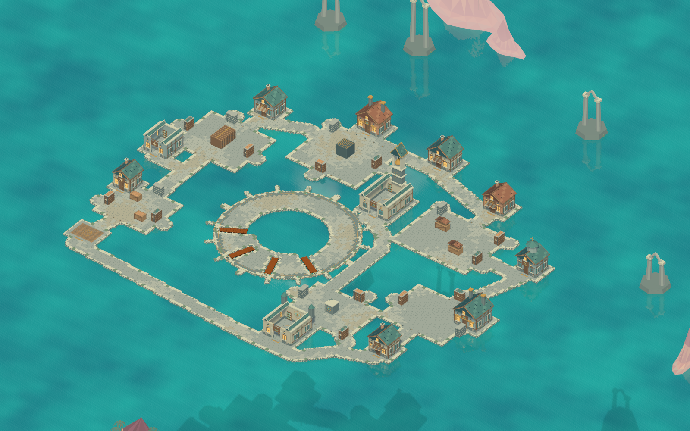
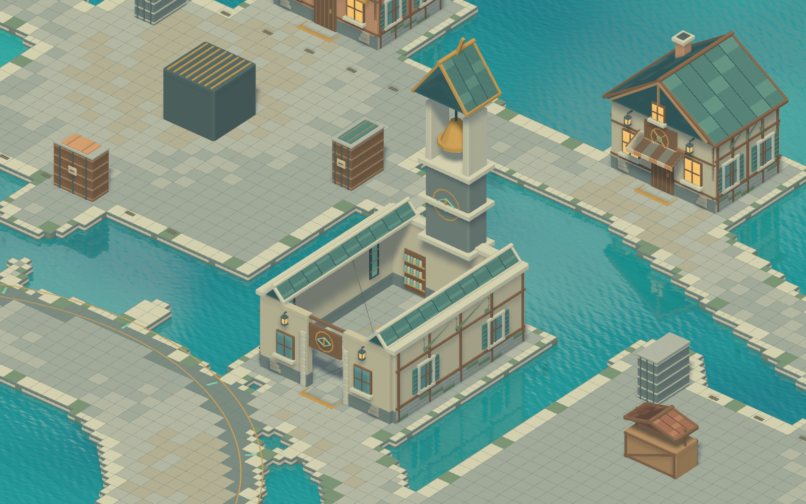

# 沉钟镇 · Blender 场景美术

本版按现有玩法路线重做建筑与水上环境。石木街屋、青绿色瓦顶和暖色窗灯形成主要色调；沉钟塔、双烟囱机房、八角测绘亭与海中旧神遗迹负责远距离识别。

## 打开与查看

- `DrownedBellTown.blend`：可编辑模型，打开后默认是全景摄像机。集合按街面、建筑、掩体、岸基、远景、预览分组。
- `layout.json`：从正式玩法布局导出的米制坐标。Blender 的 X/Y 对应 Unity 的 X/Z，Blender Z 是高度。
- Unity 正式场景：`samples/TacticalGame.Unity/Assets/HookIsland/Scenes/DrownedBellTown.unity`。
- Unity 美术预制件：`samples/TacticalGame.Unity/Assets/HookIsland/Prefabs/DrownedBellTownArt.prefab`。





## 本版内容

- 12 组服务建筑：码头铺板、军械铺、医馆、潜泳商店、工坊、委托所、当铺、测绘站、双闸机房、驿站、档案馆、礼拜堂。
- 25 处既有战斗掩体：货垛、石砌遮挡体、机组、覆船、集市摊位与纪念碑。
- 石街铺面、深色仪式环、门槛指示、四个维修绞盘、排水格栅、海蚀墙脚与水下桩基。
- 礼拜堂钟塔、测绘亭、工业烟囱以及玩法范围外的 5 组海中遗迹。
- 63 个导出网格，约 16.5 万三角面。地砖使用合并基底和薄顶面，避免为每块砖创建 GameObject。

可进入的医馆、档案馆和礼拜堂采用开放屋顶，以便斜俯视镜头观察室内。建筑贴面根据实际墙厚定位，门洞保留 2.8 米通行宽度。模型是表现资源，不添加 Unity Collider，也不接管确定性碰撞。

`90 - Preview only` 集合中的水面和初始木桥只用于 Blender 预览，不导出到 FBX。正式游戏的木带与维修桥继续由 `TownPresentation` 根据确认状态创建/隐藏，海面使用已有海水着色器。

## 重新生成

在仓库根目录工作：

1. Unity 菜单 **Tools → Hook Island → Town Art → Export Authoritative Layout**，导出当前布局。
2. 运行 Blender 建模脚本：

   ```sh
   /Applications/Blender.app/Contents/MacOS/Blender --background --factory-startup \
     --python scripts/blender/create_drowned_bell_town.py -- --render
   ```

3. Unity 菜单 **Tools → Hook Island → Town Art → Import and Apply to Formal Scene**，导入并保存正式场景。
4. 菜单 **Capture Scene Previews** 可重新拍摄 Unity 场景预览，输出到 `artifacts/drowned-bell-town-art/`。摄像机和木桥预览对象仅临时存在，不写入正式场景。

脚本会重新生成 `.blend` 和 FBX；手工修改前请另存副本。Windows 可用本机 Blender 可执行文件替换命令中的 macOS 路径，其余相对路径一致。

## 文件职责

| 文件 | 职责 |
| --- | --- |
| `scripts/blender/create_drowned_bell_town.py` | 场景组织、建筑轮廓、街面、导出清单与预览 |
| `scripts/blender/town_geometry.py` | 聚合网格、屋顶、梁、圆环与基础材质 |
| `scripts/blender/town_facades.py` | 窗框、木骨架、海蚀墙面、货垛贴面 |
| `Editor/Art/TownArtLayoutExporter.cs` | 从正式 `TownLayout` 导出地面与建筑/障碍坐标 |
| `Editor/Art/TownArtInstaller.cs` | 检查布局指纹及坐标轴，绑定材质，安装预制件 |
| `Editor/Art/TownArtPreview.cs` | 显式运行的编辑器截图工具 |
| `Tests/Editor/TownArtTests.cs` | 用实际导入网格验证入口、木带缺口与场景接入 |

表中 `Editor/`、`Tests/` 均相对于 `samples/TacticalGame.Unity/Assets/HookIsland/`。

FBX 旁的 `manifest.json` 保存材质槽顺序、网格统计和布局 SHA-256。导入时会重新计算布局指纹，并用 4 个坐标标记检查原点、方向和单位；布局不一致会明确报错，避免美术与权威地形错位。

## 验证范围

本次只涉及表现资源与编辑器工具。验证包含 Unity 编译/导入、场景截图，以及 `TownArtTests` 和既有 `TownPresentationTests`；不重跑帧同步/UDP 全量测试。日志、测试结果和中间渲染保存在 `artifacts/drowned-bell-town-art/`，不提交到 Git。多人实机手感与 Windows 图形表现需在对应设备运行后确认。
